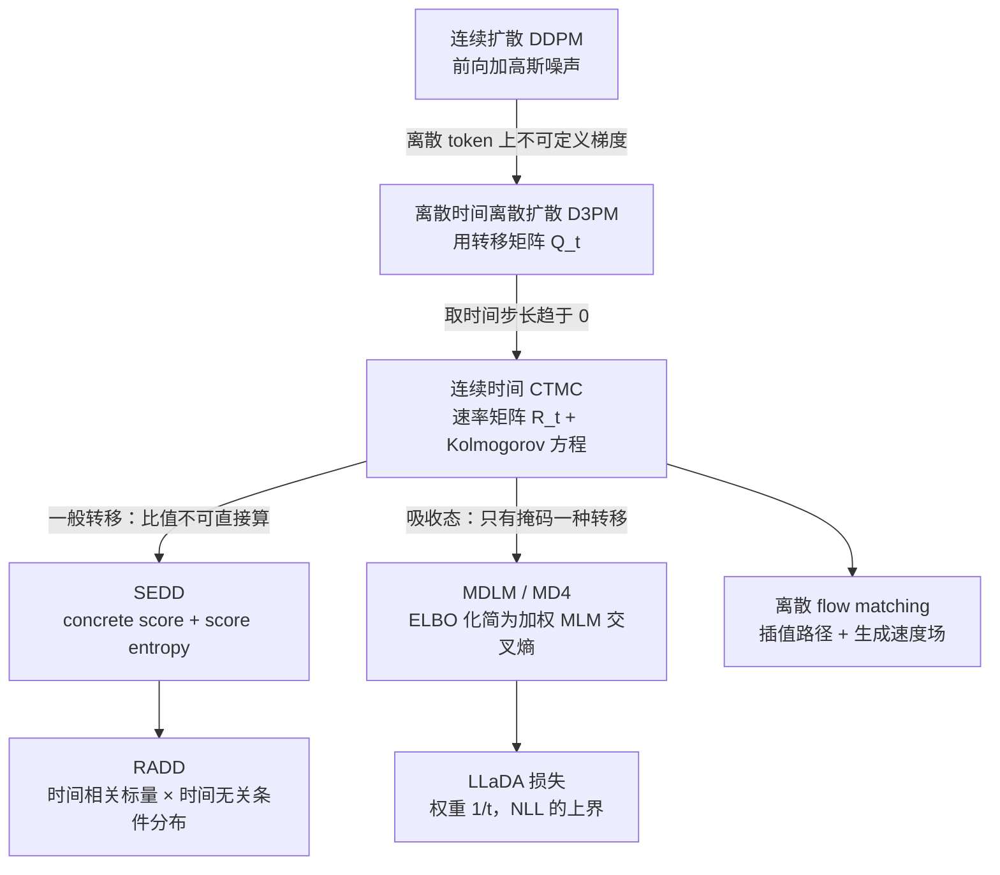

# 02 数学基础：离散扩散的完整推导

> 系列文档：扩散语言模型（Diffusion LM）学习资料
> 上一篇：[01 动机与谱系](01-motivation-and-taxonomy.md) | 下一篇：[03 训练配方与 Scaling](03-training-recipe-and-scaling.md)

---

## 0. 先看结论：整条推导的骨架

全文要推的是一件事：**吸收态（掩码）离散扩散的连续时间变分下界，化简之后就是"对每个掩码位置算交叉熵、再乘一个 $$1/t$$ 权重"**。这一行结论是 dLLM 能规模化的全部理论依据。



---

## 1. 符号约定

| 符号 | 含义 | 代码变量 | Shape |
|---|---|---|---|
| $$\mathcal{V}$$ | 词表，大小为 $$V$$，含特殊掩码符号 $$\mathrm{M}$$ | `vocab_size` | 标量 |
| $$L$$ | 序列长度 | `seq_len` | 标量 |
| $$x_0$$ | 干净序列 $$x_0 = (x_0^1, \ldots, x_0^L)$$ | `input_ids` | $$(B, L)$$ |
| $$z_t$$ / $$x_t$$ | $$t$$ 时刻的加噪序列 | `noisy_ids` | $$(B, L)$$ |
| $$\alpha_t$$ | 时间表：token **未被掩码**的概率，$$\alpha_0 = 1$$，$$\alpha_1 = 0$$ | `alpha_t` | $$(B,)$$ 或标量 |
| $$t$$ | 连续时间，$$t \sim \mathcal{U}[0,1]$$ | `t` | $$(B,)$$ |
| $$\mathbf{Q}_t$$ | 离散时间转移矩阵 | — | $$(V, V)$$ |
| $$\mathbf{R}_t$$ | 连续时间速率矩阵 | — | $$(V, V)$$ |
| $$p_\theta(\cdot \mid z_t)$$ | 掩码预测器（双向 Transformer）输出的逐位置分布 | `logits` | $$(B, L, V)$$ |
| $$\mathcal{M}$$ | 被掩码位置集合 | `mask` | $$(B, L)$$ 布尔 |

> 记号提示
> 不同论文对"保留概率 / 掩码概率"的记号相反：LLaDA 用 $$t$$ 直接表示**掩码概率**（所以权重是 $$1/t$$），Kuleshov 组与 MDLM 用 $$\alpha_t$$ 表示**保留概率**（所以 $$\alpha_t = 1 - t$$ 时掩码概率为 $$t$$，两种写法等价）。读原文时先确认这一约定。

---

## 2. 从连续扩散出发：什么能继承，什么不能

DDPM 的前向过程是 $$q(x_t \mid x_0) = \mathcal{N}(x_t \mid \sqrt{\bar\alpha_t}\,x_0, (1-\bar\alpha_t)\mathbf{I})$$，训练目标是去噪网络预测噪声；采样时用重参数化一步步去噪 [1](https://arxiv.org/abs/2006.11239)。这套东西之所以不能直接搬到文本，有两处硬伤：

1. **加噪本身无意义**。对 one-hot 或离散 id 施加小高斯扰动，量化回词表后要么不变、要么跳到语义无关的 token，不存在"轻微污染但可恢复"的中间态。
2. **score 无法定义**。连续扩散的去噪目标等价于估计 $$\nabla_x \log p_t(x)$$；词表是有限集，这个梯度无从谈起 [2](https://ar5iv.arxiv.org/html/2506.13759)。

能继承的是**思路**：定义一个可控的前向破坏过程，学它的逆，并用变分下界作为训练目标。下面的推导全部围绕"把破坏过程定义在离散状态上"展开。

---

## 3. 离散时间：D3PM 的转移矩阵框架

D3PM 把前向过程写成离散状态上的马尔可夫链，每步作用一个转移矩阵 $$\mathbf{Q}_t$$，边际分布由累积乘积给出：

$$
q(x_t \mid x_0) = \mathrm{Cat}\left(x_t;\; x_0\, \bar{\mathbf{Q}}_t\right), \qquad \bar{\mathbf{Q}}_t = \mathbf{Q}_1 \mathbf{Q}_2 \cdots \mathbf{Q}_t
$$

其中 $$\mathrm{Cat}$$ 表示类别分布，$$x_0$$ 按行索引取出对应行 [3](https://aiwiki.ai/wiki/discrete_diffusion)。$$\mathbf{Q}_t$$ 的选择决定了"噪声"的性质：

| 转移类型 | 行为 | 特点 |
|---|---|---|
| 均匀（uniform） | 以某概率换成词表内均匀随机的 token | 破坏最彻底，但被污染的 token 偶尔恰好是正确 token，保留部分信息 |
| 吸收态（absorbing） | 以某概率换成 $$\mathrm{M}$$，$$\mathrm{M}$$ 永不还原 | 与掩码语言模型同构，是 2024 年之后的主流 |
| 嵌入近邻 | 按学习到的嵌入相似度换到相邻 token | 破坏更"温和"，实现复杂 |

训练目标为对数似然的变分下界，D3PM 额外叠加了一项"预测 $$x_0$$"的辅助交叉熵以稳定训练 [3](https://aiwiki.ai/wiki/discrete_diffusion)。

吸收态的关键性质：**一旦戴上 `MASK` 就不会自己摘下来**，因此序列的污染程度单调上升，$$t=1$$ 时整条序列全是 $$\mathrm{M}$$，反向过程就是"从全掩码画布反复填空"。

---

## 4. 连续时间：CTMC 与速率矩阵

把时间步长趋于零，前向过程成为连续时间马尔可夫链（CTMC），由一个速率矩阵 $$\mathbf{R}_t \in \mathbb{R}^{V \times V}$$ 驱动：非对角元非负、行和为零，在无穷小区间 $$[t, t+\mathrm{d}t)$$ 内从状态 $$j$$ 跳到 $$k \neq j$$ 的概率为 $$[\mathbf{R}_t]_{jk}\,\mathrm{d}t$$。转移概率满足 Kolmogorov 前向方程 [4](https://arxiv.org/html/2607.13431v1)：

$$
\frac{\mathrm{d}}{\mathrm{d}t}\mathbf{P}_t = \mathbf{P}_t \mathbf{R}_t, \qquad \mathbf{P}_0 = \mathbf{I}
$$

时间齐次时 $$\mathbf{P}_t = \exp(t\mathbf{R})$$。

连续时间视角有两个实打实的好处：

1. **下界写成积分而非求和**，表达式更简洁，并且能看清"目标只依赖时间表的端点、不依赖其函数形式"这一事实（MDLM / MD4 都指出了这一点）[3](https://aiwiki.ai/wiki/discrete_diffusion)。
2. **训练与推理的粒度解耦**：模型在连续时间上训练，推理时可以任意选择 $$[0,1]$$ 的离散化份数 $$T'$$，不必与训练时的 $$T$$ 一致——这正是"步数自由"这一卖点的来源。

反向采样需要模拟反向 CTMC。精确模拟代价高，实践中用 $$\tau$$-leaping：在一个时间步内允许多个位置同时跳变，并假设这些跳变**条件独立**。这个近似是并行解码质量损失的根源，在文档 04 中会详细拆开。

---

## 5. 关键一步：吸收态下的 ELBO 化简

### 5.1 前向核与反向核

令 $$\alpha_t$$ 为"token 仍未被掩码"的概率，单调递减，$$\alpha_0 = 1$$、$$\alpha_1 = 0$$。对 $$s < t$$，前向核定义为：把 $$z_s$$ 中**尚未被掩码**的每个 token 以概率 $$(\alpha_s - \alpha_t)/\alpha_s$$ 换成 $$\mathrm{M}$$，已被掩码的保持不动 [5](https://kuleshov-group.github.io/blog/blog/2026/how-to-build-a-diffusion-language-model/)：

$$
q(z_t^i \mid z_s^i) = \begin{cases} 1, & z_s^i = \mathrm{M},\; z_t^i = \mathrm{M} \\ \dfrac{\alpha_t}{\alpha_s}, & z_s^i \neq \mathrm{M},\; z_t^i \neq \mathrm{M},\; z_t^i = z_s^i \\ \dfrac{\alpha_s - \alpha_t}{\alpha_s}, & z_s^i \neq \mathrm{M},\; z_t^i = \mathrm{M} \\ 0, & \text{其他} \end{cases}
$$

第一行对应吸收性（掩码不自愈）；第二行的 $$\alpha_t/\alpha_s$$ 保证联合起来后"在 $$t$$ 时刻仍未掩码"的边缘概率恰为 $$\alpha_t$$，可以自行验算：$$\alpha_s \cdot (\alpha_t/\alpha_s) = \alpha_t$$。

若已知真实干净序列 $$x$$，最优反向核为：把 $$z_t$$ 中的掩码位置以概率 $$(\alpha_s-\alpha_t)/(1-\alpha_t)$$ 换成 $$x$$ 中对应的值，否则保留掩码 [5](https://kuleshov-group.github.io/blog/blog/2026/how-to-build-a-diffusion-language-model/)。这里的分母 $$1-\alpha_t$$ 正是"$$t$$ 时刻处于掩码状态"的概率——条件概率必须归一化在这个事件上，这是最容易写错分母的地方。

### 5.2 连续时间下界

把连续时间 ELBO 写开，单项贡献形如"权重 $$\times$$ 逐位置对数概率"，权重为 $$-\alpha'_t/(1-\alpha_t)$$。取线性表 $$\alpha_t = 1-t$$（于是 $$\alpha'_t = -1$$、$$1-\alpha_t = t$$），得到 [5](https://kuleshov-group.github.io/blog/blog/2026/how-to-build-a-diffusion-language-model/)：

$$
\mathcal{L}_{\mathrm{ELBO}} = \mathbb{E}_{t \sim \mathcal{U}[0,1]}\; \mathbb{E}_{q(z_t \mid x)} \left[ \frac{1}{t}\, \log p_\theta(x \mid z_t) \right]
$$

由于吸收态下只有被掩码的位置需要预测（未掩码位置的 $$z_t^i = x^i$$ 已知），对整条序列的对数概率分解为对被掩码位置求和，配上因子化假设 $$p_\theta(x \mid z_t) = \prod_{i \in \mathcal{M}} p_\theta(x^i \mid z_t)$$，就得到掩码扩散的最终训练目标。

### 5.3 LLaDA 的损失与"上界"性质

LLaDA 采用的形式是 [6](https://arxiv.org/html/2502.09992)：

$$
\mathcal{L}(\theta) \triangleq -\mathbb{E}_{t, x_0, x_t}\left[ \frac{1}{t} \sum_{i=1}^{L} \mathbf{1}[x_t^i = \mathrm{M}] \; \log p_\theta\!\left(x_0^i \mid x_t\right) \right]
$$

并证明它是对数似然期望的**上界**：

$$
-\mathbb{E}_{p_{\mathrm{data}}(x_0)}\left[\log p_\theta(x_0)\right] \le \mathcal{L}(\theta)
$$

这两个式子必须一起记住：**第一式让训练可行，第二式让"它是一个生成模型"成立**。$$1/t$$ 的解释是归一化——$$t$$ 是被掩码 token 的期望占比，除以它才不会让高掩码率的样本在损失里权重过小 [5](https://kuleshov-group.github.io/blog/blog/2026/how-to-build-a-diffusion-language-model/)。

### 5.4 与 BERT 的差别只有两处，但两处都致命

| | BERT / MLM | 掩码扩散 |
|---|---|---|
| 掩码率 | 固定约 15% | $$t \sim \mathcal{U}[0,1]$$，每个样本独立采样 |
| 损失权重 | 无（或常数） | $$1/t$$ |
| 是否生成模型 | 否，无似然 | 是，损失是 NLL 上界 |
| 能否从全 $$\mathrm{M}$$ 生成 | 不能 | 能 |

掩码率随机化让模型见过"从几乎全掩码到几乎不掩码"的全部状态，这是能从全 `MASK` 出发生成整句的前提；$$1/t$$ 让损失具备变分解释 [6](https://arxiv.org/html/2502.09992)。LLaDA 论文明确指出这个细微差别在大规模下影响显著。

---

## 6. 另一支：SEDD、concrete score 与 RADD

上面的化简依赖吸收态。若换成均匀转移或其他一般转移，"只有掩码位置需要预测"这一简化不再成立，需要直接处理**比值**。

**concrete score**：连续扩散估计 $$\nabla \log p$$，离散情形改为估计分布比值

$$
s_\theta(x, t)_y \approx \frac{p_t(y)}{p_t(x)}
$$

**score entropy**：SEDD 提出一个 tractable 的 Bregman 散度作为训练目标，只需在观测到的转移上计算 [2](https://ar5iv.arxiv.org/html/2506.13759)：

$$
\mathcal{L}_{\mathrm{SE}}(\theta) = \mathbb{E}_{x_t \sim p_t}\left[ \sum_{y \neq x_t} \left( s_\theta(x_t, t)_y - \frac{p_t(y)}{p_t(x_t)} \log s_\theta(x_t, t)_y \right) \right]
$$

直观上，第一项压低"整体比值"的规模，第二项让模型把真实比值学对。SEDD 在 GPT-2 尺度上把此前离散扩散的困惑度降低了 25%–75%，并首次与自回归可比，获 ICML 2024 最佳论文 [3](https://aiwiki.ai/wiki/discrete_diffusion)。

**RADD** 注意到吸收态下 concrete score 可以分解为 **时间相关标量 $$\times$$ 时间无关的条件分布**，于是模型主体不必以 $$t$$ 为输入，配合缓存策略显著减少函数评估次数 [7](https://arxiv.org/html/2406.03736v1)。这条分解也是"为什么掩码扩散可以把时间条件和网络解耦"的理论依据。

---

## 7. 离散 flow matching：同一件事的另一种写法

把离散扩散看作在源分布与目标分布之间插值，可以定义插值路径与生成速度场：对凸插值 $$p_t(x^i \mid x_0, x_1) = (1-\kappa_t)\,\delta_{x_0}(x^i) + \kappa_t\,\delta_{x_1}(x^i)$$，生成速度有闭式解 [2](https://ar5iv.arxiv.org/html/2506.13759)：

$$
u_t^i(x^i, z) = \frac{\dot\kappa_t}{1-\kappa_t}\left[ p_{1 \mid t}(x^i \mid z) - \delta_z(x^i) \right]
$$

其中 $$p_{1 \mid t}$$ 就是"给定当前状态预测目标 token"的概率去噪器，训练仍是交叉熵：

$$
\mathcal{L}(\theta) = -\sum_{i=1}^{N} \mathbb{E}_{t, (x_0, x_1), x_t}\left[ \log p_{1 \mid t}(x_1^i \mid x_t; \theta) \right]
$$

结论：**不管从 CTMC、score entropy 还是 flow matching 出发，落到可训练的东西上都是"在污染状态上预测干净 token 的交叉熵"，区别只在权重与路径。** 这也解释了为什么工业实现可以只写一份损失、换不同的时间表与采样器。

---

## 8. 把公式对上代码

### 8.1 变量映射

| 数学符号 | 代码变量 | Shape | 说明 |
|---:|:---|:---|:---|
| $$x_0$$ | `input_ids` | $$(B, L)$$ | 干净 token id |
| $$t$$ | `t` | $$(B,)$$ | $$t \sim \mathcal{U}[0,1]$$，每条样本独立 |
| $$z_t$$ | `noisy_ids` | $$(B, L)$$ | 以概率 $$t$$ 把位置替换为 $$\mathrm{M}$$ 的 id |
| $$\mathbf{1}[z_t^i = \mathrm{M}]$$ | `is_mask` | $$(B, L)$$ | 布尔掩码 |
| $$1/t$$ | `loss_weight` | $$(B,)$$ | 广播到序列维 |
| $$p_\theta(\cdot \mid z_t)$$ | `logits` | $$(B, L, V)$$ | 双向 Transformer 输出 |
| $$\mathcal{L}$$ | `loss` | 标量 | 掩码位置上的加权平均 |

### 8.2 最小可跑片段

下面这段只依赖 numpy，用来验证"前向过程 + 加权损失"这两件事，不涉及任何训练框架：

```python
import numpy as np

rng = np.random.default_rng(0)

B, L, V, MASK_ID = 4, 8, 32, 31          # 批、长度、词表大小、掩码 id

x0 = rng.integers(0, V - 1, size=(B, L))  # 干净序列 (B, L)
t  = rng.random(B)                        # 掩码率 t ~ U[0,1]，每条样本独立 (B,)

# 前向过程：每个位置独立以概率 t 变成 MASK（吸收态）
is_mask = rng.random((B, L)) < t[:, None]
z_t = np.where(is_mask, MASK_ID, x0)      # (B, L)

# 假设模型给出的逐位置对数概率（真实实现里是双向 Transformer 的输出）
logp = np.log(rng.random((B, L, V)) + 1e-8)          # (B, L, V)
token_logp = np.take_along_axis(logp, x0[..., None], axis=-1)[..., 0]  # (B, L)

# 1/t 权重：t 是被掩码 token 的期望占比，除以它做归一化
w = 1.0 / np.maximum(t, 1e-3)                        # (B,)
per_sample = -(w * (token_logp * is_mask).sum(axis=1) / np.maximum(is_mask.sum(axis=1), 1))
loss = per_sample.mean()

print("masked per sample:", is_mask.sum(axis=1))
print("loss:", loss)
```

三处最容易出错，写实现时逐一核对：

1. `t` 是**每条样本**独立采样，不是整批一个值；否则模型见不到足够的掩码率多样性。
2. 分母用 `is_mask.sum()` 而不是 `L`，对应公式里"只在掩码位置上平均"；用 $$1/t$$ 权重时两者只差一个常数因子，但会改变梯度尺度。
3. 掩码位置求和前不要忘记 $$\mathbf{1}[\cdot]$$ 指示函数，否则未掩码位置（它们的信息已经泄漏）会污染损失。

---

## 9. 推导自查清单

读完本文，下面的每一条都应当能独立推出或证伪：

- [ ] 前向核里三个分支的表达式，以及"$$\alpha_t / \alpha_s$$ 这一项为什么是这个值"；
- [ ] 反向核的分母为什么是 $$1-\alpha_t$$ 而不是 $$\alpha_t$$；
- [ ] $$-\alpha'_t/(1-\alpha_t)$$ 在 $$\alpha_t = 1-t$$ 下退化为 $$1/t$$；
- [ ] 为什么吸收态使得"只需在掩码位置算交叉熵"；
- [ ] $$\mathcal{L}(\theta)$$ 为何是 NLL 的上界（要点：变分下界 + 因子化近似各自引入的间隙）；
- [ ] BERT 与掩码扩散的两处差别，以及各自带来的后果；
- [ ] concrete score 为什么用比值而不是梯度；
- [ ] 为什么连续时间训练能支持推理时任意步数。

配 [10 配套实验](10-labs.md) 的实验 1、2、3、8 分别验证前向核数值一致性、掩码率随机化的必要性、ELBO 上界关系与 $$1/t$$ 权重的作用。

---

## 参考链接

1. Ho, Jain, Abbeel, Denoising Diffusion Probabilistic Models — https://arxiv.org/abs/2006.11239
2. Discrete Diffusion in Large Language and Multimodal Models: A Survey — https://ar5iv.arxiv.org/html/2506.13759
3. Discrete diffusion language model / Diffusion Language Models（aiwiki，D3PM、SEDD、MDLM 脉络） — https://aiwiki.ai/wiki/discrete_diffusion 、 https://aiwiki.ai/wiki/diffusion_language_models
4. Discrete Diffusion Models: A Unified Framework from Tokenization to Generation — https://arxiv.org/html/2607.13431v1
5. Kuleshov Group, How to Build a Diffusion Language Model — https://kuleshov-group.github.io/blog/blog/2026/how-to-build-a-diffusion-language-model/
6. Nie et al., Large Language Diffusion Models (LLaDA) — https://arxiv.org/html/2502.09992
7. Ou et al., Your Absorbing Discrete Diffusion Secretly Models the Conditional Distributions of Clean Data (RADD) — https://arxiv.org/html/2406.03736v1
