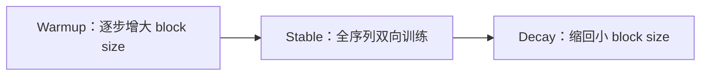

> 系列文档：扩散语言模型（Diffusion LM）学习资料

# 03 训练配方与 Scaling：如何让 dLLM 训得动、训得起

扩散语言模型（dLLM）的“训练”与自回归（AR）有本质差异：目标从“预测下一个 token”变成“在任意噪声水平上重建被掩掉的 token”。
这一节聚焦工程层面真正决定成败的配方——数据怎么喂、掩码率怎么采、注意力怎么从 causal 退烧到双向、上下文长度与变长如何学、以及规模化（scaling）时出现的反直觉现象。
所有数字均带来源，厂商/二手数据已显式标注。

需要专门讨论“训练配方”的原因在于：dLLM 没有 AR 那种炉火纯青的既定范式，掩码率、注意力结构、噪声时间表、上下文长度这几个自由度彼此耦合，任意一项配错都会让模型既训不稳也推不快。
下面按“配方总览 → 路线选择 → 各自由度要点 → scaling”的顺序展开。

## 1 预训练配方总览

一个可用的 dLLM 预训练配方至少包含五个自由度：

- **数据**：与同代 AR 同质的网页/代码/书籍语料，无需按文档顺序建模，但仍需去重与质量过滤。
- **掩码率采样**：每个训练序列按时间表随机掩码一部分 token，掩码比例由时间步 $$t\sim\mathcal{U}[0,1]$$ 决定。
- **损失**：只在被掩码位置上算交叉熵（BERT 式），未掩码位置不贡献梯度，否则会鼓励模型记忆输入。
- **上下文长度**：固定最大序列长，短样本需要特殊处理（见下）。
- **EOS 与变长**：模型必须学会自己决定输出长度，而非被固定上下文截断。

### 1.1 为什么走离散/掩码扩散，而不是连续扩散

连续扩散在连续嵌入空间加噪，离散 token 需先量化再反量化，会引入不可逆信息损失并放大训练-推理不匹配。
掩码扩散直接对离散 token 操作：把“加噪”定义为“以一定概率把 token 换成 $$[\mathrm{MASK}]$$”，反向过程则是分类分布，天然适配语言这种离散对象 [Kuleshov 组教学博客](https://kuleshov-group.github.io/blog/blog/2026/how-to-build-a-diffusion-language-model/) [LLaDA 论文](https://arxiv.org/html/2502.09992)。
这也是 dLLM 与图像扩散最直观的分野。

### 1.2 SFT 阶段的条件构造

以 LLaDA 为例：8B 参数，从头训练，消耗约 $$2.3\,\mathrm{T}$$ tokens，序列长 $$4096$$，约 $$0.13\mathrm{M}$$ H800 GPU 小时；预训练时每个 token 按 $$t\sim\mathcal{U}[0,1]$$ 的掩码率被掩码，SFT 阶段**只对 response 掩码、prompt 不掩码**，从而让模型学会“在给定未掩码 prompt 的条件下重建回答”，而不是顺手把 prompt 也重建一遍 [LLaDA 论文](https://arxiv.org/html/2502.09992) [LLaDA 代码](https://github.com/ML-GSAI/LLaDA)。
约 $$1\%$$ 的预训练序列长度随机取自 $$\mathcal{U}[1,4096]$$ 以学习变长输出；短回答用 $$\mid\!\mathrm{EOS}\!\mid$$ 填充，且这些 EOS 参与损失，从而让模型学会自行决定何时停止 [LLaDA 论文](https://arxiv.org/html/2502.09992)。

一个常被低估的推理侧代价：LLaDA 官方 FAQ 承认，当时其采样比 AR 慢，原因有三——固定上下文长度、尚不能使用 KV Cache、且采样步数等于回答长度时效果最好，减少步数会明显掉点 [LLaDA 代码](https://github.com/ML-GSAI/LLaDA)。
这提示“训得起”与“推得起”是两个独立工程问题，训练配方再好也救不了没有 KV Cache 的慢解码。

### 1.3 与 BERT 式预训练目标的异同

dLLM 的掩码重建目标容易让人联想到 BERT，但二者有三点本质区别。
第一，BERT 固定掩码比例（约 $$15\%$$），dLLM 按 $$t$$ 在 $$[0,1]$$ 上变化掩码比例，从而覆盖从“几乎全干净”到“几乎全噪声”的完整轨迹。
第二，BERT 只预测被掩码位，dLLM 同样只算掩码位损失，但建模的是生成过程而非填空。
第三，BERT 是判别式编码器，dLLM 是可通过反向核采样的生成模型，能产出任意长度序列 [Kuleshov 组教学博客](https://kuleshov-group.github.io/blog/blog/2026/how-to-build-a-diffusion-language-model/)。
理解这点能避免一个常见误解：把 dLLM 当成“会生成的 BERT”即可，但它需要学到去噪轨迹而非单步填空。

### 1.4 为什么变长不能靠截断，而要靠 EOS 填充

固定上下文长度下，最简单的“变长”处理是把短样本右补_pad_再截断，但这会让模型把“长度”当成由上下文窗口硬决定的外部常数，丧失自主停止能力。
LLaDA 的 $$\mid\!\mathrm{EOS}\!\mid$$ 填充 + EOS 参与损失的做法，把“何时停止”变成模型在扩散目标里自己要预测的事件：短回答后面跟着的 EOS 也是被重建/判定的对象，从而让输出长度由内容驱动而非由窗口截断 [LLaDA 论文](https://arxiv.org/html/2502.09992)。
这对 instruct 与对话场景尤其重要，否则模型会在短答后继续吐无意义 token 直到窗口耗尽。

## 2 两条路线对比：从零训练 vs AR 转 dLLM

| 维度 | 从零训练（scratch） | AR 转 dLLM（continue-pretrain） |
| --- | --- | --- |
| 初始权重 | 随机初始化，无先验 | 复用已训练 AR 权重，知识继承好 |
| 所需数据量 | 大（LLaDA 约 $$2.3\,\mathrm{T}$$ tokens） | 小很多（DiffuLLaMA 用 $$<200\mathrm{B}$$ tokens） |
| 训练稳定性 | 相对可控，但全程长 | 直接放开注意力易崩，需退火 |
| 保住预训练能力 | 取决于数据规模 | 关键优势，但要克服分布漂移 |
| 代表模型 | LLaDA 8B | DiffuLLaMA、Efficient-DLM、LLaDA 2.0 |

从零训练路线以 LLaDA 为代表，完全不依赖既有 AR 权重 [LLaDA 论文](https://arxiv.org/html/2502.09992)。
AR 转 dLLM 路线以 DiffuLLaMA 为先例：把预训练好的 AR 模型（GPT-2 / LLaMA）通过持续预训练转成 dLLM，仅需 $$<200\mathrm{B}$$ tokens；其关键技巧是**注意力掩码退火**（训练过程中从 causal 逐步放开到完全双向），并切换到掩码扩散目标 [DiffuLLaMA 代码](https://github.com/jwkirchenbauer/DiffuLLaMA)。
Dream 7B 取中间路线：用 Qwen2.5-7B 权重初始化（比从头训更好），在 $$580\mathrm{B}$$ tokens 上预训练，并引入上下文自适应噪声重调度；其预测所有掩码 token 时采用 shifted 方式与 AR 架构对齐，报告 $$96\times$$H800 约 $$256$$ 小时 [Dream 7B 博客](https://hkunlp.github.io/blog/2025/dream/)。

### 2.1 路线选择的决策依据

选“从零训练”还是“AR 转 dLLM”取决于是否已有高质量 AR 权重以及数据预算。
若已有同规模 AR 检查点，转制路线能用 $$1\%$$–$$10\%$$ 量级的持续预训练数据继承大部分语言能力，性价比极高；若从零起步（如追求纯扩散架构、或没有合适 AR 基座），则需准备与 AR 同代相当的 token 量，但换来更干净的训练分布与对扩散目标的充分适配 [DiffuLLaMA 代码](https://github.com/jwkirchenbauer/DiffuLLaMA) [LLaDA 论文](https://arxiv.org/html/2502.09992)。

## 3 掩码率采样与损失加权的工程要点

为什么时间步要 $$t\sim\mathcal{U}[0,1]$$ 均匀采样？因为 dLLM 的 ELBO 展开后，对每个 $$t$$ 的期望损失权重与该时间步下被掩码 token 的期望占比成正比；若 $$t$$ 分布偏置，模型会在某些噪声水平过拟合、在另一些欠训练，推理时遇到未见过的噪声分布就会掉点。
若改用固定掩码率（如恒为 $$0.5$$），模型只会在一处噪声水平附近有效，遇到推理时高低噪混合的真实轨迹就会失配；均匀 $$t$$ 实质是在噪声轴上做覆盖式采样，保证每个水平都被充分训练 [Kuleshov 组教学博客](https://kuleshov-group.github.io/blog/blog/2026/how-to-build-a-diffusion-language-model/)。

实现上，掩码率采样只需对每条序列独立采一个 $$t$$，再均匀随机挑 $$\lfloor t\cdot L\rfloor$$ 个位置置为 $$[\mathrm{MASK}]$$；多文档打包时该采样应在文档级注意力掩码之内进行，避免把跨文档的 token 当成同一序列去掩码。
这条细节看似琐碎，却直接决定“变长 + 打包”训练能否不串味。

为什么损失要乘 $$\frac{1}{t}$$？在 $$\alpha_t=1-t$$ 的线性时间表下，掩码扩散的变分下界可写成

$$\mathcal{L}_{\mathrm{ELBO}}=\mathbb{E}_{t\sim\mathcal{U}[0,1]}\mathbb{E}_{q(z_t\mid x)}\!\left[\frac{1}{t}\log p_\theta(x\mid z_t)\right]$$

其中内部项 $$-\log p_\theta(x\mid z_t)$$ 就是 BERT 式交叉熵，而 $$\frac{1}{t}$$ 正是对“被掩码 token 期望占比”的归一化系数 [Kuleshov 组教学博客](https://kuleshov-group.github.io/blog/blog/2026/how-to-build-a-diffusion-language-model/)。
直接对被掩码位置求平均会系统性低估高噪声步的贡献，故需要该加权。

### 3.1 时间表 $$\alpha_t$$ 的选择

线性 $$\alpha_t=1-t$$ 最常见，因为它让 ELBO 退化为干净的 BERT 式交叉熵。
但教学资料也指出，时间表形状会影响低噪步（接近成品）与高噪步（接近纯噪声）的相对权重；余弦等非线性时间表可让模型在低噪步投入更多容量，代价是推导略复杂 [Kuleshov 组教学博客](https://kuleshov-group.github.io/blog/blog/2026/how-to-build-a-diffusion-language-model/)。
实践中多数公开工作仍默认线性表，仅在需要贴近特定解码轨迹时做上下文自适应调整（见第 5 节）。

### 3.2 掩码作用在子词级

dLLM 的掩码作用在 tokenizer 输出（子词）级，而不是词级或字级；一个词被切成的多个子词各自独立按概率被掩，模型也是逐子词预测。
这意味着“whole-word masking”在 dLLM 里不是默认设定，也无需特殊处理——子词间本就独立建模，掩掉其中几个不会破坏其余子词的可预测性 [Kuleshov 组教学博客](https://kuleshov-group.github.io/blog/blog/2026/how-to-build-a-diffusion-language-model/)。

## 4 注意力退烧：causal → bidirectional 与权重复用

AR 模型的因果注意力天然单向，而双向注意力是 dLLM 并行解码的前提。但直接把因果注意力替换成全双向，已学到的权重分布会剧烈漂移，训练不稳。

其直觉是：AR 注意力里每个位置只依赖左侧，权重早已适应这种“单向感受野”；突然允许看右侧，相当于让每个头同时承担两类相反职责，初期梯度方向冲突，loss 会先涨后降甚至不收敛。
block-wise（块内双向、块间 causal）恰好保留了“块边界处的单向性”，给权重一个可平滑迁移的中间结构 [Efficient-DLM（arXiv）](https://arxiv.org/abs/2512.14067)。

Efficient-DLM 的洞见是：采用 **block-wise attention**（块间 causal、块内双向）比全双向更能保住预训练 AR 的权重分布 [Efficient-DLM（arXiv）](https://arxiv.org/abs/2512.14067)。
其进一步发现，当块长 $$L'=1$$ 时该方案与 AR 在数学上等效，但仍存在困惑度差距；根因之一是训练时掩码率分布（均匀）与推理时（偏左到右）不一致。为此提出位置相关掩码

$$p_{\mathrm{mask}}(t,i)=p_{\mathrm{base}}\bigl(1+\beta\cdot i/L\bigr)$$

让靠后的位置更易被掩码，从而对齐推理时的“从左向右”偏置 [Efficient-DLM（arXiv）](https://arxiv.org/abs/2512.14067)。
其中 $$\beta$$ 取小正数：过大让靠后位置几乎全掩、训练信号枯竭，需按序列长与解码并行度调。该工作报告约 $$10\mathrm{B}$$ tokens 即可完成基本转换、约 $$100\mathrm{B}$$ tokens 支持更激进的并行解码；Efficient-DLM-8B 相比 Dream-7B / Qwen3-4B 精度提升 $$+5.4\%/+2.7\%$$、吞吐达 $$4.5\times/2.7\times$$ [Efficient-DLM（DOI v2）](https://dx.doi.org/10.48550/arXiv.2512.14067)。

## 5 上下文自适应噪声重调度与位置相关掩码

“训推不一致（train/test gap）”是 dLLM 掉点的高频来源：训练时所有位置按同一时间表加噪，但推理时左侧 token 往往比右侧更早被确定，导致噪声分布错位。

Dream 7B 用 **context-adaptive token-level noise rescheduling** 缓解这一问题：不是给整条序列一个全局 $$t$$，而是为不同 token 估计更合适的局部噪声水平，使训练分布更贴近实际解码轨迹 [Dream 7B 博客](https://hkunlp.github.io/blog/2025/dream/)。
这与 Efficient-DLM 的位置相关掩码 $$p_{\mathrm{mask}}(t,i)$$ 思路相通——本质都是让前向过程的掩码分布去贴近反向解码时的真实条件分布，缩小 train/test gap。二者可叠加：位置相关掩码管“空间偏置”，上下文自适应管“逐 token 噪声水平”。

## 6 分块 continue-pretraining 的 WSD 三阶段

对于“从 AR 平滑过渡到 dLLM”的任务，简单两阶段（退火 + 稳定）仍可能损伤预训练能力。LLaDA 2.0 采用 **Warmup-Stable-Decay（WSD）三阶段** 的分块持续预训练：

- **Warmup**：从较小的 block size 起步并逐步增大，让注意力在可控范围内慢慢放开，避免一次性全双向导致的崩溃。
- **Stable**：在全序列双向设定下稳定训练，充分吸收扩散目标。
- **Decay**：把 block size 缩回较小值，使最终模型更接近推理时的分块解码模式，从而平滑过渡到部署形态 [LLaDA 2.0 代码](https://github.com/inclusionAI/LLaDA2.0)。

这一曲线与 AR 训练里常见的 warmup-stable-decay 学习率调度同名但操作对象不同：WSD 这里调度的是“注意力块大小”而非学习率，是结构层面的退火。
实践上 block size 的 warmup 斜率与 decay 拐点都需要按预训练 AR 检查点质量来调：基座越强，可越激进地缩短 warmup [LLaDA 2.0 代码](https://github.com/inclusionAI/LLaDA2.0)。

## 7 MoE、并行策略与训推稳态性小坑

LLaDA 2.0 采用 MoE 架构，发布 LLaDA2.0-mini（$$16\mathrm{B}$$）与 LLaDA2.0-flash（$$100\mathrm{B}$$）两个规格 [LLaDA 2.0 代码](https://github.com/inclusionAI/LLaDA2.0)。
其后训练采用 SFT + DPO，其中 DPO 的偏好信号用 ELBO 近似似然来构造 [LLaDA 2.0 代码](https://github.com/inclusionAI/LLaDA2.0)。
在 MoE 与并行训练下，需要额外注意：

- **专家并行与负载均衡**：扩散目标下所有位置同时预测，token 路由比 AR 更均匀，但仍可能在特定噪声水平出现专家倾斜，需常规负载均衡损失。
- **文档级注意力掩码**：多文档拼接打包训练时，必须用文档级注意力掩码避免跨文档错误连接 [二手来源，见量子位报道](https://www.qbitai.com/2025/12/360425.html)。
- **数据打包**：变长样本拼接可提升吞吐，但需配合文档级掩码，否则语义串味。
- **训练初期数值不稳**：有报道称在 masked token embedding 输出上加独立高斯噪声可缓解扩散训练初期的数值不稳定 [二手来源，见量子位报道](https://www.qbitai.com/2025/12/360425.html)。
- **推理引擎**：LLaDA 2.0 配套 dInfer 推理引擎，承担 MoE 路由与分块并行的工程落地 [LLaDA 2.0 代码](https://github.com/inclusionAI/LLaDA2.0)。

MoE 在此处的额外收益是：扩散目标下每个前向要预测全序列所有掩码位，计算密度高，MoE 用“大总参、小激活”换取部署效率，使该形态在 dLLM 上同样成立；代价是路由抖动会在高噪声步更明显，需要更稳的负载均衡 [LLaDA 2.0 代码](https://github.com/inclusionAI/LLaDA2.0)。
这些“小坑”目前主要来自厂商/百科等二手来源，未按严格口径核验，落地时建议先在自有栈上复现。

Stable-DiffCoder（字节 Seed）在**完全相同的架构与数据**下与 AR 基线做公平对比：采用 block diffusion 的持续预训练（CPT）加定制 warmup，以及 block-wise clipped noise schedule，最终反而超过了同配置 AR 基线，说明扩散训练本身能抬高质量天花板；它仅需 CPT + SFT 就能与许多约 $$8\mathrm{B}$$ 的 AR/扩散 instruct 模型抗衡 [Stable-DiffCoder 代码](https://github.com/ByteDance-Seed/Stable-DiffCoder)。

## 8 Scaling 观察：已验证与待验证

| 观察 | 状态 | 依据 |
| --- | --- | --- |
| 计算受限下 dLLM 比同代 AR 更 data-hungry | 多工作交叉指向，但仍需更多复现 | DiffuLLaMA / Efficient-DLM 数据量对比 |
| 同名 dense 参数下 dLLM 可更小即得同等能力 | 部分证据（Efficient-DLM-8B 超 Dream-7B） | [Efficient-DLM（arXiv）](https://arxiv.org/abs/2512.14067) |
| dLLM 是“Super Data Learner”，同等计算吃得更快、同等 token 预算更划算 | **团队主张，非社区共识** | [量子位报道（二手）](https://www.qbitai.com/2025/12/360425.html) |
| 扩散训练可超过同配 AR 质量天花板 | 单一厂商公平对比支持 | [Stable-DiffCoder](https://github.com/ByteDance-Seed/Stable-DiffCoder) |

“更 data-hungry”的直觉来自：扩散目标在每个噪声水平都要重建，单位 token 的信息密度低于 AR 的下一 token 预测，故同等计算下需要更多样本覆盖完整去噪轨迹；这一解释仍属定性，缺少严格 scaling law 证据，引用时宜标注“主张/待复现” [量子位报道（二手）](https://www.qbitai.com/2025/12/360425.html)。
关于“dLLM 更 data-hungry / Super Data Learner”的说法，来源为厂商团队主张，尚非社区共识，必须写成“主张/待更多复现”，不得当作定论 [量子位报道（二手）](https://www.qbitai.com/2025/12/360425.html)。
LLaDA 2.0 的测评数字（$$47$$ 个基准平均分与 Qwen3-30B-A3B-Instruct-2507 基本持平，$$73.18$$ vs $$73.60$$；LLaDA2.0-flash-CAP 约 $$535$$ TPS）来自厂商报道/百科等二手来源，未按严格口径核验，需谨慎引用 [LLaDA 2.0 代码](https://github.com/inclusionAI/LLaDA2.0) [量子位报道（二手）](https://www.qbitai.com/2025/12/360425.html)。

另一条常被提及、但尚未充分验证的说法是“dLLM 的推理吞吐借助块并行 + KV 复用可追平甚至超过 AR”——Seed Diffusion 与 Efficient-DLM 给出了方向性证据，但跨厂商口径不一，仍属待复现区间 [Seed Diffusion 论文](https://arxiv.org/html/2508.2193v1) [Efficient-DLM（arXiv）](https://arxiv.org/abs/2512.14067)。

### 8.1 训练/推理成本一览

| 模型 | 训练数据量 | 训练算力/时长 | 推理速度声明 | 来源 |
| --- | --- | --- | --- | --- |
| LLaDA 8B | $$2.3\,\mathrm{T}$$ tokens | $$\sim0.13\mathrm{M}$$ H800 GPU-h | FAQ：慢于 AR（固定上下文/无 KV Cache） | [arXiv](https://arxiv.org/html/2502.09992) [代码](https://github.com/ML-GSAI/LLaDA) |
| DiffuLLaMA | $$<200\mathrm{B}$$ tokens | 未披露 | 未披露 | [代码](https://github.com/jwkirchenbauer/DiffuLLaMA) |
| Dream 7B | $$580\mathrm{B}$$ tokens | $$96\times$$H800 $$\sim256$$ h | 未披露 | [博客](https://hkunlp.github.io/blog/2025/dream/) |
| Efficient-DLM-8B | $$\sim100\mathrm{B}$$ tokens | 未披露 | $$4.5\times/2.7\times$$ vs Dream/Qwen3 | [arXiv](https://arxiv.org/abs/2512.14067) |
| Stable-DiffCoder | 同 AR 基线 | 未披露 | 未披露（超同配 AR） | [代码](https://github.com/ByteDance-Seed/Stable-DiffCoder) |
| LLaDA 2.0 flash | 未披露 | 未披露 | $$\sim535$$ TPS（二手） | [代码](https://github.com/inclusionAI/LLaDA2.0) [量子位](https://www.qbitai.com/2025/12/360425.html) |

## 9 小结与实践清单

- 处方起点：固定上下文 + $$t\sim\mathcal{U}[0,1]$$ 掩码 + 仅掩码位损失 + $$\frac{1}{t}$$ 加权。
- 若已有 AR 权重：优先走“注意力退火 / WSD 三阶段 + block-wise”的转制路线，数据量可降低一两个数量级。
- 推理成本要单独评估：固定上下文、无 KV Cache、步数≈回答长度，是早期 dLLM 比 AR 慢的真实约束。
- 缩小 train/test gap：用上下文自适应重调度或位置相关掩码 $$p_{\mathrm{mask}}(t,i)=p_{\mathrm{base}}(1+\beta\cdot i/L)$$。
- 转制路线优先验证“基座质量 → block size 曲线”的迁移成本，再决定 warmup 斜率。
- 引用数字时区分一手（arXiv/官方博客/GitHub）与二手（厂商新闻/百科），厂商 benchmark 一律标注“未按严格口径核验”。

## 参考链接

- LLaDA 论文与配置：https://arxiv.org/html/2502.09992
- LLaDA 官方代码与 FAQ：https://github.com/ML-GSAI/LLaDA
- DiffuLLaMA 代码：https://github.com/jwkirchenbauer/DiffuLLaMA
- Dream 7B 博客：https://hkunlp.github.io/blog/2025/dream/
- Efficient-DLM（arXiv）：https://arxiv.org/abs/2512.14067
- Efficient-DLM（DOI 镜像 v2）：https://dx.doi.org/10.48550/arXiv.2512.14067
- Stable-DiffCoder（字节 Seed）：https://github.com/ByteDance-Seed/Stable-DiffCoder
- LLaDA 2.0 代码：https://github.com/inclusionAI/LLaDA2.0
- 量子位二手报道：https://www.qbitai.com/2025/12/360425.html
- Kuleshov 组掩码扩散公式教学：https://kuleshov-group.github.io/blog/blog/2026/how-to-build-a-diffusion-language-model/
