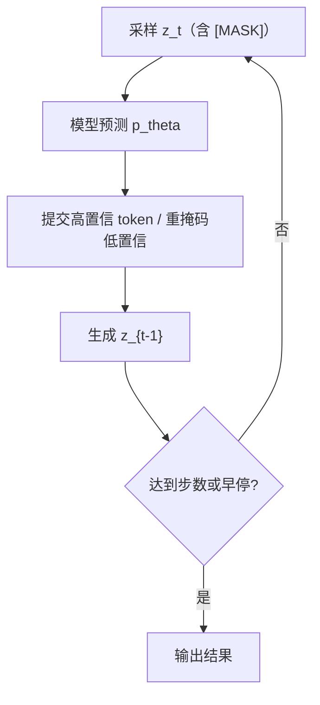
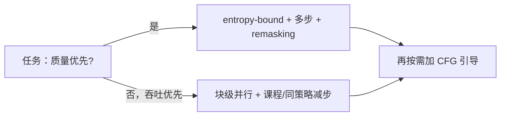

> 系列文档：扩散语言模型（Diffusion LM）学习资料

# 04 采样器、remasking 与引导：解码一场“遗憾博弈”怎么打

dLLM 的“解码”不是逐 token 贪心，而是在噪声时间轴上反复“揭示—修正”。这一节把采样器、remasking（重掩码）与引导（guidance）三条线索拧到一起：先给出反向核的数学形式，再解释为什么并行解码会掉质量、有哪些 remasking 策略能补回自我纠错能力，最后落到可实操的步数/temperature/引导旋钮与几家系统的减步工程。所有数字均带来源，厂商/二手口径已逐条标注。

需要把“采样”单列为节，是因为 dLLM 的推理循环与 AR 的 autoregressive 缓存式解码完全不同：它没有固定的“下一个位置”，每一步都在回答“哪些位置现在足够确定了”。这带来并行加速的可能，也带来“并行会破坏 token 间依赖”的新问题，二者共同定义了本节的全部权衡。
可以把采样理解成一个受约束的离散优化：在“相邻时间步满足反向核”的约束下，最小化最终序列的负对数似然；remasking 相当于允许该优化回溯已做的决定——这正是标题“遗憾博弈”的由来：每一步的揭示都可能留下需要后续修补的遗憾。

## 1 反向核与采样器：对 alpha 时间表的依赖

掩码扩散的数学骨架由一条“未被掩码概率”时间表 $$\alpha_t$$ 决定。$$\alpha_t$$ 在 $$t=0$$ 时为 $$1$$、$$t=1$$ 时为 $$0$$，在离散设定里扮演高斯扩散中信噪比（SNR）的角色：$$\alpha_t$$ 越大说明序列越干净、信息越多，越小说明越接近纯噪声 [Kuleshov 组教学博客](https://kuleshov-group.github.io/blog/blog/2026/how-to-build-a-diffusion-language-model/)。

前向过程从较干净的状态 $$z_s$$（$$s<t$$）加噪到更脏的 $$z_t$$：

- 对 $$z_s$$ 中**仍未掩码**的每个 token，以概率 $$\frac{\alpha_s-\alpha_t}{\alpha_s}$$ 把它掩掉，即 $$q(z_t\mid z_s)$$ 的核。

若已知干净序列 $$x$$，最优反向一步为：把 $$z_t$$ 中每个掩码位置以概率 $$\frac{\alpha_s-\alpha_t}{1-\alpha_t}$$ 替换成 $$x$$ 中的对应真值 [Kuleshov 组教学博客](https://kuleshov-group.github.io/blog/blog/2026/how-to-build-a-diffusion-language-model/)。注意分子与前向相同、分母换成 $$1-\alpha_t$$（当前已被掩码的比例），这正是“在已知真值条件下、把掩码位复原”的正确后验。

在 $$\alpha_t=1-t$$ 的线性时间表下，变分下界正好是掩码位置上的期望交叉熵：

$$\mathcal{L}_{\mathrm{ELBO}}=\mathbb{E}_{t\sim\mathcal{U}[0,1]}\mathbb{E}_{q(z_t\mid x)}\!\left[\frac{1}{t}\log p_\theta(x\mid z_t)\right]$$

内部项 $$-\log p_\theta(x\mid z_t)$$ 就是 BERT 式交叉熵，系数 $$\frac{1}{t}$$ 是对“被掩码 token 期望占比”的归一化 [Kuleshov 组教学博客](https://kuleshov-group.github.io/blog/blog/2026/how-to-build-a-diffusion-language-model/)。
采样器本质上就是在没有真值 $$x$$ 时，用模型 $$p_\theta$$ 近似这个反向核，并迭代 $$t:1\to 0$$ 逐步去噪。把 $$\alpha_t$$ 与高斯扩散里的 $$\bar\alpha_t$$ 对照有助于直觉：在 DDPM 中 $$\bar\alpha_t$$ 是累积保留系数、信噪比随 $$t$$ 单调下降；掩码扩散里 $$\alpha_t$$ 扮演完全相同角色，只是退化成离散的“未被掩码概率”，因此高斯扩散里“低噪步更难也更关键”的结论可直接迁移到离散设定 [Kuleshov 组教学博客](https://kuleshov-group.github.io/blog/blog/2026/how-to-build-a-diffusion-language-model/)。

## 2 τ-leaping 与条件独立假设：为什么并行解码会掉质量

并行解码是 dLLM 提速的核心卖点，但它受一个数学事实约束。从 $$z_t$$ 一步跳到 $$z_s$$（$$s<t$$，即“揭掉一批 token”）时，严格反向需要联合分布 $$p(x_s^i,x_s^j\mid z_t)$$；而常用的 $$\tau$$-leaping 用边缘概率之积

$$\prod_j p(x_s^j\mid z_t)$$

来近似该联合分布，等于假设各待解 token 条件独立 [Fast-dLLM 论文](https://arxiv.org/abs/2505.22618) [Fast-dLLM 项目页](https://nvlabs.github.io/Fast-dLLM)。

问题在于：一旦同一步同时解出相互依赖的 token，模型会产出“局部合理、全局不通”的组合（例如主谓不一致、括号错配、变量未定义就被引用）。
该近似误差随同一步内“相互依赖的 token 数”增长；若待解 token 构成一个依赖团（clique），独立假设下的误差不可忽略，这也是并行度越高、质量掉得越狠的根因 [Fast-dLLM 论文](https://arxiv.org/abs/2505.22618)。
Fast-dLLM 的对策是**置信度感知并行解码**：每一步只提交置信度超过阈值的高置信 token，低于阈值的继续保留为掩码；当没有一个 token 超过阈值时，至少解一个（取最高置信者）以保证推进 [Fast-dLLM 论文](https://arxiv.org/abs/2505.22618) [Fast-dLLM 项目页](https://nvlabs.github.io/Fast-dLLM)。
一个工程上的折中是在同一步内做多轮“预测 → 提交最高置信 → 重算”的局部迭代（micro-iteration），用少量额外前向换回一部分联合依赖信息；这与置信度感知并行解码互补，前者管“步内”、后者管“步间” [Fast-dLLM 论文](https://arxiv.org/abs/2505.22618)。

### 2.1 置信度阈值怎么设

阈值本身需在任务与模型间经验设定：过高则几乎不提交、并行度退化回近似串行；过低则把不可靠 token 也钉死、保不住质量。
实践中常把它和步数联合扫描，而不是固定成一个常数 [Fast-dLLM 论文](https://arxiv.org/abs/2505.22618)。

## 3 unmasking / remasking 策略谱系

朴素 MDLM 有一个硬伤：token 一旦被揭示就永远不能改，因为前向过程不会重新掩码，于是模型没学会自我纠错 [Kuleshov 组教学博客](https://kuleshov-group.github.io/blog/blog/2026/how-to-build-a-diffusion-language-model/)。
现代 dLLM 通过改造前向/反向过程补回该能力，主流是 **remasking（ReMDM）** 与 **uniform-state diffusion（UDLM）**——任何 token 在任意步都可被修订 [Kuleshov 组教学博客](https://kuleshov-group.github.io/blog/blog/2026/how-to-build-a-diffusion-language-model/)。其数学动机是：把前向从“只增不减的掩码”改成“允许状态回到均匀/掩码”，使反向分布具备修正已揭示 token 的通道。
二者区别在于：ReMDM 把要修订的位置重新置回 $$[\mathrm{MASK}]$$，UDLM 则置为“词表上的均匀状态”，后者更平滑、使反向分布的梯度更连续，但实现上需支持非独热的均匀目标 [Kuleshov 组教学博客](https://kuleshov-group.github.io/blog/blog/2026/how-to-build-a-diffusion-language-model/)。

| 策略 | 机制 | 适用场景 | 来源 |
| --- | --- | --- | --- |
| random | 每步随机挑若干掩码位揭示 | 基线/对照 | [Kuleshov 博客](https://kuleshov-group.github.io/blog/blog/2026/how-to-build-a-diffusion-language-model/) |
| low-confidence | 揭示当前置信度最高的 token，其余保留 | 通用质量优先 | [LLaDA](https://arxiv.org/html/2502.09992) |
| semi-AR（半自回归） | 按块/按序揭示，介于 AR 与并行之间 | instruct 模型更好 | [LLaDA](https://arxiv.org/html/2502.09992) |
| ReMDM（重掩码） | 允许把已揭示 token 重新掩回，支持自我纠错 | 长程一致性 | [Kuleshov 博客](https://kuleshov-group.github.io/blog/blog/2026/how-to-build-a-diffusion-language-model/) |
| UDLM（uniform-state） | 任意 token 任意步可被修订，状态更平滑 | 稳定多步修正 | [Kuleshov 博客](https://kuleshov-group.github.io/blog/blog/2026/how-to-build-a-diffusion-language-model/) |

LLaDA 明确给出三种重掩码策略：random / low-confidence / semi-autoregressive，并报告 semi-AR 在 instruct 模型上表现更好 [LLaDA 论文](https://arxiv.org/html/2502.09992)。
实践上 low-confidence / semi-AR 常与置信度感知并行解码组合使用：先并行揭一批高置信 token，再用 remasking 把发生冲突的位置重新掩回，进入下一轮修正，从而把“并行提速”与“自我纠错”捏在同一个循环里。

## 4 temperature、步数 few-step vs quality 的权衡面板

步数与 temperature 是最常被调的两个旋钮，二者都呈“少/低→快但可能掉点，多/高→质量稳但慢”的单调权衡。以 DiffusionGemma 为参照：

| 设定 | few-step / 低温 | 多步 / 高温 | 说明 |
| --- | --- | --- | --- |
| 步数 | 约 $$12$$–$$16$$ 步常见 | 标准最多 $$48$$ 步 | 步数减少通常掉点 |
| temperature | $$0.4$$ 偏确定 | 从 $$0.8$$ 降到 $$0.4$$ | 高温度增多样但降一致 |
| 早停条件 | 平均画布熵 $$<0.005$$ 且连续两轮 argmax 不变 | — | 满足即停，省步数 |
| 单步产出 | 每次前向最终确定约 $$15$$–$$20$$ 个 token | — | $$256$$ 画布 ≠ 一次出 $$256$$ 成品 |

以上画布/步数/早停/单步产出数字来自 DiffusionGemma 资料，官方与二手口径见第 6 节标注 [Google 开发者指南](https://developers.googleblog.com/diffusiongemma-the-developer-guide/) [aiwiki 二手整理](https://aiwiki.ai/wiki/diffusiongemma)。
需要提醒两点：第一，few-step 与 low-temperature 并非独立——步数越少，每步要确定的 token 越多，对 temperature 越敏感，调参时应联合扫描而非单独固定其一；第二，temperature 从 $$0.8$$ 降到 $$0.4$$ 的退火之所以必要，是因为早期步需要一定探索以铺开合理结构、后期步需要确定以收口细节，恒低温容易卡在局部、恒高温则迟迟不收敛。

### 4.1 主流系统采样配方横向对比

| 系统 | 画布初始化 | 步数 | temperature | 并行/减步手段 | 速度声明 | 来源 |
| --- | --- | --- | --- | --- | --- | --- |
| LLaDA | $$[\mathrm{MASK}]$$ + remask | 步数 $$\approx$$ 回答长度 | 未指定 | random/low-conf/semi-AR | FAQ：慢于 AR | [arXiv](https://arxiv.org/html/2502.09992) [代码](https://github.com/ML-GSAI/LLaDA) |
| LLaDA 2.0 | $$[\mathrm{MASK}]$$ + dInfer | 未指定 | 未指定 | WSD 分块并行 + dInfer | $$\sim535$$ TPS（二手） | [代码](https://github.com/inclusionAI/LLaDA2.0) |
| DiffusionGemma | 随机 token | $$\le48$$，常 $$12$$–$$16$$ | $$0.8\to0.4$$ | entropy-bound、self-cond | 未给绝对 TPS | [开发者指南](https://developers.googleblog.com/diffusiongemma-the-developer-guide/) |
| Seed Diffusion | 未指定 | 减步课程 | 未指定 | 两阶段课程/约束顺序/同策略/块级并行+KV | $$2146$$ tok/s（H20） | [arXiv](https://arxiv.org/html/2508.2193v1) |
| Fast-dLLM | 同基模型 | 未指定 | 未指定 | 置信度感知并行解码 | 提速（无绝对数） | [arXiv](https://arxiv.org/abs/2505.22618) |

### 4.2 温度退火与早停的交互

温度退火与早停条件并非正交：温度偏高时画布熵下降更慢，会推迟“平均熵 $$<0.005$$”的触发，等效于隐式增加步数；温度偏低则早停来得太早，可能留下未收敛区域。
因此调温度时不要只看质量曲线，要同时监控实际步数分布，避免“低温 + 早停”组合在表面上快、实际上质量塌方 [Google 开发者指南](https://developers.googleblog.com/diffusiongemma-the-developer-guide/)。

## 5 引导：discrete CBG 与 discrete CFG

把 AR 里的引导思想搬到掩码扩散，关键是构造“有条件 vs 无条件”两个反向核再做差。discrete CFG（分类器无关引导）在 dLLM 里即对同一 $$z_t$$ 分别跑带条件与不带条件的 $$p_\theta$$，按引导系数插值，从而在不训练额外判别器的情况下强化条件信号；discrete CBG 则是其变体。
之所以“manageable”，是因为掩码扩散的反向核是离散分类分布，引导只作用在 logit 空间，计算开销与一次普通前向同阶 [Kuleshov 组教学博客（含引导讨论）](https://kuleshov-group.github.io/blog/blog/2026/how-to-build-a-diffusion-language-model/)。

### 5.1 CFG 与 CBG 的细微差别

二者实现同一“条件增强”目标，差别在信号来源：CFG 用模型自身在“有条件/无条件”两种前向下的输出差做引导；CBG（classifier-based guidance）则额外引入一个判别器对生成质量打分并反传到 logit。
在 dLLM 里无判别器的 CFG 更主流，因为它不增加推理时的额外模型、且天然适配“只算掩码位”的扩散损失 [Kuleshov 组教学博客（含引导讨论）](https://kuleshov-group.github.io/blog/blog/2026/how-to-build-a-diffusion-language-model/)。

需注意两点：第一，引导系数过大会放大伪相关，应配合 remasking 自我纠错使用，否则会把局部合理但全局不通的组合“推得更坚定”；第二，引导与并行解码共享同一约束——二者都依赖对联合分布的近似，故高引导系数下更不宜盲目拉高并行度。实践中引导系数常取中等值（如 $$1$$–$$3$$ 区间）并随步数退火，以兼顾条件强度与全局一致性。

## 6 entropy-bound sampler、self-conditioning 与早停（以 DiffusionGemma 为例）

DiffusionGemma 的官方开发者指南给出了一套具体、可直接复用的采样组件；以下凡标注“二手”的来自 aiwiki 整理，未独立核验 [Google 开发者指南](https://developers.googleblog.com/diffusiongemma-the-developer-guide/) [aiwiki 二手整理](https://aiwiki.ai/wiki/diffusiongemma)。

- **画布初始化（官方）**：canvas 用随机 token 初始化，而非纯 $$[\mathrm{MASK}]$$。这避免了“全掩码画布”在初期梯度方向过于单一。
- **重噪声纠错（官方）**：可以直接对不确定位置重新加噪（re-noising）实现自我纠错，等价于在采样循环中引入 remasking。
- **self-conditioning（官方）**：把上一步的 softmax 分布变成 embedding 的加权平均，经一个小 gated MLP 加进 canvas embedding，作为下一步条件。其作用是把“上一步的 belief”显式喂回网络，缓解多步去噪中的信息丢失。
- **entropy-bound sampler（官方）**：选最低熵的预测，并把互信息界压在 $$0.1$$ 以下；未选中的位置全部重新加噪。该准则以“信息论界”替代固定阈值，天然适配不同噪声水平。
- **标准采样器（官方+二手混合）**：最多 $$48$$ 步，temperature 从 $$0.8$$ 降到 $$0.4$$；仅当画布平均熵 $$<0.005$$ 且连续两轮 argmax 不变才早停，通常 $$12$$–$$16$$ 步。
- **单步产出（二手）**：模型卡称每次前向最终确定约 $$15$$–$$20$$ 个 token，即 $$256$$-token 画布不等于一次产出 $$256$$ 个成品 token，评估吞吐时须按“成品 token / 秒”而非“画布 token / 秒”计。

### 6.1 为什么 self-conditioning 在扩散里特别重要

AR 模型靠隐藏状态自然携带历史信息，每一步解码都隐式知道前面生成了什么；dLLM 的每一步却只看“当前画布”这一瞬时态，历史上已确定又可能被重掩的 token 若不留痕就会在后续步丢失上下文。
self-conditioning 正是把“上一步的预测分布”作为跨步记忆补回网络，等效于给扩散采样一个轻量状态通道；这也是为何 DiffusionGemma 把它列为官方推荐组件而非可选优化 [Google 开发者指南](https://developers.googleblog.com/diffusiongemma-the-developer-guide/)。

### 6.2 早停阈值的工程陷阱

平均画布熵 $$<0.005$$ 的早停阈值依赖 tokenizer 与词表大小：词表越大，均匀分布的熵越高，同一“已确定”程度对应的平均熵也更高，直接套用会过早停止、留下未定 token。
换模型或换词表时该阈值必须重标定，否则要么早停丢内容、要么永不早停浪费步数 [Google 开发者指南](https://developers.googleblog.com/diffusiongemma-the-developer-guide/)。

### 6.3 remasking 的代价

remasking 不是免费的：把已揭示 token 重新掩回后，下一步必须重新前向预测它，等于用额外算力换回一致性。
因此“每步重掩多少”本身是一个旋钮——重掩过多会退化成近似串行、丧失并行收益；重掩过少则保留冲突。置信度感知并行解码正是这个权衡的工程解：只保留真正不可信的少量 token，把重掩开销压到最低 [Fast-dLLM 论文](https://arxiv.org/abs/2505.22618)。

## 7 Seed Diffusion 的减步手段

Seed Diffusion Preview 面向代码生成，报告在 H20 上达 $$2,146$$ tokens/s，且代码基准质量与同规模 AR 相当；它给出四类减步工程 [Seed Diffusion 论文](https://arxiv.org/html/2508.2193v1)：

1. **两阶段课程学习**：先 mask-based 扩散，再 edit-based 扩散——用插入/删除构造噪声，逼模型重新审视全部 token，避免对未污染上下文的伪相关依赖；第二阶段尤其关键，因为它让模型学会“在已有草稿上修改”而非“从零生成”。
2. **约束顺序扩散**：蒸馏高质量生成轨迹，并注入代码结构先验，去除尴尬的生成顺序随机性；代码的结构约束（缩进、括号配对）恰好是可被先验显式编码的信号。
3. **同策略学习**：用“最小化生成步数”的代理损失直接优化采样效率，使减步目标与训练目标对齐，而非事后蒸馏。
4. **块级并行扩散采样**：块间保持因果、块内并行，且 KV cache 跨块复用；这是把 AR 的 KV 复用思想移植到分块扩散、显著拉近与 AR 推理成本的关键。

该工作**明确警告跨厂商速度不可比**：Mercury Coder 在私有数据集上用 H100 测量、Gemini Diffusion 用混合任务且硬件未知；此外 format-constraining system prompt 也会抬高速度数字，横向对比需谨慎 [Seed Diffusion 论文](https://arxiv.org/html/2508.2193v1)。

## 8 小结：一张“采样旋钮”对照表

若任务容忍稍低质量但要高吞吐，优先块级并行 + 课程/同策略减步；若质量优先，则 entropy-bound + 多步 + remasking 更稳。二者并非互斥：多数部署会先按质量目标定步数，再用置信度感知并行与 KV 复用把单步成本压下来。

| 旋钮 | 调小/调少 | 调大/调多 | 注意 |
| --- | --- | --- | --- |
| 步数 | 更快，易掉点 | 更稳，更慢 | 与回答长度强相关 |
| temperature | 更确定、偏重复 | 更多样、可能不一致 | 常配退火 $$0.8\to0.4$$，与步数联合扫 |
| 引导系数 | 弱条件、更自然 | 强条件、易伪相关 | 需配 remasking |
| 并行度/块大小 | 慢但稳 | 快但可能全局不通 | 用置信度阈值兜底 |
| 置信度阈值 | 提交更多、风险高 | 提交更少、保进展难 | 无超阈值时至少解一个 |

实践口诀：先用 entropy-bound / 置信度感知并行解码保住质量，再用两阶段课程或同策略学习压步数，最后用引导系数按需强化条件；任何跨模型的速度数字都先确认硬件、数据集与 system prompt 是否可比。

## 参考链接

- Kuleshov 组掩码扩散公式与引导教学：https://kuleshov-group.github.io/blog/blog/2026/how-to-build-a-diffusion-language-model/
- Fast-dLLM 论文：https://arxiv.org/abs/2505.22618
- Fast-dLLM 项目页：https://nvlabs.github.io/Fast-dLLM
- LLaDA 论文（remasking 策略）：https://arxiv.org/html/2502.09992
- DiffusionGemma 官方开发者指南：https://developers.googleblog.com/diffusiongemma-the-developer-guide/
- DiffusionGemma aiwiki 二手整理：https://aiwiki.ai/wiki/diffusiongemma
- Seed Diffusion Preview 论文：https://arxiv.org/html/2508.2193v1
