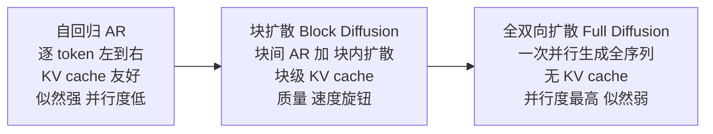

# 05 块扩散与混合范式：在自回归与扩散之间插值

> 系列文档：扩散语言模型（Diffusion LM）学习资料。本文为第 05 篇，聚焦块扩散与混合范式；上承离散扩散基础，下接推理系统加速。

## 1. 纯双向的三个坎与插值谱系

纯双向（full bidirectional）离散扩散在三个维度同时吃亏，这三个坎直接催生了“在自回归与扩散之间插值”的设计谱系：

- **定长输出**：早期离散扩散模型只能在固定长度窗口内并行去噪，难以像自回归（AR）那样按需延长序列 [1]。
- **无法复用 KV Cache**：双向注意力要求每个 token 看到全部上下文，朴素 KV cache 失效，长序列推理成本陡增 [2]。
- **似然跟不上 AR**：双向扩散的边际似然估计偏弱，困惑度（PPL）普遍高于同规模 AR 模型 [1]。

由此形成一条从 AR 到全扩散的连续谱系，块扩散（block diffusion）落在中段：

下表把三种范式放在同一组可比维度上：

| 维度 | 自回归 AR | 块扩散 Block Diffusion | 全双向扩散 |
| --- | --- | --- | --- |
| 生成顺序 | 严格左到右 | 块间左到右、块内并行 | 全序列并行去噪 |
| 变长生成 | 天然支持 | 支持（块可追加） | 受训练窗口约束 |
| KV Cache | 原生支持 | 块级 cache 成立 | 不兼容 |
| 似然 / PPL | 最强 | 接近 AR（调块大小） | 偏弱 |
| 单次前向并行度 | 1 token | 块内多 token | 全序列 |
| 典型 NFE | 1 / token | 块数 × 块内步数 | 全局步数 |

谱系的两端各有硬伤：AR 的并行度被因果链锁死，全扩散的似然与定长问题难解。块扩散的价值正在于把“AR 式好似然”与“扩散式少 NFE”放在同一个可调旋钮上，使部署决策可被参数化——给定延迟预算，可直接反查合适的块长度，而不必重新训练 [1]。

需要区分“插值谱系”与“混合架构”：前者指单个模型内部块大小的连续调节，后者（见第 7 节）指同一份权重显式支持多种解码模式。两者解决不同层面的问题，但共享“不必在 AR 与扩散间二选一”的动机 [1][4]。

## 2. BD3-LM 的形式化：块间 AR + 块内离散扩散

BD3-LM（Block Discrete Denoising Diffusion Language Models，ICLR 2025 Oral）把长度为 $$L'$$ 的 $$B$$ 个块拼接成序列，联合似然按块做自回归分解 [1]：

$$\log p_\theta(x)=\sum_{b=1}^{B}\log p_\theta(x^{(b)}\mid x^{(<b)})$$

其中每个块内部用离散去噪扩散建模，块 $$b$$ 在去噪步 $$t \to s$$ 的转移为：

$$p_\theta(x_s^{(b)}\mid x_t^{(b)},x^{(<b)})=\sum_{x^{(b)}}q(x_s^{(b)}\mid x_t^{(b)},x^{(b)})\,p_\theta(x^{(b)}\mid x_t^{(b)},x^{(<b)})$$

实现上用一个带 **block-causal attention mask** 的 Transformer。该 mask 的物理含义是：位置 $$i$$ 在块 $$b$$ 内可 attend 到块 $$b$$ 内所有位置，也可 attend 到所有编号小于 $$b$$ 的块，但不可 attend 到编号大于 $$b$$ 的块。这样一次前向即可并行给出所有块的去噪预测，且块间因果不被破坏；模型对每个块预测去噪目标 $$\hat x_0^{(b)}$$ [1]。

预测 $$\hat x_0^{(b)}$$ 而非直接输出分布，使训练目标与最终采样对齐，也便于复用标准交叉熵式损失，不必为扩散另写一套输出头 [1]。

块内去噪与标准掩码扩散的唯一区别在条件集：标准扩散以整段为条件，BD3-LM 以 $$x^{(<b)}$$ 为条件。这一差别让每个块的重构都能“站在前序块肩膀上”，从而把全序列的似然拆成可并行记账的子目标 [1]。

block-causal mask 的另一个好处是：所有块的去噪可在同一次带掩码的前向里并行完成，只需保证 mask 正确切分块边界。这正是 BD3-LM 能用标准 Transformer 实现、无需自定义层的原因 [1]。

训练目标是逐块的变分下界（VLbB）之和，构成序列级证据下界：

$$-\log p_\theta(x)\le \mathcal{L}_{\mathrm{BD}}(x;\theta)=\sum_{b=1}^{B}\mathcal{L}(x^{(b)},x^{(<b)};\theta)$$

## 3. 训练为何需要两次前向

BD3-LM 的训练不能靠一次标准前向算完，原因在于块内去噪目标依赖“当前块被掩码、前序块完整”的上下文，而一次性前向难以同时给出所有块的去噪监督信号 [1]。

标准做法是两次前向：

1. **第一次前向**：以完整序列为输入，预计算所有 token 的 K、V 激活并缓存；
2. **第二次前向**：复用缓存的 K、V，一次性对所有块分别计算去噪预测（即各块的 $$\hat x_0^{(b)}$$ 与对应损失）[1]。

两次前向把“上下文表征”与“逐块去噪监督”解耦，既保证块间因果正确，又避免重复计算前序块的表征。代价是训练时前向次数翻倍，但推理时块生成完即缓存其 KV，与 AR 一样成立块级 cache，训练成本不传导到部署 [1]。

### 3.1 块级生成流程（直觉示例）

以 $$B=3, L'=4$$ 为例：先对块 1 做块内去噪（多步并行填充 4 个位置），完成后缓存块 1 的 KV；再对块 2 去噪，条件为块 1 的 KV，完成后追加缓存；块 3 同理。块内是双向扩散、块间是因果 AR，因此整段既享受并行又保持因果一致 [1]。

## 4. 梯度方差与裁剪噪声计划

离散扩散的 ELBO 训练方差很大，这是 BD3-LM 与纯扩散共有的痛点：

- 若 **掩码率过低**，重构过于容易，模型几乎得不到学习信号；
- 若掩码到 **全掩码**，最优解退化成边际词频，同样无监督意义 [1]。

这解释了为何纯扩散训练中“掩码率曲线”是比层数更敏感的设计变量：曲线稍有偏差，训练信号便在“过易”与“过退化”间摆荡 [1]。

为此作者推导了梯度方差估计量，并引入 **裁剪的掩码率（clipped noise schedule）**：每隔若干去噪步用网格搜索优化两个参数 $$\beta,\omega$$，在“重构难度”与“信号强度”之间取折中，以最小化训练方差、缩小与 AR 的困惑度差距 [1]。

掩码率过高时，梯度方差主要来自稀有 token 的边际退化；过低时，方差来自易样本的零梯度。网格搜索的步长与 $$\beta,\omega$$ 的搜索范围共同决定收敛稳定性，是复现 BD3-LM 时最容易踩坑的超参 [1]。

实践上 $$\beta,\omega$$ 的搜索范围与网格步长本身是超参，过小则方差下降有限、过大则训练不稳。复现 BD3-LM 时，这部分常被论文略写，却是 PPL 能否逼近 AR 的关键 [1]。

一个反直觉点是：当块长度 $$L'=1$$ 时，块扩散在形式上等价于逐 token 的 AR，但实测困惑度仍略逊于纯 AR。理论等价不保证经验对齐，差异来自裁剪噪声计划引入的近似、以及块内并行去噪的目标设定与 AR 的逐位条件分布并不完全一致 [1]。

## 5. 变长生成与超长文档

BD3-LM 能生成任意长度序列，包括超出训练上下文长度的文档，这直接反驳了“离散扩散只能固定长度”的质疑。报道中的对比是：OpenWebText 文档最长可达 131K tokens，而同期 SEDD 只能生成 1024 tokens [1]。

评测变长能力时需注意两套口径：

| 口径 | 含义 | 易踩的坑 |
| --- | --- | --- |
| gen PPL | 生成序列的困惑度 | 需区分“自回归评估”还是“扩散评估” |
| NFE | 每次生成消耗的前向次数 | 块数 × 块内步数，非总 token 数 |
| 长度外推 | 超出训练窗口的生成 | 需验证位置编码是否支持外推 |

块扩散的变长来自“块可不断追加”，每块只依赖前序块的 KV，因此超长生成不会因窗口固定而截断 [1]。

长度外推能否成立，取决于位置编码是否对“超出训练窗口的块序号”保持合理归纳。BD3-LM 的块级结构把外推从“token 位置”降维到“块序号”，相对全扩散更易处理 [1]。

gen PPL 的口径之争在于：用 AR 解码器去评估扩散生成结果，会高估扩散的劣势；用扩散自身的一致性评估，又可能低估。报告时应显式说明评估器，否则跨论文不可比 [1]。

## 6. 扩散内部的“编辑式”建模

在教学博客归纳的另一类做法中，生成被建模为对序列的 **编辑操作** 而非纯掩码去噪，长度天然可变 [3]：

- **Set Diffusion**：把块扩散推广到任意位置集合，不再受连续块约束，适合需要“挑选若干位置同时填充”的场景；
- **Edit Flows / FlexMDM**：把生成看成插入 / 删除 / 替换的编辑操作序列，长度由操作决定，天然支持变长；
- **离散 flow matching 与 CTMC**：Gat 等工作把离散流匹配与连续时间马尔可夫链（CTMC）衔接，给出另一条去噪路径，强调连续时间下的最优传输视角 [3]。

这些方法共享一个动机：纯掩码去噪对“长度变化”不友好，编辑式视角把长度当作操作的结果而非预设超参 [3]。

编辑式建模的共性是把“长度”从超参降级为操作的产物：模型不再回答“生成多长”，而是“下一步做什么操作”，长度由此自然涌现。这与块扩散“块可追加”的变长思路互补，可作更细粒度的混合 [3]。

## 7. 混合范式：同一份权重多模式切换

混合范式的代表是 NVIDIA Nemotron-Labs-Diffusion（2026-05）：单一架构统一 **AR / diffusion / self-speculation** 三种解码模式，推理时仅更换注意力 pattern 即可切换，权重共享 [4][5]。

其训练采用联合 AR-diffusion 目标，设计假设是：扩散改善 lookahead planning（前瞻规划），AR 提供从左到右的语言先验；self-speculation 模式由扩散出草稿、AR 验证，在温度 0 下相对纯 AR 无损，且优于 MTP [4]。

厂商公布的规模与性能（**NVIDIA 厂商自测数据，口径未独立核验**）：

| 项目 | 数值 |
| --- | --- |
| 模型规模 | 3B / 8B / 14B，含 base / instruct / VL |
| 预训练 + 后训练 | 1.3T tokens 预训练 + 45B tokens 后训练 |
| 8B 解码效率 | 每次前向解码 token 数约为 Qwen3-8B 的 5.9 倍 |
| 8B 吞吐 | GB200 + SGLang 上约 4× 吞吐 |
| 模式倍数 | diffusion 约 2.6× tokens/forward；线性 self-speculation 约 6×；二次约 6.4× |
| B200 吞吐 | 约 865 tok/s（厂商口径） |

同一份权重三种模式意味着：部署方可按请求类型动态选择——质量敏感走 AR，延迟敏感走 diffusion 或 self-speculation，无需维护多套 checkpoint [4][5]。

从 serving 视角，三模式统一还有一个隐性收益：同一份权重可同时服务质量敏感与延迟敏感流量，GPU 池无需按模式分桶，利用率更高 [4][5]。这把“块大小旋钮”从训练期超参进一步升格为运行期可调的部署参数 [4][5]。

## 8. 小结与设计建议

块扩散的核心卖点是一枚 **质量 / 速度旋钮**，也是产品部署旋钮：调大块长度 $$L'$$ 更接近全扩散、少 NFE、速度快；调小 $$L'$$ 更接近 AR、似然强、速度慢 [1]。

按部署场景选型可参考下表：

| 部署目标 | 推荐 $$L'$$ | 取舍 |
| --- | --- | --- |
| 追求似然 / 质量 | 1–8 | 逼近 AR 的 PPL，速度下降 |
| 平衡质量与延迟 | 16–32 | 中等 NFE，质量损失可控 |
| 追求吞吐 / 低延迟 | 32–64 | 少 NFE，质量略降 |

进一步的设计建议：

- **训练方差**：务必用裁剪噪声计划网格搜索 $$\beta,\omega$$，否则掩码率极端化会吞掉学习信号 [1]；
- **变长需求**：若需超长生成，优先验证块追加与位置编码外推是否打通 [1]；
- **混合部署**：若已具备 AR 底座，可考虑 Nemotron 式三模式统一，用同一份权重覆盖不同延迟预算 [4]；
- **推理协同**：块扩散的块级 KV cache 与服务端流式粒度（第 06 篇）需配套设计，否则端到端收益会被缓冲延迟抵消。
- **与混合范式衔接**：若后续要上三模式统一（第 7 节），块大小 $$L'$$ 的选值应与 diffusion 模式的块粒度保持一致，避免训练 / 推理块边界错位 [1][4]。

- **评估口径**：跨论文比较块扩散时，统一用 gen PPL 而非普通 PPL，并注明评估器，否则数值不可比 [1]。

块扩散不是“又一个模型族”，而是把 AR 与扩散的取舍显式暴露成超参 $$L'$$ 的工程化方案。当部署环境从“质量优先”切到“延迟优先”时，理论上只需调 $$L'$$ 而不必换底座——前提是训练时已覆盖目标区间的块大小 [1]。

## 参考链接

[1] BD3-LM（ICLR 2025 Oral）：https://arxiv.org/abs/2503.09573 、PDF https://arxiv.org/pdf/2503.09573v1 、综述 https://ar5iv.arxiv.org/html/2506.13759
[2] 块级 KV cache 与双向注意力不兼容的讨论见第 06 篇。
[3] Kuleshov Group 教学博客（Set Diffusion / Edit Flows / FlexMDM / 离散 flow matching）：https://kuleshov-group.github.io/blog/blog/2026/how-to-build-a-diffusion-language-model/
[4] NVIDIA Nemotron-Labs-Diffusion（厂商页面，数据未独立核验）：https://research.nvidia.com/publication/2026-05_nemotron-labs-diffusion-tri-mode-language-model-unifying-autoregressive
[5] NVIDIA HuggingFace 博客：https://huggingface.co/blog/nvidia/nemotron-labs-diffusion
