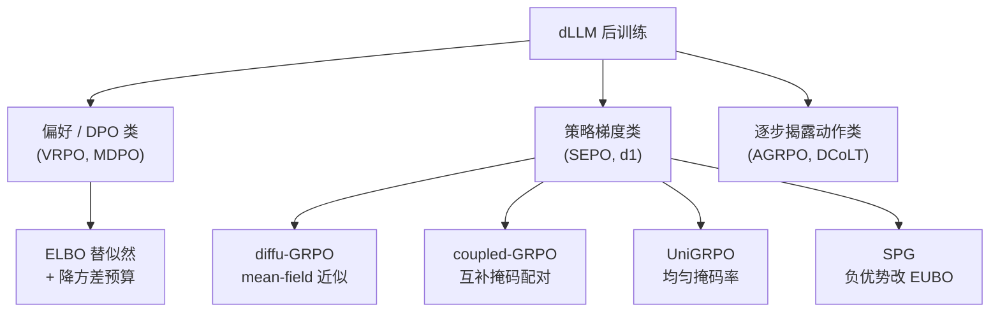

# 07 后训练与对齐：SFT / DPO / 强化学习在 dLLM 上怎么改

> 系列文档：扩散语言模型（Diffusion LM）学习资料

本文聚焦离散/掩码扩散语言模型（dLLM）的后训练与对齐。与自回归（AR）模型不同，dLLM 的生成是迭代去噪而非从左到右的链式分解，这一结构差异使几乎所有现成的后训练工具（SFT 的 loss mask、DPO 的似然、PPO/GRPO 的对数概率）都需要重新推导或近似。下文按“问题根源 → 各方法的改法 → 经验结论”组织。

## 0. 符号与问题设定

设数据分布为 $$p(x)$$，掩码（吸收态）扩散的预训练目标是证据下界（ELBO）：

$$
\mathcal{L}(\theta)=\mathbb{E}_{\substack{t\sim U[0,1]\\ x,x^{t}\sim p^{t}}}\left[\frac{1}{t}\sum_{x^{t}_{i}=\blacksquare}\log p_{\theta}\left(x_{i}\mid x^{t}\right)\right]
$$

其中 $$x^{t}$$ 是对 $$x$$ 以概率 $$t$$ 独立置为掩码 $$\blacksquare$$ 的损坏序列 [综述](https://ar5iv.arxiv.org/html/2508.10875)。

**一切麻烦的根源**：AR 模型有自然的序列分解 $$p_{\theta}(y\mid x)=\prod_{i}p_{\theta}(y_{i}\mid y_{<i},x)$$，因此序列对数概率可精确、低成本地计算，PPO/GRPO 直接可用。而 dLLM 缺乏这种链式结构，**序列级似然 $$\log p_{\theta}(y\mid x)$$ 不可得**，只能靠 ELBO 或均值场近似去估计，且估计带有偏差与方差 [d1 论文](https://arxiv.org/abs/2504.12216)。后文的 SFT 改法、DPO 改法、策略梯度改法，本质上都是在“如何绕过或近似这个不可得的似然”上做文章。

直观地说，掩码扩散的“前向”是独立地以概率 $$t$$ 把每个 token 翻成掩码，而“反向”是给定损坏序列预测被掩 token 的边际分布；由于一个完整序列可由无数种掩码视图生成，不存在唯一的“第 $$i$$ 个 token 之前已确定”的因果序，链式分解天然失效。这正是 dLLM 后训练所有近似的起点 [综述](https://ar5iv.arxiv.org/html/2508.10875)。

## 1. SFT：只对 response 掩码

dLLM 的 SFT 与 AR 的关键差异在 **loss mask**：训练语料被组织成“prompt 保持可见、response 区段随机掩码”的填空（fill-in-the-blank）样本，损失只作用在 response 的被掩码位置上 [d1 论文](https://arxiv.org/abs/2504.12216)。

- AR 的 SFT loss mask 只屏蔽 prompt、对 response 全量计算交叉熵；dLLM 的 SFT 则对 response 做**随机掩码**，让模型在“已知双向上下文、补全中间”的设定下学习，这与预训练目标一致。
- 数据形态上，dLLM SFT 天然适合“批量采样 + 填空”式构造：从一个高质量轨迹里随机挖掉若干 token 让模型重建，等价于一种自蒸馏式的自我改进信号 [d1 论文](https://arxiv.org/abs/2504.12216)。
- “掩码 SFT”已被证明能把 s1k 这类千条级高质量推理轨迹蒸馏进掩码 dLLM，并植入自我验证、回溯等行为 [d1 项目页](https://dllm-reasoning.github.io/)。

**批量采样与 fill-in-the-blank 数据形态**：dLLM 的 SFT 语料常以“上下文填空”形式构造——给定一段文本，对其中若干连续或非连续区段随机置掩，要求模型在保留的双向上下文条件下重建被掩区段。这种做法与 BERT 式预训练目标同构，但发生在 instruction 层面：一个原始样本可批量生成多个不同掩码率的填空视图，等价于低成本的数据增强。与 AR SFT 中“prompt 全可见、response 全计算交叉熵”的单一形态相比，dLLM 的 response 区段天然需要随机掩码，否则会与“全可见”的预训练分布脱节 [d1 论文](https://arxiv.org/abs/2504.12216)。

## 2. 似然估计这道坎

由于精确似然不可得，后训练里所有需要 $$\log p_{\theta}(y\mid x)$$ 的地方都要用估计器替代，主要有四类 [综述](https://ar5iv.arxiv.org/html/2508.10875)：

- **ELBO 估计器**：直接用第 0 节的 ELBO 作为 $$\log p_{\theta}$$ 的下界代理。实现上是“对时间步 + 对掩码”的双重蒙特卡洛（doubly Monte Carlo），偏差与方差都受评分估计方差支配 [VRPO 论文](https://arxiv.org/abs/2505.19223)。
- **均值场（mean-field）分解**：把序列对数概率近似成各 token 对数概率的（平均后的）乘积，再用“完整掩码的 completion + 随机掩码的 prompt”做一次前向得到逐 token 对数概率 [d1 论文](https://arxiv.org/abs/2504.12216)。
- **耦合掩码（coupled masking）**：为每个 completion 构造互补掩码配对来估计对数似然，降低估计方差 [综述](https://ar5iv.arxiv.org/html/2508.10875)。
- **一步精确估计器**：如 AGRPO 的 timestep estimation，把单步去噪当作可无偏估计的基本单元，绕开序列级近似 [AGRPO 论文](https://arxiv.org/html/2510.04019)。

偏差与方差的权衡是后训练稳定性的核心：ELBO 类估计在蒙特卡洛样本数不足时方差大，且经非线性函数（见第 3 节）放大后会污染梯度 [VRPO 论文](https://arxiv.org/abs/2505.19223)。

具体实现上，ELBO 估计是一个“对时间步 $$t$$ + 对掩码 $$x^{t}$$”的**双重蒙特卡洛（doubly Monte Carlo）**过程：先抽样时间步，再在该时间步下抽样损坏样本，最后用边际对数概率的均值近似期望。VRPO 的理论分析表明，引入的偏差与方差都由**评分估计（preference score estimator）的方差**所支配——这意味着降方差的关键不是简单堆样本，而是降低该评分估计的方差 [VRPO 论文](https://arxiv.org/abs/2505.19223)。一步精确估计器（如 AGRPO 的 timestep estimation）则干脆不在序列级做近似，而是把单步去噪当作可无偏估计的基本单元，从结构上规避了偏差问题 [AGRPO 论文](https://arxiv.org/html/2510.04019)。

## 3. 偏好优化：把 DPO 里的似然换成 ELBO

标准 DPO 依赖精确对数概率：

$$
\mathcal{L}_{\mathrm{DPO}}=\!-\mathbb{E}\left[\log\sigma\!\left(\beta\log\frac{\pi_{\theta}(y_{w}\mid x)}{\pi_{\mathrm{ref}}(y_{w}\mid x)}-\beta\log\frac{\pi_{\theta}(y_{l}\mid x)}{\pi_{\mathrm{ref}}(y_{l}\mid x)}\right)\right]
$$

掩码扩散模型（MDM）算不出精确似然，只能把其中四处对数概率用 ELBO 估计替换，得到“ELBO 版偏好得分”（四个 ELBO 项的线性组合）[VRPO 论文](https://arxiv.org/abs/2505.19223)。这四个项来自获胜/失败回答与当前/参考策略的两两组合：$$\log\frac{\pi_{\theta}(y_{w}\mid x)}{\pi_{\mathrm{ref}}(y_{w}\mid x)}$$ 与 $$\log\frac{\pi_{\theta}(y_{l}\mid x)}{\pi_{\mathrm{ref}}(y_{l}\mid x)}$$ 中的每一处对数概率都被 ELBO 替代，于是偏好得分变成关于四个 ELBO 估计的线性组合，再用 $$\log\sigma(\cdot)$$ 包成 DPO 损失 [VRPO 论文](https://arxiv.org/abs/2505.19223)。

问题在于：ELBO 的估计方差会经过 $$\log\sigma(\cdot)$$ 这一非线性后被进一步放大并污染梯度。VRPO（LLaDA 1.5 采用的偏好对齐框架）给出三招降方差 [VRPO 论文](https://arxiv.org/abs/2505.19223)：

1. **预算分配**：总采样预算 $$n=n_{\mathrm{time}}\times n_{\mathrm{mask}}$$，优先投在时间步上，即 $$n_{\mathrm{time}}=n,\,n_{\mathrm{mask}}=1$$，而非平均分配。
2. **时间步优先**：每个时间步只用 1 个掩码样本，让预算覆盖更多时间步，降低评分估计方差。
3. **antithetic（负相关配对）采样**：对模型策略与参考策略的 ELBO 估计做负相关配对，使方差相互抵消。

LLaDA 1.5 在 VRPO 下相对纯 SFT 取得 GSM8K +4.7、Arena-Hard +4.3 等提升 [VRPO 论文](https://arxiv.org/abs/2505.19223)；相关复现讨论见 [issue 记录](https://github.com/nishide-dev/unturtle-legacy/issues/204)。综述把 VRPO、MDPO 归入“价值/偏好/DPO 类”方法，与策略梯度类（SEPO、d1 等）并列 [综述](https://ar5iv.arxiv.org/html/2508.10875)。

## 4. 策略梯度：diffu-GRPO / coupled-GRPO / UniGRPO / SEPO

综述把整条后训练线分为两大类：其一是**价值/偏好/DPO 类**（以 VRPO、MDPO 为代表，直接改造偏好目标）；其二是**策略梯度类**（以 SEPO、d1/diffu-GRPO 等为代表，用策略梯度直接最大化奖励）[综述](https://ar5iv.arxiv.org/html/2508.10875)。下面的方法都属于策略梯度类，区别仅在“如何估计那个不可得的似然”以及“把什么当作动作”。

### diffu-GRPO（d1 框架）
d1 提出 critic-free 的策略梯度算法 diffu-GRPO，用 **mean-field 分解近似序列对数概率**；逐 token 对数概率则通过在“完整掩码的 completion + 随机掩码的 prompt”上做单次前向得到，且每次梯度步使用不同随机掩码，本身起到正则作用 [d1 论文](https://arxiv.org/abs/2504.12216)。SFT 后接 diffu-GRPO 在 LLaDA 上显著提升数学与规划任务 [d1 项目页](https://dllm-reasoning.github.io/)。

### coupled-GRPO（DiffuCoder）
为每个 completion 构造**互补掩码配对**来估计对数似然，降低估计方差，是更“扩散原生”的设计 [综述](https://ar5iv.arxiv.org/html/2508.10875)。

### UniGRPO（MMaDA）
掩码率 $$\pi_{i}\in[0,1]$$ **均匀采样**（而不是把 response 全掩码），让模型见到的去噪阶段与训练一致，从“几乎全掩”到“几乎全解”都覆盖，提升多步去噪能力的利用率 [综述](https://ar5iv.arxiv.org/html/2508.10875)。

### SEPO（Score Entropy Policy Optimization）
在 score entropy 框架下用重要性采样把 PPO/GRPO 推广到离散扩散，目标写成对 $$s_{\theta}(x,T-T_{0})_{y}$$ 的加权对数期望：

$$
\ell^{A}(\theta)=\mathbb{E}_{x\sim\pi_{\theta_{\mathrm{old}}}}\left[\sum_{y\neq x}w_{x,y}\log s_{\theta}(x,T-T_{0})_{y}\right],\quad w_{x,y}=\pi_{\theta}(y)\,f\!\left(r^{T-T_{0}}_{x,y}\right)
$$

其中 $$f$$ 决定退化形态：截断函数得到 PPO（clip），组标准化奖励得到 GRPO；可对**不可微奖励**做低方差梯度估计 [综述](https://ar5iv.arxiv.org/html/2508.10875)。其原始方法论文见 [SEPO](https://ar5iv.arxiv.org/html/2502.01384)。与 d1 仅限掩码扩散、且依赖序列似然近似不同，SEPO 在 score entropy 框架下对任意离散扩散都适用，且能处理无条件生成，是更通用的理论基础 [SEPO 原论文](https://ar5iv.arxiv.org/html/2502.01384)。

下表汇总四类策略梯度方法的核心差异：

| 方法 | 似然/动作视角 | 方差控制手段 | 代表模型 |
| --- | --- | --- | --- |
| diffu-GRPO | mean-field 近似序列似然 + 逐 token 单步前向 | 随机掩码正则、可放大内更新步数 $$\mu$$ | LLaDA（d1） |
| coupled-GRPO | 互补掩码配对估计对数似然 | 配对降低估计方差 | DiffuCoder |
| UniGRPO | 均匀采样掩码率 $$\pi_i\in[0,1]$$ | 覆盖多去噪阶段、与训练一致 | MMaDA |
| SEPO | score entropy + 重要性采样 | self-normalized IS，低方差 | 通用离散扩散 |
| AGRPO | 单步 unmasking 作为动作（见第 5 节） | 多步 MDP 无偏梯度 | LLaDA |

## 5. 另一条路：把“逐步揭露”当作动作

AGRPO（“Simple Policy Gradients for Reasoning with Diffusion Language Models”）把单个 **unmasking 步当作动作**，绕开序列似然近似，从多步 MDP 视角推导无偏策略梯度 [AGRPO 论文](https://arxiv.org/html/2510.04019)。

- 每批 rollout 做 $$\mu$$ 次梯度更新：$$\mu=1$$ 完全 on-policy，$$\mu=4$$ 为温和 off-policy。
- 在 Countdown 上，LLaDA 由 20.3 提升到 AGRPO 的 63.3（$$\mu=1$$）/ 61.3（$$\mu=4$$）[AGRPO 论文](https://arxiv.org/html/2510.04019)。
- 论文明确讨论与 diffu-GRPO / VRPO / DCoLT / SPG 的差异：AGRPO 每步需多次前向、wall-clock 更贵但样本效率更高；而 dLLM 在线 RL 的主要瓶颈本来就是推理时间 [AGRPO 论文](https://arxiv.org/html/2510.04019)。
- DCoLT 思路相近：把反向扩散每一步当作潜在“思考动作”，但用基于结果的奖励优化整条多步轨迹，并为掩码 dLLM 引入学习 token 揭示顺序的 Unmasking Policy Module（UPM）[综述](https://ar5iv.arxiv.org/html/2508.10875)。

**AGRPO 的代价与取舍**：把单步 unmasking 当动作意味着每个梯度步需要对多个去噪步分别前向，wall-clock 比 diffu-GRPO 这类序列级近似更贵；但其梯度无偏、样本效率更高。论文指出 dLLM 在线 RL 的主要瓶颈本来就是推理时间，因此“用更多单步前向换更少 rollout 轮次”在工程上往往划算 [AGRPO 论文](https://arxiv.org/html/2510.04019)。与之相对，DCoLT 不近似序列似然、而是把整条轨迹当 outcome-based RL 优化，UPM 把“揭示顺序”也纳入动作空间，相当于在策略里显式学习最优解码顺序 [综述](https://ar5iv.arxiv.org/html/2508.10875)。

## 6. EUBO / SPG：负优势样本下优化下界会失效

SPG（Sandwiched Policy Gradients）指出一个被忽视的问题：策略梯度目标里似然可能乘上**负优势**，此时优化下界（ELBO）不再有效，因此对负优势轨迹改用 **EUBO（evidence upper bound）** 来约束 [AGRPO 论文](https://arxiv.org/html/2510.04019)。这一洞察说明“盲目把 ELBO 当似然塞进 GRPO”在负优势区域会出问题，是 ELBO 类方法晚期坍塌的潜在诱因之一。

## 7. 经验结论：没有放之四海皆准的最优算法

DARE（统一的 dLLM 后训练执行/评测框架，覆盖 SFT/PEFT/偏好优化与 VRPO、d1、(Coupled-)GRPO、MDPO、CJ-GRPO、BGPO、SPG、EBPO 等）给出几项关键经验 [DARE 论文](https://arxiv.org/abs/2604.04215)：

- **没有普适最优算法**：数学类（GSM8K/MATH）在 LLaDA/Dream 上 CJ-GRPO、Coupled-GRPO 最好；代码类（HumanEval/MBPP）VRPO 或 Coupled-GRPO 领先——**任务排序会翻转** [DARE 论文](https://arxiv.org/abs/2604.04215)。
- **ELBO 类（BGPO、SPG）在蒙特卡洛样本数不足时方差大、易晚期坍塌**；d1 / Coupled-GRPO / CJ-GRPO 收敛更稳 [DARE 论文](https://arxiv.org/abs/2604.04215)。

“晚期坍塌”一种可能的机制是：当策略在训练后期把低质量轨迹的对数概率也推高（ELBO 作为下界被过度乐观估计），或负优势轨迹仍被下界优化（见第 6 节 SPG 的讨论），梯度方向被污染，生成分布塌缩到少数高置信 token。这进一步说明：在 dLLM 上盲目沿用 AR 的 token 级 RL 目标，比想象中更容易失稳 [DARE 论文](https://arxiv.org/abs/2604.04215)。
- 工程加速：rollout 侧用 Fast-dLLM 类 KV 兼容注意力约 **2.2×**，块扩散走 LMDeploy/SGLang 等融合算子 **>14×**（厂商/框架口径，待复现）[DARE 汇总](https://www.emergentmind.com/papers/2604.04215)。

| 任务族 | 表现最好的方法（DARE 观测） | 备注 |
| --- | --- | --- |
| 数学（GSM8K/MATH） | CJ-GRPO、Coupled-GRPO | LLaDA/Dream 上 |
| 代码（HumanEval/MBPP） | VRPO、Coupled-GRPO | 排序与数学不同 |
| 需要稳定收敛 | d1、Coupled-GRPO、CJ-GRPO | ELBO 类样本不足时易坍塌 |

## 8. 工程：rollout 加速与显存吞吐

- **KV 兼容注意力**：早期开源 dLLM 定长、无 KV cache、采样步数≈回答长度才最优，故真实采样慢于 AR；Fast-dLLM 类 KV 兼容注意力可显著提速（约 2.2×，框架口径）[DARE 汇总](https://www.emergentmind.com/papers/2604.04215)；LLaDA 官方 FAQ 也承认早期开源 dLLM 采样慢于 AR [LLaDA FAQ](https://github.com/ML-GSAI/LLaDA)。
- **块扩散走融合算子**：块扩散（block diffusion）配合 LMDeploy / SGLang 等后端融合算子，吞吐可 >14×（厂商/框架口径，待复现）[DARE 汇总](https://www.emergentmind.com/papers/2604.04215)。
- **显存**：掩码 dLLM 的 rollout 需多次前向 + 多样本；随机掩码正则允许放大内更新步数 $$\mu$$，从而减少外循环批次数与在线生成次数，降低整体算力成本 [d1 论文](https://arxiv.org/abs/2504.12216)。
- **注意力后端选择**：SFT 与 rollout 对注意力机制的需求不同，可解耦优化——SFT 侧重变长批处理的 padding 开销（如 flash_attn_varlen_func 可减少填充、降低约 2× 延迟），rollout 则侧重 KV 兼容与并行解码；DARE 的工程结论正是把训练侧与推理侧作为正交加速目标分别优化 [DARE 汇总](https://www.emergentmind.com/papers/2604.04215)。
- **块扩散的融合算子**：块扩散把序列切成块、块内并行去噪、块间自回归，配合 LMDeploy / SGLang 的融合算子可把吞吐推到 >14×（厂商/框架口径，待复现），是工程上最值得优先尝试的加速路径 [DARE 汇总](https://www.emergentmind.com/papers/2604.04215)。

## 9. 实践清单

- 选算法前先定任务族：数学优先试 CJ-GRPO / Coupled-GRPO，代码优先试 VRPO / Coupled-GRPO [DARE 论文](https://arxiv.org/abs/2604.04215)。
- 用 ELBO 类方法时，务必给足蒙特卡洛样本数，否则方差与晚期坍塌会拖垮收敛 [DARE 论文](https://arxiv.org/abs/2604.04215)。
- 偏好优化若走 DPO 路线，优先采用“时间步优先 + antithetic”的 VRPO 式预算分配 [VRPO 论文](https://arxiv.org/abs/2505.19223)。
- 在意样本效率且能接受更高 wall-clock，可试 AGRPO 的多步 MDP 视角 [AGRPO 论文](https://arxiv.org/html/2510.04019)。
- rollout 提速优先上 KV 兼容注意力与块扩散融合算子 [DARE 汇总](https://www.emergentmind.com/papers/2604.04215)。
- 报告任何推理基准分数时，固定生成序列长度再报分，因为 dLLM 在不同序列长度下表现差异显著，否则跨工作比较无意义 [d1 论文](https://arxiv.org/abs/2504.12216)。
- 工程侧先 profiling 再优化：先确认瓶颈在 attention（KV 兼容）还是融合算子（块扩散），再决定上 Fast-dLLM 类注意力还是 LMDeploy/SGLang 后端，避免盲上加速库 [DARE 汇总](https://www.emergentmind.com/papers/2604.04215)。
- 对齐方法选型应结合可复现性：优先选用 DARE 等统一框架已内置实现的算法，减少 paper-specific 代码带来的比较偏差 [DARE 论文](https://arxiv.org/abs/2604.04215)。

## 后训练方法分层（Mermaid）

下图按“是否依赖序列级似然近似”对主流方法分层；节点含括号已加双引号以兼容 Mermaid 解析。

## 参考链接

- d1 / diffu-GRPO：<https://arxiv.org/abs/2504.12216>
- d1 项目页：<https://dllm-reasoning.github.io/>
- VRPO / LLaDA 1.5：<https://arxiv.org/abs/2505.19223>
- VRPO 复现讨论：<https://github.com/nishide-dev/unturtle-legacy/issues/204>
- AGRPO：<https://arxiv.org/html/2510.04019>
- SEPO 原始论文：<https://ar5iv.arxiv.org/html/2502.01384>
- 综述（含 SEPO/d1/coupled-GRPO/UniGRPO/DCoLT/VRPO 分层）：<https://ar5iv.arxiv.org/html/2508.10875>
- DARE 框架：<https://arxiv.org/abs/2604.04215> 与 <https://www.emergentmind.com/papers/2604.04215>
- LLaDA 仓库与 FAQ：<https://github.com/ML-GSAI/LLaDA>
