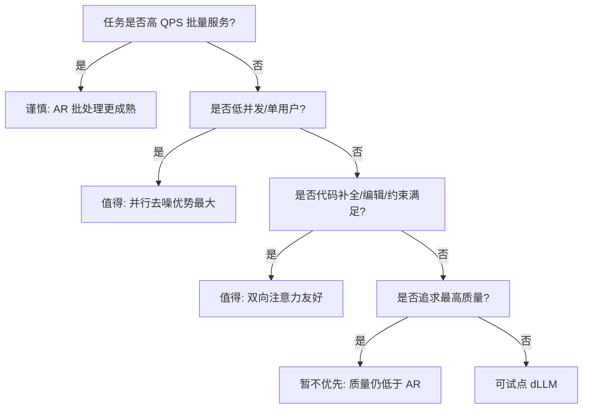

# 08 2026 模型全景与评测：谁在做、做到了什么、怎么读这些数字

> 系列文档：扩散语言模型（Diffusion LM）学习资料

截至 2026 年，扩散语言模型（dLLM）已从纯研究走向“开源权重 + 商用 API + 混合路线”并存的局面。本文给出一份可对照的全景表，并重点拆解“厂商 TPS 为什么不能横向比”“评测口径怎么看”这两个最容易被误读的地方。

## 1. 全景表：开源 / 商用 / 混合三类

下表按实现路线区分：MDLM（掩码离散扩散）、块扩散（block diffusion）、UDLM（统一扩散-自回归）、连续潜空间（latent diffusion + Flow Matching）。

| 家族 / 模型 | 类型 | 参数与路线 | 许可 | 引擎 / 备注 |
| --- | --- | --- | --- | --- |
| LLaDA-8B-Base/Instruct | 开源 | 8B，MDLM（掩码） | 开源 | NeurIPS 2025 Oral；多模态版 LLaDA-V [仓库](https://github.com/ML-GSAI/LLaDA) |
| LLaDA 1.5 | 开源 | 8B，MDLM + VRPO 偏好对齐 | 开源 | GSM8K/Arena-Hard 相对 SFT 提升 [仓库](https://github.com/ML-GSAI/LLaDA) |
| LLaDA-MoE-7B-A1B | 开源 | 7B 总 / 约 1B 激活，原生 MoE | 开源 | 首个原生 MoE dLLM，超 8B dense [仓库](https://github.com/ML-GSAI/LLaDA) |
| iLLaDA-8B | 开源 | 8B，MDLM 改进 | 开源 | 设 mask_id=5 可直接复用 LLaDA 推理代码（厂商口径）[仓库](https://github.com/ML-GSAI/LLaDA) |
| LLaDA2.0 | 混合 | 16B mini / 100B flash，MoE，WSD 三阶段由 AR 转扩散 | 厂商报道 | 二手报道，口径不明 [报道](https://www.qbitai.com/2025/12/360425.html) |
| Dream 7B | 开源 | 7B，MDLM；Qwen2.5-7B 初始化，580B tokens 预训练 | 开源 | 规划类任务优于同尺寸 AR [博客](https://hkunlp.github.io/blog/2025/dream/) |
| Mercury Coder | 商用 | Mini/Small，MDLM | 商用 API | H100 上 1109 / 737 tok/s（Artificial Analysis 独立评测）[论文](https://arxiv.org/abs/2506.17298) |
| Gemini Diffusion | 商用 | 实验性文本扩散 | 商用非开源 | Google 系，未开源 [官方博客](https://blog.google/innovation-and-ai/technology/developers-tools/diffusion-gemma-faster-text-generation) |
| DiffusionGemma | 开源 | 26B MoE / 激活 3.8B，Gemma 4 主干 + diffusion head | Apache 2.0 | 256-token canvas 并行去噪 [开发者指南](https://developers.googleblog.com/diffusiongemma-the-developer-guide/) |
| Nemotron-Labs-Diffusion | 混合 | 3B/8B/14B + VL，三模式解码 | 厂商 | AR/扩散/自推测三模式 [NVIDIA](https://research.nvidia.com/publication/2026-05_nemotron-labs-diffusion-tri-mode-language-model-unifying-autoregressive) |
| Seed Diffusion Preview | 商用 | 离散状态扩散，代码向 | 厂商 | H20 上 2146 tok/s（厂商口径）[论文](https://arxiv.org/html/2508.02193v1) |
| Stable-DiffCoder-8B | 开源 | 8B，块扩散 CPT | 开源权重 | 开源权重 + 训练配方 [仓库](https://github.com/ByteDance-Seed/Stable-DiffCoder) |
| Cola DLM | 开源 | 连续潜空间：Text VAE + block-causal DiT + Flow Matching | Apache 2.0 | 二手报道，口径不明 [报道](https://startupfortune.com/?p=10749/) |

表中“类型”一列把模型归为开源 / 商用 / 混合三类，含义如下：开源指权重与（多数）训练配方公开、可自行部署；商用指通过 API 或受限许可提供、权重不公开；混合指权重部分公开或处于“预览/报道”状态、许可与可用性仍在演进。读表时务必注意“开源”不等于“可随意商用”，需逐一看许可（见第 7 节误判七）。

### 实现路线对照

| 路线 | 核心机制 | 代表 | 当前短板 |
| --- | --- | --- | --- |
| MDLM（掩码离散扩散） | 随机掩码 + 双向注意力去噪 | LLaDA、Dream、Mercury | 步数=长度才最优，早期无 KV cache [仓库](https://github.com/ML-GSAI/LLaDA) |
| 块扩散（block diffusion） | 块内并行去噪、块间自回归 | Stable-DiffCoder、Seed Diffusion | 块边界一致性需额外约束 [仓库](https://github.com/ByteDance-Seed/Stable-DiffCoder) |
| UDLM（统一扩散-自回归） | 同一主干支持多模式解码 | Nemotron-Labs-Diffusion、LLaDA2.0 | 训练复杂度高 [NVIDIA](https://research.nvidia.com/publication/2026-05_nemotron-labs-diffusion-tri-mode-language-model-unifying-autoregressive) |
| 连续潜空间 | Text VAE + Flow Matching 潜变量先验 | Cola DLM（二手） | 难达 AR 质量、蒸馏更难 [报道](https://startupfortune.com/?p=10749/) |

## 2. 主要家族逐个点评

本节按“谁在做、做到什么程度、怎么读它的数字”逐一点评。需要反复强调的是：dLLM 领域 2025–2026 年迭代极快，下方任何“最优/最快”表述都只反映对应论文与厂商声明发布时的状态，后续很可能被刷新。

- **LLaDA 系**：从 8B Base/Instruct（NeurIPS 2025 Oral）到 1.5（VRPO 对齐）、MoE-7B-A1B（首个原生 MoE dLLM，约 1B 激活即超 8B dense、可比 Qwen2.5-3B-Instruct）、iLLaDA-8B（效果与效率双提升，mask_id=5 复用既有推理代码），再到 LLaDA2.0 的 16B/100B MoE 与 WSD 三阶段由 AR 转扩散（LLaDA2.0 为厂商报道，口径不明）[仓库](https://github.com/ML-GSAI/LLaDA) [LLaDA2.0](https://github.com/inclusionAI/LLaDA2.0) [报道](https://www.qbitai.com/2025/12/360425.html)。LLaDA-V 把同一套掩码扩散扩展到多模态视觉指令微调，是“一个主干、多种模态”路线的代表。
- **Dream**：港大 + 华为诺亚，base/instruct，580B tokens 预训练、Qwen2.5-7B 初始化；Countdown、Sudoku 等规划任务显著优于同尺寸 AR [博客](https://hkunlp.github.io/blog/2025/dream/)。其意义在于证明“非顺序生成”在强约束、需前瞻的任务上有结构优势，而非仅拼语言建模困惑度。
- **Mercury**：Inception Labs 商用级 dLLM 家族，Mercury Coder Mini/Small 在 H100 上分别 1109 / 737 tok/s（Artificial Analysis 独立评测口径），相对速度优化的前沿模型最高约 10×，Copilot Arena 质量第二且最快 [论文](https://arxiv.org/abs/2506.17298)。它是首个商业规模的 dLLM 落地案例，定位“代码优先”，并提供了公开 API 与 playground。
- **Google 系**：Gemini Diffusion（2025-05 公布的实验性文本扩散，商用非开源）；DiffusionGemma（2026-06-10 开源，Apache 2.0，26B MoE / 激活 3.8B，基于 Gemma 4 主干 + Gemini Diffusion 研究，新增 diffusion head；256-token canvas 并行去噪 + 块间自回归写入 KV cache；官方称 H100 1000+ tok/s、RTX 5090 700+ tok/s、约 4× 于同尺寸 AR Gemma 4，但官方也承认整体质量低于标准 Gemma 4）[官方博客](https://blog.google/innovation-and-ai/technology/developers-tools/diffusion-gemma-faster-text-generation) [开发者指南](https://developers.googleblog.com/diffusiongemma-the-developer-guide/)。有二手汇总（模型卡聚合）称其在 AIME 2026 上 69.1% 对自回归 Gemma 4 的 88.3%，标注为二手/口径不明，待复现 [二手来源](https://ai-beat.github.io/news/2026/08/diffusion-lm-two-roads)。其 256-token canvas 设计把“块内全双向注意力 + 块间自回归”结合，是兼顾并行与一致性的工程折中。
- **NVIDIA**：Nemotron-Labs-Diffusion（3B/8B/14B + VL，三模式解码：AR、扩散、自推测）[NVIDIA](https://research.nvidia.com/publication/2026-05_nemotron-labs-diffusion-tri-mode-language-model-unifying-autoregressive)。三模式的意义在于同一权重可按场景切换——批量服务用自推测、低延迟交互用扩散——降低了部署侧“二选一”的代价。
- **字节系**：Seed Diffusion Preview（H20 上 2146 tok/s，代码基准与同规模 AR 相当，并明确警告跨厂商速度不可比）[论文](https://arxiv.org/html/2508.02193v1)；Stable-DiffCoder-8B（开源权重 + 训练配方，块扩散 CPT）[仓库](https://github.com/ByteDance-Seed/Stable-DiffCoder)；Cola DLM（连续潜空间：Text VAE + block-causal Diffusion Transformer 用 Flow Matching 建模潜变量先验 + 解码器，Apache 2.0，2026-05 论文）为二手报道，标注口径不明 [报道](https://startupfortune.com/?p=10749/)。Seed Diffusion 引入两阶段扩散训练、约束顺序学习与强化高效并行解码，强调“速度与质量的可行平衡”而非单纯追速。
- **连续潜空间路线**：与离散掩码扩散相对，更贴近图像扩散、跨模态更自然，但历史上难达 AR 质量、蒸馏更难；flow map 让单步生成成为可能（二手视角，注明）[二手来源](https://ai-beat.github.io/news/2026/08/diffusion-lm-two-roads)。该路线若成熟，有望在“文本-图像-视频”统一生成架构上反超离散路线。

### 关键数字速查（均标注口径）

| 模型 | 速度数字 | 口径 |
| --- | --- | --- |
| Mercury Coder Mini / Small | 1109 / 737 tok/s | H100，Artificial Analysis 独立评测 [论文](https://arxiv.org/abs/2506.17298) |
| DiffusionGemma | 1000+ / 700+ tok/s | H100 / RTX 5090，官方声称 [官方博客](https://blog.google/innovation-and-ai/technology/developers-tools/diffusion-gemma-faster-text-generation) |
| Seed Diffusion Preview | 2146 tok/s | H20，厂商声称 [论文](https://arxiv.org/html/2508.02193v1) |
| LLaDA 1.5 vs SFT | GSM8K +4.7 / Arena-Hard +4.3 | 论文报告 [论文](https://arxiv.org/abs/2505.19223) |
| DiffusionGemma AIME 2026 | 69.1% vs Gemma 4 88.3% | 二手模型卡汇总，待复现 [二手来源](https://ai-beat.github.io/news/2026/08/diffusion-lm-two-roads) |

## 3. 速度与质量的口径问题

厂商 TPS 不能直接横向比，原因有三：

**块扩散与掩码扩散的速度含义不同**：掩码扩散通常“步数≈序列长度”才最优，单步产出 1 个 token，其速度上限受步数约束；块扩散把序列切块、块内并行，单步可产出一整块 token，因此同样 NFE 下有效吞吐更高，但也引入块间一致性问题 [仓库](https://github.com/ByteDance-Seed/Stable-DiffCoder)。比较两类模型时，“tok/s”分母虽都是 token，但分子付出的计算与质量代价并不等价，必须配合 NFE 与质量一起读。

1. **硬件与批次不同**：Seed Diffusion 在 H20 上 2146 tok/s，Mercury 在 H100 上 1109 tok/s，Gemini Diffusion 速度基于未知硬件的混合任务均值——Seed Diffusion 论文自己警告跨厂商速度不可比 [论文](https://arxiv.org/html/2508.02193v1)。
2. **格式约束的系统提示会抬速**：格式受限的 system prompt 能让速度数字偏高，需看是否同口径 [论文](https://arxiv.org/html/2508.02193v1)。
3. **理论并行 ≠ 真实 TPS**：LLaDA 官方 FAQ 明确说早期开源 dLLM 采样慢于 AR（定长、无 KV cache、步数=回答长度才最优），这解释了“并行潜力”与“实测吞吐”的落差 [仓库](https://github.com/ML-GSAI/LLaDA)。

因此读厂商数字时一律标注“厂商数据/独立评测口径”，绝不把不同硬件下的 tok/s 直接比较。

还需注意两类隐性口径：其一，**质量随硬件变化**——DiffusionGemma 在专用显存 NVIDIA GPU 上加速最明显，在 Apple Silicon 统一内存上增益大幅缩水，且高 QPS 服务器批处理下并行解码优势会收窄 [官方博客](https://blog.google/innovation-and-ai/technology/developers-tools/diffusion-gemma-faster-text-generation)；其二，**失败模式不同**——扩散文本模型有“块级不连贯（block-level incoherence）”这类 AR 模型少见的失效形态，社区调参经验远少于 AR，因此单看平均速度会高估可用性 [官方博客](https://blog.google/innovation-and-ai/technology/developers-tools/diffusion-gemma-faster-text-generation)。

## 4. 评测方法学：怎么给 dLLM 打分

- **似然用 ELBO**：dLLM 无精确序列似然，报告困惑度类指标应以 ELBO 为代理（gen PPL）[综述](https://ar5iv.arxiv.org/html/2508.10875)。
- **NFE 必须同时报**：函数评估次数（NFE）应和步数、质量一起报，否则无法复现结论。
- **步数 = 长度时的偏差**：当采样步数等于回答长度时质量最优，但会放大延迟；跨步数比较需控制变量 [仓库](https://github.com/ML-GSAI/LLaDA)。
- **“并行度-质量”权衡需量化**：有二手结论（ParallelBench 类）称从每步 1 个 token 到每步 2 个 token，GSM8K 掉约 10 个百分点——此为二手来源，待复现 [二手来源](https://ai-beat.github.io/news/2026/08/diffusion-lm-two-roads)。
- **已有基准与偏差**：数学（GSM8K/MATH）、规划（Countdown/Sudoku）、代码（HumanEval/MBPP）、对齐（IFEval/Arena-Hard）等；dLLM 特有偏差在于并行解码会牺牲单步精度，且“步数=长度”时最优的设定使延迟随回答长度线性增长。评测时应同时报告 NFE、步数、并行度与硬件，否则结论不可比。
- **gen PPL 与 ELBO 的关系**：生成困惑度（gen PPL）由 ELBO 推导而来，是 dLLM 上最接近“似然”的可计算代理；但它只是下界，跨模型比较 gen PPL 时仍需同口径（同掩码策略、同步数）[综述](https://ar5iv.arxiv.org/html/2508.10875)。
- **下游任务评测建议**：推理/规划任务优先用 0-shot 或少量 CoT，并固定生成序列长度再报分，因为 dLLM 在不同序列长度下表现差异显著（d1 论文即按各任务最优序列长度报分）[d1 论文](https://arxiv.org/abs/2504.12216)。
- **怎么读 tok/s**：先确认硬件（H100 / H20 / RTX 5090 三者不可比）、批次（单用户 vs 高 QPS）、是否含格式约束 system prompt；只有同口径数字才有比较意义。Seed Diffusion 论文自己强调跨厂商速度不可比，正是因为这个 [论文](https://arxiv.org/html/2508.02193v1)。
- **NFE 的定义与意义**：NFE（Number of Function Evaluations）即去噪过程中模型前向次数，近似等价于 AR 的“生成步数”。dLLM 的 NFE 通常远小于序列长度（并行解码），但质量随 NFE 下降而下降，因此任何速度声明都应附 NFE，否则无法判断“快”是否以质量为代价 [综述](https://ar5iv.arxiv.org/html/2508.10875)。
- **避免“单点数字”误导**：一个模型的“最佳序列长度分数”与“默认配置分数”可能差很多；横向对比应取各模型的各自最优配置或统一配置，两种方式都要显式说明，不能混用 [d1 论文](https://arxiv.org/abs/2504.12216)。

**为什么 dLLM 评测比 AR 更难**：AR 模型“步数=长度、每步一个 token”使延迟与质量近似解耦，单一配置即可报分；dLLM 则把“并行度、步数（NFE）、序列长度”三个旋钮耦合在一起，任意一个变动都会同时改变速度与质量，因此任何评测都必须显式固定其中两个、报告第三个，否则数字不可复现。这也是为什么 DARE 这类统一评测栈的价值在于“把这三个旋钮与奖励、rollout 实现一起标准化” [DARE 论文](https://arxiv.org/abs/2604.04215)。

## 5. 选型决策框架

| 场景 | 是否值得用 dLLM | 理由 / 备注 |
| --- | --- | --- |
| 低并发 / 单用户本地推理 | 值得 | 并行去噪把带宽瓶颈转为算力，单用户下优势最大 [官方博客](https://blog.google/innovation-and-ai/technology/developers-tools/diffusion-gemma-faster-text-generation) |
| 代码补全与编辑、infilling | 值得 | 双向注意力对“中间补全/全局规划”天然友好 [官方博客](https://blog.google/innovation-and-ai/technology/developers-tools/diffusion-gemma-faster-text-generation) |
| 约束满足 / 规划（Sudoku、Countdown） | 值得 | 非顺序依赖任务上 dLLM 常优于同尺寸 AR [博客](https://hkunlp.github.io/blog/2025/dream/) |
| 需要双向上下文的任务 | 值得 | 每块内全双向注意力 [官方博客](https://blog.google/innovation-and-ai/technology/developers-tools/diffusion-gemma-faster-text-generation) |
| 高 QPS 云端批量服务 | 谨慎 | 高批次下并行解码优势收窄，AR 批处理更成熟 |
| 追求最高输出质量的生产场景 | 暂不优先 | Google 官方承认 DiffusionGemma 整体质量低于 Gemma 4 [官方博客](https://blog.google/innovation-and-ai/technology/developers-tools/diffusion-gemma-faster-text-generation) |

上表是“方向性”而非“阈值性”指引：同一场景内不同模型的差距可能很大，最终仍应以目标硬件上的实测质量-延迟曲线为准。决策流（Mermaid）给出的是快速初筛，落地前仍需走第 8 节的 Checklist。

### 什么时候仍该用 AR

在以下情形，AR 仍是更稳妥的默认选择：其一，**高 QPS 云端批量服务**——AR 的因果注意力 + KV cache 在大规模批处理下吞吐与成熟度都占优，dLLM 的并行优势在高批次时被摊薄；其二，**追求峰值质量的知识密集型生成**——当前主流 dLLM 在 MMLU-Pro、GPQA 等基准上仍落后同规模 AR（DiffusionGemma 即为例证，二手数据待复现）[二手来源](https://ai-beat.github.io/news/2026/08/diffusion-lm-two-roads)；其三，**生态成熟度**——AR 的工具链、量化、服务框架远多于 dLLM，生产落地成本更低。简言之：dLLM 的甜区是“低并发、强交互、需双向上下文”，而非“大规模、最高质量”的通用服务。

## 6. 2026 趋势观察

- **路线收敛于“混合”**：纯掩码扩散、块扩散、UDLM（统一扩散-自回归）与连续潜空间并存，且头部工作（LLaDA2.0 的 WSD 三阶段、NVIDIA 三模式解码）都在“用 AR 预训练打底、再转扩散”或“同一权重多模式切换”，说明纯离散/纯连续之争正在被工程折中取代 [LLaDA2.0](https://github.com/inclusionAI/LLaDA2.0) [NVIDIA](https://research.nvidia.com/publication/2026-05_nemotron-labs-diffusion-tri-mode-language-model-unifying-autoregressive)。
- **开源权重开始成规模**：DiffusionGemma、Stable-DiffCoder、LLaDA 系列、Cola DLM 等把可用权重放出，使 fair 对比与二次开发成为可能，但质量-速度权衡仍需各自验证 [开发者指南](https://developers.googleblog.com/diffusiongemma-the-developer-guide/) [仓库](https://github.com/ByteDance-Seed/Stable-DiffCoder)。
- **评测框架标准化**：DARE 这类统一执行/评测栈的出现，说明社区已意识到“碎片化的 paper-specific 代码”是公平比较的最大障碍 [DARE 论文](https://arxiv.org/abs/2604.04215)。

## 7. 常见误判清单

下面把社区与厂商材料里反复出现的十类误判逐条列出，每条附正确读法。

- **误判一**：“dLLM 理论并行，所以一定比 AR 快。”——早期开源实现因无 KV cache、定长采样，实测慢于 AR [仓库](https://github.com/ML-GSAI/LLaDA)。
- **误判二**：“不同厂商的 tok/s 可以直接比。”——硬件、批次、格式约束各异，且厂商自己警告不可比 [论文](https://arxiv.org/html/2508.02193v1)。
- **误判三**：“扩散模型质量全面追上 AR。”——至少在 DiffusionGemma 上官方承认质量更低 [官方博客](https://blog.google/innovation-and-ai/technology/developers-tools/diffusion-gemma-faster-text-generation)。
- **误判四**：“连续潜空间路线已实用化。”——该路线跨模态更自然但难达 AR 质量、蒸馏更难，多数结论仍为二手报道 [二手来源](https://ai-beat.github.io/news/2026/08/diffusion-lm-two-roads)。
- **误判五**：“并行度越高越好。”——每步解码更多 token 会以质量换速度，GSM8K 在二手观测中掉约 10 个百分点 [二手来源](https://ai-beat.github.io/news/2026/08/diffusion-lm-two-roads)。
- **误判六**：“MoE 一定更省算力。”——LLaDA-MoE 仅约 1B 激活，但扩散的多步前向本身比 AR 单次前向更重，端到端是否更省取决于步数与批处理 [仓库](https://github.com/ML-GSAI/LLaDA)。
- **误判七**：“开源权重等于可随意商用。”——需逐个看许可：DiffusionGemma、Cola DLM 为 Apache 2.0 可商用，但部分 LLaDA 权重与 Mercury 为受限/商用 API，混用前须核对许可 [官方博客](https://blog.google/innovation-and-ai/technology/developers-tools/diffusion-gemma-faster-text-generation)。
- **误判八**：“扩散模型做不了长文本/长推理。”——256-token canvas、块间自回归与多步去噪已能把长生成拆成可管理的块，限制主要在质量而非长度 [官方博客](https://blog.google/innovation-and-ai/technology/developers-tools/diffusion-gemma-faster-text-generation)。
- **误判九**：“开源 dLLM 一定比闭源慢/差。”——Stable-DiffCoder、LLaDA-MoE 等开源权重在各自口径下已接近或超越部分闭源；快慢主要取决于实现路线与后端，而非是否开源 [仓库](https://github.com/ByteDance-Seed/Stable-DiffCoder) [仓库](https://github.com/ML-GSAI/LLaDA)。
- **误判十**：“只看平均分数就能选型。”——dLLM 在不同并行度、NFE、序列长度下表现波动大，单看平均分会掩盖“某配置下骤降”的风险，必须看配置-质量曲线 [综述](https://ar5iv.arxiv.org/html/2508.10875)。

## 8. 落地前 Checklist

在把某个 dLLM 投入实际系统前，建议逐项核对：

- **许可核对**：确认权重许可是否允许目标用途（商用/再分发），Apache 2.0 与受限 API 差异巨大 [官方博客](https://blog.google/innovation-and-ai/technology/developers-tools/diffusion-gemma-faster-text-generation)。
- **硬件对齐**：用目标部署硬件（而非论文里的 H100）实测 tok/s，避免被跨硬件数字误导 [论文](https://arxiv.org/html/2508.02193v1)。
- **质量基线**：在同一批任务上跑同尺寸 AR 基线，确认 dLLM 的质量折损在可接受范围 [二手来源](https://ai-beat.github.io/news/2026/08/diffusion-lm-two-roads)。
- **NFE 与质量曲线**：画出“NFE↑ → 质量”曲线，选取质量达标下的最小 NFE，作为延迟预算 [综述](https://ar5iv.arxiv.org/html/2508.10875)。
- **失败模式压测**：针对块级不连贯、长程一致性做专项测试，而非只看平均分数 [官方博客](https://blog.google/innovation-and-ai/technology/developers-tools/diffusion-gemma-faster-text-generation)。
- **批量场景复核**：若预期高 QPS，先用 AR 批处理基线比对吞吐，确认并行优势未被摊薄 [官方博客](https://blog.google/innovation-and-ai/technology/developers-tools/diffusion-gemma-faster-text-generation)。
- **生态可用性**：确认量化、服务框架（vLLM/MLX/llama.cpp/SGLang）是否已支持该模型，降低落地成本 [开发者指南](https://developers.googleblog.com/diffusiongemma-the-developer-guide/)。
- **监控与回滚**：上线后监控块级不连贯率与延迟分布，准备回退到 AR 基线的开关，避免扩散特有失效影响线上体验 [官方博客](https://blog.google/innovation-and-ai/technology/developers-tools/diffusion-gemma-faster-text-generation)。

## 选型决策流（Mermaid）

下图给出“是否用 dLLM”的快速判断；节点含括号已加双引号以兼容 Mermaid 解析。

## 参考链接

- LLaDA 仓库与 FAQ：<https://github.com/ML-GSAI/LLaDA>
- LLaDA2.0：<https://github.com/inclusionAI/LLaDA2.0>
- LLaDA2.0 厂商报道（二手）：<https://www.qbitai.com/2025/12/360425.html>
- Dream 7B 博客：<https://hkunlp.github.io/blog/2025/dream/>
- Mercury 论文：<https://arxiv.org/abs/2506.17298>
- DiffusionGemma 官方博客：<https://blog.google/innovation-and-ai/technology/developers-tools/diffusion-gemma-faster-text-generation>
- DiffusionGemma 开发者指南：<https://developers.googleblog.com/diffusiongemma-the-developer-guide/>
- NVIDIA Nemotron-Labs-Diffusion：<https://research.nvidia.com/publication/2026-05_nemotron-labs-diffusion-tri-mode-language-model-unifying-autoregressive>
- Seed Diffusion 论文：<https://arxiv.org/html/2508.02193v1>
- Stable-DiffCoder 仓库：<https://github.com/ByteDance-Seed/Stable-DiffCoder>
- Cola DLM 报道（二手）：<https://startupfortune.com/?p=10749/>
- 两条路线对照（二手）：<https://ai-beat.github.io/news/2026/08/diffusion-lm-two-roads>
- 综述：<https://ar5iv.arxiv.org/html/2508.10875>
