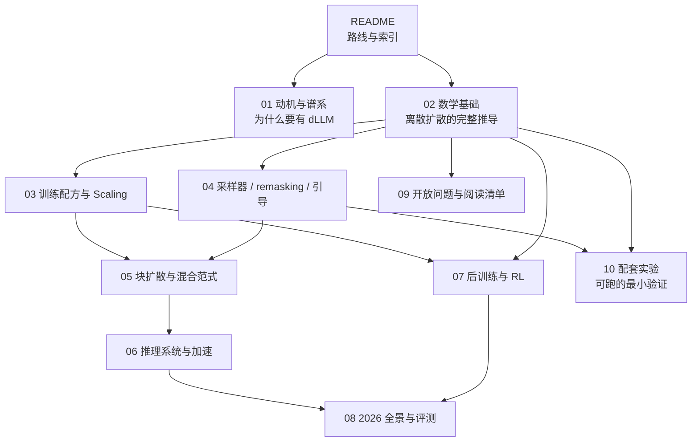

# 扩散语言模型（Diffusion LM）学习资料与路线

> 系列文档：扩散语言模型（Diffusion LM）学习资料
> 本目录是**草稿与素材**，已加入 `_config.yml` 的 `exclude`，不参与站点构建。

---

## 0. 这套资料在讲什么

> 已发布的第一篇博客正文：[扩散语言模型（01）：离散扩散的 ELBO](https://lrypcy.github.io/2026/10/12/diffusion-lm-01-discrete-diffusion-elbo/)
> （对应本目录 01 + 02，实验落在 `ipynbs` 的 `experiments/diffusion-lm/`）。后续篇目从 03–08 取料。

自回归（Autoregressive, AR）把语言分布拆成一串从左到右的条件概率；扩散语言模型（diffusion language model, dLLM）换了一条路：定义一条**逐步加噪的前向过程**，再学一条**逐步去噪的反向过程**。文本上的"噪声"不是高斯噪声，而是离散状态上的转移——主流做法是**吸收态掩码**（把 token 换成 `MASK`），于是训练目标退化成一族带权重的掩码语言模型交叉熵，推理则是从全 `MASK` 画布出发反复"完形填空"。

截止 2026 年 10 月，这条路已经不是实验室玩具：开源侧有 LLaDA 系、Dream、Stable-DiffCoder，商业侧有 Mercury、Gemini Diffusion / DiffusionGemma、Nemotron-Labs-Diffusion、Seed Diffusion，推理侧有 Fast-dLLM、dInfer、SGLang 的 dLLM 后端。

本套资料的目标：**从数学原理 → 训练配方 → 采样器 → 系统加速 → 后训练对齐 → 产业全景，逐层打通，并给出可动手验证的实验清单。**

---

## 1. 前置知识自检

在进入正文前，下面每一条都应当能不看资料答出来。答不出来的先补，否则后面的推导会变成抄公式。

| 自检项 | 要求程度 | 补充材料 |
|---|---|---|
| 变分下界（ELBO）与 KL 的基本操作 | 会推 VAE 的下界 | 任意概率模型教材 |
| DDPM 的前向/反向、重参数化 | 能写出 $$q(x_t \mid x_0)$$ 的闭式，会推简化损失 | Ho et al. 2020 |
| Transformer 的 causal mask 与 KV cache | 能说清为什么 AR 能缓存、双向不行 | 任意 LLM 工程材料 |
| 交叉熵与 softmax 的数值细节 | 会写带 mask 的加权 CE，知道 label smoothing | 基础 |
| 泊松过程的 $$\tau$$-leaping 直觉 | 知道"一个小区间内多跳"这一近似 | CTMC 入门材料 |
| AR 的 scaling law 与训练配方 | 知道数据/参数/算力的三角关系 | Kaplan / Chinchilla 系列 |

---

## 2. 文件索引与依赖关系

| 文件 | 主题 | 先修 | 建议顺序 |
|---|---|---|---|
| [01 动机与谱系](01-motivation-and-taxonomy.md) | AR 的结构性瓶颈、dLLM 的三条技术路线与 2019–2026 时间线 | 无 | 1 |
| [02 数学基础](02-math-foundations.md) | 从 DDPM 到 D3PM、CTMC、score entropy、MDLM/MD4 化简、LLaDA 损失 | 01 | 2 |
| [03 训练配方与 Scaling](03-training-recipe-and-scaling.md) | 掩码率采样、损失加权、AR→dLLM 转换、WSD、MoE、缩放观察 | 02 | 3 |
| [04 采样器 / remasking / 引导](04-sampling-remasking-and-guidance.md) | 反向核、$$\tau$$-leaping、置信度并行解码、remasking 谱系、离散 CFG | 02 | 3 |
| [05 块扩散与混合范式](05-block-diffusion-and-hybrids.md) | BD3-LM、变长生成、梯度方差、AR+扩散联合目标 | 03、04 | 4 |
| [06 推理系统与加速](06-inference-systems-and-acceleration.md) | 块级 KV cache、NFE 压缩、蒸馏、量化、dInfer / SGLang / vLLM | 05 | 5 |
| [07 后训练与 RL](07-post-training-and-rl.md) | SFT、ELBO-DPO、VRPO、diffu-GRPO 系、逐步动作视角 | 03 | 5 |
| [08 2026 全景与评测](08-landscape-and-benchmarks-2026.md) | 各家族点评、速度/质量口径、选型决策 | 06、07 | 6 |
| [09 开放问题与阅读清单](09-open-problems-and-reading-list.md) | 13 个开放问题、六档分级论文清单、代码仓库 | 全部 | 随时 |
| [10 配套实验](10-labs.md) | 10 个 numpy/torch 最小验证实验 | 02 起 | 与 03–05 并行 |

---

## 3. 学习路线：五个台阶

### 台阶一：建立正确的心智模型（建议 3–5 天）

读完 01、02 两篇，目标是能在纸上独立写出下面这些东西，而不是"看懂了"：

1. 吸收态前向过程 $$q(z_t \mid z_s)$$ 的掩码概率 $$(\alpha_s-\alpha_t)/\alpha_s$$，以及反向里对应的 $$(\alpha_s-\alpha_t)/(1-\alpha_t)$$；
2. 连续时间 ELBO 在吸收态下如何化简为"带 $$1/t$$ 权重的掩码交叉熵"；
3. 为什么这个损失是 $$-\mathbb{E}[\log p_\theta(x_0)]$$ 的**上界**，而 BERT 的 MLM 损失不是；
4. $$\tau$$-leaping 的条件独立假设，以及它为什么会让"每步多解一个 token"掉点。

> 关键判据：能把这些讲给一个只懂 AR 的人听，并且不借助"像图像扩散那样"这种含糊类比。

### 台阶二：把训练与采样分开看（建议 5–7 天）

03 与 04 是"一体两面"：训练决定模型见过什么样的掩码分布，采样决定它实际面对什么样的掩码分布，两者的错配（train/test gap）是掉点的主要来源之一。读完应能回答：

- 掩码率为什么要 $$t\sim\mathcal{U}[0,1]$$，固定 15% 会怎样；
- 从预训练 AR 转 dLLM 时，为什么块式注意力比全双向更能保住原有权重分布；
- 采样步数、每步解出 token 数、置信度阈值这三个旋钮如何共同决定"质量-延迟"曲线；
- 为什么朴素掩码扩散不能自我纠错，remasking 与 uniform-state 如何补上。

### 台阶三：系统视角（建议 5–7 天）

05、06 解决"理论上的并行 ≠ 真实的 TPS"。核心命题只有一句：**双向注意力和 KV cache 天生冲突，块扩散是这场冲突的和解方案。** 读完应能量化：

- NFE（function evaluation 次数）、tokens-per-forward、TPS 三者如何换算；
- 块级 KV cache 的"近似"到底近似掉了什么，代价如何测；
- 什么场景下 dLLM 从 memory-bound 迁到 compute-bound 是真收益，什么场景只是账面数字。

### 台阶四：对齐与前沿（建议 4–6 天）

07、08 覆盖"怎么把 dLLM 训好"与"现在谁做到了什么"。这一层的重点不是记数字，而是**建立对数字的免疫力**：厂商 TPS 互不严谨可比、步数与温度能显著改分数、ELBO 只能给上界。

### 台阶五：动手（与前面并行，贯穿全程）

[10 配套实验](10-labs.md) 里的实验 1–9 全部可以在 CPU 上用 numpy 跑完，建议读 02 时做实验 1/2/8，读 04 时做实验 4/5，读 05 时做实验 6/7。实验 10 需要 GPU 与开源权重，放到最后。

> 仓库约定：随文实验脚本不进本仓库 `tools/`，统一放在 `ipynbs` 仓库的 `experiments/<topic>/<name>/` 下（含 `README.md` + 脚本 + `results/`）。本目录的 Markdown 只内联最小可跑片段。

---

## 4. 两种节奏

| | 四周速通（每天 1.5–2 小时） | 八到十周完整版 |
|---|---|---|
| 第 1 周 | 01、02 + 实验 1/2 | 01、02 + 实验 1/2/8 |
| 第 2 周 | 03、04 + 实验 4/5 | 03 + 实验 3 |
| 第 3 周 | 05、06 | 04 + 实验 4/5/9 |
| 第 4 周 | 08 + 09 的阅读清单，选一个开源模型跑通推理 | 05 + 实验 6/7 |
| 第 5–6 周 | — | 06，跑通 Fast-dLLM 或 dInfer 的一条链路 |
| 第 7–8 周 | — | 07，复现一个 ELBO 类后训练流程 |
| 第 9–10 周 | — | 08、09，写一份自己的选型/研究结论 |

四周版的目标是"能读懂论文、能和人讨论"；八到十周版的目标是"能改代码、能跑实验、能下判断"。

---

## 5. 必须记住的十条（记忆锚点）

1. 文本扩散的噪声是**离散状态转移**，主流是吸收态掩码；`MASK` 一旦戴上不会自己摘掉。
2. 掩码扩散的连续时间 ELBO 化简后就是**带 $$1/t$$ 权重的 MLM 交叉熵**，这是它能规模化的根本原因。
3. 这个损失是 $$-\mathbb{E}[\log p_\theta(x_0)]$$ 的**上界**，所以 dLLM 是正经的生成模型，有似然可谈——这是它区别于 BERT 的关键。
4. 掩码率 $$t\sim\mathcal{U}[0,1]$$ 与 BERT 的 15% 之差，是"能不能从全 `MASK` 生成"的分水岭。
5. 采样时每步并行解多个 token，依赖 $$\tau$$-leaping 的**条件独立假设**，代价是掉点；掉点集中在低置信 token 上。
6. 朴素掩码扩散**不能自我纠错**：已揭示的 token 不会重掩码。remasking 与 uniform-state 是两条修复路线。
7. 双向注意力与 KV cache 冲突；**块扩散**（块间自回归、块内双向）是标准解法，也是变长生成的前提。
8. 推理成本三件套：NFE、tokens-per-forward、TPS。只报其中一个的数字基本不可信。
9. 后训练的最大障碍是**序列似然不可精确计算**，于是 ELBO / mean-field / 耦合掩码等估计方式各显神通，方差是主要敌人。
10. AR 与扩散不是简单的替代关系：联合目标、互为草稿模型、同一份权重多模式解码，都是正在收敛的方向。

---

## 6. 常见误判（读资料时反复出现的坑）

| 误判 | 事实 |
|---|---|
| "dLLM 就是 BERT 多做几步" | 训练目标形似，但掩码率分布、$$1/t$$ 权重、生成式地位三者都不相同；BERT 不是生成模型 |
| "并行解码天然更快" | 早期开源 dLLM 实测慢于 AR：定长输出、无 KV cache、步数等于回答长度才最优 |
| "每步解 256 个 token" | 256 是画布长度，实际每次前向"最终确定"的 token 数远小于此（模型卡量级为十几到二十） |
| "TPS 可以直接横比" | 硬件、批大小、提示约束、数据集都不同，Seed Diffusion 论文自己也明确警告过 |
| "扩散一定打不过 AR 的质量" | 在相同架构与数据下，块扩散训练反而可能超过同配 AR 基线（Stable-DiffCoder 的受控对比） |
| "有了 dLLM 就不要 AR 了" | 高并发生态、长链路推理、成熟工具链仍属 AR；dLLM 的甜区在单用户/低并发、编辑与约束满足 |
| "困惑度可以直接比" | dLLM 报的是 ELBO（上界），与 AR 的精确 NLL 不同口径 |

---

## 7. 维护约定

- 本目录是草稿，不进站点构建；**任何新增的 `.md` 目录都要同步加入 `_config.yml` 的 `exclude`**。
- 引用一律带链接；厂商自测或二手数据必须标注口径，不得转写成客观结论。
- 数学一律用来源文献的通行写法，不自造符号；公式里不出现裸竖线；LaTeX 用 `\mathrm{}` 而非 `{\rm }`。
- 不得出现主目录绝对路径与真实姓名。

---

## 参考链接

- Kuleshov 组教学博客（ICLR 2026 / MLSS 2026 讲义改编）：https://kuleshov-group.github.io/blog/blog/2026/how-to-build-a-diffusion-language-model/
- A Survey on Diffusion Language Models：https://ar5iv.arxiv.org/html/2508.10875
- Discrete Diffusion in Large Language and Multimodal Models: A Survey：https://ar5iv.arxiv.org/html/2506.13759
- Discrete Diffusion Models: A Unified Framework from Tokenization to Generation：https://arxiv.org/html/2607.13431v1
- LLaDA 官方仓库与 FAQ：https://github.com/ML-GSAI/LLaDA
- Fast-dLLM 项目页：https://nvlabs.github.io/Fast-dLLM
- dInfer 推理框架：https://github.com/inclusionAI/dInfer
