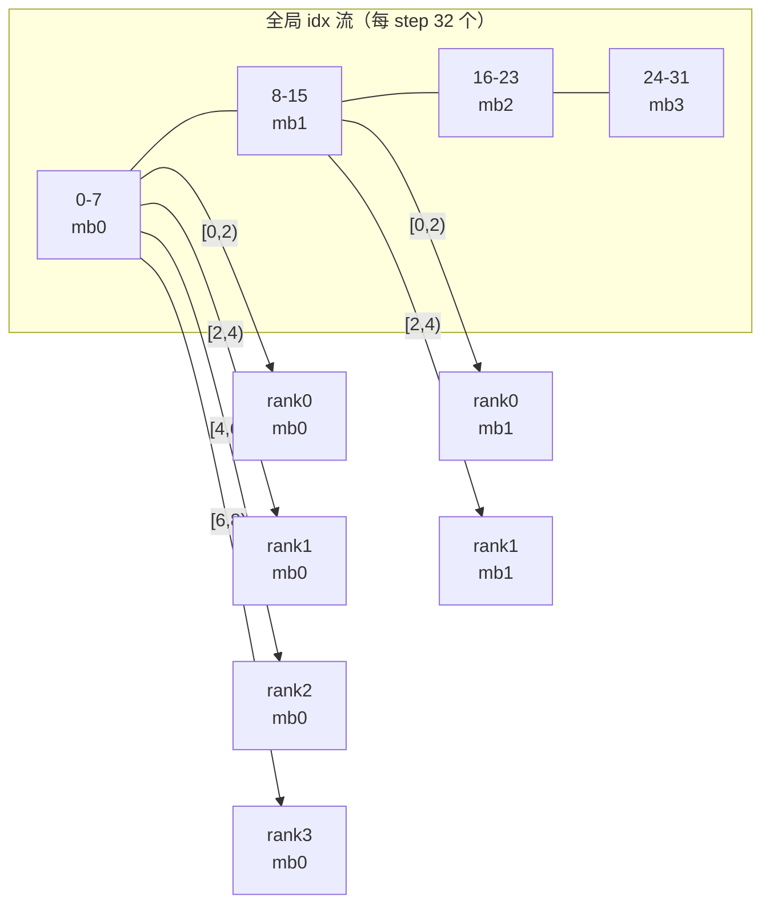
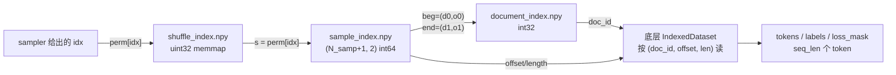
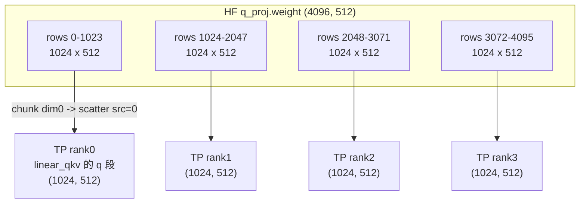
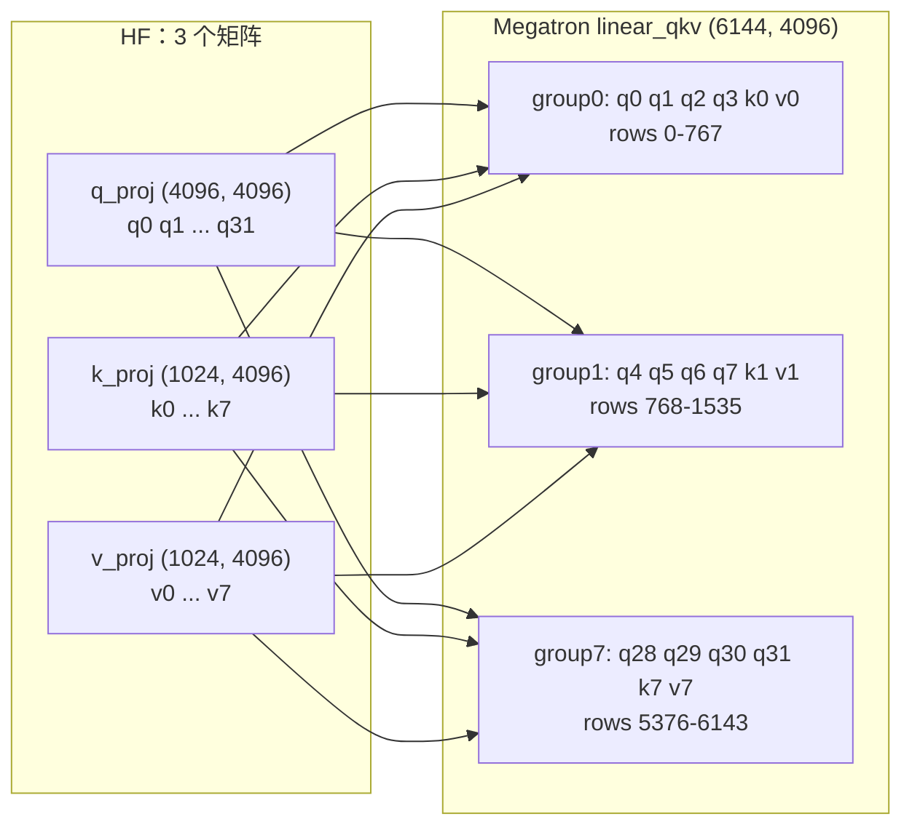
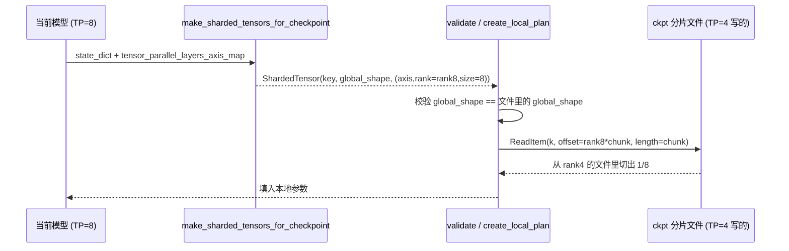

# 01 Megatron-LM + Megatron-Bridge 源码级素材

- Megatron-LM：`~/Desktop/Projects/github/Megatron-LM` @ `4b4acac9a1d28ea6829c8d4f566d75698a21249d`（core_v0.19.2）
- Megatron-Bridge：`~/Desktop/Projects/github/Megatron-Bridge` @ `c0e164ed2aedac4ad1c877780e2564a19d5d54ec`（v0.6.2）
- permalink 前缀：`https://github.com/NVIDIA/Megatron-LM/blob/4b4acac9a1d28ea6829c8d4f566d75698a21249d/`、`https://github.com/NVIDIA-NeMo/Megatron-Bridge/blob/c0e164ed2aedac4ad1c877780e2564a19d5d54ec/`
- 行号全部用 `git show <commit>:<path> | sed -n 'A,Bp'` 落到本地核对过。
- 本机工作树 HEAD 与这两个 commit 不同（Megatron-LM 工作树在 `60e0396`），**所有引用只对上述 commit 成立**。

---

## 专题 1：数据分片的三层

**结论**：数据分片不在「DataLoader」这一层完成，而是分成三个互不关心的层：
(1) **全局 idx 由 sampler 切**（谁读第几个样本），(2) **idx→token 由 `GPTDataset.__getitem__` 查**（磁盘随机读），
(3) **多数据集混合由 `BlendedDataset` 在 idx 空间上查表**（不搬数据）。
三者之间只靠「一个整数 idx」通信，所以任何一层都可以单独换掉。

### 1.1 第 0 层（上层组装）：`build_pretraining_data_loader`

**代码**（`megatron/training/datasets/data_samplers.py` L58-L75）：

```python
    elif args.dataloader_type == 'single':
        if args.hybrid_context_parallel:
            batch_sampler = HybridCPMegatronPretrainingSampler(...)
        else:
            # Megatron sampler
            batch_sampler = MegatronPretrainingSampler(
                total_samples=len(dataset),
                consumed_samples=consumed_samples,
                micro_batch_size=micro_batch_size,
                data_parallel_rank=mpu.get_data_parallel_rank(),
                data_parallel_size=mpu.get_data_parallel_world_size())
```

**读法**：注意这里只把 `micro_batch_size` / `data_parallel_size` / `consumed_samples` 传下去，**没传
`global_batch_size`**。`global_batch_size` 被拆成一个独立的全局量 `num_microbatches`（见 1.5），
sampler 本身对「一个 step 有几个 microbatch」毫不知情——它只是一个「无穷长的、按 DP 切好的 idx 流」。

**坑**：`build_pretraining_data_loader` 对 valid/test split 会偷偷换成 `args.eval_micro_batch_size` /
`args.eval_global_batch_size`（L39-L41）；`full_validation` 时用 `MegatronFullValidationSampler`，
那个 sampler 的 `micro_batch_size` 被硬编码为 1（L237），`__iter__` 每个 batch 只吐 1 个 idx（L270），
和训练路径的语义完全不同。

### 1.2 第 1 层：`MegatronPretrainingSampler.__iter__` —— 真正的「谁读哪个 idx」

**代码**（`megatron/training/datasets/data_samplers.py` L169-L182）：

```python
    def __iter__(self):
        batch = []
        # Last batch will be dropped if drop_last is not set False
        for idx in range(self.consumed_samples, self.total_samples):
            batch.append(idx)
            if len(batch) == self.micro_batch_times_data_parallel_size:
                start_idx, end_idx = self.get_start_end_idx()
                yield batch[start_idx:end_idx]
                batch = []

        # Check the last partial batch and see drop_last is set
        if len(batch) > 0 and not self.drop_last:
            start_idx, end_idx = self.get_start_end_idx()
            yield batch[start_idx:end_idx]
```

其中 `get_start_end_idx`（L164-L167）：

```python
        start_idx = self.data_parallel_rank * self.micro_batch_size
        end_idx = start_idx + self.micro_batch_size
```

**读法**：这是一个**流式**的全局顺序窗口——所有 rank 依次推进同一条 `consumed_samples → total_samples`
的整数流，每凑满 `m × dp` 个 idx 就切成 `dp` 片，第 `r` 片是 `[r*m, (r+1)*m)`。
所以**同一个 microbatch 序号 `k` 下，rank `r` 拿到的 idx 是 `base + k*m*dp + r*m`**，
`base = consumed_samples + step_index * G`。

**量化（题设例子 G=32, m=2, dp=4）**：

- 一个 step 的全局样本数 = `G = 32`
- 每个 rank 每 step 的样本数 = `G / dp = 32 / 4 = 8`
- 每个 rank 每 step 的 microbatch 数 = `m_num = G / (m * dp) = 32 / (2*4) = 4`
- 一个 step 消耗的 idx 区间 = `[base, base+32)`

`step 0`（`base=0`）的 idx 分配表：

| microbatch k | 全局 idx 窗口 `[k*m*dp, (k+1)*m*dp)` | rank0 | rank1 | rank2 | rank3 |
| --- | --- | --- | --- | --- | --- |
| 0 | `[0, 8)` | 0,1 | 2,3 | 4,5 | 6,7 |
| 1 | `[8, 16)` | 8,9 | 10,11 | 12,13 | 14,15 |
| 2 | `[16, 24)` | 16,17 | 18,19 | 20,21 | 22,23 |
| 3 | `[24, 32)` | 24,25 | 26,27 | 28,29 | 30,31 |

按 rank 汇总（这就是 rank 在一次 `for mb in range(num_microbatches)` 里依次拿到的 4 个 list）：

| DP rank | 本 step 的 8 个 idx（按 microbatch 顺序） |
| --- | --- |
| 0 | `[0,1] [8,9] [16,17] [24,25]` |
| 1 | `[2,3] [10,11] [18,19] [26,27]` |
| 2 | `[4,5] [12,13] [20,21] [28,29]` |
| 3 | `[6,7] [14,15] [22,23] [30,31]` |

**图**（Mermaid，画「一条全局 idx 流怎么被交错切给 4 个 DP rank」）：



**坑（性能悬崖）**：`__iter__` 里 `batch.append(idx)` 然后 `batch[start:end]` 返回的是**新 list**，
`idx` 本身是 Python int。也就是说每个 step sampler 生成 `G` 个 int 对象再切片，**这层是纯 CPU 的**，
对 `G` 很大（比如 4096）时每 step 要造 4096 个 int 和 4096 次 append——不是瓶颈但也不是零成本。

### 1.3 第 2 层：`BlendedMegatronDatasetBuilder` —— 多数据集混合在「idx 空间」完成

**结论**：混合比例不是「按权重随机抽数据集」，而是**排名 + 查表**：先算出每个子数据集本 step/split
应该贡献多少样本，再拼一张 `dataset_index`（这个 idx 属于哪个子集）和 `dataset_sample_index`
（是该子集里的第几个样本）两张 1-D 数组，运行时只做两次数组索引。

**代码**（`megatron/core/datasets/blended_megatron_dataset_builder.py` L196-L214）：

```python
                    if weights_i is not None and self.sizes[i] is not None:
                        # Blend according to client-specified weights and client-specified size
                        size_per_dataset = list(zip(*sizes_per_dataset_target))[i]
                        size_i = sum(size_per_dataset)
                    elif weights_i is None:
                        # Blend according to dataset sizes as-is and (maybe) client-specified size
                        try:
                            weights_i = [
                                len(megatron_dataset) for megatron_dataset in megatron_datasets[i]
                            ]
                        except TypeError:
                            weights_i = [0 for _ in prefixes]
```

**读法**：三条路：`weights=None` 时**按各子集实际长度当权重**（即「自然混合」）；`weights + size`
都给时按 `_get_size_per_split_per_dataset(weights, sizes)` 算每子集配额；只给 weights 不给 size 直接
`raise ValueError("Using client-specified weights requires client-specified size")`（L213-L214）。

**真正被 sampler 访问的那一步**（`megatron/core/datasets/blended_dataset.py` L98-L109）：

```python
    def __getitem__(self, idx: int) -> Dict[str, Union[int, numpy.ndarray]]:
        if self.dataset_index is None:
            self.dataset_index = safe_numpy_load(
                self.path_to_dataset_index, allow_pickle=True, mmap_mode="r"
            )
            self.dataset_sample_index = safe_numpy_load(
                self.path_to_dataset_sample_index, allow_pickle=True, mmap_mode="r"
            )

        dataset_id = self.dataset_index[idx]
        dataset_sample_id = self.dataset_sample_index[idx]
        return {"dataset_id": dataset_id, **self.datasets[dataset_id][dataset_sample_id]}
```

**读法**：`BlendedDataset` 的 `__len__` 等于「配额总和」，`__getitem__(idx)` 只是两次 memmap 数组读。
**混合完全发生在索引构建期**（`_build_indices`），运行期零随机、零同步。这一点决定了：
**混合比例一改就必须重建索引**（缓存 key 是 `unique_description_hash`）。

### 1.4 第 3 层：`GPTDataset.__getitem__` → token

**代码**（`megatron/core/datasets/gpt_dataset.py` L230-L258）：

```python
    def __getitem__(self, idx: Optional[int]) -> Dict[str, torch.Tensor]:
        if idx is None:
            # Batch padding sequence so the index does not matter
            text, _, document_lengths = self._query_document_sample_shuffle_indices(0)
        else:
            text, _, document_lengths = self._query_document_sample_shuffle_indices(idx)

        text = torch.from_numpy(text).long()
        if self.config.add_extra_token_to_sequence:
            tokens = text[:-1].contiguous()
            labels = text[1:].contiguous()
        else:
            tokens = text
            labels = torch.roll(text, shifts=-1, dims=0)
            labels[-1] = self._pad_token_id
```

**读法**：`add_extra_token_to_sequence=True` 时取 `seq_len+1` 个 token，`tokens=text[:-1]`、
`labels=text[1:]`——**tokens/labels 是同一块内存的两个错位视图**，拷到 GPU 后只存一份 HBM。
`idx is None` 是「最后一个 microbatch 补位」用的：读 idx 0 但把 `loss_mask` 全清零（L276-L278），
所以 padding 样本**不产生梯度**，这是 `data_sampler.batch` 里最后一个 batch 不满时的静默兜底。

### 1.5 `consumed_samples` 游标与 `iteration × G` 的关系式

三处关键代码：

**(a) `consumed_train_samples` 的推进**（`megatron/training/training.py` L3936-L3942）：

```python
        else:
            batch_size = (
                _dp_world_size() * args.micro_batch_size * get_num_microbatches()
            )
            iteration_sequences = batch_size

        # Update consumed samples (always means sequences now)
        args.consumed_train_samples += iteration_sequences
```

**(b) 从 iteration 反推**（`training.py` L4523-L4528）：

```python
    if args.iteration > 0 and args.consumed_train_samples == 0:
        assert (
            args.train_samples is None
        ), 'Only backward compatiblity support for iteration-based training'

        args.consumed_train_samples = args.iteration * args.global_batch_size
```

**(c) 载入 ckpt 时重算 num_microbatches**（`megatron/training/checkpointing.py` L2499-L2501）：

```python
        args.consumed_train_samples = getattr(checkpoint_args, 'consumed_train_samples', 0)
        ...
        update_num_microbatches(consumed_samples=args.consumed_train_samples, verbose=True)
```

**关系式（恒定的 global batch size 下）**：

```
G        = m * dp * num_microbatches
consumed_samples(iteration t) = t * G            # 第 t 次 step 之前的游标
采样窗口(iteration t)          = [t*G, (t+1)*G)
rank r 在 iteration t, microbatch k 的 idx:
    idx = t*G + k*(m*dp) + r*m + [0..m)
```

代入题设（G=32, m=2, dp=4）：`num_microbatches = 4`；`iteration 3` 时 `consumed_samples=96`，
rank 2 的 4 个 microbatch 分别是 `[100,101] [108,109] [116,117] [124,125]`。

**公式的边界**：以上恒等式要求 `G % (m*dp) == 0`，否则 `ConstantNumMicroBatchesCalculator` 会直接
`assert` 失败（见下）。而 `torch_data_sources` / `step_batch_size_schedule` 开启后这个恒等式**不成立**，
`update_num_microbatches(consumed_samples)` 会按阈值查表改 `num_microbatches`——
此时「iteration × G」只是一个近似，正确值必须从 `consumed_samples` 反查。

### 1.6 `num_microbatches` 的除法校验（G 与 m×dp 不整除时会发生什么）

**代码**（`megatron/core/num_microbatches_calculator.py` L380-L393）：

```python
        else:
            assert global_batch_size % micro_batch_times_data_parallel_size == 0, (
                'global batch size ({}) is not divisible by micro batch size ({})'
                ' times data parallel size ({})'.format(
                    global_batch_size, micro_batch_size, data_parallel_size
                )
            )
            running_global_batch_size = global_batch_size
            num_micro_batches = global_batch_size // micro_batch_times_data_parallel_size
        assert (
            num_micro_batches >= 1
        ), 'number of microbatches should be at least 1, got {}.'.format(num_micro_batches)
```

**量化**：`--decrease-batch-size-if-needed` 打开时走 L366-L374 的 `_round()` 分支，把 `G` 向下取整到
`m*dp` 的倍数，并只打印一行 INFO（`decreasing batch size from X to Y`）。**这一行日志是唯一线索**——
不打开这个开关时是硬 assert；打开后是**静默改变训练规模**。

---

## 专题 2：索引到样本的映射与 shuffle 算法

**结论**：`_query_document_sample_shuffle_indices` 不「随机打乱数据」，它做的是**三次数组查表**：
`shuffle_index[idx]` → 得真实样本号；`sample_index[s]` / `sample_index[s+1]` → 得该样本的起止文档与偏移；
再从 memmap 的数据文件里按需读 token。因此**永远不需要把全量 token 读进内存**。

### 2.1 三次查表

**代码**（`megatron/core/datasets/gpt_dataset.py` L370-L383）：

```python
        if self.shuffle_index is None:
            # NOTE(asolergi-nv): Lazy memmap the indexes
            self.shuffle_index = safe_numpy_load(
                self.path_to_shuffle_index, allow_pickle=True, mmap_mode='r'
            )
            self.sample_index = safe_numpy_load(
                self.path_to_sample_index, allow_pickle=True, mmap_mode='r'
            )
            self.document_index = safe_numpy_load(
                self.path_to_document_index, allow_pickle=True, mmap_mode='r'
            )

        # Do the shuffle mapping
        idx = self.shuffle_index[idx]
```

**读法**：注意 `mmap_mode='r'`——三张索引表都是**惰性映射**，`shuffle_index[i]` 这一下才触发一次
4 字节的缺页。三个 `.npy` 的文件头不占显存也不占 RSS 之外的内存（页缓存共享）。

### 2.2 三张表的语义（源码 docstring 原文）

`_build_document_sample_shuffle_indices`（L440-L451）：

```
        The document index:
            -- 1-D
            -- An ordered array of document ids

        The sample index:
            -- 2-D
            -- The document indices and offsets which mark the start of every sample

        The shuffle index:
            -- 1-D
            -- A random permutation of index range of the sample index
```

### 2.3 seed 与 epoch 怎么影响 shuffle（三层都不打乱「同一 epoch 内」）

**关键发现**：在 `GPTDataset` 这一层，`epoch` **不参与** shuffle 计算。shuffle 只由两样东西决定：

1. `self.config.random_seed` → 初始化一个 `numpy.random.RandomState`（L549）；
2. `num_epochs`（由 `--train-samples` 与 `num_tokens_per_epoch` 反推，L676-L696），它决定要铺几个 epoch 的文档。

**代码**（L696-L697、L720-L730）：

```python
            numpy_random_state = numpy.random.RandomState(self.config.random_seed)

            # Build the document index
            document_index = _build_document_index(
                self.indices, num_epochs, numpy_random_state, separate_final_epoch
            )
```

```python
            # Build the shuffle index
            if separate_final_epoch:
                shuffle_index = _build_shuffle_index(
                    num_samples_sans_final_epoch, sample_index.shape[0] - 1, numpy_random_state
                )
            else:
                shuffle_index = _build_shuffle_index(
                    sample_index.shape[0] - 1, sample_index.shape[0] - 1, numpy_random_state
                )
```

**epoch 的 shuffle 顺序由 `_build_document_index` 承担**（L699-L731）：它把「文档 × epoch」铺成二维
`mgrid[0:num_epochs, 0:len(documents)]`，第二次 shuffle 这个**展平后的整块**：

```python
    if not separate_final_epoch or num_epochs == 1:
        document_index = numpy.mgrid[0:num_epochs, 0 : len(documents)][1]
        document_index[:] = documents
        document_index = document_index.reshape(-1)
        document_index = document_index.astype(numpy.int32)
        numpy_random_state.shuffle(document_index)
        return document_index
```

**读法**：epoch 之间的边界**不是**「第 e 个 epoch 在数组第 e 段」——`shuffle` 是全局的，
一个 epoch 的文档会在数组中散落到任意位置。所以「epoch e 用的是哪些文档」只能通过
`sample_index` 反查每段的 `num_samples_per_epoch` 来推断。这是设计上的取舍：全局 shuffle 更均匀，
代价是 epoch 边界不可见。

**`separate_final_epoch` 的 80% 阈值**（L476-L490）：当最后一个 epoch 的样本数不足满 epoch 的 80% 时，
最后一个 epoch 被**排除在全局 shuffle 之外**单独打乱，避免「尾巴 epoch 只覆盖文档的一小部分」。

**`_build_shuffle_index`**（L733-L763）：值域是 uint32（`total_size` 接近 `2^32-1` 时降级到 int64），
说明**一个 split 的样本数上限是约 42.9 亿**。

### 2.4 为什么不需要全量数据进内存（量化）

设：

- `N_doc` = 文档数，`N_samp` = 总样本数（跨所有 epoch），`L` = seq_len
- 索引内存：`document_index` 4 B/doc，`sample_index` 2×`int64`×(`N_samp+1`)，`shuffle_index` 4 B/samp
- token 内存：**0**（只在 `dataset.get(doc_id, offset, length)` 时按 `L` 读一次）

代入一个 100 B token 训练规模（`L=4096`，`N_samp = 100e9/4096 ≈ 24.4 M`）：

| 项 | 大小 |
| --- | --- |
| `sample_index` | `24.4e6 × 16 B ≈ 391 MiB` |
| `shuffle_index` | `24.4e6 × 4 B ≈ 93 MiB` |
| `document_index` | 假设 1 M 文档 → `4 MiB` |
| 全量 token（若不 mmap） | `100e9 × 2 B(bf16) ≈ 186 GiB` |

即 **索引 ≈ 488 MiB vs 数据 186 GiB，差 390 倍**。而且这 488 MiB 还是 mmap 惰性的，
单个 Python 进程的常驻集只有「当前 step 真正碰到的那些页」。

**图**（Mermaid，画三次查表链）：



**坑**：

- `unique_description_hash` 是缓存文件名的一部分。**改 `--seq-length` / `--train-samples` / blend 权重
  都会导致重建索引**；在 petabyte 级语料上这一步是分钟到小时级。
- `sample_index` 的 dtype 是 int64，但如果语料 token 数超过 `2^63` 才会溢出——实际不会；
  `shuffle_index` 的 uint32 是真实边界（42.9 亿样本）。
- `defer_npy_index_mmap`（L464-L470）是「直接算路径、不建索引」的旁路，和 `fast_cache_load` 配合用；
  两者不一致时会出现「读取了另一个 run 的索引文件」的静默错误。

---

## 专题 3：Bridge 的映射表机制

**结论**：`MegatronMappingRegistry` 是一张「名字模式 → 转换器」表，核心是一个 40 行的 glob→正则
编译器和一个「首个命中即返回」的线性查找。它**不是** dict，因此**冲突不报错、由顺序决定**——
这是整个机制里最容易被忽略的一点。

### 3.1 模式语法：`*` 和 `**` 是两个不同的东西

**代码**（`src/megatron/bridge/models/conversion/mapping_registry.py` L125-L149）：

```python
    def _convert_pattern_to_regex(self, pattern: str) -> str:
        """Convert a pattern with wildcards to regex pattern.
        ...
        Note:
            ** must be processed before * to avoid conflicts.
            ** becomes (.*) - matches any characters including dots
            * becomes (\\d+) - matches digits only for layer indices
        """
        # Escape the pattern first
        regex_pattern = re.escape(pattern)

        # Process ** before * to avoid conflicts
        regex_pattern = regex_pattern.replace(r"\*\*", r"(.*)")

        # Replace remaining \* with (\d+)
        regex_pattern = regex_pattern.replace(r"\*", r"(\d+)")

        return regex_pattern
```

**读法**：`*` **只匹配数字**（`(\d+)`），`**` 匹配任意字符（`(.*)`）。所以
`decoder.layers.*.self_attention.linear_qkv.weight` **不会**匹配 `decoder.layers.foo.self_attention...`，
只会匹配 `decoder.layers.0|1|2|...`。这是「层号」这个语义被**硬编码进正则**——代价是
MoE 的 `decoder.layers.*.mlp.experts.linear_fc1.weight``（**experts 用数字索引**）也刚好能对上，
但 `**` 才是给嵌套路径用的。

编译时 `re.compile(f"^{pattern}$")`（L172），因此是**全匹配**而非前缀匹配。

### 3.2 双向查找：正向与反向各一张表

**代码**（`mapping_registry.py` L213-L247，正向）：

```python
        for pattern, mapping in self._compiled_patterns:
            if pattern is None:
                # Direct match
                if mapping.megatron_param == megatron_param_name:
                    return self._prepare_mapping(mapping)
            else:
                # Pattern match
                match = pattern.match(megatron_param_name)
                if match:
                    # Return resolved mapping with wildcards replaced
                    return self.resolve_mapping(mapping, match.groups())
        return None
```

**代码**（L249-L290，反向 `hf_to_megatron_lookup`）：同一套遍历，但走 `_reverse_patterns`；
当 `hf_param` 是 dict（QKV 那种「一个 Megatron 参数对三个 HF 参数」）时，
`_reverse_patterns` 里存的是 `{key: compiled_pattern}` **字典**，要对每个 value 逐个试。

**读法**：`pattern is None` 就是「没有通配符 → 退化成字符串相等」，这样**无通配符的映射**走的是
O(n) 字符串比较而不是正则匹配，是给热路径留的短路。

**复杂度**：查找是 O(n) 的线性扫描、每条一次正则 `match`。n 等于该模型的映射条数（Llama-3.2 级别约 10 条
pattern，MoE+多模态几千条）。一次 `export_hf_weights` 要查 `num_params` 次 → 总代价
O(num_params × n)，纯 CPU。对 7B 模型（约 290 个参数 × 10 条 pattern = 2900 次匹配）可忽略；
但对 1T MoE（几万参数 × 几千 pattern）就是千万次正则匹配——**这是 refit 路径上一个真实的 CPU 热点**。

### 3.3 通配符解析：`resolve()` 造一个**新 mapping 实例**

**代码**（`param_mapping.py` L273-L287）：

```python
    def resolve(self, captures: Tuple[str, ...]) -> "MegatronParamMapping":
        resolved_megatron_param, resolved_hf_param = self._resolve_names(captures)
        return type(self)(resolved_megatron_param, resolved_hf_param)
```

**读法**：`type(self)(resolved_megatron, resolved_hf)`——用**同名构造器**重新实例化。
这要求每个 Mapping 子类的 `__init__` 签名都接受 `(megatron_param, hf_param)`。
`QKVMapping` 就违反了这个约定（它的签名是 `(megatron_param, q, k, v)`），所以它**必须**重写
`resolve()`（L1857 有 `def resolve`）。这是一个「基类默认实现 + 子类覆盖」的隐性契约：
**新增 Mapping 子类时忘了重写 `resolve` 会在第一次 lookup 时静默报 TypeError**。

`_validate_patterns`（L662-L684）在构造时强制检查「两侧通配符个数必须相等」：

```python
            if megatron_param_wildcards != hf_param_wildcards:
                raise ValueError(
                    f"Wildcard count mismatch: megatron_param='{self.megatron_param}' has "
                    f"{megatron_param_wildcards} wildcards, hf_param='{self.hf_param}' has {hf_param_wildcards}"
                )
```

**坑**：这个检查只管**个数**不管**位置/语义**。`decoder.layers.**.linear_qkv.weight`（1 个 `**`）
和 `model.layers.*.q.weight`（1 个 `*`）个数相等，但解析时 `**` 会吃掉一段可能含 `.` 的字符串，
而 `*` 只能吃数字——**反向查找时捕获值会对错位**，且不报错。

### 3.4 冲突处理：没有冲突处理

`resolve_mapping`（L205-L211）只做一件事：

```python
    def resolve_mapping(
        self,
        mapping: MegatronParamMapping,
        captures: tuple[str, ...],
    ) -> MegatronParamMapping:
        """Resolve a mapping while preserving this registry's process groups."""
        return self._prepare_mapping(mapping.resolve(captures))
```

**结论（重要）**：`resolve_mapping` **不做任何冲突检测**。冲突完全由 `megatron_to_hf_lookup` /
`hf_to_megatron_lookup` 的**遍历顺序**决定：`self._compiled_patterns` 就是
`mappings` 的入参顺序（`__init__` 里 `self.mappings = list(mappings)`，L157）；先命中的赢，
后面的**永远不可达且无告警**。

**副作用**：`__init__` 会**自动扩充** mapping 列表（L157-L161）：

```python
        self.mappings = list(mappings)
        self._pg_collection = None
        self._add_separate_layernorm_mappings()
        if int(os.environ.get("ENABLE_BRIDGE_QUANT_MAPPING", "0")):
            self._add_quantization_mappings()
```

`_add_separate_layernorm_mappings` 会为每个以 `*.self_attention.linear_qkv.layer_norm_weight` 结尾的映射
**再复制一条** `input_layernorm.weight` 的别名映射（L69-L108）。也就是说：
**同一个 HF 参数可能被两条 Megatron 名字映射到**，反向查找时先命中的是哪条取决于别名插入位置。

**坑**：
- 想「覆盖」某条映射，必须把它**放在最前面**，不能追加到末尾。
- `describe()`（L331）是唯一能打印全部映射（含别名与类型）的接口；没有冲突检测的 debug 手段。
- 量化映射的插入受**环境变量** `ENABLE_BRIDGE_QUANT_MAPPING` 控制——同一份代码在不同 env 下
  会得到**不同顺序的映射表**，进而可能改变 `hf_to_megatron_lookup` 的结果。这是环境相关的静默分叉。

---

## 专题 4：ColumnParallel / RowParallel 的完整转换

**结论**：两个方向都**以 rank 0 为唯一权威**：rank 0 拿完整 HF 张量、校验除尽、`torch.chunk` 切好，
再用一次 `torch.distributed.scatter` 分发。**没有任何 rank 需要持有全量**（除了 rank 0 的瞬时内存）。

### 4.1 ColumnParallel（切 dim 0 = 输出维）

**代码**（`src/megatron/bridge/models/conversion/param_mapping.py` L966-L1027，只截关键）：

```python
        # On rank 0, check for divisibility and split
        if self.tp_rank == 0:
            if hf_weights is None:
                raise ValueError("hf_weights should not be None on rank 0")
            ...
            # For bias (1D), we still split along dim 0
            # For weight (2D), we split along dim 0 (output dimension)
            full_size = hf_weights.shape[0]
            if full_size % self.tp_size != 0:
                raise ValueError(f"Cannot evenly split dimension 0 size {full_size} across {self.tp_size} TP ranks")
            splits = torch.chunk(hf_weights, self.tp_size, dim=0)

        else:
            splits = None
        ...
        return self.scatter_to_tp_ranks(splits, output_shape, target_param.dtype, target_param.device)
```

**代码**（L578-L617 `scatter_to_tp_ranks`，真正的通信）：

```python
        output = torch.empty(output_shape, dtype=dtype, device=device)
        global_src = torch.distributed.get_global_rank(group=self.tp_group, group_rank=src_rank)

        scatter_list = None
        if self.tp_rank == src_rank and splits:
            scatter_list = [s.to(device=device, dtype=dtype).contiguous() for s in splits]

        torch.distributed.scatter(
            output,
            scatter_list,
            src=global_src,
            group=self.tp_group,
        )
        return output
```

**读法**：`output_shape` 来自**目标 Megatron 参数自身**的 shape（`target_param.shape`），
不是算出来的——即「按模型期望的形状构造接收缓冲」，这是最稳的做法（兼容 DTensor、
不整除时的 padding 分支）。`scatter_list` 只有 src 使用，其他 rank 传 `None`。

**反向 `megatron_to_hf`**（L1029-L1054）：`gather_from_tp_ranks`（L618-L634，内部是
`torch.distributed.all_gather`）+ `torch.cat(dim=0)`。注意它是 **all_gather 不是 gather**：
**所有 TP rank 都拿到完整权重**，而不是只有 rank 0。这一点在 refit 场景很关键——
每个推理 worker 都能各自完成转换，不需要额度的点对点分发。

### 4.2 RowParallel（切 dim 1 = 输入维）

**代码**（L1155-L1172）：

```python
            # bias (1D) is replicated across tp ranks
            # For weight (2D), we split along dim 1
            if hf_weights.ndim == 1:
                splits = [hf_weights] * self.tp_size
            else:
                assert hf_weights.ndim == 2
                full_size = hf_weights.shape[1]
                if full_size % self.tp_size != 0:
                    raise ValueError(
                        f"Cannot evenly split dimension 0 size {full_size} across {self.tp_size} TP ranks"
                    )
                splits = torch.chunk(hf_weights, self.tp_size, dim=1)
```

**读法**：RowParallel 的 **bias 是复制的**（`splits = [hf_weights] * tp_size`），
反向时也是直接返回不 gather（L1200）：

```python
        if self.tp_size == 1 or len(megatron_weights.shape) == 1 or _module_uses_fsdp(megatron_module):
            # bias is unsharded in row parallel, so we can just return it
            full_weights = megatron_weights
```

**这是 RowParallel 与 ColumnParallel 唯一的方向差异**：column 的 bias 跟着 weight 切，row 的 bias 复制。

还有一个**隐蔽的转置修正**（L1146-L1157）：

```python
        # HF fused expert weights (e.g. down_proj) may be stored in [in, out]
        # layout while Megatron expects [out, in]. Detect via the unsharded dim:
        # for RowParallel, dim 0 is never split, so hf_weights.shape[0] must
        # equal target_param.shape[0].
        if (
            hf_weights is not None
            and hf_weights.ndim == 2
            and hf_weights.shape[0] != target_param.shape[0]
            and hf_weights.shape[1] == target_param.shape[0]
        ):
            hf_weights = hf_weights.t().contiguous()
```

即：**靠 shape 猜出「这个 HF 权重存的是转置版」**。所以 RowParallel 并不假定 HF 一定是 `[out, in]`。

### 4.3 具体矩阵例子：q_proj `(4096, 512)`，TP=4

设为 `hidden=4096`、`num_attention_heads=32`、`head_dim=128`、`num_query_groups=8`、`TP=4`
（这个参数组合在下面专题 5 继续用）。

HF 的 `q_proj.weight` 形状 = `(n_heads*head_dim, hidden)` = `(4096, 4096)`?? ——**注意题设给的是
`(4096, 512)`**，这对应 `n_heads*head_dim=4096`、`hidden=512`（如 Qwen2.5-0.5B 那一级的隐藏维）。
下面按题设算：

- 输出维 4096 被 TP=4 切成 4 × 1024
- 输入维 512 完整复制

| 分块 | 行范围 `[start, end)` | 形状 |
| --- | --- | --- |
| rank0 | `[0, 1024)` | `(1024, 512)` |
| rank1 | `[1024, 2048)` | `(1024, 512)` |
| rank2 | `[2048, 3072)` | `(1024, 512)` |
| rank3 | `[3072, 4096)` | `(1024, 512)` |

**量化（单卡内存）**：

- HF 侧 rank 0 的瞬时峰值：`4096 × 512 × 2 B ≈ 4.19 MiB`（bf16）＋ `splits` 的 4 个视图（`torch.chunk`
  返回**视图**不复制，所以不额外占内存）＋ `scatter_list` 里的 `.contiguous()`
  ——前 3 个 chunk 本身已连续，`contiguous()` 是 no-op；实际上只有 `output` 是新分配的
- 每个 TP rank 的常驻：`1024 × 512 × 2 B = 1 MiB`
- 4 卡合计系数 = 1（不重复存储），符合 column-parallel 的零冗余

**图**（Mermaid，画切分前后）：



**坑**：L999-L1007 有一段 padding 特判——只有 `embedding.word_embeddings.weight` /
`output_layer.weight` 允许 `shape` 不一致并右补零（`_pad_right_dim0`），其余参数
**直接 assert 失败**。这也是「词表大小 TP 不整除」能跑、但「hidden TP 不整除」跑不了的原因。

---

## 专题 5：QKV 交错的数学

**结论**：Megatron 的 `linear_qkv.weight` 不是 `[Q; K; V]` 三块拼接，而是**按 query group 分组交错**：
`[q_1..q_h, k_1, v_1, q_{h+1}..q_{2h}, k_2, v_2, ...]`。Bridge 用一次 reshape + 一次 Python 循环
+ 一次 `torch.cat` 完成合并。

**源码注释原文**（`param_mapping.py` L1666-L1669）：

```
    **Megatron format**
    -   Single interleaved tensor following grouped query attention (GQA) pattern
    -   Interleaving order: `[q1...qn, k1, v1, q1...qn, k2, v2, ...]`
    -   Where `n = num_attention_heads / num_query_groups`
```

Megatron-LM 自己也在 attention 前向里写了同一件事（`megatron/core/transformer/attention.py` L1845-L1847）：

```python
        if self.config.num_query_groups < self.world_size:
            # Note that weights are interleaved in the following manner:
            # q1 q2 k1 v1 | q3 q4 k2 v2 | q5 q6 k3 v3 | ...
```

### 5.1 合并的实现

**代码**（`param_mapping.py` L3159-L3189）：

```python
    head_num = provider.num_attention_heads
    num_query_groups = provider.num_query_groups
    heads_per_group = head_num // num_query_groups
    head_size = provider.kv_channels or (provider.hidden_size // head_num)
    ...
    q_reshaped = q.view(head_num, q_head_size, hidden_size)
    k_reshaped = k.view(num_query_groups, head_size, hidden_size)
    v_reshaped = v.view(num_query_groups, head_size, hidden_size)
    ...
    # Interleave in Megatron pattern: [q1...qn, k1, v1, q1...qn, k2, v2, ...]
    qkv_weights = []
    for i in range(num_query_groups):
        q_group = q_reshaped[i * heads_per_group : (i + 1) * heads_per_group]
        k_group = k_reshaped[i : i + 1]
        v_group = v_reshaped[i : i + 1]
        ...
        qkv_weights.extend([q_group, k_group, v_group])

    qkv = torch.cat(qkv_weights, dim=0)
```

**读法**：`view` 不拷贝，`q_group = q_reshaped[i*hp:(i+1)*hp]` 也是视图，
真正拷贝发生在 `torch.cat` ——**峰值内存 = 完整 qkv + q/k/v 三份原张量**，约 2 倍输出大小。
（`q_reshaped` 只是重解释 `q` 的内存布局，不额外分配。）

### 5.2 完整张量排列表（n_heads=32, n_query_groups=8, head_dim=128）

- `heads_per_group = 32 // 8 = 4`
- `hidden_size = 32 × 128 = 4096`（题设的 head_dim × n_heads；注意专题 4 里 q_proj 输入维用了 512，
  这里为了把「全部行」列全，取 hidden=4096）
- Q 总行数 `32 × 128 = 4096`；K/V 各 `8 × 128 = 1024`
- Megatron `linear_qkv_out_dim = 4096 + 2 × 1024 = 6144`

HF 三个独立矩阵：

| 矩阵 | 形状 | 行区间语义 |
| --- | --- | --- |
| `q_proj.weight` | `(4096, 4096)` | 32 个头，每头 128 行 |
| `k_proj.weight` | `(1024, 4096)` | 8 个 KV 头，每头 128 行 |
| `v_proj.weight` | `(1024, 4096)` | 8 个 KV 头，每头 128 行 |

合并后 Megatron `linear_qkv.weight` 的 6144 行排列（每个 group 占 `4*128 + 128 + 128 = 768` 行，
`8 × 768 = 6144` 对得上）：

| group `g` | 行区间 `[g*768, (g+1)*768)` | 内容（按子块） |
| --- | --- | --- |
| 0 | `[0, 768)` | q 头 0-3 `(512 行)` │ k 头 0 `(128)` │ v 头 0 `(128)` |
| 1 | `[768, 1536)` | q 头 4-7 │ k 头 1 │ v 头 1 |
| 2 | `[1536, 2304)` | q 头 8-11 │ k 头 2 │ v 头 2 |
| 3 | `[2304, 3072)` | q 头 12-15 │ k 头 3 │ v 头 3 |
| 4 | `[3072, 3840)` | q 头 16-19 │ k 头 4 │ v 头 4 |
| 5 | `[3840, 4608)` | q 头 20-23 │ k 头 5 │ v 头 5 |
| 6 | `[4608, 5376)` | q 头 24-27 │ k 头 6 │ v 头 6 |
| 7 | `[5376, 6144)` | q 头 28-31 │ k 头 7 │ v 头 7 |

**逐行映射公式**（可用来自检）：

```
对 Megatron linear_qkv 的第 r 行：
    g   = r // 768
    off = r %  768
    if     off < 512:     来源 = q_proj 的第 (g*512 + off) 行        # 4 个 q 头
    elif   off < 640:     来源 = k_proj 的第 (g*128 + (off-512)) 行
    else:                 来源 = v_proj 的第 (g*128 + (off-640)) 行
```

**例**：Megatron 第 1000 行 → `g=1000//768=1`，`off=232 < 512` → `q_proj` 第 `1*512+232 = 744` 行。
Megatron 第 1450 行 → `g=1`，`off=682`，`682-640=42` → `v_proj` 第 `1*128+42 = 170` 行。

**图**（Mermaid，画「三个矩阵 → 一个交错矩阵」）：



### 5.3 反向：`split_qkv_weights` 与 TP 切分后的「组内错位」

`split_qkv_weights`（L3257-L3300）用完全对称的做法：

```python
    if getattr(provider, "attention_output_gate", False):
        qkv_total_dim = 2 * head_num + 2 * num_query_groups
        total_heads_per_group = 2 * heads_per_group + 2
    else:
        qkv_total_dim = head_num + 2 * num_query_groups
        total_heads_per_group = heads_per_group + 2
```

注意 `qkv_total_dim` 是**按 head 计数**（32+2×8=48「头」），随后 `view(qkv_total_dim, head_size, hidden)`。

**关键坑（TP 切分会让 group 边界错位）**：`ColumnParallelMapping` 在 `megatron_to_hf` 里先
`gather` 再 `cat`（L1040-L1044）——**一定是先拼回完整的 6144 行再 split**。如果反过来
（先按 rank 切再 split），当 `TP > num_query_groups` 时一个 rank 只拿到 768/TP = 192 行，
`192 < 128+128`，一个 rank 内连 k/v 都不完整，无法独立 split。这正是 Megatron 里
`num_query_groups < tp_size` 时要 `all_gather` 的原因（见专题 6）。

**量化（QKV 合并的临时内存）**：BF16 下 `4096×4096 + 2×1024×4096 = 6144×4096` 元素
× 2 B = **48 MiB**；`torch.cat` 期间峰值约 48 MiB（输出）+ 48 MiB（三个输入）= **96 MiB**。
如果先在 GPU 上做（Bridge 的 `hf_to_megatron` 默认在 device 上做），对 80B 级模型的
`head_dim=256, hidden=8192, nheads=64` 就是 `(64+2*8)*256*8192 = 167.8M` 元素 ≈ **320 MiB**，
临时峰值翻倍到 640 MiB——这就是文档里「按 `NRL_REFIT_BUFFER_MEMORY_RATIO` 切 chunk」的直接动因。

---

## 专题 6：`num_query_groups` 与 TP 不整除的实际处理

**结论**：Megatron-LM 的处理是「**允许多重或约数，两种都不行就报错**」，并且两种允许的情形走**两条
完全不同的代码路径**：`ng >= tp` 走「均分 + 零复制」，`ng < tp` 走「每 rank 复制一份 + AG 后切片」。

### 6.1 校验：要么整除，要么被整除

**代码**（`megatron/core/transformer/transformer_config.py` L1338-L1346）：

```python
        if (
            self.num_query_groups % self.tensor_model_parallel_size != 0
            and self.tensor_model_parallel_size % self.num_query_groups != 0
        ):
            raise ValueError(
                f"num_query_groups ({self.num_query_groups}) must be a multiple or divisor of "
                f"tensor_model_parallel_size ({self.tensor_model_parallel_size})."
            )
```

**读法**：`raise ValueError`，不是 assert（所以 `python -O` 也拦得住）。
两侧只接受 LLaMA-3 那种 `ng=8, tp∈{1,2,4,8}` 的组合。反例：`ng=8, tp=3` 直接失败。

**量化：可行组合**（`ng=8`）：

| tp | `8 % tp` | `tp % 8` | 结论 | 每 rank 的 KV 组数 | 复制倍数 |
| --- | --- | --- | --- | --- | --- |
| 1 | 0 | — | 均分 | 8 | 1 |
| 2 | 0 | — | 均分 | 4 | 1 |
| 4 | 0 | — | 均分 | 2 | 1 |
| 8 | 0 | — | 均分 | 1 | 1 |
| 16 | 8 | 0 | **复制** | 1（含 8 份复制） | 2 |
| 32 | 8 | 0 | **复制** | 1 | 4 |
| 64 | 8 | 0 | **复制** | 1 | 8 |
| 3 / 5 / 6 / 7 / 12 | ≠0 | ≠0 | **报错** | — | — |

### 6.2 路径 A：`ng >= tp` —— 直接均分

**代码**（`megatron/core/transformer/attention.py` L361-L366）：

```python
        else:
            # When num_kv_heads >= tp_size, each TP rank produces activations for
            # (num_kv_heads / tp_size) kv_heads and (num_q_heads / tp_size) q_heads.
            self.num_query_groups_per_partition = divide(self.config.num_query_groups, world_size)
            self.num_attention_heads_per_partition = divide(
                self.config.num_attention_heads, world_size
            )
```

`divide()` 内部是 `assert n % d == 0`——因为 6.1 已经保证过，这里不会炸。

### 6.3 路径 B：`ng < tp` —— 每 rank 1 个 KV 组（= 复制），靠 AG 补回来

**代码**（`attention.py` L355-L360）：

```python
        if self.config.num_query_groups < world_size:
            # When num_kv_heads < tp_size, each TP rank (post AG) initially produces
            # activations for 1 kv_head and (num_q_heads / num_kv_heads) q_heads.
            # We then pull out the appropriate (num_q_heads / tp_size) q_heads.
            self.num_query_groups_per_partition = 1
            self.num_attention_heads_per_partition = divide(
                self.config.num_attention_heads, self.config.num_query_groups
            )
```

注意 `num_attention_heads_per_partition` 被设为 **`nh / ng`**（不是 `nh / tp`）——即「一个完整的组」。
然后前向里（L1845-L1868）：

```python
        if self.config.num_query_groups < self.world_size:
            # Note that weights are interleaved in the following manner:
            # q1 q2 k1 v1 | q3 q4 k2 v2 | q5 q6 k3 v3 | ...
            # When tp_size > num_kv_heads, we split "q1 q2 k1 v1" over multiple
            # ranks, so a rank does not have a clean partitioning of just the q_heads
            # it needs. Instead, we perform the following steps:
            # 1. Assemble the full "q1 q2 k1 v1 | q3 q4 k2 v2 | q5 q6 k3 v3 | ..."
            #    through an AG.
            # 2. Pull out the right slice (e.g., "q1 q2 k1 v1" or "q3 q4 k2 v2").
            # 3. Split q_heads (e.g., q1, q2), k_heads (e.g., k1), v_heads (e.g., v1).
            # 4. Further index into query to get only the q_heads that this rank is
            #    responsible for (e.g., q1).
            # The block of code below performs steps 1 and 2.
            mixed_qkv = all_gather_last_dim_from_tensor_parallel_region(
                mixed_qkv, group=self.pg_collection.tp
            )
            idx = get_pg_rank(self.pg_collection.tp) // (
                self.world_size // self.config.num_query_groups
            )
            size = mixed_qkv.size()[-1] // self.config.num_query_groups
            mixed_qkv = mixed_qkv[:, :, idx * size : (idx + 1) * size]
```

**读法**：这是**用通信换无除尽约束**。`idx = tp_rank // (tp_size / ng)`：每 `tp_size/ng` 个 rank
共享同一个 KV 组（即**这些 rank 上 KV 权重是复制品**），它们通过 AG 各自切出自己那一段 q。
代入 `ng=8, tp=32`：`tp_size/ng = 4`，rank 0-3 都落在 group 0，rank 4-7 都在 group 1…

**量化（通信量）**：AG 的宽度 = 一个 group 的完整 qkv 输出 = `(4 heads × 128) + 128 + 128 = 768`
× `hidden=4096` → 每 token **3.1 M** 元素。序列 `s=8192`、batch `b=1`、bf16：
`8192 × 768 × 4096 × 2 B ≈ 48 GiB` 的 AG 流量 **per layer per microbatch**。
这就是文档里「`tp_size > num_kv_heads` 时别开」的真实代价——复制带来的显存节省被 AG 气泡吃光。

**Megatron-LM 侧的另一个坑**：`attention.py` L374-L380 说

```python
        if self.config.num_query_groups < world_size:
            # TE throws an assertion error if num_kv_heads / num_query_groups
            # is not divisible by TP size.
            # TODO(rwaleffe/dnarayanan): Clean this up eventually.
            tmp_config = copy.deepcopy(self.config)
            tmp_config.num_query_groups = world_size
```

即：**为了让 TE 的 fused attention 不 assert，代码临时把 `num_query_groups` 改写成 `world_size`**。
所以「配置里写的 ng」和「attention 实现看到的 ng」在 `ng < tp` 时**不是同一个数**——
任何基于 `config.num_query_groups` 反推 shape 的外部代码（比如权重转换脚本）都会拿到错的值。

### 6.4 Bridge 侧是**区分处理**的

Bridge 的 `_get_shard_spec`（`param_mapping.py` L533-L575）显式承认复制布局：

```python
        """Get the unique TP shard count and shard rank for the current TP rank.

        This supports layouts where TP ranks may contain replicated copies of a
        smaller set of unique shards, such as KV-head sharding when
        ``num_query_groups < tensor_model_parallel_size``.
        ...
        """
        ...
        shard_world_size = resolved_global_size // shard_size
        if self.tp_size % shard_world_size != 0:
            raise ValueError(
                f"Invalid replicated shard layout: tp_size={self.tp_size}, shard_world_size={shard_world_size}"
            )

        replicas = self.tp_size // shard_world_size
        shard_rank = self.tp_rank // replicas
        return shard_world_size, shard_rank
```

**结论**：Bridge **能**在 `tp > ng` 时正确地把同一个 shard 发给多个 rank（`shard_rank = tp_rank // replicas`），
但它要求 `tp % shard_world_size == 0`，也就是和 Megatron 同样的整除约束。**Bridge 不解决
`ng` 与 `tp` 互质的组合**，它只是正确处理「复制」这一类。

---

## 专题 7：`--load` 的 reshard 路径

**结论**：Megatron 的 checkpoint **不按 TP 维度存盘**。它在每个参数上存一个 `ShardedTensor`，
里面带的是**全局形状 + 本 rank 分片的全局偏移 + 分片网格**。加载时按「当前进程组的 rank/worker 数」
重新计算目标分片，`torch.distributed.checkpoint` 的 planner 再从文件里按偏移切出来。
所以「按当前 TP/PP 重切」**不是一段重切代码，而是一次元数据比对**。

### 7.1 存盘时：偏移是 `(轴, rank, size)` 三元组

**代码**（`megatron/core/utils.py` L1000-L1024、L1038-L1047）：

```python
    tp_rank = get_pg_rank(tp_group)
    dp_rank = get_pg_rank(dp_cp_group)
    tp_size = get_pg_size(tp_group)
    dp_size = get_pg_size(dp_cp_group)
    dp_replica_id = get_pg_rank(dp_cp_group)

    new_offsets.append((tp_axis + prepend_axis_num, tp_rank, tp_size))
    ...
    if replica_id is None:
        replica_id = (0, 0, dp_replica_id)

    sharded_tensor = ShardedTensor.from_rank_offsets(
        key,
        tensor,
        *prepend_offsets,
        *new_offsets,
        replica_id=replica_id,
        prepend_axis_num=prepend_axis_num,
        **kwargs,
    )
```

**读法**：`(axis, rank, size)` 是「这一维按 `size` 等分，我是第 `rank` 段」。全局形状由
`local_shape × size` 推回，或由 `ShardedTensor.from_rank_offsets` 从 `tensor.shape` 与 offsets 反推。
**这就是 reshard 的全部信息**——存的是「我这一段的语义坐标」，不是「我是第几个文件」。

### 7.2 哪些参数走 TP 分片、哪些不分

**代码**（`megatron/core/transformer/utils.py` L153-L196，`make_sharded_tensors_for_checkpoint`）：

```python
        if layer_name.endswith(extra_state_suffix):
            replica_id = (0, get_pg_rank(tp_group), get_pg_rank(dp_cp_group))
            sharded_state_dict[layer_key] = make_sharded_object_for_checkpoint(...)

        elif layer_name in tensor_parallel_layers_axis_map:
            tp_axis = tensor_parallel_layers_axis_map[layer_name]
            sharded_state_dict[layer_key] = make_tp_sharded_tensor_for_checkpoint(
                tensor, layer_key, tp_axis, prepend_offsets=sharded_offsets,
                tp_group=tp_group, dp_cp_group=dp_cp_group,
            )
        else:
            sharded_state_dict[layer_key] = make_sharded_tensor_for_checkpoint(...)
```

即：**只有 `tensor_parallel_layers_axis_map` 里列出的参数按 TP 切**，其余参数带 `tp_size=1`
的 offset（等价于「TP 内复制」）。这份表是「哪些参数是 column-parallel 的」的唯一真实来源。
所以 reshard 的正确性**完全取决于这张表是否与服务端实际的 module 构造一致**。

### 7.3 加载时：planner 按目标分片重算读取窗口

**代码**（`megatron/core/dist_checkpointing/strategies/torch.py` L519-L536、L561-L567）：

```python
    def _validate_global_shapes(self, metadata, sharded_tensors):
        for sh_ten in sharded_tensors:
            if sh_ten.key not in metadata.state_dict_metadata:
                raise KeyError(...)
            loaded_shape = metadata.state_dict_metadata[sh_ten.key].size
            expected_shape = sh_ten.global_shape
            if loaded_shape != expected_shape:
                _msg = (
                    f'Global shape mismatch for loaded ({loaded_shape})'
                    f' and expected ({expected_shape}) tensor'
                    f' for key {sh_ten.key}'
                )
                raise CheckpointingException(_msg)
```

```python
    def create_local_plan(self) -> LoadPlan:
        """Runs additional shapes validation."""
        self._validate_global_shapes(self.metadata, self.shapes_validation_sharded_tensors)
        with self._temporarily_bypass_shape_validation():
            local_plan = super().create_local_plan()
        return local_plan
```

**读法**：**全局形状必须严格相等**（`_validate_global_shapes`），但**分片方式可以随便变**——
`super().create_local_plan()` 是 `torch.distributed.checkpoint` 的默认 planner，它按
`ReadItem` 里的「目标 offset/length」去文件里找对应的 `Shard`。所以：

- TP 4→8：目标分片变成原来的一半，planner 会从**原 rank r 写的那个文件**里再切一半出来
- PP 2→4：`prepend_offsets` 里的 PP 轴 offset 变了，参数量按层重新分配
- DP 8→4：数据完全复制，无需通信

**图**（Mermaid，画 reshard 的时序）：



**坑**：
- **`fully_parallel_load` / `fully_parallel_save`**（Bridge `checkpointing.py` L377、L1349）把
  「谁写哪段」从「按进程组固定」改成「按负载均衡再分配」。它**不改变 reshard 语义**，
  但会让**某些 rank 的文件里出现不属于它自己 TP 分片的权重**——手工解析 ckpt 目录的脚本会踩坑。
- `_temporarily_bypass_shape_validation`（L537-L559）里有一个 `allow_shape_mismatch_sharded_tensors`
  通道（GTP / FSDP2 padding 用），**打开后全局形状不一致也不报错**，静默从错位偏移读数据。
- Bridge 的 `--load` 还有一条**完全不同的路**：HF 格式 ckpt（`ckpt_format == "hf"`）走
  `AutoBridge` + `mapping_registry`，和 MCore 的 `ShardedTensor` 路径**没有任何交集**。
  判断走哪条的是 `detect_checkpoint_format`（Bridge `checkpointing.py` L246-L251）。
- Bridge 文档（`docs/bridge-rl-integration.md`）明确写了：「The import-time parallelism is only
  for loading/conversion. The saved config is restored to canonical values」——
  即**转化时用的 TP 与训练时用的 TP 可以不同**，靠的就是 7.1-7.3 的元数据机制。

---

## 专题 8：官方文档自述

### 8.1 Megatron-LM `docs/`

**(a) 数据管线** —— `docs/user-guide/data-loading.md` L16-L24 原文：

```
Megatron builds three index arrays for each dataset: a **document index** (shuffled document order), a
**sample index** (mapping samples to document offsets), and a **shuffle index** (final sample permutation).
This happens once during initialization:

1. **Rank 0** builds all three indices and writes them to a cache directory as `.npy` files.
2. All ranks synchronize at a `torch.distributed.barrier()`.
3. **All other ranks** load the cached indices via memory-mapped reads (`numpy.load(mmap_mode='r')`).
```

以及「Scaling Characteristics」表（L125-L131）里的两条自述，直接对应专题 1/2 的结论：

| 文档原文（Aspect / Behavior） | 对应源码 |
| --- | --- |
| **Sampling determinism** / All ranks produce the same permutation | `numpy.random.RandomState(seed)` 只由 seed 决定 |
| **Data-parallel sharding** / assignment happens in the sampler rather than via extra dataset coordination | `MegatronPretrainingSampler.get_start_end_idx` |
| **Index broadcast** / Via shared filesystem, not collectives: Rank 0 writes `.npy` files; other ranks read them | `_build_document_sample_shuffle_indices` 的 `torch.distributed.get_rank() == 0` 分支 |

**注意一条与源码不一致的自述**：文档说「epoch-based seed variation」，但我在
`gpt_dataset.py` 里**没有**找到按 epoch 变 seed 的代码——`numpy_random_state = numpy.random.RandomState(self.config.random_seed)`
是唯一的种子来源（L696），epoch 只影响 `mgrid` 的行数。按 epoch 改 seed 的是
`MegatronPretrainingRandomSampler`（`data_samplers.py` L359-L360：`g.manual_seed(self.epoch)`）。
**这是文档与实现分属两条 sampler 路径造成的不一致，写作时需要分开讲。**

**(b) 并行** —— `docs/user-guide/parallelism-guide.md`（未在本轮逐行取证，建议 Lead 补一次 `git show`）；
`docs/api-guide/core/tensor_parallel.md` 是 TP 的 API 入口。

**(c) RL 相关（本轮新发现）** —— `docs/user-guide/features/megatron_rl.md`（55 行）+ `megatron/rl/` 目录：

- 文档自述（L20-L22）："Megatron RL is under active development and primarily designed for research
  teams exploring RL post-training on modern NVIDIA hardware. For production deployments, use
  **NeMo RL**."
- 代码里真实存在的模块：`megatron/rl/agent/api.py`（`Rollout` / `RolloutRequest` /
  `num_rollouts` / `rollouts_per_group`）、`megatron/rl/rollout_granularity.py`
  （`ConsumptionGranularity` / `SubmissionGranularity`）、`megatron/rl/inference/megatron.py`
  （Megatron 原生推理后端）、`megatron/rl/sequence_packing_utils.py`。
- 训练侧有一个 RL 专用开关：`training.py` L3928-L3936 里 `args.perform_rl_step and args.rl_use_sequence_packing`
  会走 `rl_utils.get_iteration_sequence_count(args)` 算 `iteration_sequences`，
  而不是 `dp * m * num_microbatches`。**也就是说 RL 的 sequence packing 打开时，专题 1.5 的
  `batch_size = dp*m*num_microbatches` 公式失效**，`consumed_samples` 的增量是「装箱后的序列数」。
  注释原文（L3941）：`# Update consumed samples (always means sequences now)`。

### 8.2 Megatron-Bridge `docs/`

**(a) `docs/bridge-rl-integration.md`（506 行）** —— 这是四个仓库里**最接近 RL 场景的官方文档**，直接给出
NeMo-RL 的接入方式。它的 refit 章节（§6）原文列了三条关键事实：

1. 「**Two common pathways**: A) Export full HF checkpoint (simplest)… B) **Zero-copy streaming via ZMQ**
   (fast refit, colocated)」
2. 「The transport is ZMQ peer-to-peer with async send/recv and ping‑pong buffers for overlap; Ray is used
   only for lightweight coordination. This replaces the earlier ad‑hoc per‑tensor IPC handle passing」
3. 「**Size estimation across PP ranks**: Parameters are only materialized on their owning PP rank. The worker
   computes per-parameter byte sizes and then broadcasts those sizes to all PP ranks so the entire pipeline can
   agree on chunk boundaries.」

第 3 条是**非显然的实现细节**：因为 PP 下参数不在同一个 rank 上，**chunk 边界必须先广播尺寸才能对齐**。
对应代码是 `bridge.get_conversion_tasks([model])` + `broadcast_object_across_pp_ranks()`。

文档还给出 RL 场景的推荐配置（§2）：

```python
    checkpoint = CheckpointConfig(
        ...
        fully_parallel_save=True,
        fully_parallel_load=True,
        ...
    )
```
以及 §5 的 Tips：「Prefer fully-parallel save/load at scale (`fully_parallel_save=True`,
`fully_parallel_load=True`).」

**(b) `docs/bridge-tech-details.md` / `docs/parallelisms.md`** —— 讲转换机制与各种并行组合的入口。
**(c) `docs/training/checkpointing.md`** —— 讲 `torch_dist` / `fsdp_dtensor` / `hf` 三种格式，
`detect_checkpoint_format` 的自述与此对应。

**(d) 一条反向的有用自述**（§1 Notes）：

> "The import-time parallelism is only for loading/conversion. The saved config is restored to canonical
> values to avoid validation issues at training time."

以及：

> "If you are running inside a framework, make sure to clean up any existing distributed state before and
> after import by destroying or initializing process groups as needed."

后者是**在 RL 框架里嵌 Bridge 的实操坑**：RL 训练进程已经在 NCCL 组里，再 `import_ckpt` 会
重建 process group，旧组句柄失效。

---

## 遗留疑点（未能验证）

1. **`parallelism-guide.md` 与 `docs/api-guide/core/tensor_parallel.md` 未逐行取证** —— 本轮时间预算
   花在了源码上，这两份文档的内容没贴原文。若 Lead 要用「官方对 TP 的自述」，需补一次
   `git show 4b4acac:docs/user-guide/parallelism-guide.md`。
2. **`tensor_parallel_layers_axis_map` 到底在哪被填充** —— 我只确认了它是 `make_sharded_tensors_for_checkpoint`
   的入参，没有追到 `TransformerLayer.sharded_state_dict` 里具体的 map 字面量。这是专题 7 里
   「reshard 正确性取决于这张表」那条结论的关键前提，行号待补。
3. **`ng < tp` 时 `idx` 的推导在 CP>1 时是否仍然成立** —— `attention.py` L1855 的
   `idx = tp_rank // (world_size // ng)` 里的 `world_size` 是 TP 组大小，不是全局大小；
   CP>1 时我**没有**验证这段是否被 CP 的分片语义影响。
4. **QKV 合并的 `torch.cat` 峰值内存**是我按「视图 + cat」推的，**没有实测**。
   `merge_qkv_weights` 的 `q_view`/`k_view` 是否是视图取决于传入张量是否 contiguous；
   `hf_to_megatron` 前面还有一次 `permute_dims` 的可能的 `.contiguous()`，会把这份计入峰值。
5. **`ENABLE_BRIDGE_QUANT_MAPPING` 对映射顺序的实际影响** —— 我只看到它触发
   `_add_quantization_mappings()`（追加到末尾），所以理论上只增加尾部不可达风险，
   但 `derive_kv_bmm_amax_map` 的具体模式是否会和已有模式冲突，没有逐条比对。
