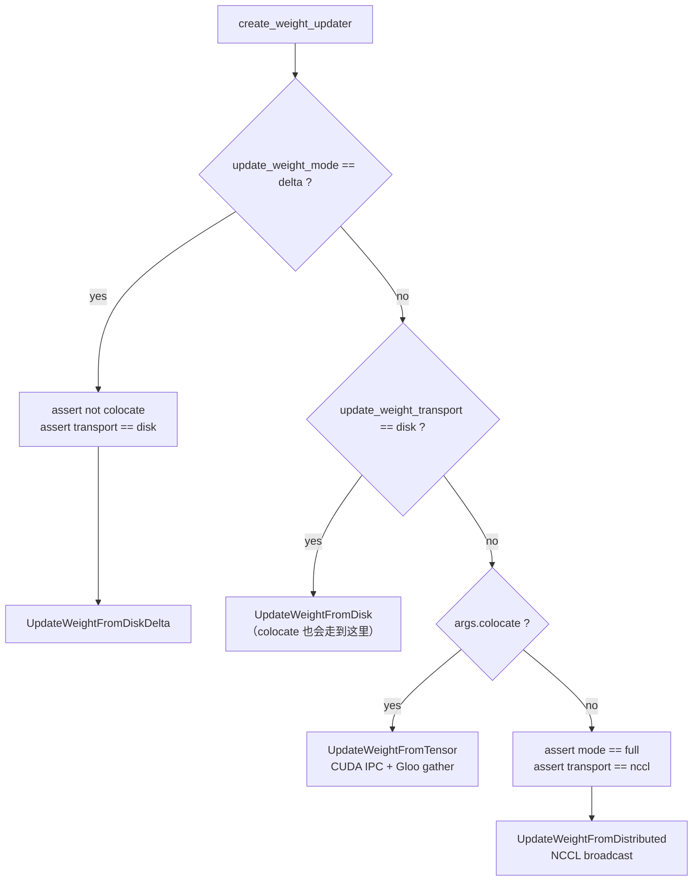
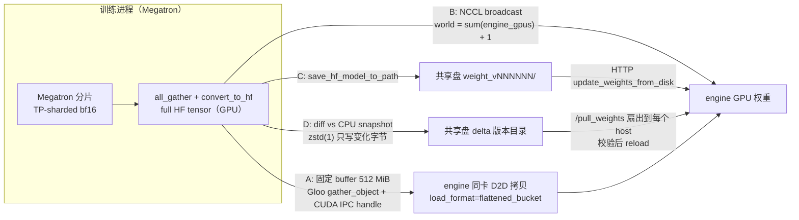
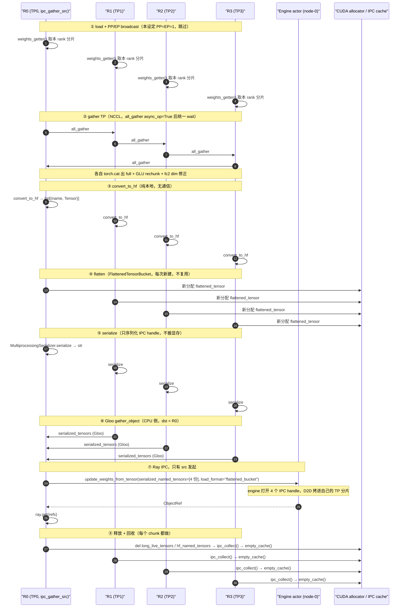
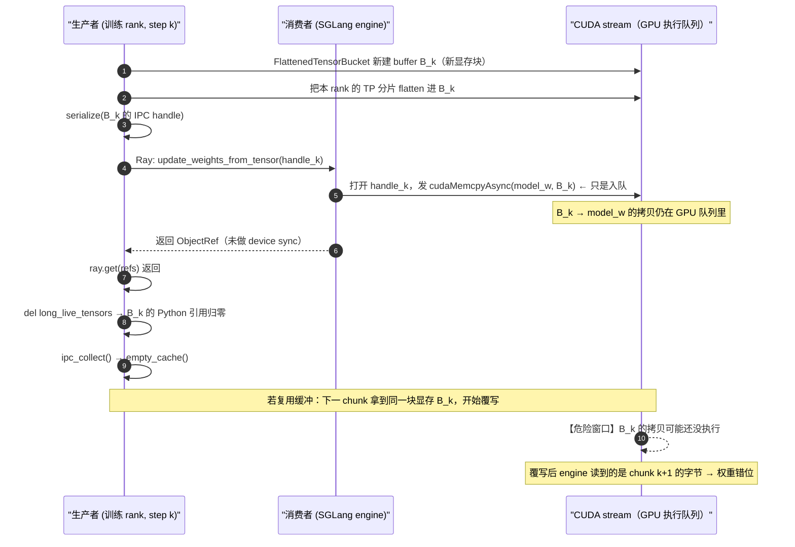
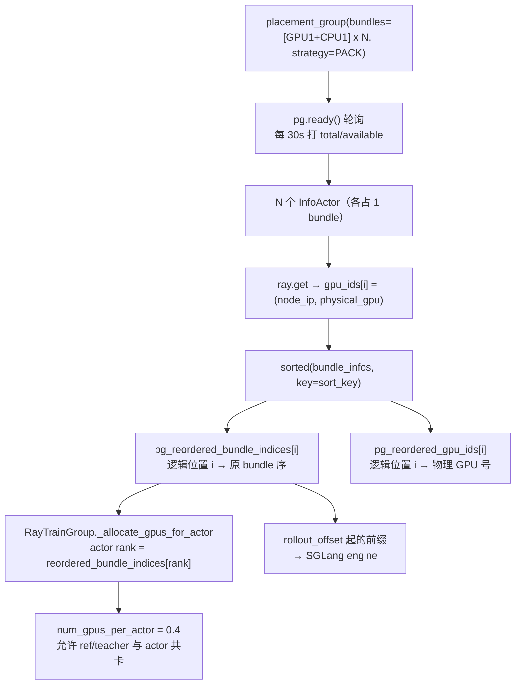
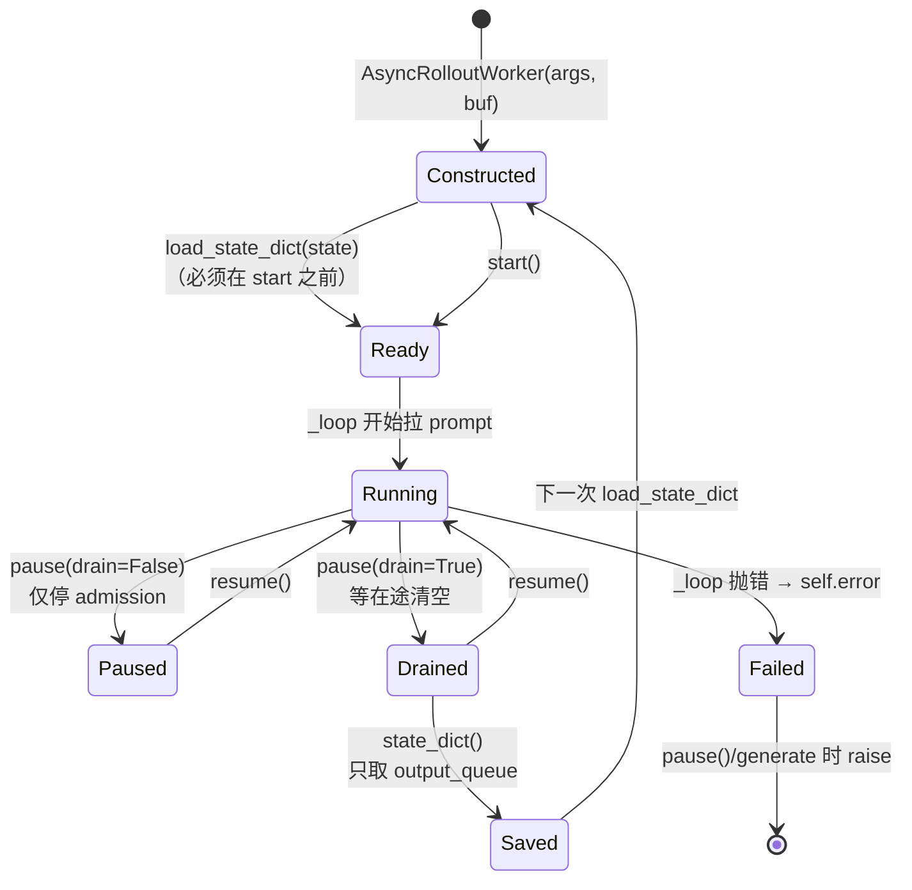
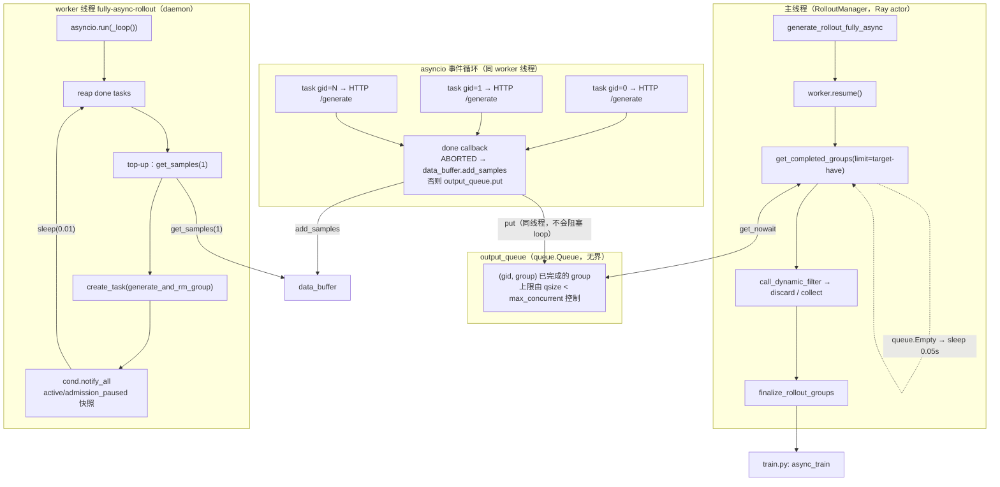
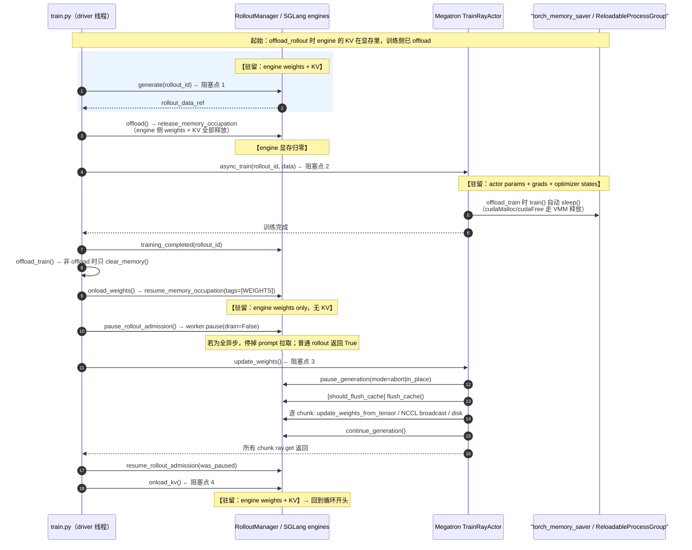
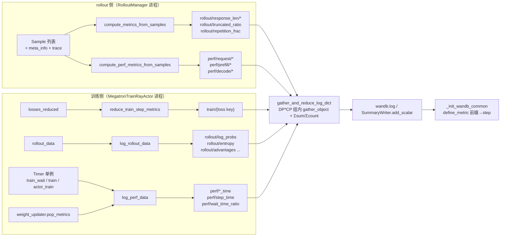

# 02 slime 源码级调研素材

> 基准：`slime` @ `0b0c277d5b4cc66efc3b6db269e2e5184e8f3b1e`（tag `v0.4.0`，release 2026-10-09）
> 取证方式：`git -C ~/Desktop/Projects/github/slime show "<commit>:<path>"`，行号均为该 commit 下 `sed -n 'A,Bp'` 逐条核对。
> permalink 基准：`https://github.com/THUDM/slime/blob/0b0c277d5b4cc66efc3b6db269e2e5184e8f3b1e/<path>#L<a>-L<b>`
> 本文只交付素材，不成文。括号内的「估算」标记表示该数字由本文推导，源码与文档都没有给出。

---

## 0. 全局坐标：slime 在异步形态四级里的位置（供 BRIEF §4 归位）

**结论**：slime 的**默认**形态是「同步」；它的「部分异步」和「全异步」不是四个独立的训练循环，而是**同一个 `train.py` 主循环 + 可替换的 rollout 函数**。

**权威原文（`docs/en/blogs/introducing_slime.md` L43-L45）**：

```markdown
Regarding training schemes, slime uses Ray for resource management, enabling **colocated** (same GPUs) or **decoupled** (separate GPUs) setups with a single flag (`--colocate`).

slime keeps a single training entrypoint, `train.py`. Fully-async behavior lives in the rollout implementation instead of a separate training loop: select `slime.rollout.fully_async_rollout.generate_rollout_fully_async` with `--rollout-function-path`. Its background worker keeps individual generations in flight and carries a warm queue across training steps.
```

**归位表**（按 BRIEF §4 的四级定义，用本文件的证据填写）：

| 形态 | slime 的开关 | 是否全局屏障 | 证据 |
| --- | --- | --- | --- |
| 同步 | 默认 `--rollout-function-path slime.rollout.sglang_rollout.generate_rollout` | 是 | `train.py` L47-L51：`generate` 返回才进 `async_train` |
| 部分异步 | `--partial-rollout`（配合 `--use-dynamic-batch-size`） | **是**（权重更新仍是全局屏障） | `sglang_rollout.py` L456-L473：abort 出的部分样本回填 data buffer |
| off-policy 异步 | `--flush-cache-interval != 1`（注释原文点名 PipelineRL） | 否（在途请求保留、KV 不 flush） | `arguments.py` L349-L359 |
| 全异步（样本队列） | `--rollout-function-path slime.rollout.fully_async_rollout.generate_rollout_fully_async` + `straw` transport | **否**（队列深度控 staleness） | `fully_async_rollout.py` 全文 |

**坑**：`--flush-cache-interval` 的帮助文本写死了「Values other than 1 select fully-async rollout by default and require separate GPUs」（`arguments.py` L357）。也就是说「保留在途序列」这件事在 slime 里**与 GPU 是否 colocate 绑定**——它不是一个纯算法开关。

---

## 1. 官方文档全读：73 个 md/rst 文件的清单与架构自述

**结论**：`docs/` 下共 **88 个文件**，其中 `.md` / `.rst` 源文件 **73 个**（正好等于任务书里的 73），其余是 7 张图片、2 个 CSS、1 个 JS、3 个构建脚本、1 个 `conf.py`、1 个 `requirements.txt`。英文 `docs/en/` 与中文 `docs/zh/` 是**严格镜像**（各 36 个页面），`index.rst` 分列。

### 1.1 清单（`git ls-tree -r --name-only <commit> -- docs` 按目录分组）

```text
docs/
├── README.md  conf.py  requirements.txt  build.sh  build_all.sh  serve.sh
├── _static/css/{custom_log.css, readthedocs.css}
├── _static/js/lang-toggle.js
├── _static/image/{arch.png, sglang_config.png, trace.png, logo.ico, logo.jpg,
│                  blogs/release_v0.1.0/{cuda_vmm.png, overrall.png}}
│
├── en|zh/index.rst
├── en|zh/advanced/            (13 页 × 2)
│     arch-support-beyond-megatron.md   delta-weight-sync.md
│     external-rollout-engines.md       fault-tolerance.md
│     low-precision.md                  megatron-config.md
│     observability.md                  on-policy-distillation.md
│     pd-disaggregation.md              reproducibility.md
│     sglang-config.md                  speculative-decoding.md
│     straw.md
├── en|zh/blogs/               (2 页 × 2)
│     introducing_slime.md              release_v0.1.0.md
├── en|zh/developer_guide/     (5 页 × 2)
│     ci.md  debug.md  install_flashqla.md  profiling.md  trace.md
├── en|zh/examples/            (9 页 × 2)
│     deepseek-r1.md  glm4-9B.md  glm4.7-30B-A3B.md  glm4.7-355B-A32B.md
│     glm5.2-744B-A40B.md  qwen3-30B-A3B.md  qwen3-4B.md
│     qwen3-4b-base-openhermes.md  qwen3-next-80B-A3B.md
├── en|zh/get_started/         (5 页 × 2)
│     agent.md  customization.md  qa.md  quick_start.md  usage.md
└── en|zh/platform_support/amd_tutorial.md   (1 页 × 2)
```

计数核对：`1 (index.rst) + 13 (advanced) + 2 (blogs) + 5 (developer_guide) + 9 (examples) + 5 (get_started) + 1 (platform_support) = 36`（每语言），`36 × 2 = 72`，加 `docs/README.md` 共 **73**。实测 `docs/en` 与 `docs/zh` 各 **36** 个页面，`docs/zh/platform_support/amd_tutorial.md` 存在，镜像关系成立。

### 1.2 官方架构自述（`docs/en/blogs/introducing_slime.md` L37-L41 + 图 `_static/image/arch.png`）

**结论文本**（L37-L41）：

```markdown
slime views the data sampling in RL differently. We manage all SGLang servers within slime with [sgl-router](...) and provide an interface for the data generation component, **allowing users to inject custom logic and freely interact with SGLang servers**. Unleash their creativity.


With the sgl-router, users only need to send HTTP requests to a single endpoint. By exposing this endpoint, complex agent environments can directly interact with slime through an OpenAI-compatible API — no need to modify the environment, and training-deployment consistency is preserved.
```

**README 对同一张图的三模块说明**（`README.md` L59-L65）：

```markdown

**Module Descriptions**:
- **training (Megatron)**: Responsible for the main training process, reads data from the Data Buffer, and synchronizes parameters to the rollout module after training.
- **rollout (SGLang + router)**: Generates new data (including rewards/verifier outputs) and stores it in the Data Buffer.
- **data buffer**: A bridge module that manages prompt initialization, custom data, and rollout generation methods (including agentic workflows that produce samples through the same interface).
```

**图的读法（三模块 + 两条边）**：`training(Megatron) --读/写--> data buffer <--写/读-- rollout(SGLang + sgl-router)`，外加一条 `training --参数同步--> rollout`。README 说的「Training, rollout, the data buffer, and environment feedback share one dataflow」（L11）是这张图的设计主张。

**第二张图**是 `sglang-config.md` L11-L15 的 `arch.png` + `sglang_config.png`，讲的是**一个 router 后面挂多组 server group**（多模型 / PD 分离 / 冻结 ref 模型）。这与权重同步的「非 colocate 引擎只会拿到一部分更新」直接相关（见 §2 表）。

### 1.3 六个 advanced 文档的要点摘录（排版用，勿直接抄进正文）

**`arch-support-beyond-megatron.md`（仅 19 行，最短的一篇）**

L3 原文：

```markdown
slime can extend a Megatron model by replacing selected layer specifications (`ModuleSpec`) with a custom implementation. Qwen3-Next 80B-A3B uses this approach for its Gated DeltaNet (GDN) layers, while retaining Megatron's full-attention layers, MoE blocks, and pipeline scheduling.
```

三个组成部分：`get_qwen3_next_spec` 只替换 HF config 里标 `linear_attention` 的层（并处理每个 PP stage 的 layer offset）；`HuggingfaceAttention` 先 gather 序列/上下文分片再算、再切回本地分片；权重 loader 把 HF 参数名映射到自定义模块。**限制原文（L17）**：「Its projections are not sharded by TP, so increasing TP does not reduce that module's parameter memory or computation」——即 **GDN 层是 TP 复制的**，加大 TP 只会多存一份（这对 §2 的显存账是一条重要修正：不能简单按 `1/TP` 折算）。

**`megatron-config.md`**：`--megatron-config-path` 只是「角色级覆盖」，**不管资源分配**。原文 L22 与 L130：

```markdown
- **Resource allocation is still controlled by CLI.** `num_nodes` and `num_gpus_per_node` in YAML are ignored; placement is still controlled by `--actor-num-*` / `--critic-num-*`.
...
No. Resource allocation and placement groups are still controlled by CLI arguments, and the corresponding YAML fields are ignored.
```

限制（L113-L118）：只支持 PPO actor/critic；**actor 与 critic 必须同并行拓扑**，否则「may fail during initialization or training」；**共用同一个 train placement group**（L115）。这条对 §5 的 PG 设计有约束意义。

**`fault-tolerance.md`**：默认开启，`--use-fault-tolerance` 只剩兼容性（L5）。三个组件（L72-L74）：

| 组件 | 职责 | 生命周期 |
| --- | --- | --- |
| `ServingCluster` | routers、SGLang engines、GPU 资源、Straw queue controller、**权重更新锁** | **named + detached**，活过创建它的 job |
| `RolloutManager` | 生成、读数据、样本转换、训练数据切分 | 可复用、可重建；重建不销毁 `ServingCluster` 的资源 |
| `TrainingRecovery` | 模型 checkpoint 边界与批次留存 | 持有 checkpoint 之后要重训的 batch |

关键量化（L80、L96-L98）：`--rollout-cleanup-timeout` 默认 **60 s**；三个 health-check 参数默认全是 **600 s**（`first-wait` / `interval` / `timeout`）。恢复约束：必须 `torch_dist` + RNG state，`--no-save-rng` 会被拒；换 TP/PP 可以恢复但「results are not guaranteed to be bitwise identical」（L55）。

**`external-rollout-engines.md`**：三条更新路径的选型表（L13-L17），以及**一条硬性禁配（L104）**：

```markdown
- Delta mode does not support `--colocate`, because colocated sync uses CUDA IPC handles and delta encoding does not reduce the actual transfer.
```

**`delta-weight-sync.md`**：传输方式是「训练端发布 canonical HF checkpoint 目录 → engine 的 `/pull_weights` 扇出到它跨的每一台 host 并校验 → engine 用**原生** `update_weights_from_disk` reload」（L8-L13）。两种编码语义（L72-L78）：`xor` 是**对合**（apply 两次会还原），`overwrite` 是**幂等**。压缩固定 zstd level 1，「profiling showed it dominates lz4 / gzip / snappy / brotli on both wire size and decompress speed」，因此**不做成旋钮**（L33）。

**`observability.md`**：见 §9，指标名清单已从代码重新提取（文档只列了一小部分）。

### 1.4 placement / colocate 相关文档的定位

`docs/` 里**没有** `placement.md` 或 `colocate.md`。placement 的一手材料只在这几处：

| 出处 | 说了什么 |
| --- | --- |
| `README.md` L67 | 默认载荷传输是 Ray `object-store`，可切 `straw` |
| `docs/en/get_started/qa.md` L11-L20 | 卡在 Ray 提交页：colocate 要 `GPU >= actor_num_nodes * actor_num_gpus_per_node`；decoupled 要 `>= actor + rollout_num_gpus` |
| `docs/en/advanced/megatron-config.md` L115 | actor / critic 共用同一个 train PG |
| `docs/en/blogs/introducing_slime.md` L43 | `--colocate` 一个开关切换（同卡 / 分卡） |
| `docs/en/advanced/fault-tolerance.md` L43 | colocate 时 trainer 必须能装进被保留的 GPU 额度 |

**结论**：PG 的内部机制（InfoActor 探测物理 GPU 号、`sort_key` 排序）**官方文档完全没有写**，只能从 `slime/ray/placement_group.py` 读——这正是 §5 的价值所在。

---

## 2. 五种权重同步的完整对比

**结论**：五个类不是五条并列路线，而是一棵**两级判定树**：先判 `update_weight_mode ∈ {full, delta}`，再判 `update_weight_transport ∈ {nccl, disk}`，最后判 `args.colocate`。树的每一片叶子都对应一个类，`UpdateWeightFromTensor`（colocate + nccl）与 `UpdateWeightFromDistributed`（非 colocate + nccl）是**唯一共用「GPU 上搬」这件事的两条路**。

### 2.1 工厂：`slime/backends/megatron_utils/update_weight/__init__.py` L10-L56

```python
def create_weight_updater(args, model, weights_getter, *, model_name, quantization_config):
    """Select and construct the weight updater for the configured transport."""
    update_weight_mode = args.update_weight_mode
    update_weight_transport = args.update_weight_transport

    if update_weight_mode == "delta":
        # Delta sync is disk-transport only: each engine's /pull_weights applies the published
        # deltas into a host-local checkpoint on every host it spans, and the engines reload
        # via vanilla update_weights_from_disk.
        assert not args.colocate, "--update-weight-mode=delta is not supported with --colocate"
        assert update_weight_transport == "disk", "--update-weight-mode=delta requires --update-weight-transport=disk"
        from .update_weight_from_disk_delta import UpdateWeightFromDiskDelta
        update_weight_cls = UpdateWeightFromDiskDelta
    elif update_weight_transport == "disk":
        from .update_weight_from_disk import UpdateWeightFromDisk
        update_weight_cls = UpdateWeightFromDisk
    elif args.colocate:
        from .update_weight_from_tensor import UpdateWeightFromTensor
        update_weight_cls = UpdateWeightFromTensor
    else:
        assert update_weight_mode == "full"
        assert update_weight_transport == "nccl", f"unsupported weight sync mode/transport: {update_weight_mode!r}/{update_weight_transport!r}"
        from .update_weight_from_distributed import UpdateWeightFromDistributed
        update_weight_cls = UpdateWeightFromDistributed
```

**读法**：`delta` 分支在最前面，且用 `assert` 硬拒两种组合。注意第二个 `elif`——**`--update-weight-transport disk` 会吞掉 `colocate` 分支**，也就是说 `--colocate --update-weight-transport disk` 静默地走 `UpdateWeightFromDisk`（写共享盘 + HTTP reload），**不走 IPC**。这是一个非显然的优先级坑：你以为 colocate 会走最快的 IPC，实际被 transport 参数截走了。

**图：判定树**



**状态**：这是 `if/elif` 链，不是状态机。真正有状态的判定在 `UpdateWeightFromDiskDelta` 里（`_needs_full_sync` 布尔位，见 §2.6）。

### 2.2 方案 A：`UpdateWeightFromTensor` —— colocate 专用的 CUDA IPC

**结论**：这条路是**唯一不需要在网络上搬字节**的：所有数据在「训练进程产出的 GPU 显存」与「推理进程持有的 GPU 显存」之间通过 **CUDA IPC handle** 直接做 device→device 拷贝，控制面走 Ray，集合通信只用来把 `TP` 个分片拼成完整张量。

**传输路径**（class docstring，`update_weight_from_tensor.py` L52-L58 原文）：

```python
class UpdateWeightFromTensor:
    """
    Update weight rollout engines from tensor dict:
    load(dict→GPU) → broadcast PP/EP(GPU NCCL) → gather TP(GPU NCCL) → convert HF(GPU) → send.
    Colocated: GPU→CPU serialize → gather_object(Gloo CPU, collects from rollout_num_gpus_per_engine ranks) → Ray IPC to engine.
    Distributed: GPU NCCL broadcast to remote engines.
    """
```

**两跳关键代码**。

第一跳是「GPU 上重排 + 转 HF」，在 `hf_weight_iterator_direct.py` L73-L134 的 `_get_megatron_full_params` 里，顺序是 **PP broadcast → EP broadcast → TP all-gather**：

```python
    # broadcast params across pp ranks
    if pp_size > 1:
        handles = []
        for info, param in zip(megatron_local_param_infos, params, strict=False):
            if info.src_rank in dist.get_process_group_ranks(mpu.get_pipeline_model_parallel_group()):
                handles.append(torch.distributed.broadcast(param, src=info.src_rank, group=mpu.get_pipeline_model_parallel_group(), async_op=True))
```

第二跳是「序列化 + Gloo `gather_object` + Ray IPC」，在 `update_weight_from_tensor.py` L403-L441 的 `_send_to_colocated_engine` 里：

```python
    serialized_tensors = []
    for _dtype, named_tensors in converted_named_tensors_by_dtypes.items():
        flattened_tensor_data = _build_flattened_tensor_data(named_tensors)
        long_live_tensors.append(flattened_tensor_data)
        serialized_tensors.append(MultiprocessingSerializer.serialize(flattened_tensor_data, output_str=True))

    serialized_named_tensors = (
        [None] * dist.get_world_size(ipc_gather_group) if ipc_gather_src == dist.get_rank() else None
    )
    dist.gather_object(serialized_tensors, object_gather_list=serialized_named_tensors, dst=ipc_gather_src, group=ipc_gather_group)

    refs = []
    if dist.get_rank() == ipc_gather_src:
        num_buckets = max(len(tensors) for tensors in serialized_named_tensors)
        ...
            refs.append(ipc_engine.update_weights_from_tensor.remote(**kwargs))
```

`kwargs` 里写着 `"load_format": "flattened_bucket"`（L438），这是 SGLang 侧认识这个格式的钥匙。

**为什么 `long_live_tensors` 要活到最后**：`MultiprocessingSerializer.serialize` 只序列化 **CUDA IPC 的共享内存 handle**（一个几十字节的字符串/bytes），真正的显存块仍由**训练进程**持有。如果训练进程在 engine 还没完成 `cudaMemcpy` 之前 `del` 掉这个 tensor，显存被 caching allocator 回收再分配，engine 侧拷到的就是脏数据。L391 + L406 的 `long_live_tensors` 与 L327 的 `del` 就是这条生命周期约束的落地。

**显存峰值**（估算，7B bf16 = 14 GB，见 §2.7 统一口径）：
- 每个 chunk 同时存在：megatron 分片（`14/TP` GB，本来就在）、gather 出的 full param 池（`14/TP × TP = 14 GB` 的分片副本 + `torch.cat` 结果 14 GB）、HF 转换结果（与 full 同量级）、flattened bucket（14 GB）。
- 单个 14 GB 的 chunk **装不下**，这也是为什么 `--update-weight-buffer-size` 默认只有 **512 MiB**（`arguments.py` L572-L578）：把 14 GB 切 ~28 个 chunk，每 chunk 峰值 ≈ `512 MiB × 4 ≈ 2 GiB`（4 来自 gather 池 / cat / HF / flatten 四份同尺寸副本）。

### 2.3 方案 B：`UpdateWeightFromDistributed` —— 非 colocate 的 NCCL 直发

**结论**：训练端只在 **PP 源 rank**（`DP=0 and TP=0`）上做转换与发送，每个 PP 源建一条独立进程组 `slime-pp_{pp_rank}`，组员 = 该 PP 源 rank + **所有 engine 的所有 GPU**。数据走一遍 NCCL broadcast，元数据（names/dtypes/shapes）走 Ray 参数。

**传输路径**（class docstring L26-L30）：

```python
class UpdateWeightFromDistributed:
    """
    Update distributed engines through a device process group. Each PP rank: group "slime-pp_{pp_rank}",
    only DP=TP=0 transfers. Non-expert (TP) and expert (EP) params separate.
    Subclasses override ``_send_weights`` / ``_on_chunk`` to inject per-mode behaviour.
    """
```

**进程组构造**（`update_weight_from_distributed.py` L297-L324）——注意 `world_size = sum(engine_gpu_counts) + 1`，那个 **+1 就是训练端的 rank 0**：

```python
    world_size = sum(engine_gpu_counts) + 1  # +1 for training rank 0
    # Compute cumulative rank offsets: engine i starts at cumulative[i] + 1.
    cumulative = [0]
    for c in engine_gpu_counts:
        cumulative.append(cumulative[-1] + c)
    backend = accelerator.weight_update_backend()
    refs = [
        engine.init_weights_update_group.remote(
            master_address=master_address, master_port=master_port,
            rank_offset=cumulative[i] + 1, world_size=world_size,
            group_name=group_name, backend=backend,
        )
        for i, engine in enumerate(rollout_engines)
    ]
```

**发送**（L347-L364）：元数据先 `.remote()` 出去，再对所有 tensor `dist.broadcast(param.data, 0, group=group, async_op=True)` 后统一 `wait()`——**先发控制、后发数据、数据批量化异步**。

**死锁防御**（L258-L260，注释原文）：

```python
        # Lock the rollout engines to prevent communication deadlock.
        while not ray.get(self.rollout_engine_lock.acquire.remote()):
            time.sleep(0.1)
```

**显存峰值**（估算）：PP 源 rank 上同时存在 full param（14 GB）+ HF 转换（14 GB），加 broadcast 的 buffer 就是 broadcast **直接读** `param.data`（不额外拷贝），所以峰值 ≈ `14 (full) + 14 (hf) = 28 GB` 当全模型一个 chunk；默认 512 MiB buffer 时 ≈ `512 MiB × 2 + 原始分片`。

### 2.4 方案 C：`UpdateWeightFromDisk` —— 落一份完整 HF checkpoint

**结论**：95 行，是**最简短**的一条。它把「搬字节」这件事外包给了文件系统 + SGLang 的 `update_weights_from_disk` 端点，slime 侧只负责「写对一份 canonical HF 目录」。reload 的调用权甚至不在它手里（L93-L95 注释）。

**传输路径 + 关键代码**（`update_weight_from_disk.py` L65-L95）：

```python
    @torch.no_grad()
    def update_weights(self) -> None:
        self.weight_version += 1
        version_dir = Path(self.args.update_weight_disk_dir) / f"weight_v{self.weight_version:06d}"
        if dist.get_rank() == 0:
            shutil.rmtree(version_dir, ignore_errors=True)
        dist.barrier(group=get_gloo_group())
        # every writing rank creates the dir itself: a non-POSIX shared filesystem may not surface
        # one rank's mkdir to another until commit
        version_dir.mkdir(parents=True, exist_ok=True)
        save_hf_model_to_path(self.args, version_dir, self.model, model_name=self.model_name,
                              quantization_config=self.quantization_config,
                              progress_desc="Save HF  weights for update from disk")
```

**读法**：`shutil.rmtree` 只在 rank0 做但不 barrier 前不删——注意顺序是「rank0 删 → barrier → 每个 rank 自己 `mkdir(exist_ok=True)`」，注释解释了为什么不能让 rank0 mkdir 后别人复用：**非 POSIX 共享文件系统在 commit 前看不到别的 rank 的 mkdir**。这是「对象存储挂载」这一类环境的通用坑。

第三段是 post-write hook（L87-L91）：

```python
        # every rank runs the hook (it gates itself): each container must publish
        # its own writes
        if self._post_write_hook is not None:
            self._post_write_hook(self.args, str(version_dir), list(self.rollout_engines))
```

**显存峰值**：**0**（相对 baseline）。它先把 GPU 张量转 HF 再 `save` 到磁盘，峰值是「一个 chunk 的 HF 转换副本」，与方案 B 同量级；**没有** `engine_gpu_counts` / `engine_gpu_offsets` 的使用（`connect_rollout_engines` L47-L56 只记下 engines，L58-L59 的 `disconnect_rollout_engines` 直接 `return`）——因为它不需要 NCCL 组。

### 2.5 方案 D：`UpdateWeightFromDistributed` 的「半路继承」——注意它不在同一个分支

**结论**：`UpdateWeightFromDiskDelta` 继承的是 **`UpdateWeightFromDistributed`**，不是 `UpdateWeightFromDisk`。这是一个容易看错的点：源码 L28 的 `from .update_weight_from_distributed import UpdateWeightFromDistributed` 与 L33 的 `class UpdateWeightFromDiskDelta(UpdateWeightFromDistributed)`。

**为什么这样设计**：它需要基类的 `_iter_non_expert_chunks()` / `_iter_expert_chunks()`（TP all-gather + EP all-gather + HF convert 的现成分块流水线），然后**只重写结尾**：把「NCCL broadcast 出去」换成「和 CPU snapshot 做 diff、写盘、`/pull_weights`」。基类的 `connect_rollout_engines`、`disconnect_rollout_engines`、`update_weights` 全部被覆盖（L69-L117），`_send_weights` 这个基类钩子**根本没被调用**。

**证据**：L86-L87 的 `disconnect_rollout_engines` 原文 `pass  # no NCCL groups to tear down`；L77-L78 注释 `The rollout_engine_lock the NCCL path uses isn't needed — the engine-side apply is serialized by a per-host flock.`

**坑**：因为继承了 `UpdateWeightFromDistributed`，`isinstance(x, UpdateWeightFromDistributed)` 对 delta 路径**为真**。如果有下游代码用它做「这是 NCCL 路径」的判断，会误判。

### 2.6 方案 E：`UpdateWeightFromDiskDelta` —— 只发变化的字节

**结论**：语义核心是「**保留一份上一次同步的 pinned-CPU snapshot，与本次 gather 出的 HF tensor 逐字节 diff，只把非零的 diff 压进 zstd 写盘**」。状态是 `self._snapshot: dict[str, np.ndarray]` + `self._needs_full_sync: bool`。

**关键代码 1：为什么不信任磁盘上的版本号**（L91-L107，注释原文）：

```python
        if self._needs_full_sync:
            # A failed update may have reached host-local checkpoints without
            # reaching GPU weights. Publish above every attempted disk version,
            # so pull() cannot mistake that stale local checkpoint for this one.
            version = [self.weight_version]
            if dist.get_rank() == 0:
                version[0] = max(
                    [self.weight_version]
                    + [int(path.name[8:]) for path in Path(self.delta_dir).glob("weight_v*") if path.name[8:].isdigit()]
                )
            dist.broadcast_object_list(version, src=0, group=get_gloo_group())
            self.weight_version = version[0]
```

**关键代码 2：diff 与压缩**（L243-L263）：

```python
        def diff_and_compress(name, buf, nbytes, pinned):
            if pinned:  # copy out and free the pinned buffer before the heavy diff/compress
                new = np.empty(nbytes, dtype=np.uint8)
                np.copyto(new, buf.numpy()[:nbytes])
                free_q.put(buf)
            else:
                new = buf
            old = snapshot[name]
            if self.delta_encoding == "xor":
                diff = new ^ old
                changed = int(np.count_nonzero(diff))
            elif self.delta_encoding == "overwrite":
                mask = new != old
                changed = int(np.count_nonzero(mask))
                diff = overwrite_encode(new, mask)
            ...
            compressed = np.frombuffer(zstandard.ZstdCompressor(level=1).compress(diff), dtype=np.uint8)
            return name, new, compressed, checksum(self.checksum_algorithm, new), changed
```

**`xor` 为什么最省**：未变化的字节 XOR 后为 **0**，而长零串对 zstd 近乎免费。`np.count_nonzero` 顺带给出了**密度**（changed/total），这就是 §9 里 `perf/update_weights_density` 的来源（L306）。

**显存峰值**：GPU 侧与方案 B 相同（一个 chunk 的 gather + HF）。**真正的新增在主机内存**：pinned buffer 池的容量公式（L237，估算推导见 §2.7）：

```python
            for _ in range(max(4, min(2 * NUM_WORKERS, (32 << 30) // max(max_bytes, 1)))):
                free_q.put(torch.empty(max_bytes, dtype=torch.uint8, pin_memory=True))
```

即「最多 32 GiB 的 pinned 池，且至少 4 个、至多 `2 × NUM_WORKERS` 个，每个能装下**最大的那一个** tensor」。`except RuntimeError` 兜底是 `low memlock limit` → 退回 pageable `.cpu()`。

**跨步状态**：`_needs_full_sync` 在三种情况置真——初始化（L59）、`connect_rollout_engines` 发现 engine 列表变了（L79-L80）、以及文档说的「trainer recovery or an engine replacement」。**这是它和另外四条路最大的结构性差别：只有它在跨步之间持有模型状态（CPU snapshot）**，所以它能算 delta，也必须付「每次 crash 都要重新 seed 一次全量」的代价。

### 2.7 五方案对比总表 + 7B bf16 量化

**统一假设（估算，全部标估算）**：模型 7B 参数 × bf16 = **14 GB** 有效权重；`TP=8, PP=1, EP=1`；每张卡暴露的显存带宽取 **H100 SXM 3.35 TB/s**，节点内 NVLink（每卡单向 **450 GB/s**），节点间 **400 Gb/s IB = 50 GB/s**（有效 ~45 GB/s）；共享盘（Lustre/NFS over IB）**10 GB/s** 写入、**10 GB/s** 读取；engine 侧 `update_weights_from_disk` 的重载速度按 **NVMe 6 GB/s/节点**。

| 方案 | 传输路径 | 关键通信原语 | 单卡 GPU 显存峰值（估算） | 传输量 | 理论传输时间（估算） | 适用条件 |
| --- | --- | --- | --- | --- | --- | --- |
| **A `FromTensor`** | 训练 GPU 分片 → `all_gather` 成 full → 转 HF → flatten → **CUDA IPC 共享内存** → engine 直接 D2D 拷 | NCCL all-gather（TP），Gloo `gather_object`，Ray IPC | ≈ `512 MiB × 4 ≈ 2 GiB`（默认 buffer） | 14 GB **但是 D2D** | `14 GB ÷ 3.35 TB/s ≈ 4.2 ms`（device 侧）+ 序列化/IPC 开销 | **必须 colocate**；engine 与 trainer 同机同卡 |
| **B `FromDistributed`** | 训练 PP 源 → **NCCL broadcast** → engine 所有 GPU | NCCL broadcast，Ray 传元数据 | ≈ `512 MiB × 2 ≈ 1 GiB` + broadcast buffer | 14 GB 走**网络** | `14 GB ÷ 45 GB/s ≈ 311 ms`（单 PP 源、单跨节点链路；多 engine 并行各自占一条） | 非 colocate，且 trainer 与 engine **能组 NCCL 组** |
| **C `FromDisk`** | 训练 → 写 **canonical HF checkpoint** → 每个 engine HTTP `update_weights_from_disk` | 文件系统写 + HTTP | ≈ 0（chunk 级 HF 副本） | 14 GB **写 + 每引擎读 14 GB** | 写 `14 GB ÷ 10 GB/s ≈ 1.4 s`；每引擎重载 `14 GB ÷ 6 GB/s ≈ 2.3 s`（串行 → 8 engine 时 **≈ 18 s**） | 非 colocate；两侧能看到同一路径；**支持跨 GPU 型号/厂商** |
| **D `DiskDelta`** | A→写盘前先与 CPU snapshot diff，只写变化字节 | 同上 + zstd(1) + xxh3-128 | ≈ 0（GPU）；**主机 pinned 池 ≤ 32 GB** | `density × 14 GB`，再 zstd | density 5% 时：`0.7 GB ÷ 10 GB/s ≈ 70 ms`，重载仍要 ~2.3 s（**瓶颈转移到 reload**） | **只支持 disk**；不支持 colocate；跨集群/跨 DC |
| **E `Direct`（迭代器）** | 不是独立 updater，是 A/B 共用的「分块 + gather + 转 HF」流水线 | — | 决定 A/B 的 chunk 粒度 | — | — | 不单独可选 |

**基准（无同步）**：7B bf16 在 TP=8 下每卡常驻 `14/8 = 1.75 GB`；方案 A 的 2 GiB 峰值已经把「每卡常驻」翻了一倍多——这就是为什么 colocate 下 `--update-weight-buffer-size` 不能调大，否则会和 KV cache 抢显存。

**校验一个非显然结论**：`arguments.py` L573-L574 的默认 buffer 是 `512 * 1024**2`。以 7B / 61 层估算，单层约 `230 MB`（attention + MLP + embedding/head 摊平），512 MiB 大约**每 chunk 1-3 层**。这意味着 7B 模型一次同步发出 **~20-60 个 chunk**，每个 chunk 都要一次 `ray.get` 往返 + `ipc_collect` + `empty_cache`（L322-L329）。**同步延迟被切碎成几十次往返**，这是 A 方案「传输时间只有 4 ms 但实测远大于此」的主要来源（估算，需要实测验证）。

**图：五方案的钱从哪走**



**坑清单**

1. `--colocate --update-weight-transport disk` **不会**走 IPC（§2.1 的 `elif` 顺序）。
2. delta 与 colocate 在工厂里 `assert` 硬拒，但文档 `external-rollout-engines.md` L104 给的理由是「CUDA IPC handles 下 delta 不减小实际传输」——即这是**设计判断**而不是实现缺陷。
3. `UpdateWeightFromTensor` 的 `pop_metrics()` 文档字符串明写「Empty under colocate today」（L188-L191），所以 **colocate 路径没有 `perf/update_weights_*` 指标**，只有 delta 路径有（L295-L314）。想在 colocate 下量化权重同步只能靠 `Timer`（`@timer` 装饰在 `actor.py` L627 的 `update_weights` 上 → `perf/update_weights_time`）。
4. `connect_rollout_engines_from_distributed` 的 `master_port` 是**每次连接随机绑定一个空闲端口**（L293-L297），所以断开/重建会换端口——恢复语义上要保证「重连一定重建组」。

---

## 3. IPC 路径的完整数据流（本系列最重要的一节）

**结论**：colocate 下的权重同步是一条**「NCCL 上重排、Gloo 上聚合、Ray 上传句柄、CUDA IPC 上拷贝」的四段式流水线**。四段用的通信设施各不相同，每一段的必要性都可以从并行语义或进程边界直接推出来。

### 3.1 类 docstring 的两条路线（`update_weight_from_tensor.py` L52-L58）

```python
class UpdateWeightFromTensor:
    """
    Update rollout engines from tensor dict:
    load(dict→GPU) → broadcast PP/EP(GPU NCCL) → gather TP(GPU NCCL) → convert HF(GPU) → send.
    Colocated: GPU→CPU serialize → gather_object(Gloo CPU, collects from rollout_num_gpus_per_engine ranks) → Ray IPC to engine.
    Distributed: GPU NCCL broadcast to remote engines.
    """
```

**术语对齐**：docstring 里的 `rollout_num_gpus_per_engine` 就是 `--rollout-num-gpus-per-engine`（= SGLang 的 `tp_size`，见 `arguments.py` L56-L61 的 help 原文「just like the tp_size in sglang」）。所以「collects from `N` ranks」= **一个 engine 对应的 TP 个训练 rank**。

### 3.2 四段流水线的落地位置

| 段 | 做什么 | 代码位置 | 通信设施 |
| --- | --- | --- | --- |
| ① load + PP/EP broadcast | 把「本 rank 有分片」和「本 rank 只有空壳」的参数统一成**每 rank 都有完整值** | `hf_weight_iterator_direct.py` L73-L134（`_get_megatron_full_params`） | NCCL（`mpu.get_pipeline_model_parallel_group()` / `get_expert_model_parallel_group()`） |
| ② gather TP | 把 TP 分片拼成 full | 同上 L131-L134 → `common.py` L59-L126（`all_gather_params_async`） | NCCL（`get_tensor_model_parallel_group()` / `get_expert_tensor_parallel_group()`） |
| ③ convert HF | Megatron 布局 → HF 布局（含 GLU 重排、MoE 维度修正） | `hf_weight_iterator_direct.py` L53-L70（`_convert_to_hf_named_tensors`） | 无通信 |
| ④ serialize + gather + IPC | flatten → 序列化 IPC 句柄 → Gloo 聚到一个 src → Ray 调 engine | `update_weight_from_tensor.py` L378-L443（`_send_to_colocated_engine`） | Gloo `gather_object` + Ray actor 调用 + CUDA IPC |

### 3.3 为什么 **TP 必须 gather**（不能各 TP rank 各发一份）

**原因 1（语义）**：SGLang engine 的 TP 世界与 Megatron 的 TP 世界**是两个独立进程**，它们的 TP 分片编号没有任何约定关系。Megatron 的 `RowParallelLinear` 按 `partition_dim=1` 切、`ColumnParallelLinear` 按 `partition_dim=0` 切，且在 **GLU 场景下 `linear_fc1` 的切法还要 rechunk**。看 `common.py` L42-L56：

```python
    partition_dim = param.partition_dim
    assert param.partition_stride == 1 or (
        param.partition_stride == 2 and "linear_fc1" in name
    ), "partition_stride != 1 is not supported"
    # TODO: here we did an extra copy during concat, maybe merge this with convert_to_hf is better?
    # TODO: check only GLU is used.
    if "linear_fc1.weight" in name or "linear_fc1.bias" in name:
        param_partitions = [p.chunk(2, dim=0) for p in param_partitions]
        param_partitions = [p[0] for p in param_partitions] + [p[1] for p in param_partitions]
```

`linear_fc1` 的 Megatron 切法是「每个 rank 拿到 `[gate; up]` 的同一段」，而 HF 要的是「前一半全是 gate、后一半全是 up」。所以**必须先 `torch.cat` 再重排**——这个操作只能在一个 rank 上对完整张量做。**如果各 TP rank 直接各发本地分片，engine 手里拼出来的 `linear_fc1` 权重就是错位的**。

**原因 2（维度）**：Megatron grouped MoE 的 `linear_fc2` 有个已知 bug 的补偿（L52-L54，注释原文 `# this is bug in megatron's grouped moe.`），也是 cat 之后才能改 `partition_dim`。

**原因 3（进程边界）**：`convert_to_hf` 是在完整张量上做的，见 `_convert_to_hf_named_tensors`，它的输入是 `megatron_full_params`。所以「HF 转换」这一步在文档上被放在 gather **之后**，不是偶然的顺序。

### 3.4 为什么 **PP/EP 必须先 broadcast**（而不是先 gather TP）

**原因 1（PP：每个 stage 只有一部分层的权重）**。`named_params_and_buffers` 会把每个 PP stage 的 local layer 索引加上 `layer_offset`（`common.py` L142-L146 + L176-L177）：

```python
    for vp_stage, model_module in enumerate(model):
        ...
            layer_offset = get_transformer_layer_offset(model_module.config, vp_stage)
```

然后 `_get_megatron_local_param_infos`（`hf_weight_iterator_direct.py` L174-L247）**解析出全模型的参数清单**，并用 `src_rank` 标记「这份参数的权威持有者」（L195-L196）：

```python
            size=param.numel() * param.element_size(),
            src_rank=rank,
```

PP 的收集方式（L199-L213）不是 all_gather，而是 `all_gather_object` 名字表 + **`min src_rank` 去重**（注释 L176-L178 原文：`resolve duplicates (MTP virtual PP) by min src_rank`）。去重之后，**每个 rank 手里都有一份完整清单，但只有 `src_rank` 那份是真的数据，其余是 `torch.empty`**：

```python
        else:
            params.append(torch.empty(info.shape, dtype=info.dtype, device=accelerator.current_device()))
```

这就决定了：**不先 broadcast，非 src_rank 上拿到的是未初始化显存**。而 `torch.empty` 的显存里是**上一轮遗留的权重（或垃圾）**，如果直接 gather，拼出来的张量会**一半是新的、一半是上一轮的**——而且不会报错。

**原因 2（EP：专家分给了不同 rank，且 src_rank 可能不在 EP 组内）**。L108-L124 有一段非显然的处理：

```python
    # broadcast params across ep ranks
    if ep_size > 1:
        handles = []
        for info, param in zip(megatron_local_param_infos, params, strict=False):
            if ".experts." in info.name:
                src_rank = (
                    info.src_rank
                    if info.src_rank in dist.get_process_group_ranks(mpu.get_expert_model_parallel_group())
                    else rank
                )
                handles.append(torch.distributed.broadcast(param, src=src_rank, group=mpu.get_expert_model_parallel_group(), async_op=True))
```

`else rank` 的意思是：**如果这个专家参数的 src_rank 不在这条 EP 通信链路里，就让「本 rank 自己」当 src**——一个「自广播」，语义上是 no-op，目的是让**所有 rank 参与同样的集合调用次数**，避免 NCCL 集合通信挂死。这是一个典型的「用自指向 broadcast 占位」的防御写法。

**原因 3（顺序对 PP 和 EP 有依赖）**：L95-L107 的 PP broadcast 里有个条件 `if info.src_rank in dist.get_process_group_ranks(mpu.get_pipeline_model_parallel_group())`。也就是说，**broadcast 的 src 是从 PP 组视角挑的**；一个参数的权威 rank 可能只在 PP 组内、也可能只在 EP 组内，两轮 broadcast 是**互补地覆盖**的，谁先谁后不能交换——EP broadcast 依赖 PP broadcast 已经把「非本 stage 的参数」补齐，否则 EP 组内的 `rank` 自广播会因为「它也没有权威数据」而把垃圾广播出去。

### 3.5 `_ipc_gather_group` / `_ipc_gather_src` / `engine_gpu_offsets` 的建立逻辑

**第一步：谁提供 `engine_gpu_offsets`**。它由 `RolloutServer.engine_gpu_offsets` 提供（`engine_group.py` L317-L327）：

```python
    @property
    def engine_gpu_offsets(self) -> list[int]:
        """Per-engine GPU offset for all node-0 engines, parallel to ``engines``.

        Accounts for placeholder groups that occupy GPU slots without creating engines.
        """
        offsets = []
        for g in self.server_groups:
            for j in range(len(g.engines)):
                offsets.append(g.gpu_offset + j * g.num_gpus_per_engine)
        return offsets
```

**注意 `placeholder` 语义**：一个 placeholder group **占着 GPU slot，但不创建 engine**。所以 `engine_gpu_offsets` 是有洞的，不是 `[0, 8, 16, ...]` 这种整齐等差数列。这就是 `connect_rollout_engines` 里 L113-L119 那个「dense fallback」分支存在的原因（注释原文：`# Fallback: assume engines are densely packed (no placeholder gaps).`）。

这段 offsets 经 `RolloutManager.get_updatable_engines_and_lock`（`rollout.py` L290-L298）打包成 6 元组送回每个训练 rank：

```python
        srv = self._get_updatable_server()
        engines = srv.engines if srv else []
        gpu_counts = srv.engine_gpu_counts if srv else []
        gpu_offsets = srv.engine_gpu_offsets if srv else []
        parallel_configs = srv.engine_parallel_configs if srv else []
        num_new = srv.num_new_engines if srv else 0
        return engines, self.rollout_engine_lock, num_new, gpu_counts, gpu_offsets, parallel_configs
```

**第二步：切分 colocate / distributed**（`update_weight_from_tensor.py` L121-L139）：

```python
        # Compute colocated engine count: engines whose GPUs fall within actor GPU range.
        total_actor_gpus = self.args.actor_num_nodes * self.args.actor_num_gpus_per_node
        colocate_engine_nums = 0
        for gpu_offset, gpu_count in zip(engine_gpu_offsets, engine_gpu_counts, strict=True):
            if gpu_offset + gpu_count > total_actor_gpus:
                break
            colocate_engine_nums += 1

        self.use_distribute = len(rollout_engines) > colocate_engine_nums
```

`break` 而不是 `continue` 是关键：前缀连续的 engine 算 colocate，**一旦遇到超出 actor GPU 范围的 engine，后面全部归 distributed**。这是一个「前缀切分」假设——它依赖 `engine_gpu_offsets` 单调递增。

**第三步：建 Gloo 组 + 选 src**（L160-L168，注释原文保留）：

```python
        # Create IPC Gloo gather groups (only on first call; partitioning is
        # fixed across reconnects).
        if self._ipc_gather_group is None:
            for i in range(colocate_engine_nums):
                group_ranks = list(range(colocate_gpu_offsets[i], colocate_gpu_offsets[i] + colocate_gpu_counts[i]))
                new_group = dist.new_group(ranks=group_ranks, backend="gloo")
                if self.rank in group_ranks:
                    self._ipc_gather_group = new_group
                    self._ipc_gather_src = colocate_gpu_offsets[i]
```

读法：**每个 engine 一个 Gloo 组**，组员是「该 engine 覆盖的那一段训练 rank」，**src = 这段的起始 rank**。`_ipc_gather_src` 就是 `engine_gpu_offsets[i]` 本身。

**第四步：rank → engine 的映射**（L170-L175）：

```python
        # Map training ranks to colocated engine actors.
        for i, engine in enumerate(self.rollout_engines):
            start = colocate_gpu_offsets[i]
            end = start + colocate_gpu_counts[i]
            if start <= self.rank < end:
                self._ipc_engine = engine
```

**坑**：这个映射是 `start <= rank < end` 的**半开区间匹配**。如果同一个 rank 同时落在两个 engine 的区间里（offsets 重叠，例如 placeholder 配置错误），后写的那次会**静默覆盖**前一次。源码里没有任何断言校验 `engine_gpu_offsets` 互不重叠。

**第五步：没拿到组的人怎么办**（L386-L389，注释原文）：

```python
    # Placeholder ranks (GPU slots reserved but no engine) have no gather group.
    # gather_object is only collective among group members, so we skip entirely.
    if ipc_gather_group is None:
        return [], None
```

这是「**一个放置错误不会变成挂死，而是变成静默跳过**」的设计——代价是**权重丢了也不会有人报错**。这是全文件最值得写进「边界与坑」的一处。

### 3.6 sequenceDiagram：4 个 rank 角色的完整时序

设定：`TP=4`，`PP=1`，`EP=1`，`--rollout-num-gpus-per-engine 4`，colocate，单节点 8 卡但只用 4 个训练 rank + 1 个 engine。角色：`R0..R3`（训练 rank，`_ipc_gather_src = 0`）、`Engine`（SGLang，4 个 GPU worker 但只有 node-0 的 actor 句柄被调用）、`Ray`（actor 调用通道）。



**读法（三个非显然点）**：

1. **只有 src 发 Ray 调用**（L419-L441），但**所有 4 个 rank 都参与 Gloo gather**。所以 R1/R2/R3 在 `⑧` 之后**并不知道 engine 拷贝完成了没有**——它们的 `del` 发生在 `gather_object` 返回之后，**早于** `ray.get`。这意味着 §4 的竞态窗口对 R1/R2/R3 比对 R0 更长。
2. **⑧ 的顺序是 `del` → `ipc_collect()` → `empty_cache()`**（L327-L329）。`ipc_collect` 是 `torch.cuda.ipc_collect()`（`torch_accelerator.py` L87-L90，`getattr(module, "ipc_collect", None)` 有则调、无则跳过，所以 NPU 后端上是 no-op）。它的作用是**回收「已被对端关闭」的共享显存块**——语义上依赖 engine 真的把 handle 还回来，所以必须在 `ray.get` 之后。
3. **`gather_object` 是 CPU 侧的 Gloo**，不占 GPU 带宽，但它**是同步阻塞的**——这意味着 4 个 rank 在这里对齐，`num_buckets` 取的是 `max(len(tensors) for tensors in serialized_named_tensors)`（L421）。**各 rank 的 dtype 分组数不一样时，会用 `_empty_flattened_tensor_data()`（L446-L450，一个 0 元素 uint8 张量）补齐**，所以 `num_buckets` 一致。

### 3.7 一句代码看懂「为什么是 IPC 而不是 NCCL」

`update_weight_from_tensor.py` L436-L441：

```python
            kwargs = {
                "serialized_named_tensors": serialized_tensors_for_dtype,
                "load_format": "flattened_bucket",
                "weight_version": str(weight_version),
            }
            refs.append(ipc_engine.update_weights_from_tensor.remote(**kwargs))
```

`**kwargs` 里**没有 device 张量**——`serialized_named_tensors` 是一串 `str`（IPC handle 的 pickle 结果）。**数据面完全不出这个节点、也不经过 Ray 的 object store**。这是 colocate 相比 NCCL 路径省下一整趟网络往返的根本原因。

**代价**：IPC handle 的有效性绑定**进程存活 + 显存地址不被回收**。这就是 §4 存在的理由。

---

## 4. 缓冲复用竞态：为什么每次都要新建 flattened tensor

**结论**：`_build_flattened_tensor_data` 故意**不复用**缓冲区。原因是 SGLang 的 `update_weights_from_tensor` 在**把 D2D 拷贝入队之后就返回 HTTP/Ray 响应**，**不保证 CUDA 同步**。生产者在 `ray.get` 返回后立刻覆写同一块显存，就会和消费侧的拷贝赛跑，**静默地把权重写坏**。

### 4.1 完整注释原文（`update_weight_from_tensor.py` L40-L49，一字不改）

```python
    # Do not reuse the IPC-facing flattened tensor. SGLang returns from the
    # HTTP/Ray request after enqueueing GPU copies into model weights, but it
    # does not guarantee a CUDA-device sync before the response. Reusing and
    # overwriting the same producer buffer immediately after ray.get can race
    # with the consumer-side copy and corrupt weights.
    flattened_tensor_bucket = FlattenedTensorBucket(named_tensors=named_tensors)
    return {
        "flattened_tensor": flattened_tensor_bucket.get_flattened_tensor(),
        "metadata": flattened_tensor_bucket.get_metadata(),
    }
```

**两个关键词**：
- `enqueueing` —— 入队，不是完成。CUDA 的 `cudaMemcpyAsync` 在**调用方 stream** 上排队，函数返回 ≠ 数据到齐。
- `corrupt weights` —— 失败模式是**权重内容错**，不是崩溃。这类 bug 在 RL 里会表现为 loss 抖动或 reward 爬不上去，很难归因到权重同步。

### 4.2 竞态时间线（生产者 / 消费者 / CUDA stream 三条泳道）



**关键的不对称**：`P` 的 `ray.get` 与 `S` 上的 `cudaMemcpyAsync` **没有任何顺序保证**。两者唯一的同步点是「同一个 CUDA device 上 stream 之间默认的隐式顺序」——但那是**同一个进程内**的语义，**跨进程（训练进程 vs engine 进程）不适用**。

### 4.3 框架给的防御：三道

**防御 1：不复用缓冲（L45）**。每 chunk 新建 `FlattenedTensorBucket`，让「上一 chunk 的 B 仍然存活」，engine 拿着它拷多久都不会被覆写。这是**用显存换正确性**。

**防御 2：每 chunk 都 `ipc_collect` + `empty_cache`（L327-L329）**：

```python
            del refs, long_live_tensors, hf_named_tensors
            accelerator.ipc_collect()
            accelerator.empty_cache()
```

`ipc_collect` 回收「已关闭的 IPC 显存」——只有 engine 真的关掉 handle 才会真正释放。所以**这两行的作用是让「不复用」的显存在下一次分配前能被复用**，否则 N 个 chunk 会累积 N 份显存。

**防御 3：末尾再收一次 + barrier（L335-L339）**：

```python
        dist.barrier(group=get_gloo_group())
        # After the barrier all engines have returned, so every rank's last-chunk
        # IPC handles are now released by the consumers.  Clean them up.
        accelerator.ipc_collect()
        accelerator.empty_cache()
```

注释原文说得很清楚：**barrier 之后 engine 全部返回，handle 才被消费者释放**。这是最后一块显存的清理时机。

**防御 4（专家权重路径独立一份，L256-L284）**：`_update_expert_weights` 里有同样的模式，而且用 `staging_buffers` **跨层复用**（L263-L264 注释：`Reuse staging across layers instead of fragmenting the CUDA allocator.`）。这与主路径「不复用」形成对照——**因为 expert staging buffer 的拷贝是同步等待完的**（L232-L233 的 `request.wait()` + L240-L241 的 `barrier` + `torch.cuda.synchronize()`），所以它敢复用。

**这个对照本身就是最好的证据**：框架不是「一律不复用」，而是「**知道哪条流是同步的、哪条不是**」。

### 4.4 量化：70B 模型分 8 个 chunk 时，不复用缓冲的显存倍数

**假设（估算）**：70B 参数 bf16 = **140 GB**；分为 **8 个 chunk**，每 chunk **17.5 GB**；`TP=8`，所以每 chunk 的**每个 rank** 摊 `17.5 / 8 = 2.1875 GB`。

| 策略 | 每个 rank 的 flattened 显存峰值 | 倍数 |
| --- | --- | --- |
| **复用同一块缓冲**（危险） | `2.1875 GB` | **1×** |
| **每 chunk 新建、但 chunk 间已回收**（实际策略） | `2.1875 GB`（+ 上一块在 `empty_cache` 前短暂共存 → 最坏 `4.375 GB`） | **1× ~ 2×** |
| **每 chunk 新建且全部不回收**（假想的最坏实现） | `2.1875 × 8 = 17.5 GB` | **8×** |

**结论的正确读法**：不复用的**代价不是 8 倍**，因为 `ipc_collect + empty_cache` 让它收敛到 1-2 倍。真正的 8 倍只出现在「既不回收又不复用」这种假想实现里。而**如果去掉 `ipc_collect`**（只 `empty_cache`），IPC 引用计数不为 0 的块不会被释放，会**真的退化成 8 倍**。

**验证这一点的方法（不需要 GPU）**：把 L327-L329 三行换成只有 `del`，然后看 `print_memory("after update_weights")`（`actor.py` L676-L678）的打点是否随 chunk 数线性增长。

**再补一个量化维度**：每 chunk 的 `ray.get` 往返。设单次 Ray RPC 往返 **2 ms**（估算，同节点），8 个 chunk × 8 个 rank 的串行点其实只有 src 的 8 次往返 → `8 × 2 ms = 16 ms`。**对比 §2.7 的 4.2 ms D2D 传输，控制面往返已经超过数据搬运本身**。这就是为什么「IPC 路径的瓶颈通常在 RPC 数量，不在带宽」。

---

## 5. placement group 与物理卡排序

**结论**：Ray 的 `placement_group(bundles, strategy="PACK")` 只保证「拿到 N 个 GPU bundle」，**不保证 bundle 序与物理 GPU 序、节点序有任何关系**。slime 用 `InfoActor` 逐个 bundle 探测 `(node_ip, physical_gpu_id)`，再用 `sort_key` 重排成「按节点 IP 升序、节点内按 GPU id 升序」的稳定顺序，并把**重排后的 bundle index 数组**一路传到 `RayTrainGroup`。这一步决定了 Megatron 的 `rank → (node, gpu)` 映射，进而决定 NCCL/NVLink 通信是否落在同一条 NVLink 域里。

### 5.1 探测：`InfoActor` + bundle 索引（`slime/ray/placement_group.py` L18-L21 + L72-L91）

```python
@ray.remote(num_gpus=1)
class InfoActor:
    def get_ip_and_gpu_id(self):
        return ray.util.get_node_ip_address(), ray.get_gpu_ids()[0]
```

```python
    info_actors = []
    for i in range(num_bundles):
        info_actors.append(
            InfoActor.options(
                scheduling_strategy=PlacementGroupSchedulingStrategy(
                    placement_group=pg,
                    placement_group_bundle_index=i,
                ),
            ).remote()
        )
    gpu_ids = ray.get([actor.get_ip_and_gpu_id.remote() for actor in info_actors])
    for actor in info_actors:
        ray.kill(actor)

    bundle_infos = [(i, gpu_ids[i][0], gpu_ids[i][1]) for i in range(num_bundles)]
    sorted_bundle_infos = sorted(bundle_infos, key=sort_key)
    pg_reordered_bundle_indices = [info[0] for info in sorted_bundle_infos]
    # Map from logical index -> physical GPU ID
    pg_reordered_gpu_ids = [gpu_ids[info[0]][1] for info in sorted_bundle_infos]
```

**读法**：每个 bundle 起一个**只活几毫秒**的 `InfoActor`，`ray.get_gpu_ids()[0]` 返回的是 Ray 分配的物理 GPU 序号（`CUDA_VISIBLE_DEVICES` 里的那个数字，**在本任务视角下**）。探测完立刻 `ray.kill`。成本：`2 × num_bundles` 次 Ray 往返 + `num_bundles` 次 actor 创建（估算，8 卡约几十毫秒量级）。

**`gpu_ids` 的 list 下标 = bundle index**，因为 `[actor.get_ip_and_gpu_id.remote() for actor in info_actors]` 是按 `i` 顺序建的。所以 `gpu_ids[i]` = 「第 i 个 bundle 落在哪」。

### 5.2 `sort_key` 的定义（L24-L42）

```python
def sort_key(x):
    index, node_identifier, gpu_id = x
    # Sort by node IP number and then by GPU ID
    try:
        # try to parse it as an IP address.
        ip_address = node_identifier
        node_ip_parts = list(map(int, ip_address.split(".")))
    except ValueError:
        # Try to resolve the hostname to an IP address.
        try:
            ip_address = socket.gethostbyname(node_identifier)
            node_ip_parts = list(map(int, ip_address.split(".")))
        except (socket.gaierror, TypeError):
            # Instead, we convert each character of the original identifier string
            # to its ASCII value. This provides a stable and consistent numerical
            # representation that allows for sorting.
            node_ip_parts = [ord(c) for c in node_identifier]

    return (node_ip_parts, int(gpu_id))
```

**三级降级**（都写在注释里）：
1. 已经是 IPv4 点分十进制 → 直接 `list(map(int, split(".")))`。**返回值是 list，不是 int**——这意味着它是**字典序**比较，`[10,1,0,5] < [10,10,0,5]` 为真（`1 < 10`），但 `[10,1,0,5] < [9,255,255,255]` 为假。**字典序与数值序在第三段会分歧**。
2. 不是 IP → `socket.gethostbyname` 解析主机名再走 1。
3. 解析失败 → `[ord(c) for c in node_identifier]`，逐字符 ASCII。**这是最后的安全网**：至少给出一个稳定的全序。

**坑 1**：`sort_key` 返回值里第一个元素是 **list**，第二个是 **int**。Python 的 tuple 比较在第一个元素不等时不会比较第二个，所以 `(list, int)` 这种混合类型能工作；但如果两个节点 IP 的**字符长度不同**（降级路径 3），list 比较长度不同也不会抛错。

**坑 2**：`sort_key(x)` 里 `index` 参数**在函数体内完全没用**。所以 `sorted` 是**稳定排序**，相同 `(node_ip, gpu)` 的两条记录保持原 bundle 序——这个「按构造不可能发生」（物理 GPU 唯一）的性质保证了排序是**确定性的**，但不构成**双射保证**。源码里没有断言 `len(set(reordered)) == num_bundles`。

### 5.3 排序前后的映射示例表（8 卡 × 2 节点）

设集群里两个节点 `10.0.1.100`（NODE-A）和 `10.0.1.101`（NODE-B），Ray 的 `PACK` 策略分配后 bundle 序与物理序错位（这是真实场景：第二个节点先注册、或者前一任务的 bundle 释放顺序不同）。

**排序前**（`gpu_ids` 的原始顺序，即 `bundle_infos`）：

| bundle index | node | physical gpu id | 排序后位置 |
| --- | --- | --- | --- |
| 0 | 10.0.1.101 (B) | 3 | 11 |
| 1 | 10.0.1.100 (A) | 5 | 5 |
| 2 | 10.0.1.101 (B) | 1 | 9 |
| 3 | 10.0.1.100 (A) | 2 | 2 |
| 4 | 10.0.1.101 (B) | 0 | 8 |
| 5 | 10.0.1.100 (A) | 7 | 7 |
| 6 | 10.0.1.101 (B) | 6 | 14 |
| 7 | 10.0.1.100 (A) | 0 | 0 |

**排序后**（`sorted_bundle_infos`，`sort_key` 升序）：

| 逻辑位置 i | `pg_reordered_bundle_indices[i]` | node | `pg_reordered_gpu_ids[i]` | Megatron rank |
| --- | --- | --- | --- | --- |
| 0 | 7 | A | 0 | 0 |
| 1 | 3 | A | 2 | 1 |
| 2 | 1 | A | 5 | 2 |
| 3 | 5 | A | 7 | 3 |
| 4 | 4 | B | 0 | 4 |
| 5 | 2 | B | 1 | 5 |
| 6 | 0 | B | 3 | 6 |
| 7 | 6 | B | 6 | 7 |

**对照排序前直接用原始 bundle 序**（即不排序）：

| Megatron rank | node | physical gpu id | 问题 |
| --- | --- | --- | --- |
| 0 | B | 3 | 与 rank 1 跨节点（NCCL 走 IB） |
| 1 | A | 5 | 与 rank 0 跨节点 |
| 2 | B | 1 | 与 rank 3 跨节点 |
| 3 | A | 2 | — |
| 4 | B | 0 | — |
| 5 | A | 7 | 与 rank 4 跨节点 |
| 6 | B | 6 | 与 rank 7 跨节点 |
| 7 | A | 0 | — |

**结论**：不排序时，**TP/EP 组内的 8 个 rank 里有一半落在另一个节点上**，每次 all-reduce/all-gather 都跨 IB；排序后，**前 4 个 rank 全部落在 A 节点、后 4 个落在 B 节点**，`TP=4` 的组内通信全部走 NVLink。

### 5.4 为什么需要排序（NVLink 拓扑）

**原因 1：NCCL 的拓扑发现依赖 rank 到设备的映射**。NCCL 从 `CUDA_VISIBLE_DEVICES` 的序推不出「rank 0 和 rank 1 是不是同一块 NVSwitch 域里的」，它靠环形/树形算法在**已建立通信的 rank 集合**上做探测。当 TP 组内的 rank **全在同一节点**，NCCL 才有机会选到 NVLink 路径（`NCCL_ALGO=RING` 下的 NVLink ring）；跨节点就退回 IB。

**原因 2：Megatron 的 `rank → 并行维度` 是纯算术**。`RankGenerator` 按 `tensor_parallel_size / pipeline_model_parallel_size / data_parallel_size` 把全局 rank 切成组，**组号连续**。所以「rank 0..TP-1 是同一个 TP 组」是一个**隐含前提**。`sort_key` 就是把这个前提映射到物理拓扑上的那一步。

**原因 3：decoupled 模式下 actor 与 rollout 共用同一个 pg 的**前缀**。见 L144-L145：

```python
    rollout_pg_reordered_bundle_indices = actor_pg_reordered_bundle_indices[rollout_offset:]
    rollout_pg_reordered_gpu_ids = actor_pg_reordered_gpu_ids[rollout_offset:]
```

`rollout_offset` 来自 `_get_placement_group_layout`（L103-L120）。在非 colocate 场景 `return actor_num_gpus + args.rollout_num_gpus, actor_num_gpus`（L120），即**一个 pg 里前 `actor_num_gpus` 个 bundle 给训练、后 `rollout_num_gpus` 个给推理**，共享同一套排序。这保证了「训练侧内部」和「推理侧内部」都是节点连续的。

**量化**：设 TP=8 且都在单节点 → 一次 all-gather 走 **NVSwitch（H100 约 450 GB/s/卡 单向）**；若退化成跨节点 → **50 GB/s**（400 Gb/s IB 有效带宽），**慢 9 倍**。7B 模型的 TP gather 要搬 14 GB（§2.7），代价从 `14/450e3 s ≈ 31 ms` 变成 `14/50 s ≈ 280 ms`。

### 5.5 `num_gpus_per_actor=0.4` 的来源与含义

**原文**（`slime/ray/placement_group.py` L157-L177 的 `allocate_train_group`）：

```python
def allocate_train_group(args, num_nodes, num_gpus_per_node, pg, role="actor", with_ref=False, with_opd_teacher=False, actor_cls=None):
    return RayTrainGroup(
        args=args,
        num_nodes=num_nodes,
        num_gpus_per_node=num_gpus_per_node,
        pg=pg,
        num_gpus_per_actor=0.4,
        role=role,
        with_ref=with_ref,
        with_opd_teacher=with_opd_teacher,
        actor_cls=actor_cls,
    )
```

**它落到哪**（`slime/ray/actor_group.py` L120-L131）：

```python
        for rank in range(world_size):
            actor = TrainRayActor.options(
                num_cpus=num_gpus_per_actor,
                num_gpus=num_gpus_per_actor,
                scheduling_strategy=PlacementGroupSchedulingStrategy(
                    placement_group=pg,
                    placement_group_bundle_index=reordered_bundle_indices[rank],
                ),
            ).remote(world_size, rank, master_addr, master_port)
```

**含义**：`num_gpus_per_actor` 是**要向 pg 的某个 bundle 借多少 GPU 配额**。每个 bundle 里只有一个 `{"GPU": 1, "CPU": 1}`（L50），而一个 bundle 上可能要放 **不只一个** Ray actor：

| 角色 | 每个 bundle 上要放的 actor | GPU 配额合计 |
| --- | --- | --- |
| 只有 actor | 1 个 `MegatronTrainRayActor` | 0.4 |
| actor + ref（`with_ref`，KL 不为 0） | 2 个 | 0.8 |
| actor + ref + opd_teacher | 3 个 | **1.2 > 1.0** |

**这里有一个真实的余量问题**：0.4 意味着**一个 bundle 理论最多能放 2 个 actor（0.8 ≤ 1.0），第 3 个会超**（1.2 > 1.0）。而 `with_ref`（`kl_coef != 0 or use_kl_loss`，见 L195）与 `with_opd_teacher`（L196）是可以**同时为真**的。源码里没有任何断言保证「0.4 × actor 数 ≤ 1.0」。

**所以 0.4 的真实语义是「乐观的分数配额」**：Ray 的 `num_gpus` 在 placement group 里是**逻辑配额**，作用域是「能不能放进这个 bundle」，不是「实际占多少显存」。真正的显存占用由进程内 `torch.cuda` 决定。它的工程目的是：
1. **允许 ref / teacher 与 actor 共享同一块物理卡**（这正是 colocate 的显存预算方式）；
2. **让 Ray 在 bundle 内做二级装箱**，从而避免 ref 被调度到另一个 bundle 上去（那样 ref 就不能和 actor 共享 NCCL 组了）。

**坑**：`num_cpus` 也用了 `num_gpus_per_actor`（L125），所以一个 8 卡节点上放 8 个 actor 时，**CPU 配额只被占了 3.2 个**（0.4×8）。如果同一节点上还有 SGLang engine 也在抢 CPU（colocate），CPU 的记账是虚的——`{"CPU": 1}` 的 bundle 声明了 1 个 CPU，但 actor 只占 0.4，SGLang 侧没有走这个 pg 的 bundle 记账。

### 5.6 建 PG 的等待策略（L54-L70）——一个运维级别的细节

```python
    # Wait for the placement group to be scheduled. Poll rather than a bare
    # ray.get(pg.ready()) so the wait is observable: when it can't be placed yet
    # (a node's GPUs haven't registered with the GCS, or an autoscaler is still
    # bringing nodes up) log the GPU counts periodically instead of hanging with no
    # output. The wait stays unbounded, so autoscaling clusters — where a pending
    # placement group is what drives scale-up — are unaffected.
```

**为什么不 `ray.get(pg.ready())`**：会**无限静默挂起**。改成 30 秒打一次日志（L62 `log_interval = 30`），日志里有 `total` / `available` 两个 GPU 数，能直接区分「集群没资源」和「资源有但调度失败」。**`while` 循环没有上限**——注释明说这是为了配合 autoscaler（pending PG 本身就是扩容信号）。

**量化**：一次 PG 创建要探测 `num_bundles` 个 GPU，`num_bundles = actor + rollout` 卡数。8 卡 colocate + 8 卡 actor = 8 bundle；`2 × 8 = 16` 次 Ray 往返。

### 5.7 四种部署形态的 PG 布局（`_get_placement_group_layout` L103-L120）

| 场景 | `num_gpus` | `rollout_offset` | 含义 |
| --- | --- | --- | --- |
| `--debug-train-only` | `actor` | 0 | 不要 rollout |
| `--rollout-external` + `--debug-rollout-only` | `actor` | 0 | 外部引擎，自己不占 rollout 卡 |
| `--rollout-external`（正常） | `actor` | `actor` | rollout 侧只用「同尺寸的影子区间」，实际不建 bundle 给 SGLang |
| `--debug-rollout-only` | `rollout` | 0 | 不要训练 |
| **`--colocate`** | `max(actor, rollout)` | **0** | **训练与推理吃同一批 bundle** |
| 非 colocate 默认 | `actor + rollout` | `actor` | 两个区间；**一个 pg，两段前缀** |

**注意 colocate 的 `max`**：如果 `rollout_num_gpus > actor_num_gpus`，PG 会开 `rollout_num_gpus` 个 bundle，但训练只用前 `actor_num_gpus` 个（`RayTrainGroup.world_size = num_nodes × num_gpus_per_node`）。**多出来的 bundle 上没有训练 actor**，它们专门给 SGLang engine 用——这时候 `engine_gpu_offsets` 会出现「超出 actor 范围」的 engine，§3.5 的 `colocate_engine_nums` 就会 `break`，那些 engine 被归到 **distributed（NCCL）** 分支。

**这是一个非显然的组合**：`--colocate` 且 `rollout_num_gpus > actor_num_gpus` 时，**PG 是共享的（同卡）但权重同步走 NCCL 而不是 IPC**。这也解释了为什么 `UpdateWeightFromTensor` 里要同时保留 `use_distribute` 分支（L129-L152）。

**图：PG → 每个 actor 的落位**



**状态**：这是一条**一次性的确定化过程**，没有状态机。真正的状态在 `RayTrainGroup` 的 `_disk_weight_version` / `_actor_handlers`（`actor_group.py` L59-L60）。

---

## 6. 全异步 `AsyncRolloutWorker` 的并发模型

**结论**：`AsyncRolloutWorker` 是「**一个 daemon 线程跑一个 asyncio 事件循环 + 一个无界 `queue.Queue` 做跨线程输出**」的两层结构。它把「并发度」与「`rollout_batch_size`」解耦：队列常暖，`train.py` 每一步只从队列里取它需要的那几个 group，**多出来的留在队列里给下一步用**。

### 6.1 三层并发边界

| 层 | 跑在哪 | 负责 | 不负责 |
| --- | --- | --- | --- |
| 主线程 | Ray actor 的 `RolloutManager` 线程 | `generate_rollout_fully_async` 的循环：从队列抽 group、跑 filter、调 `finalize_rollout_groups` | 不直接发 HTTP |
| worker 线程 `fully-async-rollout` | `threading.Thread(daemon=True)`（L104-L107） | `asyncio.run(self._loop())`，10 ms 轮询（`poll_interval = 0.01`） | 不阻塞等训练 |
| asyncio loop | 上面那个线程里 | 每个 group 一个 `asyncio.create_task(generate_and_rm_group(...))` | 不自己写队列 |

### 6.2 无界队列的注释原文（L92-L97）

```python
        # Unbounded on purpose: put() runs inside the event-loop thread (task
        # done-callback), so a bounded queue that fills up would block the loop
        # and freeze every in-flight generation. Backpressure lives in _loop()
        # instead, which stops topping up while a full pool of completed groups
        # is already waiting to be consumed.
        self.output_queue: queue.Queue[tuple[int, list[Sample]]] = queue.Queue()
```

**读法（三层因果）**：
1. `put()` 发生在 **done-callback** 里（L241-L263 的 `_make_done_cb`），而 callback 跑在**事件循环线程**上。
2. 如果队列有界且已满，`put()` 会**阻塞事件循环线程**。
3. 事件循环被阻塞 → **所有在途生成任务的 I/O 回调都无法推进** → 全部冻结，而且不只是新任务，**已经在解码的也会停**（SSE 读取的回调进不来）。

**所以有界队列在这里比无界更危险**：无界只损失内存，有界会死锁整个 worker。

**背压放在哪**（L194-L202，注释原文）：

```python
                # Top up. The qsize gate is the queue's backpressure: once a
                # full pool of completed groups is waiting, stop pulling new
                # prompts until the training side drains some.
                while (
                    len(active_tasks) < max_concurrent
                    and self.output_queue.qsize() < max_concurrent
                    and self.running
                    and not self.paused
                ):
```

两个上界：`len(active_tasks) < max_concurrent`（在途数）**且** `qsize() < max_concurrent`（积压数）。所以**稳态下最多 `2 × max_concurrent` 个 group 在系统里**（一半在飞、一半在队里）。

### 6.3 `concurrency // n_samples_per_prompt` 的除法（L85）

```python
        self.concurrency = max(1, concurrency // getattr(args, "n_samples_per_prompt", 1))
```

而 `concurrency` 的实参来自 `_get_worker`（L66-L68）：

```python
            worker = AsyncRolloutWorker(
                args, data_buffer, concurrency=args.sglang_server_concurrency * get_rollout_num_engines(args)
            )
```

**语义**：`args.sglang_server_concurrency` 是**单个 SGLang server 的并发请求数**，乘 engine 数得到「全集群能同时处理的**单条请求**数」。而这里的 task 粒度是**一个 group**（= 一个 prompt 的 `n_samples_per_prompt` 条样本）。所以要除一次。

**为什么要除**：SGLang 的并发上限是**请求级**的。一个 group 会扇出成 `n` 个请求（`generate_and_rm_group` 内部），如果 worker 按 group 为粒度做 `concurrency` 个并发 task，**实际请求数 = concurrency × n > 服务器容量**，会排在 SGLang 的队列里，反而拉高 queue time（这个指标 §9 会提取）。

**坑 1（向下取整的静默损失）**：`//` 是 floor。`args.sglang_server_concurrency = 100`，`n = 8` → `100 // 8 = 12` group，实际请求 `12 × 8 = 96`，**浪费 4 个并发槽**。`n` 越大浪费越多。
**坑 2（除到 0 的兜底）**：`max(1, ...)` 保证至少 1 个 group。所以 `sglang_server_concurrency × engines < n` 时会**超发**（1 个 group 就 n 个请求 > 容量）。这是「宁可超发也不停」的取舍。
**坑 3（docstring 与代码的错位）**：模块 docstring L13-L15 说「Concurrency is sourced from `args.sglang_server_concurrency` and scaled by the number of sglang engines to **match the per-sample semaphore cap** in `slime.rollout.sglang_rollout`」——它说的是「匹配每样本信号量上限」，但代码里**没有**用 `sglang_rollout` 的 semaphore 对象，只是数值推算。如果那边改了上限，这里不会自动跟随。

### 6.4 pause / resume / state_dict / load_state_dict 的暂停-恢复协议

四个方法构成一条**严格的检查点协议**，其中 `state_dict` 会在状态不对时**抛异常而不是返回脏数据**。

**`pause`（L109-L117）**：

```python
    def pause(self, *, drain=True):
        with self.condition:
            previous = self.paused
            self.paused = True
            while self.running and self.error is None and (not self.admission_paused or (drain and self.active)):
                self.condition.wait()
            if self.error is not None:
                raise self.error
            return previous
```

读法：先置 `paused = True`（`_loop` 的 top-up 条件里有 `not self.paused`，所以**不再拉新 prompt**），再等两个条件同时成立：
- `admission_paused` 为真 —— `_loop` 每轮把它同步成 `self.paused`（L222 `self.admission_paused = self.paused`），**所以这个条件其实是等 `_loop` 观察到 pause 生效**；
- 如果 `drain=True`，还要等 `self.active == 0`（在途全清空）。

**返回值是 `previous`**——这是一个**可嵌套的 pause**：调用方要拿返回值再传给 `resume`，避免「A 暂停、B 又暂停、A 恢复时把 B 的暂停也解了」。实际使用见 `rollout.py` L151-L158：

```python
    def pause_rollout_admission(self):
        """Stop the distributed producer before engines drain for a weight update."""
        worker = getattr(self.data_source, "consumers", {}).get("fully_async")
        return worker.pause(drain=False) if worker is not None else True

    def resume_rollout_admission(self, was_paused):
        if not was_paused:
            self.data_source.consumers["fully_async"].resume()
```

**注意两个默认值不对称**：`pause_rollout_admission` 用的是 `drain=False`（**不等待在途完成**，只停 admission），而 `pause()` 的签名默认 `drain=True`。这个设计的意思是：**权重更新不需要在途请求结束**，因为在途的会自己在完成时被判定为 ABORTED（见 §6.5）。

**`state_dict`（L123-L127）**：

```python
    def state_dict(self):
        if not self.admission_paused or self.active:
            raise RuntimeError("Pause generation before saving worker state")
        with self.output_queue.mutex:
            return {"ready": list(self.output_queue.queue)}
```

**这是整个文件最值得注意的一处**：它**只序列化输出队列里已完成的 group**，**不序列化在途任务**（`active_tasks` 根本不在 state 里）。所以「暂停-恢复」的语义是：**在途的会丢，队里的会留**。

`with self.output_queue.mutex` 是必须的——`queue.Queue` 的 `.queue` 是内部 deque，不拿锁直接 `list()` 会读到 torn state。

**`load_state_dict`（L129-L133）**：

```python
    def load_state_dict(self, state):
        if self.worker_thread is not None:
            raise RuntimeError("Restore worker state before starting generation")
        for result in state["ready"]:
            self.output_queue.put(result)
```

**约束顺序**：`load_state_dict` **必须在 `start()` 之前**调用（否则 `worker_thread` 非 None 就抛）。这与 `_get_worker`（L54-L75）的调用顺序配合：从 `data_buffer.consumers` 里拿到旧 worker 时**不 start**，只有新建的才 `worker.start()`（L73-L74）。

**协议的不对称**：`state_dict` 要求「已暂停且无在途」，`load_state_dict` 要求「未启动」。所以**完整循环必须是**：



**图注**：`Failed` 状态是**粘性**的——`self.error` 一旦非 None，`pause()` 会 raise（L116-L117）、`_generate_rollout_async` 每轮开头也会 `raise worker.error`（L296-L297）。**没有恢复路径**，只能重建 worker。

### 6.5 ABORTED group 的回流（L256-L263）

```python
            # Aborted group → requeue, don't ship to training.
            if any(getattr(s, "status", None) == Sample.Status.ABORTED for s in result):
                try:
                    self.data_buffer.add_samples([result])
                except Exception:  # noqa: BLE001
                    logger.exception("fully-async: failed to requeue aborted group")
                return
            self.output_queue.put((gid, result))
```

**读法**：一个 group 只要有**任意一条**样本 ABORTED，**整个 group 回锅**（不是丢掉那条、保留其他的）。原因是 GRPO 类算法需要 group 内完整样本算 advantage（`rollout_metrics.py` L156-L161 的 `_compute_zero_std_metrics` 也是按 `group_index` 分组）。

**坑**：`add_samples` 失败只 `logger.exception` 就 `return`，**这个 group 就此消失且不计数**。队列深度统计（`queue_size()`）和 `rollout_batch_size` 的目标数会对不上，但训练会一直等到数据够为止——**表现为 hang 而不是报错**。

### 6.6 线程模型图



**三个泳道各自的阻塞性质**：
- 主线程：`get_completed_groups` 是**非阻塞**的（`get_nowait` + `queue.Empty` 就 break），空转 50 ms。
- worker 线程：`sleep(0.01)` 是**唯一**的让出点；`condition.wait()` 在 pause 时也在这里让出。
- 事件循环：HTTP 是 async 的，**在途数上限 = `max_concurrent`**，是唯一的并发限流点。

### 6.7 量化：队列深度与 staleness 的关系

**推算（估算）**：`max_concurrent = concurrency // n`。设 `sglang_server_concurrency = 256`、engines = 4、`n = 8` → `concurrency = 1024`，`max_concurrent = 128`。稳态下系统里最多 `2 × 128 = 256` group。

一次 rollout 需要 `rollout_batch_size` 个 group（设为 128）。**队列常暖**的性质：上一步结束时队列里最多还有 128 个 group，本步开头几乎不用等。**代价是 staleness**：这些 group 是用**上一个权重版本**生成的。

`compute_staleness_metrics`（`slime/utils/staleness.py` L10-L28）把 staleness 定义成「当前权重版本 − 样本的最小权重版本」：

```python
def sample_staleness(sample: Sample, current_weight_version: int) -> int | None:
    versions = sample.weight_versions or []
    ...
    if max(numeric_versions) > current_weight_version:
        return None
    return current_weight_version - min(numeric_versions)
```

指标名：`rollout/staleness/mean`、`rollout/staleness/max`、`rollout/staleness/unknown_count`（由 `rollout_metrics.py` L270 的 `dict_add_prefix(..., "rollout/")` 加上前缀）。

**结论**：slime 的全异步**不使用「队列长度」作为 staleness 控制旋钮**，而是把 staleness 当**观测量**报出来。控制手段是 `--flush-cache-interval`（是否丢弃 KV）与 `max_concurrent`（在途池大小）。

---

## 7. partial rollout 与 streaming rollout

**结论**：这是三种**完全不同粒度**的「续用」，文档里常被混称，源码里是三条独立的路：

| 名字 | 文件 | 续用的是什么 | 谁触发 | 状态存在哪 |
| --- | --- | --- | --- | --- |
| **partial rollout** | `sglang_rollout.py`（abort 处理）+ `sglang_streaming_rollout.py`（可选） | **生成到一半的 token 序列** | 权重更新时的 abort / 动态采样超采样 | `Sample.tokens` / `response` / `rollout_log_probs`（回填进 data buffer） |
| **streaming rollout** | `sglang_streaming_rollout.py` + `streaming_utils.py` | **SSE 流的每一块**即时落到 sample | 每次 chunk 到达 | `SGLangStreamAccumulator` |
| **sleep rollout** | `sleep_rollout.py`（12 行） | 什么都不续用，**只压测** | 人工 | 无 |

### 7.1 `sleep_rollout.py`：一行代码的工具（全文 12 行）

```python
def sleep(args, rollout_id, data_source, evaluation=False):
    count = 0
    while True:
        time.sleep(3600)
        count += 1
        logger.info(f"rollout sleep for {count} hours")
```

**用途**（`docs/en/developer_guide/profiling.md` L9-L17）：把 rollout 换成它，SGLang 起好后**不进生成**，此时可以用 `tools/profile_rollout.py` 单独压测 engine。`evaluation=False` 这个参数存在但不被使用——它是**为了兼容 `--rollout-function-path` 的签名**（`generate_rollout(args, rollout_id, data_source, evaluation)`）而保留的。

**坑**：因为 `while True` 里没有检查停止信号，**Ctrl-C 也不会让它退出**（`time.sleep` 抛 KeyboardInterrupt 才会），只能杀进程。

### 7.2 partial rollout：abort 后把半成品塞回 buffer

**核心代码**（`sglang_rollout.py` L453-L473）：

```python
    while state.pendings:
        done, state.pendings = await asyncio.wait(state.pendings, return_when=asyncio.FIRST_COMPLETED)

        if not args.partial_rollout:
            continue

        # for partial rollout, collect the partial samples into the data buffer
        for task in done:
            group = task.result()
            if not any(sample.status == Sample.Status.ABORTED and sample.response_length > 0 for sample in group):
                continue
            for sample in group:
                if sample.response and "start_rollout_id" not in sample.metadata:
                    sample.metadata["start_rollout_id"] = rollout_id
            aborted_samples.append(group)
            count += len(group)
```

**四个判定条件**（缺一不可）：
1. `args.partial_rollout` 开；
2. group 里**至少有一条** `ABORTED` **且** `response_length > 0`（生成了至少一个 token 才有续用价值）；
3. 这条 sample 有 `response` 且 `metadata` 里还没有 `start_rollout_id`（**只在第一次记录**，保证续用链的起点不被覆盖）；
4. 返回值给 `generate_rollout_async` 的 `aborted_samples`，由上层再塞回 data source。

**续用时的 off-policy 掩码**（`sglang_rollout.py` L295-L297）：

```python
    # mask previous off-policy generation for partial rollout
    if args.partial_rollout and args.mask_offpolicy_in_partial_rollout and sample.response_length > 0:
        sample.loss_mask = [0] * sample.response_length
```

**这是训推一致的核心处理**：续用时，**上一版本权重生成的那段 token 不参与 loss**（`loss_mask` 全 0）。所以 partial rollout 在 slime 里的语义是「**用旧 token 当 prompt 续命，但不训练它**」——不是「用旧 token 训练」也不是「丢掉旧 token」。

**另一个细节**（`sglang_streaming_rollout.py` L70-L77）：续用时把 `max_new_tokens` 减去已有的 `response_length`：

```python
    sampling_params["max_new_tokens"] -= sample.response_length

    assert (
        sampling_params["max_new_tokens"] >= 0
    ), f"max_new_tokens: {sampling_params['max_new_tokens']} should not be less than 0"
    if sampling_params["max_new_tokens"] == 0:
        sample.status = Sample.Status.TRUNCATED
        return sample
```

**`== 0` 时直接标 TRUNCATED**：已经生成满了，不再发请求。**但如果第一次续用时 `max_new_tokens` 就是 0**（例如 `rollout_max_response_len` 配小了），这里会**静默返回一个不完整的样本**。

### 7.3 streaming rollout：把「原子性」从服务端搬到客户端

**为什么要 streaming**（`sglang_streaming_rollout.py` 模块 docstring L1-L25 原文摘要）：

```python
"""Streaming sglang rollout (example).

Drop-in alternative to :func:`slime.rollout.sglang_rollout.generate` that
consumes sglang's SSE stream incrementally instead of awaiting one final JSON
response. The win is on **abort**: every chunk we receive lands directly on
``sample`` (tokens, response text, log-probs), so when a partial-rollout
recycling or weight-update abort fires mid-generation, the partial state is
already on the sample — we don't depend on ``/abort_request`` returning the
collected text.
...
Request cancellation only preserves metadata received before disconnect.
SGLang emits top-p and routed-expert replay data on its terminal chunk, so use
server abort when those features must survive a partial rollout.
...
The outer rollout loop (semaphore, dp_rank balancing, abort orchestration,
partial-rollout buffer hand-off) is still owned by ``sglang_rollout``; this
file only replaces the inner HTTP call.
"""
```

**三条设计后果**：
1. **abort 依赖的方向反了**：非 streaming 模式靠 `/abort_request` **返回**已收集的文本；streaming 模式下文本**已经在 sample 上**，服务端返不返回无所谓。
2. **`top_p` / `routed_experts` 只在终块发出** → 用 streaming + 请求取消时**这两个特性会丢**。docstring 明说「use server abort when those features must survive a partial rollout」。
3. **一个断言**：`generate_streaming.abort_mode = "request"`（L183）——这不是普通属性，`sglang_rollout` 外层读到它就知道**要逐请求 cancel**，而不是做服务端全局 abort（docstring L16-L17：「This generator selects request abort, so Slime cancels each active streaming HTTP request instead of using server-wide abort.」）。

**`SGLangStreamAccumulator` 的两种流格式**（`streaming_utils.py` L43-L119）—— 关键在**长度校验**：

```python
        previous_length = self.output_length
        cumulative = self.output_mode == "cumulative"
        expected_length = len(chunk_tokens) if cumulative else previous_length + len(chunk_tokens)
        if expected_length != reported_length:
            raise ValueError(
                f"SGLang {self.output_mode} streaming output has inconsistent output_token_logprobs_length: "
                f"received={len(chunk_tokens)}, previous={previous_length}, "
                f"expected={expected_length}, reported={reported_length}."
            )
```

**读法**：`output_token_logprobs_length` 在**两种模式下都是累积值**（docstring L46-L48），所以：
- `cumulative` 模式：每块里带的是**从头到现在**的全部 logprob 对，`len(chunk_tokens) == reported_length`；
- `incremental` 模式：每块只带**新增**的，`previous + len(chunk) == reported_length`。

**这个断言的价值**：它是**唯一**能发现「服务端 mode 与客户端 mode 不一致」的地方。如果配置错了（`--sglang-incremental-streaming-output` 与服务端不一致），**每一个 chunk 都会立刻抛 ValueError**，而不是静默地拼出错误的 logprob 序列。

**`top_p` 元数据的特殊处理**（L13-L29 + L95-L99）：

```python
def _has_full_response_top_p_metadata(
    meta_info: dict[str, Any],
    *,
    new_token_count: int,
    reported_length: int,
) -> bool:
    token_ids = decode_int32_meta_array(meta_info, _TOP_P_TOKEN_ID_META_KEYS)
    offsets = decode_int32_meta_array(meta_info, _TOP_P_TOKEN_OFFSET_META_KEYS)
    if token_ids is None or offsets is None or offsets.numel() == new_token_count + 1:
        return False
    if offsets.numel() != reported_length + 1:
        raise ValueError(...)
    return True
```

**语义**：终块的 top-p 元数据可能是**全响应**快照（`offsets` 长度 = `reported_length + 1`），这时要**把 sample 状态回滚到本次调用之前**再重放。`sglang_streaming_rollout.py` L142-L150 的 `replace_call_state` 分支就是干这个的：

```python
                    if update.replace_call_state:
                        sample.tokens = list(base_tokens)
                        sample.response = base_response
                        sample.response_length = base_response_length
                        sample.rollout_log_probs = None if base_log_probs is None else list(base_log_probs)
                        sample.rollout_top_p_token_ids = base_top_p_token_ids
                        sample.rollout_top_p_token_offsets = base_top_p_token_offsets
                        sample.rollout_routed_experts = base_routed_experts
                        sample.loss_mask = None if base_loss_mask is None else list(base_loss_mask)
```

**这就是 L101-L111 为什么要先存 8 个 `base_*` 快照的原因**——不是防御性编码，是**终块回滚协议**的必需前提。

**坑**：`_has_full_response_top_p_metadata` 的第一个分支 `offsets.numel() == new_token_count + 1` 返回 `False`（= 不是全量快照）。在 **incremental 模式下**，`new_token_count` 本身就是增量长度，所以「块的 offsets 长度恰好 = 本块 token 数 + 1」和「全量快照 = reported_length + 1」在不带 partial rollout 的**首块**上可能**重合**（`new_token_count == reported_length`）。这时会**误判成不是全量快照**。源码没有额外的 flag 区分，这是一个真实存在的边界。复现判据：不带 partial rollout、`incremental` 模式、只看第一块。

### 7.4 三种模式的差别总表

| 维度 | 同步（默认） | partial rollout | 全异步（§6） |
| --- | --- | --- | --- |
| 状态保存粒度 | **无**（一步一清） | 单条 sample 的 token 序列 + `start_rollout_id` | 单 **group**（由 done callback 决定，见 §6.5） |
| KV 复用 | 由 `--flush-cache-interval` 决定；=1 时全 flush | 依赖 `--flush-cache-interval > 1` 才真正续用 KV | 同 partial：`in_flight` 不被 abort，KV 自然保留 |
| 跨步续用 | 否 | **是**（aborted group 回 buffer，下一步接着生成） | **是**（队列里的完成 group 跨步消费） |
| 旧 token 是否进 loss | — | **不进**（`loss_mask` 置 0） | **进**（group 是完整生成的，只是权重版本旧） |
| staleness 控制 | 0 | 由 `--flush-cache-interval` 与 abort 时机 | `max_concurrent` 池大小 + `--flush-cache-interval` |
| 相关指标 | — | `rollout/response_len/*`、`rollout/truncated_ratio` | `rollout/staleness/{mean,max,unknown_count}`、`rollout/dynamic_filter/dropped_ratio` |

**一个容易混淆的点**：partial rollout 的 `loss_mask` 置 0 与全异步的「不置 0」看起来矛盾——其实是因为**两者对「旧 token 是否可信」的判断标准不同**：
- partial rollout 的旧 token 是**被中途打断**的，续上来的序列在策略上不连续（旧策略生成 → 新策略接着生成），所以那段不训练；
- 全异步的 group 是**一个策略版本从头生成到尾**的，序列内部自洽，只是整体比当前权重旧，所以整段都进 loss，靠 `staleness` 指标观测。

---

## 8. 主循环的四个阻塞点与 offload 时序

**结论**：`train.py` 只有 **133 行**，主循环体在 **L47-L100**。它有**四个全局同步点**（rollout 结束、train 结束、权重同步结束、KV 重新 onload 结束），中间夹着**四次显存驻留状态切换**。整个 RL 步的本质是「在同一批卡上，把四个大对象轮流搬进/搬出显存」。

### 8.1 主循环全文（`train.py` L47-L100）

```python
    for rollout_id in range(args.start_rollout_id, args.num_rollout):
        if args.eval_interval is not None and rollout_id == 0 and not args.skip_eval_before_train:
            ray.get(rollout_manager.eval.remote(rollout_id))

        rollout_data_ref = ray.get(rollout_manager.generate.remote(rollout_id))   # 阻塞点 1

        if args.offload_rollout:
            ray.get(rollout_manager.offload.remote())

        if release_train:
            actor_model.create()

        actor_trains = (not args.use_critic) or rollout_id >= args.num_critic_only_steps
        if args.use_critic:
            value_refs = critic_model.async_train(rollout_id, rollout_data_ref)
            if actor_trains:
                ray.get(actor_model.async_train(rollout_id, rollout_data_ref, external_data=value_refs))
            else:
                ray.get(value_refs)
        else:
            ray.get(actor_model.async_train(rollout_id, rollout_data_ref))         # 阻塞点 2

        ray.get(rollout_manager.training_completed.remote(rollout_id))

        if release_train or should_run_periodic_action(rollout_id, args.save_interval, ...):
            save_checkpoint(...)

        offload_train(actor_trains)
        if args.offload_rollout and not release_train:
            ray.get(rollout_manager.onload_weights.remote())                      # 切换 A
        was_paused = ray.get(rollout_manager.pause_rollout_admission.remote())     # 切换 B
        actor_model.update_weights()                                             # 阻塞点 3
        if rollout_id + 1 < args.num_rollout:
            ray.get(rollout_manager.resume_rollout_admission.remote(was_paused))  # 切换 C

        if args.offload_rollout:
            ray.get(rollout_manager.onload_kv.remote())                           # 阻塞点 4

        if should_run_periodic_action(rollout_id, args.eval_interval, num_rollout_per_epoch):
            ray.get(rollout_manager.eval.remote(rollout_id))
```

### 8.2 四个阻塞点的性质

| # | 行 | 阻塞在什么上 | 谁在等 | 能否重叠 |
| --- | --- | --- | --- | --- |
| **1** | L51 | `rollout_manager.generate` 全部返回 | driver 线程；训练 actor 空闲 | 否（训练端在此空转） |
| **2** | L63 / L67 | `actor_model.async_train` 全 rank 完成 | driver；rollout engines 已 offload | critic 与 actor **可以**重叠（L61 先发 critic，L63 再发 actor 并带 `external_data=value_refs`） |
| **3** | L90 | `actor_model.update_weights()` → `weight_updater.update_weights()` | driver；engines 的 `pause_generation` 已生效 | 否 |
| **4** | L97 | `rollout_manager.onload_kv` | driver；engines 重新分配 KV | 否 |

**阻塞点 2 的重叠是唯一的例外**，而且是有条件的重叠——`critic_model.async_train` 返回的是 `value_refs`（ObjectRef），actor 直接拿它当 `external_data`。这是 **PPO 专属**的流水（`--advantage-estimator ppo`，`arguments.py` L2087 `args.use_critic = args.advantage_estimator == "ppo"`）。

### 8.3 offload 的默认值由 `--colocate` 强制打开

**这是理解整个时序的前提**（`arguments.py` L2117-L2144）：

```python
    if args.colocate:
        if args.release_train:
            ...
            args.offload_train = False
            args.offload_rollout = True
        elif args.offload_train is None:
            args.offload_train = True
        if args.offload_rollout is None:
            args.offload_rollout = True
        if args.rollout_num_gpus is None:
            args.rollout_num_gpus = args.actor_num_gpus_per_node * args.actor_num_nodes
        ...
    if args.offload_train is None:
        args.offload_train = False
    if args.offload_rollout is None:
        args.offload_rollout = False

    if args.use_critic:
        args.offload_train = True

    if args.offload_train:
        args.disable_grad_buffers_cpu_backup = True
        args.disable_param_buffers_cpu_backup = True
```

**四个非显然点**：
1. `offload_train` / `offload_rollout` 的 argparse 类型是 `BooleanOptionalAction`（L88、L96），**默认值是 `None` 而不是 `False`**。这是一个「三态开关」：`None` = 跟随场景推导，`True`/`False` = 用户显式指定。
2. `--colocate` **不强制覆盖用户显式值**——只有 `is None` 才置 `True`。所以 `--colocate --no-offload-train` 是合法的（两个模型都常驻，显存会紧张）。
3. `--use-critic`（PPO）会**无条件**把 `offload_train` 置 `True`（L2139-L2140），即使非 colocate。
4. `offload_train` 打开时把两个 `*_cpu_backup` 都**禁用**（L2142-L2144）——注释没解释，但从命名看是「既然整个模型都已 offload，逐 buffer 的 CPU 备份就变成双份主机内存」。

### 8.4 完整时序图



**读法（三个非显然的次序关系）**：

1. **`onload_weights` 在 `pause_rollout_admission` 之前**（L88 vs L89）。原因是 `onload_weights` 只是 `resume_memory_occupation(tags=[WEIGHTS])`（`engine_group.py` L399-L408），它是**显存分配动作**，不涉及生成逻辑。而 `pause` 是**调度动作**。先分配再暂停，可以让 pause 的等待时间包含显存分配的时间。
2. **`offload_train` 在 `onload_weights` 之前**（L86 vs L88）。因为 colocate 下两者抢同一块显存，**必须先腾出训练侧才能让 engine 拿回 weights**。
3. **`onload_kv` 放在 `resume_rollout_admission` 之后、`eval` 之前**（L96-L100）。注释（L91-L92）解释「Final evaluation uses the synchronized engines directly. Keep training producers paused when no later rollout will consume their new work」——即**最后一步的 resume 被跳过**（L93 的 `if rollout_id + 1 < args.num_rollout`），因为后面没有 rollout 了。

**`release_train` 是一个完全不同的分支**：它不 offload，而是 **`create()` / 销毁训练 actor**（L56-L57、L37-L44）。`arguments.py` L2115-L2116 的注释原文：

```python
    # Colocate normally offloads Megatron between rollout and train.  Release-train mode
    # releases Megatron actors instead, so only rollout needs memory-saver offload.
```

**代价**：每次训练要**重新创建 actor 进程 + 重新加载 Megatron 权重**（`--release-train` 的帮助文本 L170-L171 明说要配 `--save`）。换来的显存收益比 offload 更大（进程整个没了）。

### 8.5 量化：每次权重同步的显存搬运量

**三个模型口径（估算）**，全部 bf16 参数 / fp32 优化器，`TP` 按每卡 8 卡满载；Megatron 默认 **Adam**（fp32 m + fp32 v + fp32 master）：

| 对象 | 公式 | 7B | 70B | 355B（GLM-4.5 A32B 口径） |
| --- | --- | --- | --- | --- |
| **actor 参数**（bf16） | `2P` | 14 GB | 140 GB | 710 GB |
| **梯度**（bf16） | `2P` | 14 GB | 140 GB | 710 GB |
| **优化器 m**（fp32） | `4P` | 28 GB | 280 GB | 1,420 GB |
| **优化器 v**（fp32） | `4P` | 28 GB | 280 GB | 1,420 GB |
| **fp32 master** | `4P` | 28 GB | 280 GB | 1,420 GB |
| **训练侧合计（不含激活）** | `16P` | **112 GB** | **1,120 GB** | **5,680 GB** |
| 每卡（TP=8, 8 卡/节点） | `16P/8` | 14 GB | 140 GB | 710 GB |
| **engine 权重**（bf16，推理副本） | `2P` | 14 GB | 140 GB | 710 GB |
| **engine 权重**（fp8 推理，§10 的 v0.1.0 口径） | `1P` | 7 GB | 70 GB | 355 GB |
| **KV cache**（`mem_fraction_static` 的剩余） | 见下 | 见下 | 见下 | 见下 |

**KV cache 公式**（估算，标准 MHA/GQA）：

$$\text{KV} = 2 \times L \times n_{kv} \times d_{head} \times \text{bytes} \times \text{seq} \times \text{tokens}_{\text{inflight}}$$

以 Qwen3-4B 量级（`L=36`, `n_kv=8`, `d_head=128`, bf16=2 B）为例，单 token 的 KV = `2 × 36 × 8 × 128 × 2 = 147,456 B ≈ 144 KiB`。**32k 上下文的一个序列就要 ~4.5 GiB**，所以 KV 是「剩余显存除以单序列 KV」决定的，不是固定值。

**关键推论：`--colocate` 下，每卡显存要在六个对象间轮转**

| 阶段 | 每卡驻留（7B、TP=8、bf16 训练、bf16 推理） | 每卡驻留（355B、TP=8、fp8 推理、CPU Adam） |
| --- | --- | --- |
| rollout 期间 | engine 7 GB / 8 = **0.875 GB** + KV | engine 355/8 ≈ **44 GB** + KV |
| train 期间 | 训练侧 112/8 = **14 GB** + 激活 | 训练侧（CPU Adam 后：bf16 param `2P` + bf16 grad `2P` + fp32 master `4P` = `8P`，但 **master 在 CPU**，GPU 只剩 `4P`）→ `4×355/8 ≈ **178 GB**`，**仍超单卡 80 GB**，所以需要 TP / CPU Adam / offload 叠加，见坑 2 |
| 权重同步期间 | engine weights 0.875 GB + 训练侧 gather 峰值 ≈ 2 GiB（§2.7） | engine weights 44 GB + gather 峰值 |

**每次权重同步的「显存搬运量」**严格说是 **`2P`（14 GB / 140 GB / 710 GB）**——从训练侧分片读出、经 gather + HF 转换、写进 engine。但**真正拖慢循环的是 `onload_weights` + `onload_kv` + `offload` 这三次「驻留切换」**，它们搬的是**整个训练侧 16P 与整个 engine 的 2P + KV**。

**一个数量级的对比**：7B 模型下，一次 `offload`/`onload_kv` 要释放/重新分配 `16P = 112 GB`（**训练侧全量**），而权重同步只搬 `2P = 14 GB`。**所以「同步权重」不是最贵的，切换驻留才是**——这是 v0.1.0 博客里「把 Megatron 残余显存从 15-18 GB 降到 3-5 GB」为什么是**关键优化**的原因（见 §10）。

### 8.6 坑：这一节最难验的三件事

1. **`offload_train` 打开时用 `LD_PRELOAD` 替换 `cudaMalloc/cudaFree`**（`actor_group.py` L78-L99），并且 `TMS_INIT_ENABLE_CPU_BACKUP=1`。这意味着 offload 后的「主机侧副本」是**驻留在系统内存里的**，主机内存成为新的瓶颈。v0.1.0 博客 L86 的原话：「VMM APIs and cudaIPC APIs ... are incompatible. Therefore, for integrated training and inference tasks and DeepEP, we need to disable the `LD_PRELOAD` replacement and switch back to `cudaMalloc`.」—— **colocate + DeepEP 与 CPU offload 在机制上冲突**，这是一个**配置静默退化**点（不是崩溃，是退化成 cudaMalloc、offload 失效）。
2. **NCCL 的显存不被 VMM 接管**（v0.1.0 博客 L92-L94）：每个 NCCL group 的 buffer「potentially taking up **more than 10GB**」。slime 用「`destroy_process_group` + monkey patch `dist.new_group` 成 `ReloadableProcessGroup`」来回收。代价原文：「a slight impact on the speed of the first communication in each training iteration」。
3. **`update_weights` 期间 `torch_memory_saver.disable()`**（`actor.py` L675）：`with torch_memory_saver.disable() if self.args.offload_train else nullcontext():`。也就是说**权重同步时临时关掉内存池接手**，让 IPC 能正常分配。这是 `offload_train` 与 CUDA IPC 共存的必要条件。

**量化这三个坑的和**：v0.1.0 博客 L98 给出合并效果「reduced Megatron's residual GPU memory from around **15-18GB** to **3-5GB**」，并因此把 MoE 的 `mem_fraction` 提到 **0.7-0.8**。按 H100 80 GB 算：`80 × 0.8 = 64 GB` 给 engine，**剩下 16 GB 给训练侧残余 + 激活**——如果残余还是 15-18 GB，激活几乎无空间。

### 8.7 循环的四个阻塞点对应的 `Timer` 指标

`actor.py` 里分布的计时器（`@timer` / `with timer(...)` / `inverse_timer`），最终都被 `log_perf_data`（`train_metric_utils.py` L361-L408）转成 `perf/*_time`：

| Timer 名 | 位置 | 对应本节的哪个阻塞 |
| --- | --- | --- |
| `train_wait` | `actor.py` L63 `@with_defer(lambda: Timer().start("train_wait"))` | **阻塞点 1**（rollout 期间训练侧空转） |
| `train` | `actor.py` L458 `with inverse_timer("train_wait"), timer("train"):` | 阻塞点 2 的入口 |
| `actor_train` | `actor.py` L554 `with timer("actor_train"):` | 阻塞点 2 的核心 |
| `log_probs` / `ref_log_probs` | `actor.py` L388（`store_prefix` 前缀） | 阻塞点 2 内的两次前向 |
| `data_preprocess` | `actor.py` L406 | 阻塞点 2 内的数据搬运 |
| `ref_model_update` | `actor.py` L589 | `--ref-update-interval` 触发的额外开销 |
| `update_weights` | `actor.py` L627 `@timer`（`def update_weights`） | **阻塞点 3** |

由此派生的复合指标（`train_metric_utils.py` L398-L402）：

```python
    if "perf/train_wait_time" in log_dict and "perf/train_time" in log_dict:
        total_time = log_dict["perf/train_wait_time"] + log_dict["perf/train_time"]
        if total_time > 0:
            log_dict["perf/step_time"] = total_time
            log_dict["perf/wait_time_ratio"] = log_dict["perf/train_wait_time"] / total_time
```

**`perf/wait_time_ratio` 是这张时序图最好的单一刻度**：它就是「训练侧有多少比例的时间在等 rollout」。

---

## 9. observability 十模块：指标名清单与 Timer 语义

**结论**：`slime/observability/` 有 **12 个文件**（`__init__.py` 只有一行 docstring，其余 **11 个是模块**）。其中 **10 个**产指标或产数据（`logging_utils` / `wandb_utils` / `tensorboard_utils` / `metric_utils` / `timer` / `rollout_metrics` / `train_metric_utils` / `rollout_data_utils` / `train_data_utils` / `trace_utils`），另 **2 个**是纯基础设施（`__init__.py` 与 `profile_utils.py`，后者只写 profiler 文件、不出指标）。

### 9.1 十二个文件的职责与行数

| 文件 | 行数 | 职责 | 产出的指标前缀 |
| --- | --- | --- | --- |
| `__init__.py` | 1 | 仅 docstring | — |
| `logging_utils.py` | 51 | **facade**：`init_tracking` / `finish_tracking` / `log(args, metrics, step_key)` / `configure_logger` | —（分发器） |
| `wandb_utils.py` | 176 | W&B primary/secondary 初始化 + `define_metric` 声明前缀 | 定义 `train/*` `rollout/*` `multi_turn/*` `passrate/*` `eval/*` `perf/*` 的 step 轴 |
| `tensorboard_utils.py` | 61 | `_TensorboardAdapter` 单例，逐 key `add_scalar` | 同 metrics 键 |
| `metric_utils.py` | 123 | 纯函数工具：`compute_pass_rate` / `compute_statistics` / `has_repetition` / `compute_rollout_step` | `pass@k`、`{mean,median,max,min}` |
| `timer.py` | 103 | `Timer` 单例 + `timer` / `inverse_timer` / `with_defer` | `perf/{name}_time` |
| `rollout_metrics.py` | 276 | 从 `Sample` 列表算 rollout 侧指标 | `rollout/` `perf/` `eval/` |
| `train_metric_utils.py` | 408 | 训练侧指标聚合 + `log_perf_data` | `rollout/` `train/` `perf/` `passrate/` `multi_turn/` |
| `rollout_data_utils.py` | 161 | rollout 数据的 dtype 规整 / CPU 化 | —（数据整形，不出指标） |
| `train_data_utils.py` | 306 | 训练侧数据切分（CP gather、debug dump） | —（数据整形） |
| `trace_utils.py` | 770 | **逐样本 span 追踪**（最大的一坨） | trace `events[]`，喂给 Trace Viewer |
| `profile_utils.py` | 160 | `TrainProfiler`（torch profiler / memray / OOM snapshot） | 不产指标，产 trace 文件 |

**规模排序（说明重心在哪）**：`trace_utils.py` 770 行 > `train_metric_utils.py` 408 > `train_data_utils.py` 306 ≈ `rollout_metrics.py` 276 > `wandb_utils.py` 176 > `rollout_data_utils.py` 161 = `profile_utils.py` 160 > `metric_utils.py` 123 > `timer.py` 103 > `tensorboard_utils.py` 61 > `logging_utils.py` 51。

**结论**：**逐样本追踪（trace）是 slime 观测体系的重心**，比聚合指标本身多一倍代码。这与 `observability.md` L3 的自述一致——「request timings ... are stored in **sample traces** and **aggregated once per rollout step**」。

### 9.2 指标名全清单（从代码逐条提取，按前缀分组）

#### A. `rollout/` 前缀 —— `rollout_metrics.py` L46-L58 + L270 + `metric_utils.py`

| 指标名 | 来源 / 语义 |
| --- | --- |
| `rollout/response_len/{mean,median,max,min}` | L50 `compute_statistics(effective_response_length)` |
| `rollout/response_len/*`（`effective_` 版本见下） | L47 用 `effective_response_length`，L89 的 `token_perf` 另用 `effective_` 前缀算 `perf/effective_*` |
| `rollout/zero_std/count_{reward}` | L161，**按 reward 值分桶**的零标准差 group 数（GRPO 无效样本） |
| `rollout/spec_accept_rate` | L201，仅在 `--sglang-speculative-algorithm` 非空时出现 |
| `rollout/spec_accept_length` | L202 |
| `rollout/prefix_cache_hit_rate` | L212 = `Σcached / Σprompt` |
| `rollout/avg_cached_tokens_per_sample` | L213 |
| `rollout/error_cat/{reward_cat}` | L224，仅当 `--log-reward-category` 指定 |
| `rollout/top_p_kept_vocab_per_token` | L193 |
| `rollout/repetition_frac` | L56，`has_repetition` 比例（压缩比 > 10 视为重复） |
| `rollout/truncated_ratio` | L57 |
| `rollout/staleness/mean` / `rollout/staleness/max` / `rollout/staleness/unknown_count` | L270 + `staleness.py` L25-L29 |

#### B. `perf/` 前缀 —— `rollout_metrics.py` L61-L92 + `train_metric_utils.py` L379-L402 + `actor.py`

**从 SGLang `meta_info` 聚合**（L22-L43 的三个元组，`dict_add_prefix` 后每个键再 `/{mean,median,max,min}`）：

| 指标名 | 源字段 | 出现条件 |
| --- | --- | --- |
| `perf/request/e2e_latency/*` | `e2e_latency` | 总是 |
| `perf/request/queue_time/*` | `queue_time` | 总是 |
| `perf/decode/throughput/*` | `decode_throughput` | 总是（可用时） |
| `perf/request/count` | `compute_statistics` 的计数 | 总是 |
| `perf/request/profiled_count` | L122-L123 | 有 perf 字段的请求数 |
| `perf/prefill/bootstrap_queue_duration/*` | `pd_prefill_bootstrap_queue_duration` | **仅 PD 分离** |
| `perf/prefill/bootstrap_duration/*` | `pd_prefill_bootstrap_duration` | 仅 PD |
| `perf/prefill/alloc_wait_duration/*` | `pd_prefill_alloc_wait_duration` | 仅 PD |
| `perf/prefill/forward_duration/*` | `pd_prefill_forward_duration` | 仅 PD |
| `perf/prefill/transfer_queue_duration/*` | `pd_prefill_transfer_queue_duration` | 仅 PD |
| `perf/prefill/transfer_speed_gb_s/*` | `pd_transfer_speed_gb_s` | 仅 PD |
| `perf/prefill/transfer_total_mb/*` | `pd_transfer_total_mb` | 仅 PD |
| `perf/prefill/retry_count/*` | `pd_prefill_retry_count` | 仅 PD |
| `perf/decode/prealloc_duration/*` | `pd_decode_prealloc_duration` | 仅 PD |
| `perf/decode/bootstrap_duration/*` | `pd_decode_bootstrap_duration` | 仅 PD |
| `perf/decode/alloc_wait_duration/*` | `pd_decode_alloc_wait_duration` | 仅 PD |
| `perf/decode/transfer_duration/*` | `pd_decode_transfer_duration` | 仅 PD |
| `perf/decode/forward_duration/*` | `pd_decode_forward_duration` | 仅 PD |

**从 rollout 样本直接算**（L61-L92）：

| 指标名 | 语义 |
| --- | --- |
| `perf/rollout_time` | 整步 rollout 墙钟 |
| `perf/non_generation_time/*` | 非生成耗时（reward、调度等）的统计 |
| `perf/tokens_per_gpu_per_sec` | `Σresponse_len / rollout_time / rollout_num_gpus` |
| `perf/longest_sample_tokens_per_sec` | L73，**v0.1.0 博客 L51 点名的关键指标**：「slime also monitors `perf/longest_sample_tokens_per_sec` to better understand the potential for performance optimization」 |
| `perf/longest_sample_non_generation_time` | L83 |
| `perf/longest_sample_tokens_per_sec_without_non_generation` | L84 |
| `perf/effective_*` 版（`tokens_per_gpu_per_sec` 等的四个变体） | L89 `key="effective_"` |

**从 Timer 派生**（`train_metric_utils.py` L379-L396）：

| 指标名 | 公式 |
| --- | --- |
| `perf/{timer_name}_time` | L379 `{f"perf/{key}_time": val for key, val in log_dict_raw.items()}` → `perf/train_wait_time`、`perf/train_time`、`perf/actor_train_time`、`perf/log_probs_time`、`perf/ref_log_probs_time`、`perf/data_preprocess_time`、`perf/ref_model_update_time`、`perf/update_weights_time` |
| `perf/log_probs_tflops` | L389 `total_fwd_flops / perf/log_probs_time` |
| `perf/ref_log_probs_tflops` | L392 |
| `perf/actor_train_tflops` | L395 `3 × total_fwd_flops / perf/actor_train_time`（`3×` 是 fwd+bwd 的近似） |
| `perf/actor_train_tok_per_s` | L396 `Σseq_lens / perf/actor_train_time` |
| `perf/step_time` | L401 = `train_wait_time + train_time` |
| `perf/wait_time_ratio` | L402 = `train_wait_time / step_time` |

**从权重同步**（`update_weight_from_disk_delta.py` L295-L307）：

| 指标名 | 语义 |
| --- | --- |
| `perf/update_weights_density` | L306 `changed / total`，delta 的实际变化比例 |
| `perf/update_weights_wire_bytes` | L307 磁盘上 delta 的总字节 |

**坑**：这两个指标**只有 delta 路径产**。colocate 的 `UpdateWeightFromTensor.pop_metrics()` 文档字符串写着「Empty under colocate today」（`update_weight_from_tensor.py` L188-L191），所以 colocate 下**没有** `perf/update_weights_density` / `perf/update_weights_wire_bytes`，只有 Timer 给的 `perf/update_weights_time`。

#### C. `train/` 前缀 —— `train_metric_utils.py` L18-L59

| 指标名 | 语义 |
| --- | --- |
| `train/{key}`（由 `losses_reduced[0]["keys"]` 决定） | Megatron loss 函数上报的每个 key，经 `reduce_train_step_metrics` 聚合 |
| 聚合公式 | L53-L59：per-token-loss 时 `value × cp_size / values[0]`；per-rollout-mean 时 `value / step_global_batch_size` |

**这里有一个可验证的数学点**：`cp_factor = cp_size` 用来抵消「每个 CP rank 都基于**完整** mask 算 num_tokens 造成的 `cp_size` 倍膨胀」（注释 L32-L36 原文解释了这一点）。

#### D. `passrate/` 与 `multi_turn/` —— `train_metric_utils.py` L304-L358

| 指标名 | 语义 |
| --- | --- |
| `passrate/pass@{k}`，`k ∈ {1,2,4,8,...}` | L25 `pass_rate_name_list = [2**i for i in range(int(math.log2(group_size)) + 1)]` |
| `multi_turn/raw_response_length/response_length_{mean,max,min}` | L320-L322（原始长度） |
| `multi_turn/raw_response_length/response_length_clip_ratio` | L323-L325，被 `rollout_max_response_len` 截断的比例 |
| `multi_turn/wo_obs_response_length/response_length_{mean,max,min}` | L332-L334，**去掉 observation 后**的长度（agentic 场景关键） |
| `multi_turn/multi_turn_metric/round_number_{mean,max,min}` | L337-L339 |

**`pass@k` 的估算法**（`metric_utils.py` L43-L56）是标准的 `1 - C(n-c,k)/C(n,k)` 无偏估计，用 `np.prod(1 - k/arange(n-c+1, n+1))` 实现以避免大组合数：

```python
    def estimator(n, c, k):
        """
        Calculates 1 - comb(n - c, k) / comb(n, k).
        """
        if n - c < k:
            return 1.0
        return 1.0 - np.prod(1.0 - k / np.arange(n - c + 1, n + 1))
```

#### E. `eval/` 前缀 —— `rollout_metrics.py` L227-L257

| 指标名 | 语义 |
| --- | --- |
| `eval/{key}` | 每个 eval 数据集的平均 reward |
| `eval/{key}/{rollout 指标}` | `dict_add_prefix(compute_metrics_from_samples(...), f"eval/{key}/")` |
| `eval/{key}-truncated_ratio` | L241 |
| `eval/{key}-pass@{k}` | L243-L249，`group_size = n_samples_per_eval_prompt` |
| `eval/step` | L254 |

#### F. `rollout/dynamic_filter/` —— `fully_async_rollout.py` L348-L350

| 指标名 | 语义 |
| --- | --- |
| `rollout/dynamic_filter/drop_{reason}` | 每种丢弃原因的 group 数 |
| `rollout/dynamic_filter/dropped_groups` | 总丢弃数 |
| `rollout/dynamic_filter/dropped_ratio` | `dropped / (kept + dropped)` |

### 9.3 `Timer` 单例的嵌套语义

**单例实现**（`timer.py` L15-L18）：

```python
class Timer(metaclass=SingletonMeta):
    def __init__(self):
        self.timers = {}
        self.start_time = {}
```

`SingletonMeta` 来自 `slime/utils/misc.py`（`tensorboard_utils.py` L16 也用它）。**所以 `Timer()` 在任何地方调用都返回同一个对象**——包括跨 Ray actor？**不跨进程**，Ray actor 是独立进程，各自一份 Timer。

**嵌套语义的关键：同名计时器不能嵌套**（L20-L32）：

```python
    def start(self, name):
        assert name not in self.start_time, f"Timer {name} already started."
        self.start_time[name] = time()
        ...

    def end(self, name):
        assert name in self.start_time, f"Timer {name} not started."
        elapsed_time = time() - self.start_time[name]
        self.add(name, elapsed_time)
        del self.start_time[name]
```

**三个语义点**：
1. **同名嵌套会 assert**。所以 `with timer("train")` 里不能再 `with timer("train")`。
2. **不同名可以任意嵌套**，因为 `start_time` 是 dict，每个名字独立记录。
3. **累计而非覆盖**（L40-L41）：`self.timers[name] = self.timers.get(name, 0) + elapsed_time`。所以同一步里对 `train` 计时多次会**求和**。这是有意的——`log_perf_data` 在 `log_dict_raw = deepcopy(timer_instance.log_dict())` 之后 **`timer_instance.reset()`**（L369-L370），所以一次上报内的多次累计是同一 step 的多个 microbatch。

**`inverse_timer` 的作用（L83-L89）**：

```python
@contextmanager
def inverse_timer(name):
    Timer().end(name)
    try:
        yield
    finally:
        Timer().start(name)
```

**它是一个「把某个计时器按区间切开」的工具**：进入时**结束** `name`，退出时**重新开始** `name`。这样 `name` 统计的就是**区间之外**的时间。

**实际用法**（`actor.py` L458）：

```python
        with inverse_timer("train_wait"), timer("train"):
```

**读法（这是最精妙的一处）**：`train_wait` 从 `init()` 结束时就开始（L63 的 `@with_defer(lambda: Timer().start("train_wait"))` — **`with_defer` 在函数返回后才执行 `deferred_func`**，所以 `init` 返回时启动 `train_wait`）。然后：
- 进入 `train_actor` 的 `with inverse_timer("train_wait"), timer("train")`：
  - `inverse_timer` 先 `end("train_wait")` → **这一步之前的时间记为「等待」**；
  - `timer("train")` 开始计时。
- 退出时（`finally`）：
  - `timer("train")` 先 end（上下文管理器后进先出）；
  - `inverse_timer` 再 `start("train_wait")` → **从这里开始又是等待**。

**结果**：`train_wait` 自动累积了「两次 `train_actor` 之间的所有时间」，**不需要在 `train.py` 主循环里手动打点**。这正是 `perf/wait_time_ratio` 能准确反映「训练侧等了多久 rollout」的原因。

**`with_defer` 的作用（L92-L101）**：

```python
def with_defer(deferred_func):
    def decorator(fn):
        @wraps(fn)
        def wrapper(*args, **kwargs):
            try:
                return fn(*args, **kwargs)
            finally:
                deferred_func()
        return wrapper
    return decorator
```

**严格来说它不是计时器，是一个「finally 钩子」装饰器**。它唯一的使用点就是 `actor.py` L63 的 `@with_defer(lambda: Timer().start("train_wait"))`——把「init 成功/失败都要开始等」这个语义绑在 `init` 的退出上。

**为什么用 `finally` 而不是 after-call**：如果 `init()` 抛异常且这里不 start，后续 `inverse_timer("train_wait")` 的 `end()` 会 `assert name in self.start_time` 失败，**把真正的初始化错误掩盖成 Timer 错误**。

### 9.4 图：指标从哪来



**`gather_and_reduce_log_dict` 的两种归约**（`train_metric_utils.py` L99-L113）：值是 `(sum, count)` 二元组时用 `Σsum/Σcount`（加权平均），是标量时用 `mean`（等权平均）。这个二分是**指标正确性的关键**——例如 `response_len/mean` 必须按 token 加权，不能用 rank 间平均。

### 9.5 坑

1. **`log_perf_data` 只在特定 rank 上报**（L372-L377）：`TP rank == 0 and is_pipeline_last_stage() and DP(with_CP) rank == 0`。**其他 rank 的 Timer 数据被丢弃**（而且 `reset()` 已经执行了，所以拿不回来）。
2. **`prefill/*` 和 `decode/*duration` 只在 PD 分离时出现**（`observability.md` L29 原文）。没有 PD 时它们**不存在于日志里**，不是值为 0——下游查询要处理 key 缺失。
3. **`wandb` 的 step 轴容易串**：`_init_wandb_common`（L168-L176）把 `train/*` 绑到 `train/step`、`rollout/*` 绑到 `rollout/step`、`perf/*` 也绑 `rollout/step`。而 `compute_rollout_step`（`metric_utils.py` L120-L123）在 `--wandb-always-use-train-step` 时会把 rollout_id 换算成 train step。**两种 step 语义共存时，同一条曲线的横轴含义会变**。
4. **`trace_utils.py` 的 770 行里没有指标**，它产的是 `sample.trace["events"]`。但 `rollout_metrics._iter_sglang_generate_attrs`（L134-L144）**反过来依赖它**——从 trace 里捞 `span_end` 且 `name == "sglang_generate"` 的事件读 attrs。所以**关掉 trace 会连带丢掉 `perf/request/*`**。这是一个隐蔽的耦合。

---

## 10. 官方性能数字与 benchmark

**结论**：**slime 仓库里没有 benchmark 对比表**。`README.md` 与 `docs/` 全部 73 个文件里，**唯一的量化性能来源是 `docs/{en,zh}/blogs/release_v0.1.0.md` 这一篇**（v0.1.0 发布博客），加上 `introducing_slime.md` 里零星的定性说法。**没有任何「slime vs veRL vs OpenRLHF」的对照数字，也没有 arXiv 论文**。v0.1.0 博客自己就明说了这一点（L122-L124 原文）：

```markdown
Since the release of slime, I've often been asked about its performance comparison with other frameworks.

My understanding of benchmarks is that they should not be used as a weapon for frameworks to attack each other, but rather as a **tool for identifying gaps**. To that end, we will gradually release performance benchmarks that slime focuses on to improve ourselves.
```

也就是说：**「gradually release」是承诺，v0.4.0 这个 commit 里还没兑现**。写文章时对 slime 的性能只能写「官方自述的单点数字」，**不能写横比**。

### 10.1 全部数字（按 BRIEF §5 打等级标签）

| # | 数字 | 内容 | 模型 / GPU | 对比基线 | 等级 | 出处（commit 内） |
| --- | --- | --- | --- | --- | --- | --- |
| 1 | **< 10 → 60-70 tokens/s** | 单请求解码速度，靠 fp8 量化 + deepep 低延迟模式 + 投机采样三项叠加 | **GLM-4.5 355B-A32B**；GPU 未写 | **自身优化前**（< 10 tokens/s） | `[官方]` | `release_v0.1.0.md` L49 |
| 2 | **48 s** | 一次权重同步（bf16），训推一体（colocate） | **GLM-4.5 355B-A32B**；GPU 数未写 | 无 | `[官方]` | 同上 L108 |
| 3 | **100 s** | 一次权重同步（fp8 blockwise 量化 + 参数更新） | 同上 | 无（且原文自注「the fp8 branch is still being optimized」） | `[官方]` | 同上 L108 |
| 4 | **15-18 GB → 3-5 GB** | Megatron 残余显存（offload 后仍占用的部分） | MoE 模型（未点名具体参数）；GPU 未写 | **自身优化前** | `[官方]` | 同上 L98 |
| 5 | **mem_fraction 0.7-0.8** | offload 到位后可开的静态显存比例 | 同上 | 无（只说了「significantly boosts available KV Cache」） | `[官方]` | 同上 L98 |
| 6 | **> 10 GB** | NCCL 各通信组 buffer 占用的显存（「potentially taking up more than 10GB」） | 「larger MoE models」，并行策略多时 | — | `[官方]`（估算性质，原文用 "potentially"） | 同上 L92 |
| 7 | **> 18 倍参数量的显存** | 训练侧总显存需求（“more than 18 times the parameter size”：bf16 param + fp32 grad + fp32 master + fp32 m + v） | 通用 | — | `[官方]` | 同上 L65 |
| 8 | **8 节点** | GLM-4.5 355B-A32B 可训练的最小节点数（用 CPU Adam 后） | GLM-4.5 355B-A32B；每节点 GPU 数未写 | 无 | `[官方]` | 同上 L65 |
| 9 | **16 节点** | DeepSeek R1 可训练的最小节点数（用 CPU Adam 后） | DeepSeek R1（671B 量级） | 无 | `[官方]` | 同上 L65 |
| 10 | **L0 → `ppo_kl` 严格为 0，logprob 严格相等** | 正确性断言：第一次 rollout 重算的 logprob 必须等于 ref 模型的 logprob；每个 rollout 的第一步 `ppo_kl` 必须恰好为 0 | 「single-machine GLM4 9B and Qwen3 30B-A3B」 | — | `[官方]` | 同上 L147-L152 |

### 10.2 逐条核算「不可比原因」（BRIEF §5 强制要求）

| # | GPU 型号 | 并行度 | 是否 colocate | `rollout.n` | 序列长度 | 是否含首次编译 | 是否可横向比较 |
| --- | --- | --- | --- | --- | --- | --- | --- |
| 1 | **未写** | 未写 | 未写 | 未写 | 未写 | 未写 | **不可**（连 GPU 都没写） |
| 2-3 | **未写** | 未写 | **是**（原文「训推一体」，`release_v0.1.0.md` L108 `for a GLM4.5 355B-A32B model with bf16 weights`；zh 版明确写了「训推一体下」） | 无关 | 无关 | 大概率含（未注明） | **不可** |
| 4-5 | 未写 | MoE 相关（多并行策略） | **是**（训推一体场景，见 L64 中文版） | 无关 | 无关 | 无关 | **不可** |
| 6 | 未写 | 「various parallel strategies」 | — | — | — | — | 不可比，且原文用 "potentially" 表明是估计 |
| 7 | 无关 | 无关 | 无关 | 无关 | 无关 | 无关 | **理论值，可复用为公式**（见下） |
| 8-9 | 未写每节点卡数 | CPU Adam 打开 | 是 | — | — | — | 不可比 |

**关键**：**#2（48 s）与 #3（100 s）没有任何 GPU 数量、没有带宽、没有并行度**。任何「48 s ÷ 710 GB = 14.8 GB/s」的除法都是**把一个单点时间硬除出来的**，本文不把它当有效数字（见 §10.4 的标注）。

### 10.3 #7「18 倍参数量」的公式校验（本文可独立复原，非估算）

原文（`release_v0.1.0.md` L65）：

```markdown
Inference only needs to load the fp8 parameters, while training generally requires more than 18 times the parameter size of GPU memory (bf16 param, fp32 grad, fp32 master param, fp32 m and v).
```

**逐项展开**（`P` = 参数量）：

| 项 | 精度 | 字节/参数 | 来源 |
| --- | --- | --- | --- |
| param | bf16 | 2 | 原文 |
| grad | fp32 | **4** | 原文写 fp32 grad |
| master param | fp32 | 4 | 原文 |
| Adam m | fp32 | 4 | 原文 |
| Adam v | fp32 | 4 | 原文 |
| **合计** | | **18** | **恰好 2+4+4+4+4 = 18** |

**这是全篇唯一一个「能对上」的官方数字**：`18×` 不是约数，是**精确的加法**。原文用 "more than" 是因为**没算激活、没算 NCCL buffer、没算通信暂存**——那些才是「more than」的部分。

**推论（本文可验证）**：GLM-4.5 355B 按 `18×` 需要 `6,390 GB` 训练显存。若用 8 节点 × 8 卡 × 80 GB = `5,120 GB`，**装不下** → 这就是原文说「用 CPU Adam 才能 8 节点训 355B」的原因。**CPU Adam 把 m、v 挪到 CPU，省掉 `8P`**，剩 `10P`：`355 × 10 = 3,550 GB < 5,120 GB`，**这才装得下**。这个推导把 #7 与 #8 两个数字串起来了，是文章里可以直接用的一段论证。

### 10.4 #1 的「三项优化」拆解（每一项都有源码依据）

原文（L41-L49）列了三条：

```markdown
1.  **Reduce memory access through quantization**: Considering that long calibration is not feasible in RL training, slime opts for fp8 quantization.
2.  **Use deepep low-latency mode to reduce all2all latency across machines**: To work with deepep, slime recommends using blockwise quantization with fp8 to enable related SGLang configurations.
3.  **Enable Speculative Sampling**: slime allows loading any draft model for the inference part (currently, it doesn't support updating the draft model during training).
```

**注意第 3 条的括号**：「currently, it doesn't support updating the draft model during training」。这句话对 §2 的五种权重同步有直接含义——**投机采样用的 draft 模型不参与权重同步**，所以它的权重在整个训练过程中是**冻结的**。如果 draft 模型与 policy 偏离太远，接受率会下降，而 slime 只观测 `rollout/spec_accept_rate`（`rollout_metrics.py` L201）**不自动重训 draft**。

**#1 的 6-7 倍加速能否拆成三项的贡献**：**不能**。博客没有给消融。任何「fp8 贡献 x 倍、deepep 贡献 y 倍」的拆分都是编造。

### 10.5 仓库里**没有**的数字（写文章时必须显式说明「官方未提供」）

| 想找的数字 | 仓库里有没有 | 证据 |
| --- | --- | --- |
| slime vs veRL / OpenRLHF / AReaL 的吞吐对比 | **没有** | 73 个文档里没有任何对照表；`release_v0.1.0.md` L122-L124 明说「will gradually release」 |
| 端到端 RL 步时间（rollout + train + sync） | **没有** | 只有 `perf/step_time` 这个**指标名**，没有数值 |
| MFU | **没有数值**，只有 `perf/actor_train_tflops` 指标 | `introducing_slime.md` L66 说「monitors training MFU」 |
| 权重同步的带宽利用率 | 没有 | — |
| **`release_v0.1.0.md` 里的 GPU 型号** | **没写**（博客通篇未提 H100） | 但 `docs/en/examples/` 的标题全部写明 `H100`（见 §10.7），所以「官方口径的机器」实际是 H100 40/80GB，博客只是没标注 |
| arXiv 论文 | **没有**。引用格式是 `@misc{slime_github, ...}`（`README.md` L183-L191） | 只有 lmsys 博客与知乎文章 |

**外部关联（只作背景，不进正文数字）**：`release_v0.1.0.md` L104-L106 把权重同步的优化归功于一位贡献者的博客（「I recommend reading his blog post: [Efficient Reinforcement Learning Training - Optimizing Weight Synchronization in slime](https://hebiao064.github.io/rl-weight-sync)」）。那篇博客是**外部来源**，本仓库不受控，引用时要单独标注 `[第三方]` 并注明可能已与 v0.4.0 代码不一致。

### 10.7 官方 example 里的「可复现配置」（不是性能数字，但是唯一带并行度的口径）

`docs/en/examples/` 的 9 个页面里，**7 个的标题直接写了 GPU 型号与卡数**。这是仓库里唯一给出了「什么规模配什么并行度」的地方：

| Example 页 | 标题 | 训练并行度 | rollout 侧 | 主机内存/其它 |
| --- | --- | --- | --- | --- |
| `qwen3-4B.md` | Qwen3-4B with **8xH100** | 单节点 8 卡 | colocate 共用 | — |
| `qwen3-30B-A3B.md` | Qwen3-30B-A3B with **8xH100** | — | — | — |
| `glm4-9B.md` | GLM4-9B with **8xH100** | — | — | — |
| `glm4.7-30B-A3B.md` | GLM-4.7-Flash with **8×H100** | **TP=1, EP=8**（原文 L57「For single-node 8×H100, we use TP=1, EP=8」） | — | CPU Adam 打开 |
| `glm4.7-355B-A32B.md` | GLM-4.7 with **64xH100** | CPU Adam 打开（L59） | — | — |
| `deepseek-r1.md` | DeepSeek R1 with **128xH100** | **TP8, PP4, EP32, CP4**（L8） | SGLang **EP64 + dp attention + deepep**；bf16 训练 / fp8 128×128 blockwise 推理；max response **32k**（L6-L8） | **每节点 1.4~1.5 TB 主机内存**（L10，CPU Adam 的代价） |
| `glm5.2-744B-A40B.md` | GLM-5.2 744B-A40B with **256xH100**（32 节点，L3） | 示例里出现两组：`TP8/PP2/EP16`（L41-L44，convert 脚本）与 `TP4/PP8/CP8/EP32`（L88-L93，训练） | **PD 分离：1 prefill（64 GPU）+ 3 decode（192 GPU）= 256 GPU**，每个 engine 跨 64 卡、DP attention、`EP=64`（L126） | 用 **BF16 训练 + FP8 推理**两个不同 checkpoint（L5-L8） |

**三条可以进正文的非显然事实**：

1. **「DeepEP dispatch config map 只支持到 160 个 EP rank」是一条硬上限**（`glm5.2-744B-A40B.md` L126 原文：「DeepEP's dispatch config map supports up to 160 EP ranks, so a single 256-GPU engine would be invalid」）。所以 256 卡不是「拆成 1 个大 engine」，而是**被迫拆成 1 prefill + 3 decode**。这说明 **PD 分离在 slime 的一个用途是绕过 EP 上限**，不只是为了拆 prefill/decode 的计算特性。这是全仓库最不显然的一条工程约束。
2. **CPU Adam 的主机内存代价是硬数字**：DeepSeek R1 每节点 **1.4~1.5 TB**（L10）。8 卡 H100 的典型主机内存是 2 TB，所以**余量只有 ~0.5 TB**——这不是「顺便开一下」，而是会卡死启动的配置。与 §8.5 的「18× 参数量」串起来，可以算出完整链条。
3. **colocate 的 `rollout_num_gpus` 必须等于 PD 分离后的总卡数**：L126 原文「256 GPUs total (which must equal the colocated `rollout_num_gpus`)」。这对应 §5.7 的布局表里 colocate 用 `max(actor, rollout)`——**这里 rollout 侧更宽，PG 会开 256 个 bundle，而训练只用前 `actor_num_gpus` 个**。

**注意**：以上都**不是性能数字**，不能当吞吐 benchmark 引用。它们只回答「官方用什么配置跑通了什么规模」。

### 10.6 唯一可用的「官方正确性 benchmark」

`release_v0.1.0.md` L147-L152：

```markdown
slime v0.1.0 adds **end-to-end CI**: we run single-machine GLM4 9B and Qwen3 30B-A3B training for each PR, ensuring correctness through strict checks. For example, we explicitly require:

  - The recomputed log prob of the first rollout must be exactly equal to the log prob of the reference model.
  - The ppo_kl of the first training step within each rollout must be exactly 0.
```

**这两条断言在 v0.4.0 的代码里还在**（`train_metric_utils.py` L225-L237）：

```python
        if args.ci_test and reduced_log_dict is not None:
            if (
                rollout_id == 0
                and not getattr(args, "ci_disable_kl_checker", False)
                and not getattr(args, "use_rollout_routing_replay", False)
                and "rollout/log_probs" in reduced_log_dict
                and "rollout/ref_log_probs" in reduced_log_dict
            ):
                assert abs(reduced_log_dict["rollout/log_probs"] - reduced_log_dict["rollout/ref_log_probs"]) < 1e-8
            if "rollout/log_probs" in reduced_log_dict:
                assert -1 < reduced_log_dict["rollout/log_probs"] < 0
            if "rollout/entropy" in reduced_log_dict:
                assert 0 < reduced_log_dict["rollout/entropy"] < 1
```

**读法**：`< 1e-8` 而不是「恰好相等」——博客说的 "exactly equal" 在代码里是 **1e-8 的容差**。这是一个可以对上的**口径差异**，写文章时用代码的 1e-8。

**并且它不是无条件跑的**：需要 `args.ci_test`，且 `rollout_id == 0`，且 `--ci-disable-kl-checker` 未开，且 `use_rollout_routing_replay` 未开。四个条件任一不满足，**这一条正确性防线就静默关闭**。

---

## 附录 A：本文件所有「估算」标记汇总

以下数字**不是**源码、也不是官方文档给的，是本文推导，写进文章时必须带「估算」二字：

1. §2.7 全表的显存峰值与理论传输时间（基于 H100 3.35 TB/s、NVLink 450 GB/s、IB 50 GB/s、共享盘 10 GB/s、NVMe 6 GB/s 的假设）。
2. §2.7 末尾「7B 一次同步 ~20-60 个 chunk」的推算（基于单层 ~230 MB 与 512 MiB buffer）。
3. §3.6 注释里「Ray RPC 往返 2 ms」的假设。
4. §5.3 的 IP 地址与 GPU id 是**示构**（不是从任何日志里取的），排序语义与源码一致。
5. §5.4 「NVLink 450 GB/s vs IB 50 GB/s → 慢 9 倍」。
6. §8.5 全部显存账（公式是精确的 `2P/4P/16P`，但具体 GB 值取决于 P 的取值口径——355B 的「355」在不同文档里可能指总参数或激活）。

## 附录 B：仍需验证的疑点

| # | 疑点 | 为什么没验证 | 怎么验 |
| --- | --- | --- | --- |
| 1 | `--colocate --update-weight-transport disk` 真的会走 `UpdateWeightFromDisk` 吗 | 只读了 `if/elif` 结构，没跑 | 跑一次 `--colocate --update-weight-transport disk`，看日志里的类名 / 是否出现 `weight_vNNNNNN` 目录 |
| 2 | `num_gpus_per_actor=0.4` × 3 个 actor（actor+ref+teacher）是否真的会超额 | 没有 Ray 集群 | 起一个 1 卡 PG，起 3 个 0.4 的 actor 看是否 pending |
| 3 | `_has_full_response_top_p_metadata` 在 incremental 首块的误判（§7.3） | 需要 SGLang 的 incremental streaming 输出 | 用 `--sglang-incremental-streaming-output` 跑一次 partial rollout，检查 top_p 元数据长度 |
| 4 | `48 s` 这个数字对应的 GPU 数与并行度 | 博客没写 | 找 v0.1.0 时期的 `examples/` 或 CI 配置反推；或直接问维护者 |
| 5 | delta 路径的 `NUM_WORKERS` 取值（`slime/utils/disk_delta.py`） | 本文件没读那个文件 | `git show <commit>:slime/utils/disk_delta.py` |
| 6 | `trace_utils.py` 770 行里的 span 名清单 | 只读了头部 70 行 | 完整读 `trace_span` / `trace_function` 的调用点 |
| 7 | v0.4.0 是否已经和 v0.1.0 的 48 s / 100 s 口径脱节 | 没法比（没有新数字） | 需要外部核实或实测 |
| 8 | `offload_train` 的 `LD_PRELOAD` 与 `DeepEP` 冲突在 v0.4.0 是否仍存在（博客 L86 说的是 v0.1.0） | 没读 v0.4.0 的 DeepEP 配置代码 | 查 `slime/backends/megatron_utils/` 里 deepep 的开关与 `torch_memory_saver` 的交互 |
