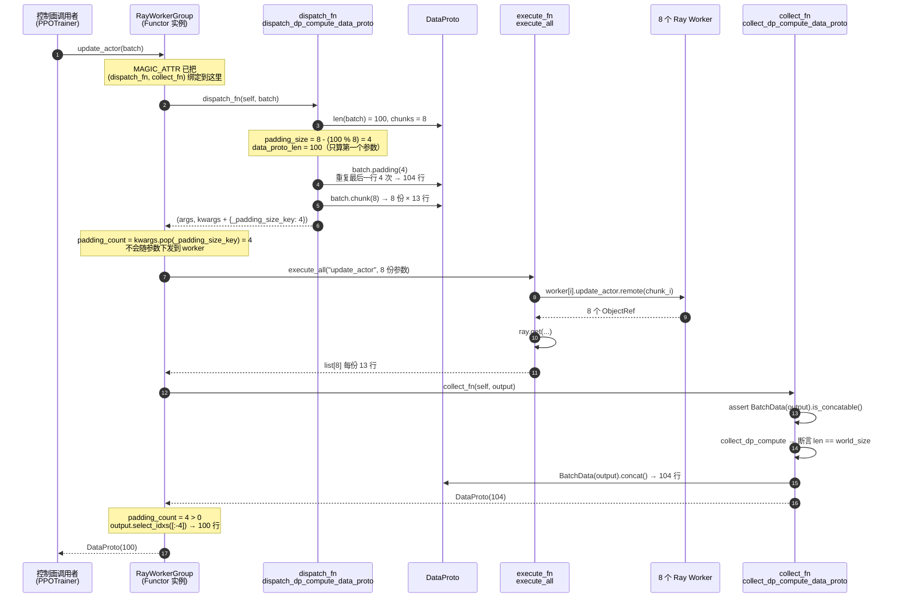
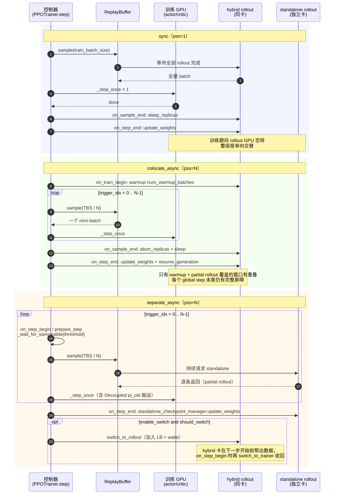
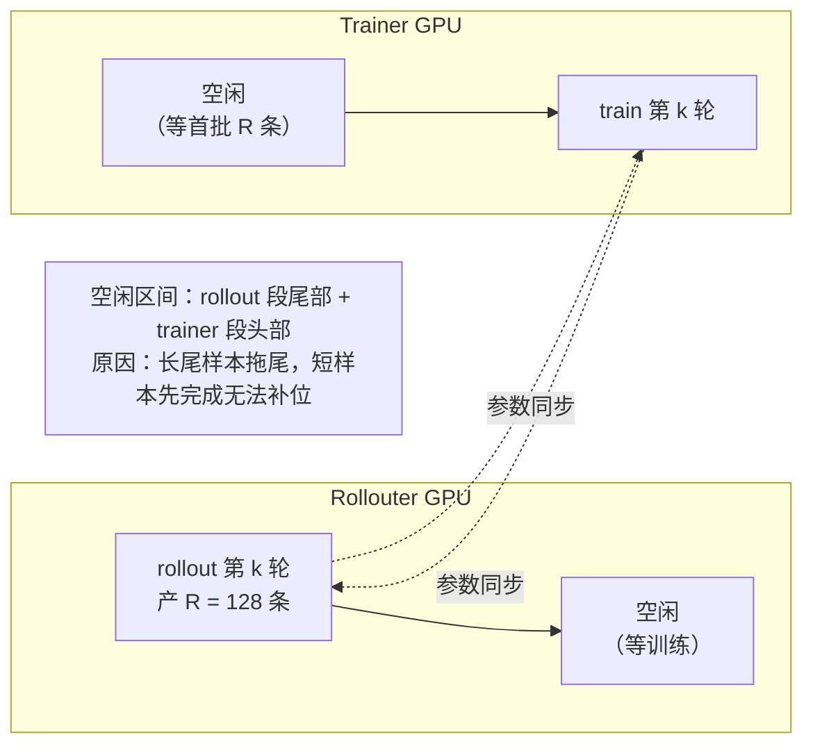
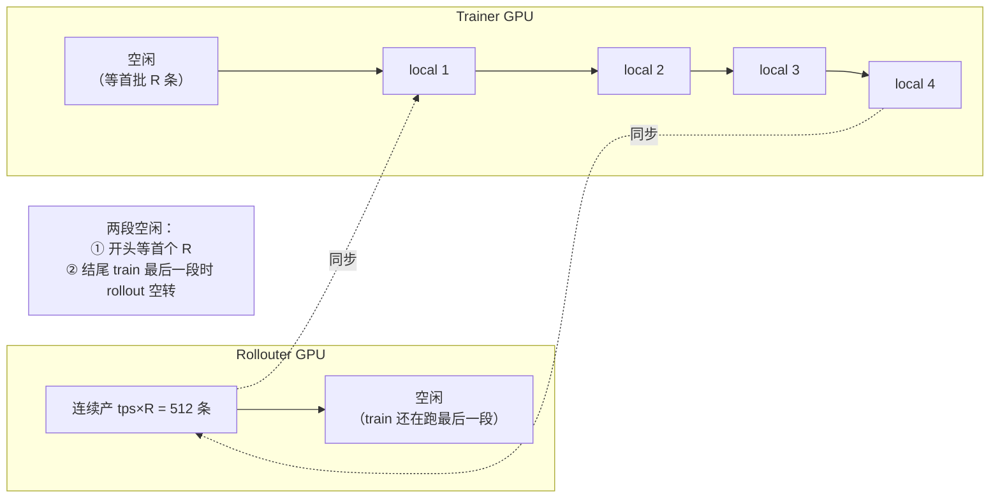
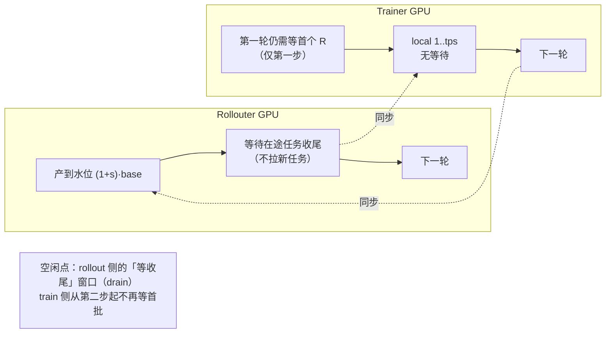
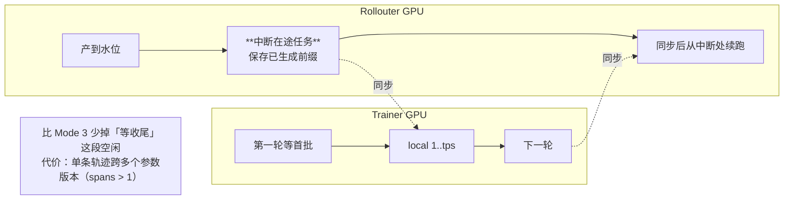
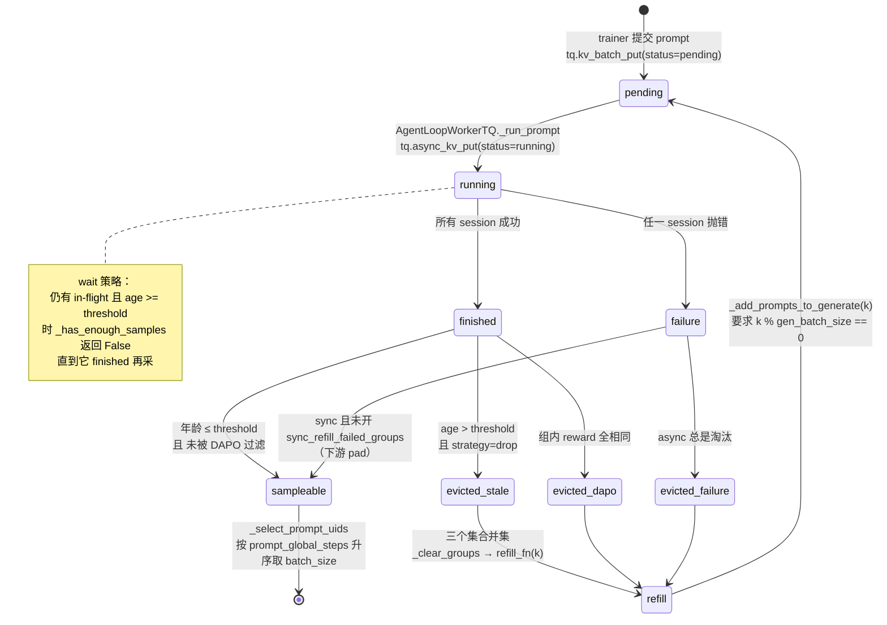
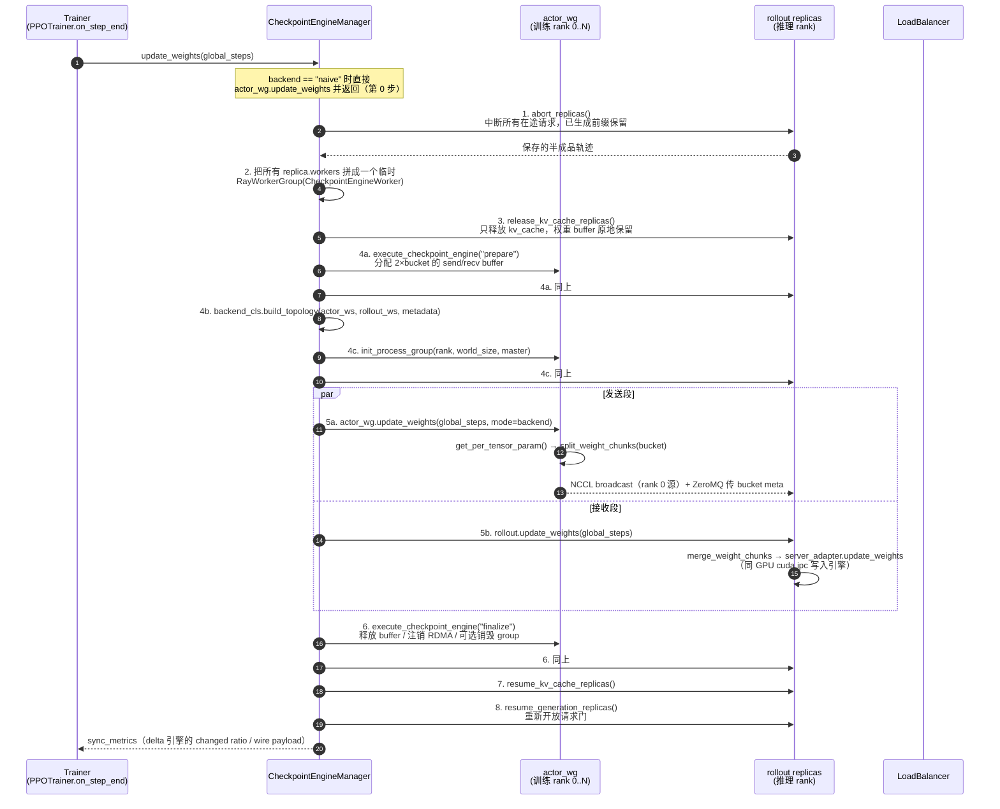
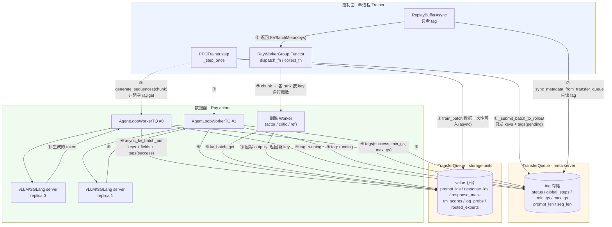

# 03 · verl（v0.9.1）源码级素材

> 取证基准：`verl-project/verl` @ `1876b06d0a3e4e71e06230be10af14492ca8a75b`（tag `v0.9.1`）。
> 所有行号均用 `git show <commit>:<path> | sed -n 'A,Bp'` 落到本地核对过。
> permalink 模板：`https://github.com/verl-project/verl/blob/1876b06d0a3e4e71e06230be10af14492ca8a75b/<path>#L<start>-L<end>`

**本文件只放素材，不是文章。**

---

## 0. 全景：verl 在 v0.9.1 里同时存在两套训练栈

这是读源码前必须先分清的一件事，否则会看到两套完全不同的 `trainer`：

| | V0（默认 v0 路径） | V1（`trainer.use_v1=True`） |
| --- | --- | --- |
| 入口 | `verl/trainer/main_ppo.py` → `verl/trainer/ppo/ray_trainer.py` | 同一入口，分派到 `verl/trainer/ppo/v1/trainer_*.py` |
| 数据容器 | `DataProto`（tensor 在控制器内存里） | `KVBatchMeta`（只有 key，数据在 TransferQueue） |
| rollout 收集 | `asyncio.gather` → 提交顺序 | `tq.async_kv_batch_put` → **完成顺序** |
| 子模式 | colocate / one_step_off / fully_async_policy（`experimental/` 下各自独立 trainer） | `sync` / `colocate_async` / `separate_async`（同一个 `PPOTrainer` 基类 + 钩子） |
| fully_async 的位置 | `verl/experimental/fully_async_policy/`（独立 `FullyAsyncTrainer` + `FullyAsyncRollouter` + `MessageQueue`） | `trainer_separate_async.py`（统一在 V1 基类里） |

**两个 fully_async 实现并存**是 v0.9.1 的事实：`docs/advance/fully_async.md` 描述的是 **V0 的
`verl/experimental/fully_async_policy/`**（Rollouter / MessageQueue / ParameterSynchronizer 四件套），
而 `docs/advance/v1_async_trainer.md` 描述的是 **V1 的三种 `trainer_mode`**。两者共享 checkpoint_engine
和 TransferQueue，但控制流不同。**文章里必须分开讲，不能混着写。**

---

## 1. dispatch/collect 的成对机制

**结论**：`@register` 不执行任何分发，它只往函数对象上挂一个字典；
真正的「切分 + 并行执行 + 合并」是在 `WorkerGroup` 绑定方法时从字典里取出 `(dispatch_fn, collect_fn)` 这一对，
生成一个 `Functor` 闭包。**dispatch 与 collect 是同一个注册表里的两半，必须成对解析。**

### 1.1 `MAGIC_ATTR` 与两个 DynamicEnum

**代码**（`verl/single_controller/base/decorator.py` L23-L63）：

```python
# here we add a magic number of avoid user-defined function already have this attribute
MAGIC_ATTR = "attrs_3141562937"

class Dispatch(DynamicEnum):
    _registry = {}
    _next_value = 0

def init_predefined_dispatch_mode():
    Dispatch.register("RANK_ZERO")
    Dispatch.register("ONE_TO_ALL")
    Dispatch.register("ALL_TO_ALL")
    Dispatch.register("DP_COMPUTE")
    Dispatch.register("DP_COMPUTE_PROTO")
    Dispatch.register("DP_COMPUTE_PROTO_WITH_FUNC")
    Dispatch.register("DP_COMPUTE_METRIC")
    # This is a special dispatch mode for vllm ExternalRayDistributedExecutor
    Dispatch.register("DIRECT_ROLLOUT_METHOD")
```

**读法**：`Dispatch` / `Execute` 都是 `DynamicEnum`（`verl/utils/py_functional.py`），是「可以运行时注册的枚举」，
所以第 7 个及以后的模式（`register_dispatch_mode`）不需要改枚举定义。`MAGIC_ATTR` 取了一个带随机数字的字符串，
注释原文说明理由：*"here we add a magic number of avoid user-defined function already have this attribute"*
—— 避免用户自己的函数恰好已经有 `attrs` 属性而被误判为已注册。

**注意**：`Dispatch.register` 了 8 个名字（`RANK_ZERO` … `DIRECT_ROLLOUT_METHOD`），但 `DISPATCH_MODE_FN_REGISTRY`
只给其中 **7 个**（除 `RANK_ZERO` 外，见 §1.3）配了函数对。`RANK_ZERO` 只存在于枚举里、没有 dispatch 实现，
所以「七种模式」的口径是**注册表里有 7 条**，不是「枚举里有 7 个」。

### 1.2 七种模式各自的 `dispatch_fn` / `collect_fn` 配对

**代码**（`verl/single_controller/base/decorator.py` L308-L331）：

```python
DISPATCH_MODE_FN_REGISTRY = {
    Dispatch.ONE_TO_ALL: {"dispatch_fn": dispatch_one_to_all, "collect_fn": collect_all_to_all},
    Dispatch.ALL_TO_ALL: {"dispatch_fn": dispatch_all_to_all, "collect_fn": collect_all_to_all},
    Dispatch.DP_COMPUTE: {"dispatch_fn": dispatch_dp_compute, "collect_fn": collect_dp_compute},
    Dispatch.DP_COMPUTE_PROTO: {
        "dispatch_fn": dispatch_dp_compute_data_proto,
        "collect_fn": collect_dp_compute_data_proto,
    },
    Dispatch.DP_COMPUTE_PROTO_WITH_FUNC: {
        "dispatch_fn": dispatch_dp_compute_data_proto_with_func,
        "collect_fn": collect_dp_compute_data_proto,
    },
    Dispatch.DP_COMPUTE_METRIC: {"dispatch_fn": dispatch_dp_compute_data_proto, "collect_fn": collect_dp_compute},
    Dispatch.DIRECT_ROLLOUT_METHOD: {
        "dispatch_fn": dummy_direct_rollout_call,
        "collect_fn": dummy_direct_rollout_call,
    },
}
```

| 模式 | dispatch | collect | 切分方式 | 合并方式 | 典型用途 |
| --- | --- | --- | --- | --- | --- |
| `ONE_TO_ALL` | `dispatch_one_to_all` | `collect_all_to_all` | 每个参数**复制** `world_size` 份（L120-123） | 原样返回**全部** rank 的 list | 广播配置、`init_model` |
| `ALL_TO_ALL` | `dispatch_all_to_all` | `collect_all_to_all` | 原样透传，调用者自己保证已经是 per-rank list | 原样返回 list | 调用者已手工切好的场景 |
| `DP_COMPUTE` | `dispatch_dp_compute` | `collect_dp_compute` | **只断言**每个参数是长 `world_size` 的 list（L148-156） | 断言长度并原样返回（L159-164） | 参数已经是 per-rank 张量 |
| `DP_COMPUTE_PROTO` | `dispatch_dp_compute_data_proto` | `collect_dp_compute_data_proto` | 沿 dim0 `chunk(world_size)`，**带自动 padding** | `BatchData(output).concat()` | 绝大多数 `DataProto` 训练方法，如 `update_actor` |
| `DP_COMPUTE_PROTO_WITH_FUNC` | `dispatch_dp_compute_data_proto_with_func` | `collect_dp_compute_data_proto` | 第一个参数是**函数对象**，广播；其余同 `DP_COMPUTE_PROTO` | 同上 | 需要把 loss fn 一起下发的 update |
| `DP_COMPUTE_METRIC` | `dispatch_dp_compute_data_proto` | `collect_dp_compute` | 同 `DP_COMPUTE_PROTO` | **不 concat**，返回 per-rank list | 每 rank 返回一个 dict/scalar 指标 |
| `DIRECT_ROLLOUT_METHOD` | `dummy_direct_rollout_call` | `dummy_direct_rollout_call` | 抛 `NotImplementedError` | 同左 | vLLM `ExternalRayDistributedExecutor` 直连，**绕过 dispatch 机制** |

**关键细节**：`DP_COMPUTE_METRIC` 是「dispatch 用 PROTO、collect 不用 PROTO」的**唯一一对错配**
（L326），它不是 bug —— 它的语义正是「输入按 DP 切，输出是 per-rank 的标量，不能再 concat」。
`DIRECT_ROLLOUT_METHOD` 的 dispatch/collect 两个都指向 `dummy_direct_rollout_call`（L126-127，直接
`raise NotImplementedError("Direct rollout call is forbidden.")`），因为这条路径的方法不走
`Functor`，而是在 `_bind_workers_method_to_parent` 里被**无前缀直接绑到类上**（见 §1.5）。

### 1.3 `register()` 怎么把 attrs 挂上去

**代码**（`verl/single_controller/base/decorator.py` L398-L421，L424-L444）：

```python
def register(dispatch_mode=Dispatch.ALL_TO_ALL, execute_mode=Execute.ALL, blocking=True, materialize_futures=True):
    _check_dispatch_mode(dispatch_mode=dispatch_mode)
    _check_execute_mode(execute_mode=execute_mode)

    def decorator(func):
        func = tqbridge(dispatch_mode=dispatch_mode)(func)     # ← 先套 TransferQueue 桥

        @wraps(func)
        def inner(*args, **kwargs):
            if materialize_futures:
                args, kwargs = _materialize_futures(*args, **kwargs)
            return func(*args, **kwargs)

        @wraps(func)
        async def async_inner(*args, **kwargs):
            if materialize_futures:
                args, kwargs = _materialize_futures(*args, **kwargs)
            return await func(*args, **kwargs)

        wrapper = async_inner if inspect.iscoroutinefunction(func) else inner
        attrs = {"dispatch_mode": dispatch_mode, "execute_mode": execute_mode, "blocking": blocking}
        setattr(wrapper, MAGIC_ATTR, attrs)
        return wrapper

    return decorator
```

**读法**：三层包装，从内到外：

1. 原函数
2. `tqbridge(dispatch_mode=…)` —— V1 的 TransferQueue 桥（`verl/utils/transferqueue_utils.py` L347+）。
   它检查实参里有没有 `BatchMeta`/`KVBatchMeta`；有就**物化**（把 key 换成真数据）→ 调原函数 →
   如果返回值是 `TensorDict` 就**回写进 TQ** 并返回新的 `KVBatchMeta`。这是 V1「控制面只传 key」的落点。
3. `inner` / `async_inner` —— `materialize_futures`：把 `DataProtoFuture` 先 `.get()` 掉（L383-395）。
4. `setattr(wrapper, MAGIC_ATTR, attrs)` —— 只挂一个 dict，**不绑定任何函数指针**。

换言之：装饰时 `dispatch_fn` 还没被解析，只留下了 `Dispatch.ALL_TO_ALL` 这个枚举值。
解析发生在运行时（见 §1.4），这样自定义 `dispatch_mode=dict` 可以在运行时才确定。

### 1.4 WorkerGroup 运行时怎么读取

**代码**（`verl/single_controller/base/worker_group.py` L204-L245）：

```python
if hasattr(method, MAGIC_ATTR):
    # this method is decorated by register
    attribute = getattr(method, MAGIC_ATTR)
    assert isinstance(attribute, dict), f"attribute must be a dictionary. Got {type(attribute)}"
    assert "dispatch_mode" in attribute, "attribute must contain dispatch_mode in its key"
    dispatch_mode = attribute["dispatch_mode"]
    execute_mode = attribute["execute_mode"]
    blocking = attribute["blocking"]

    # get dispatch fn
    if isinstance(dispatch_mode, Dispatch):
        # get default dispatch fn
        fn = get_predefined_dispatch_fn(dispatch_mode=dispatch_mode)
        dispatch_fn = fn["dispatch_fn"]
        collect_fn = fn["collect_fn"]
    else:
        assert isinstance(dispatch_mode, dict)
        assert "dispatch_fn" in dispatch_mode
        assert "collect_fn" in dispatch_mode
        dispatch_fn = dispatch_mode["dispatch_fn"]
        collect_fn = dispatch_mode["collect_fn"]

    execute_mode = get_predefined_execute_fn(execute_mode=execute_mode)
    wg_execute_fn_name = execute_mode["execute_fn_name"]

    # get execute_fn from string
    try:
        execute_fn = getattr(self, wg_execute_fn_name)
        assert callable(execute_fn), "execute_fn must be callable"
    except Exception:
        print(f"execute_fn {wg_execute_fn_name} is invalid")
        raise

    # bind a new method to the RayWorkerGroup
    func = func_generator(
        self,
        method_name,
        dispatch_fn=dispatch_fn,
        collect_fn=collect_fn,
        execute_fn=execute_fn,
        blocking=blocking,
    )
    setattr(self, method_name, func)
```

**读法**：`_bind_worker_method` 在 `RayWorkerGroup.__init__` 末尾被调用
（`verl/single_controller/ray/base.py` L494-L495：`self._bind_worker_method(self.ray_cls_with_init.cls, func_generator)`），
遍历 Worker 类的全部方法，对每个带 `MAGIC_ATTR` 的方法生成一个 `Functor` 实例替换到 WorkerGroup 上。
`Execute.ALL` → `execute_all`，`Execute.RANK_ZERO` → `execute_rank_zero`（L362-365）。

**真正的执行体**（`verl/single_controller/ray/base.py` L49-L66）：

```python
def func_generator(self, method_name, dispatch_fn, collect_fn, execute_fn, blocking):
    class Functor:
        def __call__(this, *args, **kwargs):
            args, kwargs = dispatch_fn(self, *args, **kwargs)
            padding_count = kwargs.pop(_padding_size_key, 0)
            output = execute_fn(method_name, *args, **kwargs)
            if blocking:
                output = ray.get(output)
            output = collect_fn(self, output)
            if padding_count > 0:
                if isinstance(output, DataProto):
                    indices = [i for i in range(len(output))][:-padding_count]
                    output = output.select_idxs(indices)
                elif isinstance(output, list):
                    output = output[:-padding_count]
            return output
    return type(method_name, (Functor,), {})()

```

**读法（关键）**：`padding_count` 是在 **dispatch 之后、collect 之后**才被消费的。
dispatch 阶段 `_split_args_kwargs_data_proto_with_auto_padding` 把 `padding_size` 塞进 `kwargs[_padding_size_key]`，
`Functor` 立刻把它 **pop 出来保存**（避免传给远端），然后在 `collect_fn` 把各 rank 结果 concat 回来之后，
**从尾部切掉 `padding_count` 行**。所以 padding 对调用者完全透明：进去 100 条，回来还是 100 条，
但每个 rank 实际算的是 13 条（104/8）。这是整条链路上最容易被忽略的一处补偿。

### 1.5 colocate 下的二次绑定（`_bind_workers_method_to_parent`）

`create_colocated_worker_cls` 把多个 Worker 类塞进同一个 Ray actor（详见 §2.3）。为了让外层一个
WorkerGroup 能调内层多个类的方法，`verl/single_controller/ray/base.py` L910-L958 的
`_bind_workers_method_to_parent`（定义在 `ray/base.py` L916-L958）会：

```python
if hasattr(method, MAGIC_ATTR):
    ...
    # pass MAGIC_ATTR for outer worker group
    attrs = getattr(method, MAGIC_ATTR)
    setattr(func, MAGIC_ATTR, attrs)
    try:
        # bind direct rollout method to class without prefix
        if attrs["dispatch_mode"] == Dispatch.DIRECT_ROLLOUT_METHOD and "rollout" in key:
            assert not hasattr(cls, method_name), (
                f"conflict direct rollout method {method_name} with role {key}"
            )
            setattr(cls, method_name, func)
            print(f"bind role {key} method {method_name} to class {cls}")
        else:
            method_name_with_prefix = key + "_" + method_name
            setattr(cls, method_name_with_prefix, func)
    except Exception as e:
        raise ValueError(f"Fail to set method_name {method_name}") from e
```

**读法**：`MAGIC_ATTR` 被**原样复制**到新函数上，所以 `WorkerDict` 类上的 `<role>_<method>` 也带
`MAGIC_ATTR`，外层 `RayWorkerGroup._bind_worker_method` 会**再解析一次**，得到同一个 `(dispatch_fn, collect_fn)`。
这就是「dispatch 模式在 colocate 嵌套两层之后仍然只有一个定义」的机制。
`DIRECT_ROLLOUT_METHOD` 是例外：它**不加 role 前缀**直接绑，并且断言没有同名冲突。
`spawn(prefix_set)` 之后（L714-747），`_rebind_actor_methods` 再把 `<role>_` 前缀剥掉，
于是每个子 WorkerGroup 上看到的是**原方法名**。

### 1.6 padding 的具体算法

**代码**（`verl/single_controller/base/decorator.py` L91-L117）：

```python
def _split_args_kwargs_data_proto_with_auto_padding(chunks, *args, **kwargs):
    data_proto_len = None
    padding_size = None

    def _padding_and_split_data(obj, chunks):
        nonlocal data_proto_len, padding_size
        assert isinstance(obj, DataProto | DataProtoFuture)
        if isinstance(obj, DataProto) and obj.is_padding_enabled():
            # for padding, we only support DataProto with same length
            if data_proto_len is None:
                data_proto_len = len(obj)
                padding_size = (chunks - (data_proto_len % chunks)) if (data_proto_len % chunks > 0) else 0
            else:
                assert data_proto_len == len(obj), (
                    f"expecting all arg share same length of {data_proto_len}, but got {len(obj)}"
                )
            obj.padding(padding_size=padding_size)
        return obj.chunk(chunks=chunks)
    ...
    if padding_size is not None:
        splitted_kwargs[_padding_size_key] = padding_size
```

**读法**：`padding_size = chunks - (len % chunks)`，只在 `len % chunks > 0` 时非零。
注意 **`padding_size = 0` 也会写进 `_padding_size_key`**（因为 `padding_size is not None`），
只是 `Functor` 里 `if padding_count > 0` 会跳过裁切，所以 0 是安全的。

**padding 用什么填**（`verl/protocol.py` L846-L859）：

```python
def padding(self, padding_size, padding_candidate=""):
    if padding_size == 0:
        return
    padding_candidate = self.select_idxs([0 if padding_candidate == "first" else len(self) - 1])
    padding_part = padding_candidate.repeat(padding_size)
    padded_dp = DataProto.concat([self, padding_part])
```

默认 `""` 走到 `else` 分支 → 取**最后一行**重复。所以 pad 的是**真实样本的副本**，
每个 rank 会多算若干条重复样本，回来后被 `[:-padding_count]` 切掉。
（副作用：如果 `collect_fn` 之外还有 rank 级 metric 聚合，重复行会进统计 —— `DP_COMPUTE_METRIC` 就是这种情况，
但它的 collect 是 `collect_dp_compute`，不 concat，所以不受影响。）

**padding 何时启用**（`verl/protocol.py` L837-L844 + L50-L64）：

```python
def is_padding_enabled(self):
    dataproto_specific_padding = self.meta_info.get(DataProtoConfig.auto_padding_key, False)
    return dataproto_specific_padding or DataProtoConfig.auto_padding

# L50-L59，三级开关
class _DataProtoConfigMeta(type):
    _config = {}
    auto_padding_key = "_verl_auto_padding"

    @property
    def auto_padding(cls):
        enabled_by_env = os.getenv("VERL_AUTO_PADDING", "FALSE").upper() in ["TRUE", "1"]
        return enabled_by_env or cls._config.get(cls.auto_padding_key, False)
```

即三级取或：**单次 `meta_info["_verl_auto_padding"]` < `DataProtoConfig.auto_padding` 类属性（含 env
`VERL_AUTO_PADDING`）**。而 `meta_info` 这一级只会被 `DataProto.from_dict(..., auto_padding=True)`
写入（L538-L539），且 `from_dict`/`from_single_dict` 的 `auto_padding` 参数**默认都是 `False`**（L477、L499）。

> **公开面不显眼的事实（重要）**：`git grep auto_padding -- verl/` 在 `verl/protocol.py` 之外**没有任何命中**。
> 也就是说 v0.9.1 的 verl 源码里，**没有任何训练路径主动打开 auto padding**；
> 唯一打开它的地方是测试 `tests/single_controller/test_auto_padding_on_cpu.py` L25-L26
> （`DataProtoConfig.auto_padding = True`，注释 *"or set env var VERL_AUTO_PADDING = "1" / "true"*）。
> 结论：**默认运行下 `DP_COMPUTE_PROTO` 的 padding 分支是死代码，`DataProto.chunk` 走的是整除断言**：
> `assert len(self) % chunks == 0, "only support equal chunk…"`（L870-873）。
> 想用 padding 必须显式 `export VERL_AUTO_PADDING=1`（或改代码设类属性）。
> 这一点在 `docs/` 里**没有任何文档**，只能从源码读出来。

### 1.7 量化：padding 的实际代价

设 `len = L`、`chunks = world_size = W`、`p = (W - L % W) % W`，则

- 每 rank 实际条数：`ceil(L / W) = (L + p) / W`
- 计算浪费：`p / L`；**最坏情况 `L = k·W + 1`，浪费比 `= (W-1)/(kW+1)`**，`k=1` 时趋近 `(W-1)/(W+1)`。

代入具体值（`p = (W - (L % W)) if L % W > 0 else 0`）：

| L（batch 条数） | W（DP rank） | p | 每 rank 条数 | 浪费 |
| --- | --- | --- | --- | --- |
| 64 | 8 | 0 | 8 | 0% |
| 100 | 8 | 4 | 13 | 4.0% |
| 7 | 8 | 1 | 1 | 14.3% |
| 1 | 8 | 7 | 1 | **700%**（多算 7 条） |
| 3 | 24 | 21 | 1 | **700%** |

**这是性能悬崖**：当 batch 远小于 world_size（小 batch + 大集群），padding 让每个 rank 都算「至少 1 条」，
总计算量变成 `W` 条而不是 `L` 条。`docs/advance/fully_async.md` L420-422 也自陈了这个限制：
*"the current verl implementation imposes certain constraints, such as requiring data to be evenly divisible by the
number of GPUs, making resource adjustment less flexible."*
—— 这里的「要求整除」指的正是 `separate_async` 的 `train_batch_size == parameter_sync_step × ppo_mini_batch_size`
与下游 `_get_required_batch_multiple`（§3.4），不是 padding 本身；padding 是**兜底**，
兜底得越少（整除）越好。

### 1.8 完整调用链 sequenceDiagram

场景：控制器调用 `actor_rollout_wg.update_actor(batch)`，`DP_COMPUTE_PROTO`，8 卡 DP，batch=100。



**坑**：

1. **padding 只对「第一个 DataProto 参数」定 `data_proto_len`**，其余 DataProto 参数必须同长，否则 L106 断言失败。
   传两个不同长度的 DataProto（例如 batch + 一个额外的小表）会直接 assert。
2. **`BatchData.chunk` 对 `KVBatchMeta` 先转 `BatchMeta`**（`verl/protocol.py` L1279-L1285），注释原文：
   *"early translate KVBatchMeta -> BatchMeta to prevent frequent controller communication during PUT/GET in each rank"*
   —— V1 路径上 `chunk` 是**一次性**取全量 meta 再切，不是每个 rank 各自去 TQ 取。
3. **`materialize_futures=True` 是默认**，意味着传进来的 `DataProtoFuture` 会被同步阻塞 `.get()`。
   想流水（不阻塞）必须显式 `materialize_futures=False`，此时 dispatch 拿到的是 future，`chunk` 走
   `DataProtoFuture.chunk`（L1194+），`collect` 走 `DataProtoFuture.concat`，**整条链保持异步**。
4. **`DP_COMPUTE` 的 dispatch 只断言不切分**（L148-156）。如果调用者传了一个单体 `DataProto` 给它，
   断言 `isinstance(arg, tuple | list) and len(arg) == world_size` 会失败。它和 `DP_COMPUTE_PROTO` 的区别
   就是「谁负责切」。

---

## 2. WorkerGroup 与 ResourcePool

**结论**：`ResourcePoolManager` 把 `{pool_name: [n_gpu_node0, n_gpu_node1, …]}` 变成
**每节点一个 placement group（PG）**，每个 PG 里 bundle 数 = 该节点 GPU 数，每个 bundle 声明
`{"GPU": 1, "CPU": max_colocate_count}`。接着 `create_colocated_worker_cls` 在**每个 bundle 里只起一个 Ray actor**，
把该资源池上的所有 role 类塞进同一个进程。**实际 Ray actor 数 = 该 pool 的 GPU 总数，与 role 数无关。**

### 2.1 `resource_pool_spec` 从哪来

**代码**（`verl/trainer/ppo/v1/trainer_base.py` L802-L862，节选）：

```python
self.role_worker_mapping[role] = ray.remote(ActorRolloutRefWorker)
self.mapping[role] = "global_pool"
if role == Role.Actor and need_reference_policy(config) and not ref_in_actor:
    self.role_worker_mapping[Role.RefPolicy] = ray.remote(ActorRolloutRefWorker)
    self.mapping[Role.RefPolicy] = "global_pool"
if need_critic(config):
    self.role_worker_mapping[Role.Critic] = ray.remote(TrainingWorker)
    self.mapping[Role.Critic] = "global_pool"

# Global resource pool is used for actor, rollout, critic, ref
global_pool_id = "global_pool"
resource_pool_spec = {
    global_pool_id: [config.trainer.n_gpus_per_node] * config.trainer.nnodes,
}
```

**读法**：V1 里 **actor / rollout / critic / ref 全部映射到同一个 `global_pool`**。
只有在 `reward.reward_model.enable_resource_pool=True` 时才多一个 `reward_pool`，
开了蒸馏才多一个 `teacher_pool`。`resource_pool_spec` 是 `dict[str, list[int]]`，
list 长度 = 节点数，元素 = 该节点的 GPU 数。

### 2.2 spec → Ray placement group

**代码**（`verl/single_controller/ray/base.py` L131-L164）：

```python
def get_placement_groups(self, strategy="STRICT_PACK", name=None, device_name="cuda"):
    if self.pgs is not None:
        return self.pgs
    pg_name_prefix = (
        name if name else f"{self.name_prefix}verl_group_{'_'.join([str(count) for count in self._store])}:"
    )
    ...
    device_name = current_platform.ray_resource_name()

    bundle = {"CPU": self.max_colocate_count}
    if self.use_gpu:
        bundle[device_name] = 1
        if self.accelerator_type is not None:
            bundle[self.accelerator_type] = 1e-4
    pg_scheme = [[bundle.copy() for _ in range(process_count)] for process_count in self._store]

    lifetime = "detached" if self.detached else None
    pgs = [
        placement_group(bundles=bundles, strategy=strategy, name=pg_name_prefix + str(idx), lifetime=lifetime)
        for idx, bundles in enumerate(pg_scheme)
    ]
    ray.get([pg.ready() for pg in pgs])
    self.pgs = sort_placement_group_by_node_ip(pgs)
    return pgs
```

**读法**：

- **一个 PG 对应一个节点**（`pg_scheme` 的元素是 per-node 的 `[[bundle]*4, [bundle]*4]`）。
  `sort_placement_group_by_node_ip`（L70-L89）按 node ip 排序，注释原文：
  *"Sort the placement groups by node ip, all bundles in a single placement group should be on the same node."*
  —— 排序是为了让 **PG 序号 ↔ 节点** 的映射在多次启动之间稳定（rank 分配依赖这个顺序）。
- **strategy**：`ResourcePoolManager.create_resource_pool()` 不传 strategy，用默认 `"STRICT_PACK"`；
  但 `RayWorkerGroup._init_with_resource_pool` 会用自己的 `bin_pack` 重新调用
  `get_placement_groups(strategy=..., device_name=...)`（L555-L558，`bin_pack=True → "STRICT_PACK"`，否则 `"PACK"`）。
  由于 `self.pgs` 被缓存（L132-133），**第一次调用者决定实际 strategy** —— 而 `create_resource_pool()` 先跑
  （`trainer_base.py` L244），所以实际生效的是 `STRICT_PACK`。`bin_pack=False` 在 V1 主路径上**不生效**。
- **bundle 的 CPU 份额 = `max_colocate_count`**（默认 3，`ResourcePoolManager.max_colocate_count: int = 3`，
  `ray/base.py` L192）。bundle 声明 `{"CPU": 3, "GPU": 1}` 的含义是「这个 GPU 上允许塞 3 个 actor
  （因为每个 actor 默认吃 1 CPU）」。`ResourcePoolManager.create_resource_pool` 的注释原文（L200-205）：

  > `max_colocate_count` means the number of WorkerGroups (i.e. processes) in each RayResourcePool
  > For FSDP backend, using `max_colocate_count=3`: actor_critic_ref, rollout, reward model (optional)
  > For Megatron backend, we recommend using `max_colocate_count>1` that can utilize different WorkerGroup for different models

  注意这里说的是**旧版（v0 早期）**语义；V1 已经用 `create_colocated_worker_cls` 把多个 role 塞进**一个** actor，
  所以 `max_colocate_count=3` 现在只是「留了 3 个 actor 的位置」，实际只占 1 个。

### 2.3 `create_colocated_worker_cls`：多个 Worker 类 → 一个 actor

**代码**（`verl/single_controller/ray/base.py` L984-L1025，节选）：

```python
def create_colocated_worker_cls(class_dict: dict[str, RayClassWithInitArgs]):
    cls_dict = {}
    init_args_dict = {}
    worker_cls = _determine_fsdp_megatron_base_class(
        [cls.cls.__ray_actor_class__.__mro__ for cls in class_dict.values()]
    )
    assert issubclass(worker_cls, Worker), f"worker_cls {worker_cls} should be a subclass of Worker"

    for key, cls in class_dict.items():
        cls_dict[key] = cls.cls
        init_args_dict[key] = {"args": cls.args, "kwargs": cls.kwargs}

    class WorkerDict(worker_cls):
        def __init__(self):
            super().__init__()
            self.worker_dict = {}
            for key, user_defined_cls in cls_dict.items():
                user_defined_cls = _unwrap_ray_remote(user_defined_cls)
                # directly instantiate the class without remote
                with temp_env_var("DISABLE_WORKER_INIT", "1"):
                    self.worker_dict[key] = user_defined_cls(
                        *init_args_dict[key].get("args", ()), **init_args_dict[key].get("kwargs", {})
                    )

    # now monkey-patch the methods from inner class to WorkerDict
    for key, user_defined_cls in cls_dict.items():
        user_defined_cls = _unwrap_ray_remote(user_defined_cls)
        _bind_workers_method_to_parent(WorkerDict, key, user_defined_cls)

    remote_cls = ray.remote(WorkerDict)
    remote_cls = RayClassWithInitArgs(cls=remote_cls)
    return remote_cls
```

**读法**：

1. `_determine_fsdp_megatron_base_class`（L961-L972）沿 MRO 找 `MegatronWorker` 或 `Worker`，
   **决定 `WorkerDict` 继承谁** —— 于是 colocate 之后只保留一条 `Worker.__init__`（Ray actor 初始化路径）。
2. 内层类的实例化包在 `with temp_env_var("DISABLE_WORKER_INIT", "1")` 里，注释原文：
   *"when DISABLE_WORKER_INIT == 1 it will return immediately"* ——
   否则每个内层 Worker 都会再执行一次 Ray actor 侧的初始化（建进程组、连 rank 等）。
3. `_bind_workers_method_to_parent` 把每个内层类的**带 `@register` 的方法**以 `<role>_<method>` 的名字
   挂到 `WorkerDict` 上（见 §1.5）。
4. 最后 `ray.remote(WorkerDict)` → 一个 Ray actor 类。

**`spawn`**（L714-L747）从这**同一批 actor handle** 再派生多个轻量 WorkerGroup（`from_detached`），
每个绑定一个 role 前缀，然后 `_rebind_actor_methods` 剥掉前缀。**spawn 不创建新 actor。**

### 2.4 量化：colocate 配置下实际起多少个 Ray actor、每个占多少 GPU

以 V1 `separate_async`（`docs/advance/v1_async_trainer.md` L200-L214 的示例）为基准：

```
trainer.nnodes=2, trainer.n_gpus_per_node=8        → global_pool = [8, 8]
actor_rollout_ref.rollout.nnodes=2, n_gpus_per_node=8  → standalone rollout pool（LLMServerManager 自己建）
```

`actor_role` 在 `_init_resource_pool_mgr`（L812-819）里：`_enable_hybrid_replicas=True` 时是
`Role.ActorRolloutRef`（若需要 ref 且 ref 不在 actor 里）或 `Role.ActorRollout`；`hybrid_engine=False` 时是
`Role.Actor`。以「需要 ref、无 LoRA」为例，`global_pool` 上塞进 `{ActorRolloutRef, RefPolicy(此时不额外加，见 L818 条件)}`
—— 实际上 `ref_in_actor` 为假且 `role != Role.Actor` 时**不会单独加 RefPolicy**，所以 class_dict 只有一个 key。

| 池 | PG 数 | 每 PG bundle 数 | 每 bundle 起的 actor 数 | 总 Ray actor | GPU/actor |
| --- | --- | --- | --- | --- | --- |
| `global_pool`（trainer，2 节点 × 8 卡） | 2 | 8 | 1 | **16** | 1.0 |
| `reward_pool`（若启用且独立） | `rm.nnodes` | `rm.n_gpus_per_node` | 1 | `rm.nnodes × rm.n_gpus_per_node` | 1.0 |
| `teacher_pool`（若启用蒸馏） | `distill.nnodes` | `distill.n_gpus_per_node` | 1 | 同上 | 1.0 |
| standalone rollout pool | 见 `LLMServerManager` | — | — | `rollout.nnodes × rollout.n_gpus_per_node` | 1.0 |

**若 class_dict 有 k 个 role**（例如 `use_critic=True` 且 `_enable_hybrid_replicas=True`，
则 `{ActorRolloutRef, Critic}`，k=2）：**actor 数不变，仍是 16**，但每个 actor 里跑
`k × (1 个内层 Worker 实例)`，**每个 actor 仍只声明 1 块 GPU（`num_gpus=1`，`RayClassWithInitArgs.__call__` 默认参数）**。
所以每个 actor 的 GPU 份额恒为 `1.0`，role 数是**进程内**的事，不改变 Ray 资源账。

**坑**：

1. **`max_colocate_count` 决定 bundle 的 CPU 份额**，不是 GPU 份额。设成 3 意味着每个 GPU 上最多 3 个 actor；
   V1 colocate 只用 1 个，**浪费了 2/3 的 CPU 名额**（Ray 侧看不出问题，但会阻止其他任务抢这块 GPU）。
2. **`create_colocated_worker_cls` 已标 deprecated**：源码注释 L912 与 L983 都写着 `# deprecated, switching to FusedWorker`。
   新路径是 `create_colocated_worker_cls_fused`（L1103-L1123），用 `FusedWorker._fuw_execute` +
   `{class_name}_fwmn_{method_name}` 的复合方法名，且给每个子 worker 互相注入 `fused_worker_dict` 以便跨 role 直接调用
   （L1079-L1081：*"injecting fused_worker to each sub worker so they can be aware of existence of each other"*）。
3. **`ray_trainer.py` L849-L853 的注释警告**：
   *"if you want to use a different resource pool for each role, which can support different parallel size,
   you should not use `create_colocated_worker_cls`. Instead, directly pass different resource pool to different worker groups."*
   —— colocate 的前提是**所有 role 共享同一 DP 形状**。
4. `_check_resource_available`（L226-L243）只比较 **总 GPU 数**，不检查拓扑（NUMA / NVLink 域）。
   跨节点不均等时会在 PG 创建阶段阻塞而不是提前报错。

---

## 3. V1 训练器三条路径的差异

**结论**：三条路径共用 `PPOTrainer.fit → step → _step_once`，差异**全部体现在钩子上**
（`on_step_begin` / `on_step_end` / `on_sample_begin` / `on_sample_end` / `on_train_begin`）。
`sync` 与 `colocate_async` **不重写 `step`**，所以在控制器里一次性采满 `train_batch_size`；
`separate_async` 也**不重写 `step`**，但通过 `prepare_step` 的切换逻辑 + `wait_for_sampleable` 让每个
mini-batch 单独等数据 —— 「流式」不是改切分点，而是**改等待点**。

### 3.1 `fit` 的主循环

**代码**（`verl/trainer/ppo/v1/trainer_base.py` L481-L502）：

```python
while current_epoch < self.config.trainer.total_epochs and self.global_steps <= self.total_training_steps:
    is_last_step = self.global_steps >= self.total_training_steps
    metrics = {}
    self.timing_raw = {}

    # 1. perform rollout and actor/critic training
    with marked_timer("step", self.timing_raw):
        self.on_step_begin()
        self._start_profiling()
        batch = self.step(metrics, self.timing_raw)
        self._stop_profiling()

        # 2. save checkpoint
        if self.config.trainer.save_freq > 0 and (is_last_step or self.global_steps % self.config.trainer.save_freq == 0):
            with marked_timer("save_checkpoint", self.timing_raw, color="green"):
                self._save_checkpoint()

        self.on_step_end()
        metrics.update(self._consume_sync_metrics())
```

**读法**：`on_step_begin` / `on_step_end` 包住「采样+训练+存盘」的整个时间窗。
**`save_checkpoint` 在 `on_step_end` 之前** —— 也就是说「权重同步到 rollout」发生在存盘**之后**，
各模式的差异就靠 `on_step_end` 里的 `checkpoint_manager.update_weights(...)` 表达。

### 3.2 `step`：一个 global step = `parameter_sync_step` 个 local update

**代码**（`verl/trainer/ppo/v1/trainer_base.py` L547-L574）：

```python
def step(self, metrics: dict, timing_raw: dict) -> KVBatchMeta:
    train_batch_size = self.config.data.train_batch_size
    assert train_batch_size % self.parameter_sync_step == 0, (
        f"train_batch_size ({train_batch_size}) must be divisible by "
        f"parameter_sync_step ({self.parameter_sync_step})"
    )
    sample_batch_size = train_batch_size // self.parameter_sync_step
    prepare_metrics = self.prepare_step()
    ...
    for trigger_idx in range(self.parameter_sync_step):
        self.local_trigger_step = trigger_idx
        iter_metrics: dict = {}
        batch = self._step_once(iter_metrics, timing_raw, sample_batch_size)
        ...
```

**读法**：`step` 的唯一「切分点」就是 `sample_batch_size = train_batch_size // parameter_sync_step`，
循环 `parameter_sync_step` 次，每次跑一遍完整 PPO（§3.3）。**三条路径都走这段代码**，
`parameter_sync_step` 的切分位置因此是**同一个位置**；不同的是**每次 `_step_once` 开头等数据等多久**。

**`parameter_sync_step` 从哪读**（L144）：

```python
self.parameter_sync_step = self.config.trainer.v1.get(self.trainer_mode, {}).get("parameter_sync_step", 1)
```

即 `trainer.v1.<trainer_mode>.parameter_sync_step`，**默认 1**。三个 mode 各自有一份，互不影响。

### 3.3 `_step_once`：一次 local update 的九段

**代码**（`verl/trainer/ppo/v1/trainer_base.py` L576-L626，删去空行）：

```python
def _step_once(self, metrics: dict, timing_raw: dict, sample_batch_size: int) -> KVBatchMeta:
    """Run a single local update: sample one mini-batch and perform the full PPO pipeline once."""
    # 1. sample batch from replay buffer
    with marked_timer("gen", timing_raw, color="red"):
        self.on_sample_begin()
        batch, off_policy_metrics = self.replay_buffer.sample(
            global_steps=self.global_steps, partition_id="train", batch_size=sample_batch_size,
        )
        metrics.update(off_policy_metrics)
        batch.extra_info["temperature"] = self.config.actor_rollout_ref.rollout.temperature
        self.on_sample_end()
    # 2. [OPTIONAL] compute reward score with colocated reward model
    # 3. balance batch across data parallel groups
    # 4. compute old_log_prob        5. [OPTIONAL] ref_log_prob
    # 6. [OPTIONAL] critic values    7. compute advantage
    # 8. [OPTIONAL] update critic    9. update actor
```

实际计时器名依次是 `gen` → `reward` → `old_log_prob` → `ref` → `values` → `adv` → `update_critic` → `update_actor`
（`_balance_batch` 不打计时器）。**`gen` 计时器覆盖的是 `replay_buffer.sample()` 的阻塞时长**，
也就是「等 rollout 出数据」的时间 —— 这是 `timing_s/gen` 的真实含义。
`v1_async_trainer.md` L231 原文：*"`timing_s/gen`: trainer time spent waiting for the next trainable train-batch.
(Also means idle time for separate_async's hybrid gpus)"*。

### 3.4 三条路径的钩子对比

#### （a）`sync` —— `trainer_sync.py` 全文 44 行

**代码**（`verl/trainer/ppo/v1/trainer_sync.py` L22-L44）：

```python
@register_trainer("sync")
class PPOTrainerSync(PPOTrainer):
    """Synchronous PPO trainer
    1. Trainer and rollout are colocated
    2. Partial rollout is disabled
    """

    def on_init_end(self):
        # update weights after loading checkpoint
        self.checkpoint_manager.update_weights(self.global_steps)

    def on_step_end(self):
        with marked_timer("update_weights", self.timing_raw, color="red"):
            # wake up all replicas to update weights
            self.checkpoint_manager.update_weights(self.global_steps)

    def on_sample_end(self):
        # sleep all replicas to discard weights and kv cache
        self.checkpoint_manager.sleep_replicas()
```

**读法**：**没有 `get_llm_client` 重写** → 用基类的普通 `LLMServerClient`（非 partial rollout）。
`on_sample_end` 睡掉 replicas（释放权重的 GPU 副本 + KV cache），`on_step_end` 同步权重。

#### （b）`colocate_async` —— `trainer_colocate_async.py` 全文 50 行

**代码**（`verl/trainer/ppo/v1/trainer_colocate_async.py` L19-L50）：

```python
@register_trainer("colocate_async")
class PPOTrainerColocateAsync(PPOTrainer):
    """Asynchronous PPO trainer
    1. Trainer and rollout are colocated.
    2. Partial rollout is enabled.
    """

    def get_llm_client(self):
        """Get the LLM server client for rollout generation."""
        return self.llm_server_manager.get_client(client_cls=FullyAsyncLLMServerClient)

    def on_init_end(self):
        self.checkpoint_manager.update_weights(self.global_steps)

    def on_train_begin(self):
        self._add_async_warmup_batches(self.config.trainer.v1.colocate_async.num_warmup_batches)

    def on_step_end(self):
        with marked_timer("update_weights", self.timing_raw, color="red"):
            # wake up all replicas to update weights
            self.checkpoint_manager.update_weights(self.global_steps)
            # resume generation
            self.checkpoint_manager.resume_generation_replicas()

    def on_sample_end(self):
        # abort all unfinished requests and pause generation
        self.checkpoint_manager.abort_replicas()
        # sleep all replicas to discard weights and kv cache
        self.checkpoint_manager.sleep_replicas()
```

与 `sync` 的**三处**差异：① `get_llm_client` 换成 `FullyAsyncLLMServerClient`（partial rollout）；
② `on_train_begin` 预灌 `num_warmup_batches`；③ `on_sample_end` **先 abort 再 sleep**，`on_step_end` **再 resume**。

#### （c）`separate_async` —— `trainer_separate_async.py` 439 行

与 `sync` 的最大差异：**多一个 `standalone_server_manager`**（独立 rollout 池），以及一套 **hybrid 切换状态机**。

**构造期就断言的不变式**（`trainer_separate_async.py` L50-L58）：

```python
train_batch_size = config.data.train_batch_size
ppo_mini_batch_size = config.actor_rollout_ref.actor.ppo_mini_batch_size
parameter_sync_step = config.trainer.v1.separate_async.parameter_sync_step
assert train_batch_size == parameter_sync_step * ppo_mini_batch_size, (
    f"train_batch_size must equal parameter_sync_step * ppo_mini_batch_size in separate async "
    f"training, but got train_batch_size={train_batch_size}, "
    f"parameter_sync_step={parameter_sync_step}, ppo_mini_batch_size={ppo_mini_batch_size}"
)
```

**注意这里用的是 `actor.ppo_mini_batch_size`，而 `trainer_base.step()` 的切分是
`train_batch_size // parameter_sync_step`，两者只有在不变式成立时才相等。**
`v1_async_trainer.md` L44-L48 把它写成了正式不变式：

```text
data.train_batch_size
  = trainer.v1.separate_async.parameter_sync_step
  × actor_rollout_ref.actor.ppo_mini_batch_size
```

**`on_step_end` 的切换决策**（L362-L419，节选）：

```python
decision_threshold = self._switch_threshold()
sampleable_count = self.replay_buffer.get_sampleable_count(self.global_steps + 1, "train")
remaining = max(0, decision_threshold - sampleable_count)
per_sample_time = self._wait_seconds / self._wait_samples if self._wait_samples > 0 else None
effective_switch_cost = self._effective_switch_cost()
benefit = (
    remaining * per_sample_time * (1.0 - 1.0 / self._scaling_factor)
    if per_sample_time is not None else None
)
should_switch = (
    self.global_steps < self.total_training_steps
    and remaining > 0
    and (benefit is None or effective_switch_cost is None or benefit > effective_switch_cost)
)
...
with marked_timer("update_weights", self.timing_raw, color="red"):
    self._pending_sync_metrics = dict(
        self.standalone_checkpoint_manager.update_weights(self.global_steps) or {}
    )
```

其中 `_scaling_factor`（L148-150）：

```python
hybrid_gpus = trainer_cfg.nnodes * trainer_cfg.n_gpus_per_node
standalone_gpus = rollout_cfg.nnodes * rollout_cfg.n_gpus_per_node
# TODO: Use a more accurate or dynamic scaling factor.
self._scaling_factor = (hybrid_gpus + standalone_gpus) / standalone_gpus
```

**读法**：切换的判据是「借出去的收益 > 切换成本」。收益估算里 `(1 - 1/scaling_factor)` 是
「借用后加速比」的近似：若 `scaling_factor = 2`，则收益 = `remaining × per_sample_time × 0.5`，
即「本来要等 remaining 条，现在只要一半时间」。`_switch_threshold`（L334-L340）：

```python
def _switch_threshold(self) -> int:
    """Sampleable prompts before switching to trainer, floored at one mini-batch."""
    train_batch_size = self.config.data.train_batch_size
    mini_batch_size = train_batch_size // self.parameter_sync_step
    target = round(self._switch_threshold_ratio * train_batch_size)
    return min(max(target, mini_batch_size), train_batch_size)
```

即 `threshold = clamp(round(ratio × TBS), TBS/pss, TBS)`，默认 `ratio=0.4`。

**Decoupled PPO 的 `pi_old` 稳定化**（L182-L208）：

```python
def _compute_old_log_prob(self, batch: KVBatchMeta, metrics: dict) -> KVBatchMeta:
    rollout_corr_config = self.config.algorithm.get("rollout_correction", None)
    bypass_recomputing_logprobs = rollout_corr_config and rollout_corr_config.get("bypass_mode", False)
    if bypass_recomputing_logprobs:
        return super()._compute_old_log_prob(batch, metrics)

    if self.local_trigger_step == 0:
        self.actor_rollout_wg.save_model_to_cpu(0)
        return super()._compute_old_log_prob(batch, metrics)
    else:
        self.actor_rollout_wg.save_model_to_cpu(self.local_trigger_step)
        self.actor_rollout_wg.restore_model_from_cpu(0)
        result = super()._compute_old_log_prob(batch, metrics)
        self.actor_rollout_wg.restore_model_from_cpu(self.local_trigger_step)
        self.actor_rollout_wg.clear_cpu_model(self.local_trigger_step)
        return result
```

**量化**（`v1_async_trainer.md` L110 原文）：*"For `N` mini-batches, this results in `N` `save_model_to_cpu` calls
and `2 * (N - 1)` `restore_model_from_cpu` calls."*
N=4 时：4 次 `save_model_to_cpu`、6 次 `restore_model_from_cpu`；
其中 `pi_old` 被保存 1 次、恢复 3 次，其余调用是「保护 current 权重」用的。

**7B bf16 的搬运量**：单次 `save/restore` 搬 14 GB（`7e9 × 2 B`）。
N=4 时总搬运 `4 + 6 = 10` 次 × 14 GB = **140 GB**（CPU↔GPU，走 PCIe）。
按 PCIe 4.0 x16 ~25 GB/s 估算，约 **5.6 s / global step** —— 这还没算 rollout 本身。
→ **Decoupled PPO 在 `parameter_sync_step > 1` 时是一笔显式的 CPU offload 开销**，
`bypass_mode=True` 时全部跳过（`u=1`）。这也解释了 `fully_async.md` L169-L171 为什么默认
`rollout_correction.bypass_mode=True`。

### 3.5 三条路径的时序对比



**`parameter_sync_step` 的切分位置**：

| 模式 | 切分位置的代码 | 每个 global step 内的 local update 数 | 权重同步时刻 |
| --- | --- | --- | --- |
| `sync` | `step()` L553，`sample_batch_size = TBS // 1` | 1 | `on_step_end`，一步一次 |
| `colocate_async` | `step()` L553，`TBS // pss` | `pss` | `on_step_end`，一步一次（循环结束后） |
| `separate_async` | 同 `step()`，且构造期断言 `TBS == pss × mini_bs` | `pss` | `on_step_end`，一步一次；`switch_to_rollout` 里**额外**再同步一次 |

**关键点**：`separate_async` 的 `switch_to_rollout()`（L421-L429）里会**再调一次**
`self.checkpoint_manager.update_weights(self.global_steps)` —— 因为 hybrid 卡要接管推理，
它必须拿到和 standalone 池**同一版本**的权重。所以开 `enable_switch=True` 时，
一个 global step 可能发生 **2 次** hybrid 侧同步 + 1 次 standalone 侧同步。

### 3.6 量化：不变式与 step 计数

**优化器步数**（`trainer_base.py` L789-L800）：

```python
# The LR scheduler steps once per local update, and each global step performs
# ``parameter_sync_step`` local updates (see ``PPOTrainer.step``). The optimizer's
# schedule horizon must therefore count optimizer updates.
optim_total_training_steps = total_training_steps * self.parameter_sync_step
```

即 `total_training_steps(user) = global steps`，但 LR scheduler 的 horizon 是 `global steps × pss`。
**坑**：外部传入的 `trainer.total_training_steps` 与优化器 scheduler 的 horizon 不是同一个量，
写实验记录时容易对不上。

**不变式例值**：

| `train_batch_size` | `actor.ppo_mini_batch_size` | 合法 `parameter_sync_step`（separate_async） |
| --- | --- | --- |
| 64 | 16 | 4 |
| 64 | 32 | 2 |
| 512 | 32 | 16 |
| 512 | 16 | 32 |

**注意**：v0 fully_async 文档里 `trigger_parameter_sync_step = TBS / (require_batches × mini_bs)`
（`fully_async.md` L124-125），而 V1 separate_async 是 `TBS / mini_bs`（**没有 `require_batches`**）。
**两者的 `parameter_sync_step` 定义不同**，跨文档比较时要换算，不能直接对数字。

---

## 4. fully_async 的四个模式与 staleness 数学模型

**本节严格以 `docs/advance/fully_async.md`（全文 567 行）为准**，它描述的是
`verl/experimental/fully_async_policy/` 这条 **V0 路径**。

### 4.1 参数名与含义（文档 L92-L109 原表）

| 参数 | 含义 |
| --- | --- |
| `trainer.nnodes` / `trainer.n_gpus_per_node` | Trainer 侧资源 |
| `rollout.nnodes` / `rollout.n_gpus_per_node` | Rollouter 侧资源 |
| `data.train_batch_size` | **在 fully async 下无效**（默认 0） |
| `data.gen_batch_size` | 流式产出粒度（默认 1） |
| `rollout.total_rollout_steps` | rollout 总样本数 |
| `actor_rollout_ref.actor.ppo_mini_batch_size` | **全局** mini-batch（跨所有 worker/GPU） |
| `actor_rollout_ref.actor.use_rollout_log_probs=True` | 用 rollout 出的 log_prob（不重算） |
| `algorithm.rollout_correction.bypass_mode` | 是否在训练阶段用训练引擎算 log_prob |
| `async_training.require_batches` | Trainer **一次取** 几个 `ppo_mini_batch_size` |
| `async_training.trigger_parameter_sync_step` | Trainer 做几次 local update 后同步参数 |
| `async_training.staleness_threshold` | 新鲜度控制 |
| `async_training.partial_rollout` | 是否 partial rollout |
| `async_training.use_trainer_do_validate` | 是否用 trainer 侧 `do_validate`（默认 `False`） |

### 4.2 两个 staleness 公式（文档 L127-L146 原文）

`staleness_threshold = 0`（同步）：

```
rollout_num = (trigger_parameter_sync_step * require_batches * ppo_mini_batch_size)
```

`staleness_threshold > 0`（异步，可为小数）：

```
rollout_num = (1 + staleness_threshold) * (trigger_parameter_sync_step * require_batches * ppo_mini_batch_size)
              - num_staleness_sample
```

文档对 `num_staleness_sample` 的定义（L141）：*"represents the number of stale samples generated in excess
during the last rollout."*

**源码对得上的地方**（`verl/experimental/fully_async_policy/fully_async_rollouter.py`）：

```python
# L422-L424
# required_samples use ppo_mini_batch_size*require_batches as the minimum number of samples.
self.required_samples = config.actor_rollout_ref.actor.ppo_mini_batch_size * self.require_batches

# L491-L500
async def set_max_required_samples(self):
    async with self.lock:
        self.max_required_samples = int(
            self.required_samples
            * (self.staleness_threshold + 1)
            * self.config.async_training.trigger_parameter_sync_step
        )
        self.total_train_steps = int(
            self.total_rollout_steps
            / (self.required_samples * self.config.async_training.trigger_parameter_sync_step)
        )
```

**注意量纲**：代码里的 `int(required × (s+1) × tps)` **没有减 `num_staleness_sample`**，
它实现的是**上界** `(1+s)·R`。而 `num_staleness_sample` 在代码里是**动态状态**，不是参数：

```python
# L604-L605，每次参数更新后
# every time param change, reset staleness_samples
self.staleness_samples = len(self.active_tasks) + await self.message_queue_client.get_queue_size()

# L952，每投递一个样本
self.staleness_samples += 1

# L1155-L1161，判断是否该暂停
if self.staleness_samples >= self.max_required_samples:
    ...  return True
```

**所以两个公式的关系是**：
`rollout_num`（文档）= 本轮**允许新产出**的样本数 = `(1+s)·R − num_staleness_sample`；
`max_required_samples`（代码）= `(1+s)·R` 是**水位线**，`staleness_samples` 是**当前存量**
（在途 + 队列），`staleness_samples = num_staleness_sample + 本轮已产出`。
两者在「暂停」那一刻恰好相等：`staleness_samples >= max_required_samples` ⇒ 本轮已产出 `>= rollout_num`。
**这是把文档公式和代码对上的唯一方式**，写作时必须写清「代码里执行的是上界水位，等式靠计数器复位实现」。

另外 `max_concurrent_samples`（L504-L507）：

```python
self.max_concurrent_samples = (
    self.llm_server_manager.get_active_server_count() * self.concurrent_samples_per_replica
)
self.max_concurrent_samples = min(self.max_concurrent_samples, self.max_required_samples)
self.max_queue_size = self.max_required_samples
```

即并发上限 = `活跃 replica 数 × concurrent_samples_per_replica(默认 16)`，并被水位线截断。
**queue 的最大长度也等于水位线** —— 队列不会超过 `(1+s)·R`。

### 4.3 代入具体数字

取两次官方实验的实参，`R = require_batches × ppo_mini_batch_size`：

**场景 A**（`fully_async.md` L348-L353，128 卡 7B 主实验）：
`require_batches=4, ppo_mini_batch_size=32, trigger_parameter_sync_step=4, staleness_threshold=0.5`

- `R = 4 × 32 = 128`
- `base = tps × R = 4 × 128 = 512`
- `rollout_num(0) = 512`
- `rollout_num(0.5) = 1.5 × 512 − num_staleness_sample = 768 − n_s`
- `max_required_samples = int(128 × 1.5 × 4) = 768`

**场景 B**（`fully_async.md` L440-L444，30B 实验）：
`ppo_mini_batch_size=128, trigger_parameter_sync_step = 512/128 = 4, staleness_threshold=0.5`

- `R = 4 × 128 = 512`
- `base = 4 × 512 = 2048`
- `rollout_num(0) = 2048`；`rollout_num(0.5) = 3072 − n_s`；`max_required_samples = 3072`

**场景 C**（`fully_async.md` L556-L561，multi-turn retool）：
`ppo_mini_batch_size=16, trigger_parameter_sync_step=4, require_batches=1, staleness_threshold=1`

- `R = 1 × 16 = 16`
- `base = 4 × 16 = 64`
- `rollout_num(0) = 64`；`rollout_num(1) = 2 × 64 − n_s = 128 − n_s`；`max_required_samples = 128`

**汇总表（`n_s` 取自不同假设）**：

| 场景 | tps | rb | mini_bs | s | base=(tps·rb·mini_bs) | n_s=0 时 rollout_num | n_s = 0.25·(1+s)·base 时 | 水位 max_required_samples |
| --- | --- | --- | --- | --- | --- | --- | --- | --- |
| A | 4 | 4 | 32 | 0 | 512 | **512** | 384 | 512 |
| A | 4 | 4 | 32 | 0.5 | 512 | **768** | 576 | 768 |
| A | 4 | 4 | 32 | 1.0 | 512 | **1024** | 768 | 1024 |
| B | 4 | 4 | 128 | 0.5 | 2048 | **3072** | 2304 | 3072 |
| C | 4 | 1 | 16 | 1.0 | 64 | **128** | 96 | 128 |

**读法**：`n_s > 0` 的物理含义是「上一轮结束时队列里还压着样本」。
`staleness_threshold = 1` 时水位翻倍，文档 L145 原文：*"When rollout is fast enough, setting `staleness_threshold`
to 1 is basically equivalent to one_step_off policy."* —— 因为水位 = 两轮所需，正好等于「在产下一轮」。

### 4.4 一个文档没写、但源码决定的事实：`s` 的收益有下界

设单轮 rollout 时间 `T_r`、单轮 train 时间 `T_t`、比例 `r = T_r / T_t`。
同步（mode 1）一轮周期 = `T_r + T_t`；
异步（带 staleness）在 rollout 不是瓶颈时，一轮周期 ≈ `max(T_r / (1+s), T_t)`（因为 rollout 每轮允许产 `(1+s)·R`）。
加速比 = `(T_r + T_t) / T_t · …`，化成 `r` 的函数：

- `r > 1 + s` 时（rollout 慢）：周期 = `T_r / (1+s)`，加速比 = `(1+r)/(1/(1+s))`… 不收敛，
  实际被 `r` 本身限制，上限 `= (1+r)·(1+s)/r`；
- `r ≤ 1 + s` 时（train 是瓶颈）：周期 = `T_t`，加速比 = `1 + r`（与 `s` 无关）。

**结论：`staleness_threshold` 的收益只在 `r > 1 + s` 时有意义**，而当 `r ≤ 1`（rollout 已经比 train 快）时，
加 `s` **完全不加速**，只增加陈旧样本。代入：

| rollout/train 比 `r` | `s` 至少要到多少才有收益 |
| --- | --- |
| 0.5 | `s > 0.5`（`s=0.5` 时恰好临界，无收益） |
| 0.7 | `s > 0.3` |
| 1.0 | `s > 0`（任何 `s>0` 都有收益） |
| 1.5 | 无需 `s`，同步流式 mode 2 就已经 train-bound |

这解释了文档 L386-L388 的实验观察：*"the times for staleness values of 0.3 and 0.5 are quite close,
because as the training steps increase, the response length changes significantly, causing training instability."*
—— 0.3 与 0.5 落在同一个「train-bound 平台」上，收益曲线自然平。

**这条推论在文档里没有**，是从公式 + `max_required_samples` 的语义推出来的，属于「新发现」候选。

### 4.5 四种模式的时间轴（甘特式）

文档 L231 引用了一张外部 SVG（`fully_async_policy_mode.svg`，分 a/b/c/d 四格），
**这里用 Mermaid 重画，并显式标出资源空闲区间**。

图例：每个 subgraph 是一条 GPU 资源泳道，节点从左到右即时间推进；标「空闲」的节点是资源空转区间。

#### Mode 1：on-policy pipeline（`tps=1, s=0`）



**文档原文**（`fully_async.md` L191-L197）：*"Rollouter produces `require_batches*ppo_mini_batch_size` samples at once, Trainer fetches
these samples for training, and after training completes, Trainer and Rollouter perform a parameter synchronization;
During the rollout phase, if there are long-tail samples but few rollout samples, shorter samples cannot fill idle
resources, causing some resource waste."*

#### Mode 2：stream off-policy pipeline（`tps>1, s=0`）



**文档原文**（`fully_async.md` L199-L209）：*"In one step training, there will be two periods of resource idleness: when fetching
the first batch of samples, train waits for `require_batches*ppo_mini_batch_size` samples to be produced, and during
the last parameter update, rollout waits for training to complete."*

#### Mode 3：async stream with stale（`tps≥1, s>0, partial_rollout=False`）



**文档原文**（`fully_async.md` L211-L221）：*"Rollouter will generate some additional samples num_stale_samples before parameter
synchronization for immediate use by Trainer after synchronization. When triggering parameter synchronization,
if Rollouter has ongoing tasks, it will wait for the tasks to complete and not add new tasks; Compared to b,
except for the first step training, subsequent training will not have the time to wait for the first batch rollout
to finish, but will have the time to wait for active tasks to finish."*

#### Mode 4：async stream with partial rollout（`tps≥1, s>0, partial_rollout=True`）



**文档原文**（`fully_async.md` L223-L228）：*"when triggering parameter synchronization, if Rollouter has samples being produced,
it will interrupt the rollout process and perform parameter synchronization. The interrupted samples will continue
to be generated after synchronization. This reduces the time to wait for active tasks to finish."*

#### 四模式空闲区间的对照表

| 模式 | `tps` | `s` | `partial_rollout` | rollout 空闲区间 | trainer 空闲区间 | 单轨迹跨版本 |
| --- | --- | --- | --- | --- | --- | --- |
| 1 | 1 | 0 | — | 训练全程 | 首批 R 条产出前 | 否 |
| 2 | >1 | 0 | — | 最后一段 local update | 首批 R 条产出前 | 否 |
| 3 | ≥1 | >0 | False | 同步前的 drain（等在途收尾） | 仅第一步 | 否 |
| 4 | ≥1 | >0 | True | 几乎无 | 仅第一步 | **是**（`trajectory_spans > 1`） |

`partial_rollout` 的生效条件（文档 L148-L150）：*"partial_rollout only actually takes effect when
staleness_threshold>0."* —— 因为 `s=0` 时没有「同步时还有在途任务」这件事（同步前必须等齐）。

### 4.6 `require_batches` 的反直觉处

文档 L152-L159 原文：

> In streaming training, require_batches should be set to 1, indicating that training is performed after producing
> enough ppo_mini_batch_size samples. In actual testing, we found that if fewer samples are issued at once, due to the
> order of data distribution, it can cause training instability and longer response lengths.

也就是「**理论最优是 `require_batches=1`，实测更稳的是 4**」。实验数据（`fully_async.md` L405-L409）：

| `require_batches` | step | gen | update_actor | 100 step | max acc | last acc |
| --- | --- | --- | --- | --- | --- | --- |
| 1 | 203.47 | 30.88 | **181.08** | 3h 31m | 0.349 | 0.326 |
| 2 | 158.72 | 26.32 | 128.08 | 3h 35m | 0.351 | 0.3406 |
| 4 | **124.64** | 25.62 | **95.06** | **3h 13m** | 0.3521 | **0.3521** |

**注意**：`rb=1` 的 `gen` 时间反而**更长**（30.88 vs 25.62），说明小批量触发了更长的序列（文档说的
"longer response lengths"），进而训练更慢。**这是一个「减少批量反而更慢」的实例**，
可以作为「批处理效率 vs 新鲜度」的定量反例。

### 4.7 坑

1. **`data.train_batch_size` 在 fully_async 下无效**（默认 0，L98）。对齐 colocate 的换算式是
   `rollout.total_rollout_steps = data.train_batch_size × step`（`fully_async.md` L115-L116）。
2. **`staleness_threshold` 建议 < 1**（`fully_async.md` L258-L259），但 multi-turn retool 实验用了 `s=1`（L560），
   且注明这是为长轨迹换吞吐。说明「建议值」不是硬约束。
3. **rollout 比 train 快时加 `s` 纯亏**（§4.4 推导）。
4. **`staleness_threshold=0` + `partial_rollout=True` 是空操作**（`fully_async.md` L148-L150）。
5. **`use_trainer_do_validate=True` 只在每次参数更新后验证**；`False` 时 trainer **完全不验证**（fully_async.md L182-L187），
   不是「回退到 rollouter 验证」。

---

## 5. ReplayBuffer 的 refill 与淘汰

**结论**：V1 的 `ReplayBufferAsync` 把「淘汰」和「补充」绑成一对原子操作：**每次轮询先把三类终态组求并集清掉，
再 `refill_fn(len(evicted))` 精确补同样多条**。没有重试计数，也没有「补多了再退回去」的路径 ——
因为淘汰与补充的计数天然相等。

### 5.1 三种淘汰触发条件

**类文档里的矩阵**（`verl/trainer/ppo/v1/replay_buffer.py` L94-L114）：

```
### [Terminal-group eviction/refill matrix]
``drop`` means off-policy staleness dropping. Both off-policy strategies (``drop`` and the dropless
``wait``, which blocks until stale in-flight prompts finish) are only for async trainers; sync sampling
is on-policy, so ``max_off_policy_strategy`` is a NO-OP there.
``DAPO`` means filtering groups whose configured reward metric is identical across all trajectories,
         for async reward-computation path.
``failure`` is the group status described above.
The matrix applies to the training partition, in which ``k`` is the number of prompts to evict.
Validation treats all terminal groups as sampleable

|   trainer mode   |   drop   |               DAPO               |            failure            |
| ---------------- | -------- | -------------------------------- | ----------------------------- |
|       sync       |   NO-OP  |    Evict ``k``; refill ``2k``    |  NO-OP or opt-in refill ``k`` |
|      async       |              All the same: Evict ``k``; refill ``k``.                       |

In sync mode, DAPO is opt-in and trades generation time for training stability. Each ``k`` evictions add
``2k`` logical refill credits, but prompts are fetched only as bounded pending/running slots become available.
...
In async mode, ``num_warmup_batches`` absorbs retry cost, so all three paths refill exactly ``k`` prompts.
```

**async 模式下三种条件**（`replay_buffer.py` L531-L539）：

```python
def _terminal_eviction_reasons(
    self, global_steps: int, partition_id: str
) -> tuple[set[str], set[str], set[str], Counter]:
    if partition_id == "val":
        return set(), set(), set(), Counter()

    stale_uids = self._stale_terminal_keys(global_steps, partition_id)
    dapo_uids, dapo_counts = self._dapo_filtered_keys(partition_id)
    return stale_uids, dapo_uids, set(self.failure_keys[partition_id]), dapo_counts
```

**① prompt age 超阈值且 `strategy=drop`**（`replay_buffer.py` L520-L529）：

```python
def _stale_terminal_keys(self, global_steps: int, partition_id: str) -> set[str]:
    if partition_id == "val" or self.max_off_policy_threshold is None or self.max_off_policy_strategy != "drop":
        return set()
    prompt_global_steps = self.prompt_global_steps[partition_id]
    terminal_keys = self.finished_keys[partition_id]
    return {
        uid
        for uid in terminal_keys
        if global_steps - prompt_global_steps.get(uid, global_steps) + 1 > self.max_off_policy_threshold
    }
```

**注意 `+ 1` 且用 `>`**：`prompt_global_steps` 是这个 prompt **被采出**时的 global step。
所以 `age = global_steps − birth + 1`（**1-based**），阈值为 `8` 时，**第 8 个版本仍可用，第 9 个版本才淘汰**。

**② DAPO group filter** —— `_dapo_filtered_keys`（fully_async.md L261-L315）：
按 `filter_groups_metric` 读 reward（`FILTER_GROUPS_REWARD_METRIC` 时取 `rm_scores`，
其它名字取 `extra_fields.reward_extra_info`），**组内所有轨迹的值相同**就淘汰（无信号组）。
`filter_groups_metric is None` 时 `partition_id != "val"` 也直接返回空集 —— 即 **DAPO 过滤是可选开关**。

**③ rollout failure** —— `strategy` 不影响，**async 下总是淘汰**（fully_async.md L539 `set(self.failure_keys[partition_id])`）。
对比 sync 模式（基类 L331-L334）：

```python
failed_uids = set()
if self.sync_refill_failed_groups:
    materializable_uids = {key.split("_")[0] for key in self.partitions[partition_id]}
    failed_uids = self.failure_keys[partition_id] - materializable_uids
```

sync 下**默认不淘汰失败组**，而是让它当可采样组，下游 pad（文档 L111-L113：
*"By default, failed groups remain sampleable and missing trajectories are padded downstream"*）。

### 5.2 求并集，保证「补一次只补一份」

**代码**（`replay_buffer.py` L345-L381，节选）：

```python
def _evict_terminal_groups(self, global_steps, partition_id, eviction_reasons):
    """Evict terminal groups selected by any active policy exactly once."""
    stale_uids, dapo_uids, failed_uids, dapo_counts = eviction_reasons
    evicted_uids = stale_uids | dapo_uids | failed_uids
    if not evicted_uids:
        return set(), 0, 0, {}
    ...
    self._clear_groups(partition_id, evicted_uids)
    return evicted_uids, len(stale_uids), len(dapo_uids), metrics
```

`_terminal_eviction_reasons` 的 docstring 原文（L322-L324）：
*"The three sets may overlap. Callers clear and refill their union, so one prompt is never handled twice."*
—— 这就是「一个组同时陈旧 + 被 DAPO 过滤」时只补一条的实现保证。

### 5.3 `refill_fn(k)` 的精确补位

`refill_fn` 是 trainer **注入**的函数（`trainer_base.py` L170-L175）：

```python
replay_buffer_kwargs = dict(
    trainer_mode=self.trainer_mode,
    trainer_config=self.config.trainer.v1.get(self.trainer_mode, {}),
    max_off_policy_threshold=sampler_config.max_off_policy_threshold,
    max_off_policy_strategy=sampler_config.max_off_policy_strategy,
    sampler_kwargs=sampler_config.sampler_kwargs,
    refill_fn=self._add_prompts_to_generate,
)
```

`_add_prompts_to_generate`（`trainer_base.py` L1529-L1532）：

```python
def _add_prompts_to_generate(self, num_prompts: int) -> int:
    """Add an exact number of prompts to the AgentLoopManager."""
    batch = self._next_train_batch(num_prompts)
    return self._submit_batch_to_rollout(batch)
```

`_next_train_batch`（L1494-L1509）里有一条**硬约束**：

```python
gen_batch_size = self.config.data.get("gen_batch_size", None) or train_batch_size
if num_prompts <= 0 or num_prompts % gen_batch_size != 0:
    raise ValueError(
        f"num_prompts ({num_prompts}) must be a positive multiple of gen_batch_size "
        f"({gen_batch_size}); it is submitted in whole gen_batch_size dataloader fetches."
    )
```

**坑（静默失效点）**：`refill_fn(k)` 要求 `k % gen_batch_size == 0`。
如果 `gen_batch_size` 保持默认（= `train_batch_size`，见 `_build_replay_buffer` L188-L196），
那么 `k=1` 的补位**直接 ValueError**。所以当启用 DAPO 过滤或 `sync_refill_failed_groups` 时，
`_build_replay_buffer` 会**强制**把 `gen_batch_size` 设为 1（L194-L196）：

```python
gen_batch_size=1
if filter_groups_metric is not None or sync_refill_failed_groups
else (self.config.data.get("gen_batch_size", None) or train_batch_size),
```

即「只要按组淘汰，数据加载粒度就退化为 1 条」。**代价**：dataloader 每取一条就要 `next()` 一次，
`uid` 也是逐条生成（L1492：`np.array([str(uuid.uuid4()) for _ in range(len(...))])`）。

### 5.4 async 的轮询循环：淘汰优先，`continue` 重启

**代码**（`replay_buffer.py` L564-L591）：

```python
def wait_for_sampleable(self, global_steps: int, partition_id: str, target_count: int) -> tuple[set[str], dict]:
    """Poll until ``target_count`` groups are sampleable, evicting and refilling meanwhile."""
    last_debug_time = time.time()
    eviction_metrics: dict = {}

    while True:
        # Eviction and selection share one snapshot so newly terminal stale groups wait for the next eviction pass.
        self._sync_metadata_from_transfer_queue()
        eviction_reasons = self._terminal_eviction_reasons(global_steps, partition_id)
        evicted_uids, stale_count, _dapo_count, metrics = self._evict_terminal_groups(
            global_steps, partition_id, eviction_reasons
        )
        if evicted_uids:
            _accumulate_eviction_metrics(eviction_metrics, metrics, stale_count)
            if self.refill_fn is not None:
                self.refill_fn(len(evicted_uids))
            continue

        sampleable_keys = self._sampleable_terminal_keys(partition_id, eviction_reasons)
        if self._has_enough_samples(global_steps, partition_id, target_count, sampleable_keys):
            return sampleable_keys, eviction_metrics

        last_debug_time = self._wait_for_next_poll(partition_id, last_debug_time)
```

**读法**：一处 `if evicted_uids: ... continue` —— **只要这一轮有淘汰，就立刻重新同步元数据、重新判定**，
不会在同一份快照上「边淘汰边选」。注释原文给出了理由：
*"Eviction and selection share one snapshot so newly terminal stale groups wait for the next eviction pass."*

**顺序性**：`_select_prompt_uids`（L383-L392）按 `prompt_global_steps` **升序**挑（最老的先训），
这是 FIFO 语义：

```python
ordered_keys = sorted(sampleable_keys, key=lambda key: prompt_global_steps_snapshot.get(key, 0))
return ordered_keys[:batch_size], partition_snapshot, prompt_global_steps_snapshot
```

`_has_enough_samples`（L541-L556）里还有 dropless 路径：

```python
# Dropless off-policy control: block sampling while any in-flight prompt has reached the staleness
# threshold, so it can finish and be trained on instead of dropped.
if self.max_off_policy_threshold is not None and self.max_off_policy_strategy == "wait":
    for key in self.pending_keys[partition_id] | self.running_keys[partition_id]:
        prompt_global_steps = self.prompt_global_steps[partition_id][key]
        if (global_steps - prompt_global_steps + 1) >= self.max_off_policy_threshold:
            return False
return len(sampleable_keys) >= batch_size
```

**注意 `wait` 用的是 `>=`，而 `drop` 用的是 `>`** —— 差一格。
`drop` 在第 `threshold+1` 个版本淘汰；`wait` 在第 `threshold` 个版本就阻塞。

### 5.5 状态机图



### 5.6 量化：refill 的放大链条

设每个 group 有 `n` 条轨迹（`rollout.n`），DAPO 过滤率为 `f`，失败率 `e`，陈旧淘汰率 `s_d`。
稳态下每训练 `B` 个 group，需要生成 `B / (1 − f − e − s_d)` 个 group（重复直到凑满）。

代入 128 卡 7B 实验的参数（`rollout.n=16, ppo_mini_batch_size=32, max_off_policy_threshold=8`，
`f≈0`（DAPO 开了但 AIME 上很少全同）、`e` 未知）：

- 若 `s_d = 5%`，`e = 1%`：每个训练组的**生成成本放大** `1/(1 − 0.06) ≈ 1.064` 倍，
  即 32 组要多生成约 **2 组 = 32 条轨迹**。
- 若 `staleness_threshold` 配置不当导致 `s_d = 30%`：放大 `1/0.69 ≈ 1.45` 倍，
  多生成 32 × 0.45 ≈ **14 组 = 224 条轨迹**。

**这就是「`drop` 策略的隐性成本」**：`max_off_policy_threshold` 调太小，
`timing_s/gen` 之外还要付一份**看不见的 rollout 重算**——它体现在 `rollouter` 的 total generated samples 里，
而不是 trainer 的计时器里。

### 5.7 坑

1. **`evicted_samples_staleness/*` 只在 `stale_uids` 非空时上报**（L356-L373）。全部因为 DAPO/失败淘汰时不报陈旧度。
2. **`_accumulate_eviction_metrics`（L35-L61）对 mean 用 `stale_count` 加权**，注释原文：
   *"``stale_count`` weights the staleness mean so it stays a true per-sample average across iterations."*
   但 `max/min` 直接取 max/min，**多轮 poll 的 min 会被第一轮的 min 卡住**（这是可接受的保守估计）。
3. **`sync` 模式的 DAPO 是 `2k` 记账**（矩阵那行），因为 `gen_batch_size=1` 且 `max_inflight_gen_batches`
   限制了在途量，`k` 个淘汰要占 2 份额度才不饿死 —— 只有 sync 有这条，async 没有。
4. **checkpoint 恢复时不重放 pending/running**：`v1_async_trainer.md` L98 原文：
   *"pending and running groups have already consumed dataloader entries, so they are reissued from their saved
   prompts during `load_checkpoint` recovery."* —— 也就是**数据重新生成**（可能换版本），
   这会让恢复后的第一条样本 `min_global_steps` 跳到恢复点。

---


---

## 6. off-policy 三组指标

**结论**：三组指标在 **`_compute_metrics` 里一次性算出**，输入是两个 per-trajectory 的版本号数组
`min_global_steps` / `max_global_steps`。`spans` 度量**轨迹内部**的策略漂移，`staleness` 度量
**轨迹与当前策略**的距离；两者正交，缺任一都无法判断「off-policy 到底是哪种」。
另有 **第四组** `evicted_samples_staleness/*`（只在发生淘汰时上报，§5.7），文档没写。

### 6.1 定义（源码注释原文）

**代码**（`verl/trainer/ppo/v1/trainer_base.py` L1981-L2013）：

```python
# 5. off-policy staleness metrics
#   global_steps is the model weight version (one update_weights per global_step), and
#   min/max_global_steps are the versions a trajectory was generated across, so all quantities
#   below are already in model-version units.
#   - trajectory_spans: how many distinct model versions a single trajectory was
#     generated across (1 == fully generated on a single version). This captures the
#     within-trajectory policy inconsistency caused by partial rollout / continuation.
#   - trajectory_staleness: how many model versions the trajectory lags behind the
#     *current* policy. A trajectory spans versions [min_global_steps, max_global_steps],
#     so the lag is a range: the freshest weights used give the lower bound
#     (global_steps - max_global_steps) and the oldest weights the worst case
#     (global_steps - min_global_steps). We log the lower bound as the primary metric.
trajectory_spans = max_global_steps - min_global_steps + 1
trajectory_staleness = (global_steps - 1) - max_global_steps
trajectory_staleness_worst = (global_steps - 1) - min_global_steps
metrics.update(
    {
        "training/off_policy/trajectory_spans/mean": trajectory_spans.mean(),
        "training/off_policy/trajectory_spans/max": trajectory_spans.max(),
        "training/off_policy/trajectory_spans/min": trajectory_spans.min(),
        "training/off_policy/trajectory_staleness/mean": trajectory_staleness.mean(),
        ...
        "training/off_policy/trajectory_staleness_worst/mean": trajectory_staleness_worst.mean(),
        ...
    }
)
```

| 指标 | 公式 | 语义 | 取值范围 |
| --- | --- | --- | --- |
| `trajectory_spans` | `max_gs − min_gs + 1` | 这条轨迹**用了几个不同参数版本** | `≥ 1`；`1` = 单版本生成完 |
| `trajectory_staleness` | `(global_steps − 1) − max_gs` | 最新用过的版本离当前策略差几版（**下界**） | `≥ 0`，理想 0 |
| `trajectory_staleness_worst` | `(global_steps − 1) − min_gs` | 最老用过的版本离当前策略差几版（**上界**） | `≥ staleness` |

**三个量在数学上恒满足**（同一行数据）：

```
trajectory_staleness_worst − trajectory_staleness = max_gs − min_gs = trajectory_spans − 1
```

即 **`worst = staleness + spans − 1`**。这是个恒等式，不是估计 —— 所以三组指标里只要两个就够，
第三个是冗余的（用于直接读 dashboard 时免于心算）。

### 6.2 为什么分开：三个不同的故障模式

| 故障模式 | `spans` | `staleness` | 解释 |
| --- | --- | --- | --- |
| 全同步、无 partial rollout | 1 | 0 | 健康 |
| 队列积压（rollout 比 train 快） | 1 | **> 0** | 每条轨迹单版本，但训练滞后；**off-policy 来自队列深度** |
| partial rollout 频繁中断 | **> 1** | ≥ 0 | 单条轨迹跨版本；**off-policy 来自轨迹内部**，importance ratio 在轨迹内就不稳定 |
| 两者都有 | > 1 | > 0 | 最坏 |

**关键不可替代性**：`spans > 1` 会**破坏 PPO 的 token 级重要性比假设** —— 同一轨迹里
前缀 token 是旧策略采的、后缀 token 是新策略采的，`old_log_prob` 只能标一个版本。
`staleness > 0` 只影响 batch 级（整条轨迹都是旧的），可以在 advantage / 重要性采样层面统一纠正
（这正是 `rollout_correction` 的设计目标，`fully_async.md` L173-L180）。
**两者需要不同的补救手段**，所以必须分开看。

### 6.3 `min/max_global_steps` 是怎么来的

版本号来源在 **rollout server 侧**，每个 token 段标一次（`verl/workers/rollout/llm_server.py` L159-L163）：

```python
global_steps = output.extra_fields.get("global_steps")
output.extra_fields.setdefault("min_global_steps", global_steps)
output.extra_fields.setdefault("max_global_steps", global_steps)
return output
```

`setdefault` 保证**只在没有值时写入**。partial rollout 续跑时，`FullyAsyncLLMServerClient.generate`
的 `while True` 循环里逐段更新（L323-L328）：

```python
# update model weights version
global_steps = output.extra_fields.get("global_steps", None)
if min_global_steps is None:
    min_global_steps = global_steps
max_global_steps = global_steps
```

**所以语义是**：`min_global_steps` = **第一段**（首次 prefill）用的版本，`max_global_steps` = **最后一段**用的版本。
中间若发生多次中断，**中间版本不记录** —— `spans` 是「跨度」不是「段数」。
一条轨迹如果被中断 5 次但版本号恰好只走过 2 个，`spans` 就是 2。

写入轨迹 tag（`verl/trainer/ppo/v1/agent_loop_tq.py` L211-L218）：

```python
# These tags are used for off-policy staleness control, if a trajectory
# spans too many global steps, we need to filter it out.
# global_steps: which global steps this sample is from dataloader
"global_steps": kwargs["global_steps"],
# min_global_steps: start generation model weights version of this trajectory
"min_global_steps": field["extra_fields"].get("min_global_steps"),
# max_global_steps: end generation model weights version of this trajectory
"max_global_steps": field["extra_fields"].get("max_global_steps"),
```

**注意两个不同的 `global_steps`**：tag 里的 `global_steps` 是 **prompt 被采出时的训练步**
（用于 §5.1 的 prompt age 淘汰），而 `min/max_global_steps` 是 **rollout 生成时的权重版本**。
`prompt_global_steps`（淘汰用）与 `min_global_steps`（指标用）**是两个不同的量**，
读代码时极易混。二者在稳态下关系：`prompt_age = global_steps − prompt_gs + 1`，
`staleness_worst = (global_steps − 1) − min_gs`，且 `min_gs ≥ prompt_gs`（生成不可能早于采出）。

消费端（`trainer_base.py` L1912-L1913）：

```python
min_global_steps = np.array([tag["min_global_steps"] for tag in batch.tags], dtype=int)[non_padding_mask]
max_global_steps = np.array([tag["max_global_steps"] for tag in batch.tags], dtype=int)[non_padding_mask]
```

`non_padding_mask`（L1885）过滤掉 `is_padding=True` 的 tag —— **padding 行不参与 off-policy 统计**（L1885 定义在 §6.1 上方 3 行）。
但注意 `dtype=int` 与 `[non_padding_mask]` 组合：若某个 tag 的 `min_global_steps` 是 `None`，
`np.array([..., None, ...], dtype=int)` 会**在 numpy 层抛 TypeError**。
实际上 `setdefault` 保证了它不会为 `None`（除非 server 没写 `global_steps`）。

### 6.4 量化：三组指标怎么读

设 `pss = parameter_sync_step`，`n = rollout.n`，稳态下每个 global step 同步一次参数。

**full sync**：`global_steps = k`，所有轨迹 `min_gs = max_gs = k − 1`（上一版生成）
→ `spans = 1`，`staleness = 0`，`worst = 0`。

**V1 `separate_async` + `max_off_policy_threshold = 8`、`pss = 4`**：
最老可接受的轨迹 `staleness_worst ≤ 7`（因为淘汰条件 `age > 8`，而 `age` 与 `worst` 同阶）。
→ 稳态下期望 `span_mean ≈ 1 + (中断率)`，`staleness_worst/max ≈ 4..7`。
若观察到 `worst/max = 8+`，说明**淘汰没有生效**（`max_off_policy_threshold=null` 或 `strategy=wait`）。

**v0 fully_async（`fully_async.md` 的口径）**：`detach_utils.py` L151-L161 用同样的字段
做 per-version 统计：

```python
param_version_start = final_batch.non_tensor_batch["min_global_steps"]
param_version_end = final_batch.non_tensor_batch["max_global_steps"]
...
trajectory_param_versions = final_batch.non_tensor_batch["max_global_steps"]
```

（`verl/experimental/fully_async_policy/detach_utils.py` L151-L163）

### 6.5 坑

1. **`staleness` 用 `(global_steps − 1)` 而不是 `global_steps`** —— 因为 `global_steps` 在
   `fit` 循环里是先加 1 再跑（`trainer_base.py` L468 `self.global_steps += 1`），
   而本步用的权重是上一版。写作时必须解释这个 `− 1`，否则读者会以为算错。
2. **`worst − staleness = spans − 1` 是恒等式**，三个指标不是独立观测，不能用它们做交叉验证。
3. **`spans` 是版本跨度不是中断次数**（§6.3）。
4. **`evicted_samples_staleness/*` 是第四组**，只在淘汰时上报（`replay_buffer.py` L367-L370），
   且口径是 **prompt age** 不是 trajectory staleness：
   `spans = global_steps − prompt_global_steps + 1`。名字里的 `staleness` 与 `trajectory_staleness` **不同义**。
5. **单控制器上是 numpy 求和后 `.mean()`**，不是 per-sample 加权平均到全局 batch：
   `metrics.update` 每个 global step 覆盖一次，最后在 `MetricsAggregator` 里按 `sample_count` 加权（§3.2）。

---

## 7. 权重同步的八个步骤

**结论**：`CheckpointEngineManager.update_weights` 是唯一的总控，源码里**恰好编号 0–8 共 9 段**
（0 是 `naive` 快捷返回），去掉 0 之后是**八步**。八个步骤的边界由「哪些资源必须先释放」决定：
kv_cache 必须在传输前释放（否则写不进去），请求必须 abort（否则拿到半新半旧的权重）。

### 7.1 八步源码

**代码**（`verl/checkpoint_engine/base.py` L510-L563；`class CheckpointEngineManager` 从 L380 开始）：

```python
@auto_await
async def update_weights(self, global_steps: int = None):
    """Update weights from actor worker group to rollout replicas."""
    # 0. update weights for sync training with colocated actor and rollout
    if self.backend == "naive":
        ray.get(self.actor_wg.update_weights(global_steps=global_steps, mode=self.backend))
        return {}

    # 1. abort and save all unfinished requests for partial rollout
    await self.abort_replicas()

    # 2. create a temporay worker group for all replicas
    workers = []
    for replica in self.replicas:
        workers.extend(replica.workers)
    rollout = RayWorkerGroup(worker_handles=workers, ray_cls_with_init=RayClassWithInitArgs(cls=_worker_cls))
    actor_wg = self.actor_wg

    # 3. release kv_cache before weight sync (weights stay in place)
    await self.release_kv_cache_replicas()

    # 4. build process group
    self.build_process_group(rollout)

    # 5. update weights of all workers
    results = ray.get(
        actor_wg.update_weights(global_steps=global_steps, mode=self.backend)
        + rollout.update_weights(global_steps=global_steps)
    )
    ...
    # 6. finalize all workers
    ray.get(
        actor_wg.execute_checkpoint_engine(["finalize"] * actor_wg.world_size)
        + rollout.execute_checkpoint_engine(["finalize"] * rollout.world_size)
    )

    # 7. restore kv_cache after weight sync
    await self.resume_kv_cache_replicas()

    # 8. resume all unfinished requests for partial rollout
    await self.resume_generation_replicas()

    return sync_metrics
```

**第 3 步的注释原文解释了为什么不是 `sleep`**（L492-L499）：

```python
@auto_await
async def release_kv_cache_replicas(self):
    """Release kv_cache of all rollout replicas before NCCL weight sync.

    Unlike sleep_replicas(), this only frees the kv_cache and leaves model
    weights untouched, so the NCCL transfer can write directly into the
    existing weight buffers.  Call resume_kv_cache_replicas() after sync.
    """
```

即：**权重 buffer 必须留在原地**，因为 NCCL 广播要直接写进去；只有 kv_cache 被释放。
对比 `colocate_async` 用的 `sleep_replicas`（`base.py` L467-L469）会把**权重和 kv_cache 都**释放
（注释：*"free weight and kv_cache device memory"*），所以它走的是另一条路径（`naive` / hybrid，L519-L521）。

### 7.2 单步内的两段传输

一个 `update_weights` 里有**两次**跨进程调用：

| 段 | 调用 | 方向 | 引擎侧动作 |
| --- | --- | --- | --- |
| 发送段 | `actor_wg.update_weights(...)` | 训练进程 → 网络 | `send_weights(get_per_tensor_param())` |
| 接收段 | `rollout.update_weights(...)` | 网络 → 推理进程 | `receive_weights()` → `server_adapter.update_weights()` |

发送端（`verl/workers/engine_workers.py` L758-L772）：

```python
# 0. send_weights only for async training with disaggregated trainer and rollout
if effective_mode != "naive":
    if effective_mode == "delta_sharded":
        # the delta engine owns the sync state machine (seed vs steady,
        # snapshot prime), so it drives the training engine itself.
        metrics = await self.checkpoint_engine.send_weights(self.actor.engine, global_steps=global_steps)
        return metrics or {}
    per_tensor_param, _ = self.actor.engine.get_per_tensor_param()
    metrics = await self.checkpoint_engine.send_weights(per_tensor_param, global_steps=global_steps)
    return metrics or {}
```

接收端（`checkpoint_engine/base.py` L354-L361）：

```python
@register(dispatch_mode=Dispatch.ONE_TO_ALL, blocking=False)
async def update_weights(self, global_steps: int = None):
    weights = self.checkpoint_engine.receive_weights(global_steps=global_steps)
    await self.server_adapter.update_weights(
        weights,
        global_steps=global_steps,
        wire_format=getattr(self.checkpoint_engine, "wire_format", "named_tensors"),
    )
```

**注意 `blocking=False`** —— 接收端是异步注册，`ray.get` 在 manager 侧才等。

### 7.3 八步 sequenceDiagram



**坑**：第 4 步的 process group **每次都重建**（`build_process_group` 无条件调用），
`docs/advance/checkpoint_engine/README.md` 的 backend 表里 `nccl`/`hccl`/`kimi` 的 Elastic 一栏都写
*"Low: rebuild nccl group"* —— 这就是原因。`nixl`/`mooncake` 的 Elastic 是 *"High"*，它们的 ring topology 可动态调，
但代码里 `build_process_group` 仍然每步跑一遍（只是内部可能快速返回）。

### 7.4 NCCL 引擎内部：bucket 与「双 buffer」

**代码**（`verl/checkpoint_engine/nccl_checkpoint_engine.py` L120-L125 + L165-L175）：

```python
class NCCLCheckpointEngine(CheckpointEngine):
    """
    Args:
        bucket_size (int): Bucket size in bytes to transfer multiple weights at one time. Note that we use
            two buffer to send and recv weights at same time, so the device memory overhead is 2 * bucket_size.
    """
    ...
    def prepare(self) -> WorkerMetadata:
        ...
        self.send_buf = torch.zeros(self.bucket_size, dtype=torch.uint8, device="cuda")
        self.recv_buf = torch.zeros(self.bucket_size, dtype=torch.uint8, device="cuda")
```

`bucket_size` 来自配置 `actor_rollout_ref.rollout.checkpoint_engine.update_weights_bucket_megabytes`，
默认 **2048 MiB**（`verl/workers/config/rollout.py` L135：`update_weights_bucket_megabytes: int = 2048`；
`checkpoint_engine/base.py` L332：`bucket_size = ... << 20`）。

**量化（7B bf16）**：

- 全量权重 `7e9 × 2 B = 14.0 GB`
- 每个 rank **显存常驻 2 × 2 GiB = 4 GiB**（send_buf + recv_buf），**与模型大小无关**
- 分桶数 `ceil(14.0 GB / 2 GiB) = ceil(14.0/2.147) = 7` 桶
- 广播源只有 actor **rank 0**（L196-L199 `_single_sender_ranks`：*"Only actor rank 0 joins the group;
  every other actor worker sits the broadcast out."*），其余 rank 仍要**走完 generator**：

  ```python
  # Actor workers left out of the group still have to walk the generator: producing each
  # weight is itself collective over the actor group.
  if self.rank < 0:
      for _name, _weight in weights:
          pass
      return
  ```

  —— 注释原文（L327-L328）说明理由：`get_per_tensor_param()` 内部有 FSDP all-gather，是**集合通信**，
  不参与广播的 rank 也必须调用它，否则 all-gather 会卡死。

- 多 sender 模式下必须保证**确定性提交顺序**（L344-L348）：

  ```python
  # In the case of multi senders, the broadcast and all-gather kernels must
  # be queued in a deterministic order, otherwise the NCCL kernel may deadlock.
  # Moreover the wait_for_complete() function only waits for the NCCL kernel to be enqueued,
  # not for the kernel to finish.
  pipelined = self.num_senders == 1
  ```

  `pipelined = self.num_senders == 1`（L345）—— **单 sender 才能流水**，多 sender 退化为串行（防死锁）。

### 7.5 delta 同步：8 步映射到 `delta_sharded`

`docs/advance/delta_weight_sync.md`（L62-L99）描述的 delta 后端插入点正是**第 5 步内部**：

| 八步中的位置 | delta 的额外动作 | 文档依据 |
| --- | --- | --- |
| 第 5 步（首次） | **seed**：走 `get_per_tensor_param()` 全量，只带 values 不带 positions；顺带填满 trainer 侧快照 | L96-L99 *"the first sync is an explicit **dense** pass"* |
| 第 5 步（seed 之后） | `prime_delta_snapshots()`：把每个 rank **自己的** FSDP shard 钉在 CPU | L72-L73 |
| 第 5 步（稳态） | `get_per_tensor_param_delta_shard()` → 每个参数 `(slots, dtype_str, counts, hf_idx, hf_val, gather_group)` | L73-L75 |
| 第 5 步（稳态） | byte-diff（整数视图比较，**bit-exact**，无阈值）→ 稀疏 gather 到 rank 0 → 按 slot 拼接 → bucket 广播 | L76-L89 |
| 第 5 步（接收侧） | 每个 rollout worker 通过**同 GPU IPC** 写入；SGLang 用 VERL loader，vLLM 用 `WeightTransferEngine` 适配器；**校验 checksum** | L90-L95 |
| 第 6 步 | `finalize` 释放 bucket | 同 nccl |

**wire contract 的三条不变式**（文档 L44-L52 原文）：

> Invariants: (1) *alignment* -- every rank enumerates the same K and slot order, with ``counts[k]=0`` for untouched
> slots, so the batched gather stays in lockstep; (2) *disjointness* -- per slot, different ranks' coordinate sets
> never overlap (block geometry guarantees it), so union == concatenation; (3) *bounds* -- a slot has fewer than
> 2^31 elements (int32 positions) …

### 7.6 量化：每步传输量估算（7B bf16）

| 项 | 全量广播（`nccl`） | `delta_sharded`（稳态，改变率 c） |
| --- | --- | --- |
| 载荷 | `P × 2 B = 14.0 GB` | `c × 14.0 GB` + 位置索引 `c × 14.0 / 2 × 4 B`（int32 per changed **element**） |
| c = 1% | 14.0 GB | 140 MB + 280 MB = **420 MB**（3.0× 于纯 values） |
| c = 3% | 14.0 GB | 420 MB + 840 MB = **1.26 GB** |
| 首次同步 | 14.0 GB | 14.0 GB（seed 也是全量） |
| 每个 rank 常驻显存 | 2 × 2 GiB | 文档 L87-L89：*"sender peak memory stays ~2 buckets regardless of model size"* |

**注意 position 索引的放大**：`indices` 编码是 int32 绝对位置，而值是 bf16（2 B）。
所以「稀疏载荷」= `values + 2 × positions_bytes`，总开销是**纯值字节的 3 倍**。
文档 L17-L19 说的「1–3% of parameter bytes」指的是**值**的字节；线上实际是它的 3 倍：
1% 改变率 → 线上 `3% × 14 GB ≈ 420 MB`。**写作时这个 3× 必须写清，否则会高估收益。**

**官方实测（`delta_weight_sync.md` L150-L157，H100，GSM8K GRPO，V1 `separate_async`，SGLang rollout）**：

| 模型（placement） | `delta_sharded` | `nccl` | 加速 |
| --- | --- | --- | --- |
| Qwen2.5-7B（1+1 节点） | **3.9–4.9 s** | 5.5–6.0 s | ~1.3× |
| Qwen2.5-32B（2+2 节点） | **11.2–11.9 s** | 17.7–18.1 s | 1.55× |
| Qwen2.5-32B（2+2，offload off） | **6.2 s** | 14.2 s | 2.3× |
| Qwen2.5-72B（4+4，gen TP8，offload off） | **12.0–13.0 s** | 28.5–29.1 s | 2.3× |
| Qwen3-30B-A3B（veomni ep8，1+1，50 步中位数） | **7.1 s** | 32.2 s | **4.5×** |
| Qwen3-235B-A22B（veomni ep8 × fsdp8，8+2，gen TP16） | **11.4–14.9 s** | 246–266 s | **~21×** |

文档自己的解释（L159-L163）：*"The delta sync time stays essentially flat from 32B through 235B -- the sharded
sparse gather amortizes over the larger trainer world -- while the full broadcast pays a full-model materialization
that grows linearly with parameter bytes."*

**7B 上的关键事实**：`delta_sharded` 只快 1.3×，因为 14 GB 在 H100 + InfiniBand 上本来就便宜
（14 GB / 5.75 s ≈ **2.4 GB/s** 端到端）。文档 L18-L19 自己承认：
*"on a fast intra-node link with a small model, a full broadcast is already cheap."*
**所以 7B 场景的 8 步同步不是瓶颈；30B+ 才是。**

### 7.7 坑

1. **`backend="naive"` 时整个八步被跳过**（L519-L521），V1 的 `sync`/`colocate_async` 走的就是这条
   （`trainer_base.py` L406：`checkpoint_engine_config.backend = "naive"` 被**硬编码**）。
   只有 `separate_async` 才用真的八步流程。
2. **`separate_async` 强制要求非 naive 后端**（`trainer_separate_async.py` L59-L62）：
   `assert config.actor_rollout_ref.rollout.checkpoint_engine.backend != "naive"`。
3. **`switch_to_rollout` 会额外再同步一次**（§3.4），一步内可能出现 2 次 hybrid 侧同步。
4. **`delta_sharded` 只支持 `Shard(0)`**（文档 L139：*"Other shard dimensions than `Shard(0)` are not supported and raise."*），
   且**PP 被明确拒绝**（L137-L139：*"PP is rejected at the export boundary"*）。
5. **配置陷阱**（文档 L141-L142）：训练引擎读**顶层** `actor_rollout_ref.actor.strategy`；
   只设 `actor.fsdp_config.strategy` **不会**选中 FSDP2。
6. **单 GPU FSDP1 会自动退化**（L128-L129）：`FULL_STATE_DICT` → 走 replicated/rank-0 路径，
   「still correct, just not shard-parallel」。
7. **vLLM 路径的限制**（L202-L209）：需要 CUDA IPC、`data_parallel_size=1`、`pipeline_parallel_size=1`、
   非量化模型；**不支持** `verify_every > 0`、PD 分离、投机解码、EPLB。

---

## 8. AgentLoop 与 TransferQueue

**结论**：控制面（Trainer，单进程）与数据面（AgentLoopWorker + rollout server，多 actor）之间**只传
`KVBatchMeta`**（`partition_id + keys + tags + fields`）。真正的 token / logprob / mask 全部落在
TransferQueue，由 worker **直接写**、由训练 rank **按 key 直接读**。控制器一次都不碰样本内容。

### 8.1 控制面：提交时只发 key

**代码**（`verl/trainer/ppo/v1/trainer_base.py` L1511-L1527）：

```python
def _submit_batch_to_rollout(self, batch: TensorDict) -> int:
    """Register prompts in TransferQueue and dispatch them for generation."""
    tags = [{"is_prompt": True, "status": "pending", "global_steps": self.global_steps} for _ in range(len(batch))]
    if self.trainer_mode != "sync":
        tq.kv_batch_put(
            keys=list(batch["uid"]),
            partition_id="train",
            tags=tags,
            # Persist prompt data for async checkpoint recovery.
            # TODO: maybe let workers do it?
            fields=batch.select(*[key for key in batch.keys() if not isinstance(batch.get(key), NonTensorData)]),
        )
    else:
        tq.kv_batch_put(keys=list(batch["uid"]), partition_id="train", tags=tags)

    self.agent_loop_manager.generate_sequences(batch)
    return len(batch)
```

**读法**：注意 **`trainer_mode == "sync"` 时只写 tag、不写 `fields`** —— 因为 sync 的 worker 直接拿到
`DataProto`（`batch` 本身也在 `generate_sequences(batch)` 里被**值传递**）。async 才把 prompt 数据也写进 TQ
（为了 checkpoint 恢复）。注释里的 `TODO: maybe let workers do it?` 说明这块还在收敛。

`generate_sequences` 是**非阻塞**的（`agent_loop_tq.py` L243-L257）：

```python
def generate_sequences(self, prompts: TensorDict) -> None:
    """
    Dispatch input batch to agent loop workers without blocking. Workers should put agent loop outputs
    into TransferQueue once an agent loop finished.
    """
    chunkes = prompts.chunk(len(self.agent_loop_workers))
    ray.get(
        [
            worker.generate_sequences.remote(chunk)
            for worker, chunk in zip(self.agent_loop_workers, chunkes, strict=False)
        ]
    )
```

**`ray.get` 等到的是「任务已派发」而不是「生成已完成」** —— `AgentLoopWorkerTQ.generate_sequences`
（L59-L106）只负责 `asyncio.create_task`，注释原文：

```python
# "fire-and-forget" background tasks
task = asyncio.create_task(
    self._run_prompt(prompt, sampling_params, trajectory=trajectory_info[i], trace=trace_this_sample)
)
self.background_tasks.add(task)
task.add_done_callback(self.background_tasks.discard)
```

### 8.2 数据面：worker 直接写 TransferQueue

**代码**（`verl/trainer/ppo/v1/agent_loop_tq.py` L107-L110、L183-L227 节选）：

```python
async def _run_prompt(self, prompt: dict, sampling_params: dict, trajectory: dict, trace: bool = False) -> None:
    """Spawn multiple agent loops in parallel according to rollout.n or rollout.val_kwargs.n."""
    uid, partition_id = prompt["uid"], "train" if not trajectory["validate"] else "val"
    await tq.async_kv_put(key=uid, partition_id=partition_id, tag={"status": "running"})
    ...
    # Publish a terminal status only after every session settles, so no sibling can write after
    # ReplayBuffer clears a failed group.
    session_errors = await _settle_session_tasks(tasks)
    if session_errors:
        ...
        status = "failure"
    else:
        status = "finished"
    await tq.async_kv_put(key=uid, partition_id=partition_id, tag={"status": status})
```

```python
for i, output in enumerate(outputs):
    prompts = torch.tensor(output.prompt_ids, dtype=torch.int64)
    responses = torch.tensor(output.response_ids, dtype=torch.int64)
    input_ids = torch.cat([prompts, responses], dim=0)
    ...
    tags.append({
        "status": "success",
        "prompt_len": prompt_len,
        "response_len": response_len,
        "seq_len": prompt_len + response_len,
        "global_steps": kwargs["global_steps"],
        "min_global_steps": field["extra_fields"].get("min_global_steps"),
        "max_global_steps": field["extra_fields"].get("max_global_steps"),
    })

await tq.async_kv_batch_put(
    keys=keys,
    fields=list_of_dict_to_tensordict(fields),
    tags=tags,
    partition_id="train" if not validate else "val",
)
```

**读法**：「先写 `running`、后写终态」这两次 `async_kv_put` 是**状态机的心跳**，
ReplayBuffer 靠 `_sync_metadata_from_transfer_queue`（§5.1）读 tag 来判定终态。
注释「Publish a terminal status only after every session settles」说明**终态是「所有 session 都收尾」**
才发的 —— 保证 ReplayBuffer 清掉组之后，不会有兄弟 session 再写回来（避免幽灵数据）。

**键格式**（`replay_buffer.py` L66-L72，类文档原文）：

```
### [Trajectories storage format]
The key format is `{uid}_{session_id}_{index}`, where:
- uid: Auto generated unique id when prompt is sampled from dataset.
- session_id: Session id for GRPO group sampling: [0, n).
- index: Index of output trajectory in a session.
...
TransferQueue store tag and value separately, the tag are stored in meta server, while the value is stored
in storage units.
```

**这段是 TransferQueue 设计的核心**：`tag`（小、频繁读写）在 **meta server**，
`value`（大、只写一次）在 **storage units**。ReplayBuffer 只碰 tag，训练 rank 只读 value。
所以「控制器只发 key」之所以可行，是因为**状态与数据物理分离**。

### 8.3 训练侧：按 key 取数，`tqbridge` 自动物化

训练方法（`update_actor` 等）参数类型是 `KVBatchMeta`。`@register` 里的 `tqbridge`
（`verl/utils/transferqueue_utils.py` L375-L420 节选）在进入 worker 方法前做：

```python
def inner(*args, **kwargs):
    batch_meta = _find_meta(*args, **kwargs)
    if batch_meta is None:
        return func(*args, **kwargs)
    else:
        ...
        is_kv_batch_meta = isinstance(batch_meta, KVBatchMeta)
        if is_kv_batch_meta:
            tags = batch_meta.tags
            batch_meta = kv_batch_meta2batch_meta(batch_meta)
        t1 = time.time()
        args = [_meta_to_realdata(arg) if isinstance(arg, BatchMeta | KVBatchMeta) else arg for arg in args]
        ...
        logger.info(f"Task {func.__name__} (pid={pid}) is getting len_samples={batch_meta.size}, cost time: {t2 - t1}")
        output = func(*args, **kwargs)

        put_data = False
        if isinstance(output, TensorDict):
            if output.batch_size:
                assert output.batch_size[0] == batch_meta.size, (...)
                put_data = True
        ...
        if put_data and need_collect:
            updated_meta = _update_meta_with_output(output, batch_meta, func.__name__)
            if is_kv_batch_meta:
                updated_meta = batch_meta2kv_batch_meta(updated_meta)
                updated_meta.tags = tags
            return updated_meta
```

**读法（这段最值得写）**：

1. 如果参数里有 `KVBatchMeta` → **物化成 TensorDict**（每个 worker 各自去 TQ 取自己那份）。
2. 调原方法。
3. 如果返回 `TensorDict` → **回写 TQ**，再把 `BatchMeta` 转回 `KVBatchMeta`，**并把原 tags 带回去**。
4. `_compute_need_collect`（L210-L259）：在 `lazy` dispatch 模式下，**只有真正该收集的 rank 才回写**，
   其余 rank 返回 `BatchMeta.empty()`。注释原文：
   *"It's used to optimize distributed data collection by ensuring only the appropriate rank collects data."*

也就是说：**`update_actor` 一次调用 = 各 rank 从 TQ 取数据 → 各 rank 回写新数据 → 控制器只拿到 key**。
控制器内存里从头到尾只有一个 `KVBatchMeta`（几十 KB），不是 `DataProto`（GB 级）。

**和 §1.2 的 `DP_COMPUTE_PROTO` 连起来看**：`chunk(world_size)` 对 `KVBatchMeta` 是先转 `BatchMeta` 再切
（`verl/protocol.py` L1279-L1285），所以**切分也是按 key 切的**，不搬运数据。

### 8.4 控制器 / 数据面分离架构图



**这张图要传达的三件事**：

1. **`①→⑨` 这条控制线上没有任何样本内容**，只有 `uid` 列表和 tag 字典。
2. **`⑨` 的取数是「各 rank 自己去」**，控制器不中转。
3. **`⑦` 的 ReplayBuffer 只读 tag** —— 所以它能以 2 s 的轮询粒度（`poll_interval=2.0`，`replay_buffer.py` L144）
   扫描整个分区的几千个 key，而不用碰 GB 级数据。

### 8.5 量化：控制面载荷

设 `train_batch_size = 512`、`rollout.n = 16`、`prompt_len = 512`、`resp_len = 8192`。

| 项 | 大小 |
| --- | --- |
| 单条轨迹 value（prompt+resp，int64） | `(512 + 8192) × 8 × 2`（ids + mask）≈ **139 KB** |
| 单个 prompt 组的 value | `16 × 139 KB ≈ 2.2 MB` |
| 一个 global step 的 value 总量 | `512 × 2.2 MB ≈ 1.13 GB` |
| 对应 `KVBatchMeta`（512 prompt × 16 session 的 key + tag） | key 约 40 B × 8192 ≈ 330 KB，tag 约 120 B × 8192 ≈ 1 MB → **≈ 1.3 MB** |

**比值 ≈ 1 : 870**。这就是「控制面只发 key」全部的收益：
控制器在 `step()` 里搬运的是 **MB 级**而不是 **GB 级**。在 V0（`DataProto` 直接传参）里，
这 1.13 GB 要走「worker → 控制器（`DataProto.concat`）→ 再分发回 worker」两趟。

**但注意**：这不是没有代价 —— `tq.kv_clear(keys=batch.keys, partition_id=batch.partition_id)`（`trainer_base.py` L520）
在每一步结束时会清 key；异步路径下**清理和生成的时序必须严格**，否则会出现「清掉了还在写的 key」。
`agent_loop_tq.py` 的 `_settle_session_tasks`（L47-L51）就是为此存在的。

### 8.6 `agent_loop.rst` 里的老架构（V0）对照

`docs/advance/agent_loop.rst`（2025-07-17 更新，L4）描述的是 **V0** 的 8 步流程（L83-L101）：

> 1. PPOTrainer sample a batch from dataset and call ``AgentLoopManager.generate_sequences``.
> 2. AgentLoopManager ``wake_up`` all async LLM server instances, which will sync weights between inference
>    engine(vLLM/SGLang) and training engine(FSDP/Megatron-LM).
> 3. AgentLoopManager split batch into chunks and send each chunk to ``AgentLoopWorker``.
> 4. AgentLoopWorker receive chunk and for each prompt, spawn a user defined ``AgentLoopBase`` instance …
> …
> When all prompts in all AgentLoopWorker finish, AgentLoopManager gather results and return to PPOTrainer.
> 8. AgentLoopManager ``sleep`` all server instances, which will free kv cache and offload weights to CPU memory.

**对照源码**（`verl/experimental/agent_loop/agent_loop.py` L1232-L1254）：

```python
@auto_await
@SkipManager.annotate(role="rollout")
async def generate_sequences(self, prompts: DataProto) -> DataProto:
    """Split input batch and dispatch to agent loop workers."""
    ...
    chunkes = prompts.chunk(len(self.agent_loop_workers))
    outputs = await asyncio.gather(
        *[
            worker.generate_sequences.remote(chunk)
            for worker, chunk in zip(self.agent_loop_workers, chunkes, strict=True)
        ]
    )
    output = DataProto.concat(outputs)

    # calculate performance metrics
    metrics = [output.meta_info.pop("metrics") for output in outputs]
    timing = self._performance_metrics(metrics, output)
    ...
```

**关键差异**：V0 是 `asyncio.gather`（**等待完成**），V1 是 `ray.get`（**只等派发**）+ `fire-and-forget`。
**这一行差异就是 §9 确定性问题的全部根源。**

### 8.7 坑

1. **`tq` 未安装时是 `_MockTQ`**（`transferqueue_utils.py` L44-L63），任何调用都抛
   `RuntimeError("transferqueue is not installed. … pip install TransferQueue==0.1.8")` ——
   **版本被钉死在 0.1.8**。
2. **`KVBatchMeta` 的所有字段都只是元数据**；`len(kv_batch_meta)` 得到的是**轨迹条数**，不是 token 数。
   `_materialize_batch`（`replay_buffer.py` L394-L406）里 `keys` 是展平的轨迹 key。
3. **`docs/advance/agent_loop.rst` 与 `v1_async_trainer.md` 描述的是两代实现**，同名的
   `generate_sequences` 在 V0/V1 里语义完全不同（阻塞 vs 非阻塞）。引用时必须区分。
4. **`chunks = prompts.chunk(len(self.agent_loop_workers))`**：worker 数必须整除 batch 大小，
   否则 `DataProto.chunk` 的整除断言会炸（除非开了 padding，§1.6 已说明默认不开）。

---

## 9. 确定性

**结论**：`full_determinism` 是**五层**强制，其中**第 4 层（trainer 后端）**要求 `trainer.use_v1=false`，
原因只有一个：**V1 按完成顺序收集，V0 按提交顺序收集**。这一条在 `docs/advance/determinism.md`
出现两次（L45-L48 配置处、L102-L106 正文处、L125 限制处）。

### 9.1 原文引用（三处，措辞略有不同）

**① 配置注释**（`docs/advance/determinism.md` L44-L49）：

```yaml
trainer:
  # REQUIRED: use the V0 trainer backend. The default V1 backend collects rollout
  # outputs in completion order (via a TransferQueue), which varies across runs and
  # breaks bitwise reproducibility. V0 uses asyncio.gather (submission order).
  use_v1: false
```

**② 正文「Trainer backend (V0 required)」**（L102-L106）：

> Full determinism requires the **V0** trainer backend (`trainer.use_v1=false`, i.e. `AgentLoopManager`).
> The default V1 backend (`AgentLoopManagerTQ`) decouples rollout submission from collection via a fire-and-forget
> TransferQueue: outputs are collected **in completion order**, which depends on per-request latency and varies
> across runs, so the output concatenation order (and thus the training batch) differs run-to-run. V0 instead uses
> `asyncio.gather`, which returns outputs in **submission order** — stable across runs.

**③ 「Limitations」一节**（L125）：

> **Trainer backend**: the V0 trainer (`trainer.use_v1=false`) is required. The default V1 backend's TransferQueue
> collects outputs in completion order, which is nondeterministic (see [Trainer backend](#trainer-backend-v0-required) above).

### 9.2 源码对得上

V0（`verl/experimental/agent_loop/agent_loop.py` L1247-L1254）：

```python
chunkes = prompts.chunk(len(self.agent_loop_workers))
outputs = await asyncio.gather(
    *[
        worker.generate_sequences.remote(chunk)
        for worker, chunk in zip(self.agent_loop_workers, chunkes, strict=True)
    ]
)
output = DataProto.concat(outputs)
```

→ `asyncio.gather` **按入参顺序**返回（Python 文档保证），`concat(outputs)` 的顺序 = worker 顺序。

V1（`verl/trainer/ppo/v1/agent_loop_tq.py` L243-L257 + L59-L106）：

```python
ray.get(
    [
        worker.generate_sequences.remote(chunk)
        for worker, chunk in zip(self.agent_loop_workers, chunkes, strict=False)
    ]
)
```

worker 侧立刻返回（`fire-and-forget`），样本**完成一条写一条**到 TQ。
ReplayBuffer 的 `_sync_metadata_from_transfer_queue`（`replay_buffer.py` L201-L236）遍历 `tq.kv_list()` 得到的
**字典序**（`for key, tag in items.items()`），再在 `_select_prompt_uids` 里按 `prompt_global_steps` 排序
（**同一步内所有 prompt 的 `prompt_global_steps` 相同 → 排序退化成 `sorted(set)` 的字符串序**）。

**所以 V1 的 batch 组成是「按 uid 字符串序取前 batch_size 个可采样的」** ——
`sorted()` 本身是确定的，但**哪些在采样时刻是 finished 的**取决于每次完成的时刻，
而这个时刻是**请求延迟的函数**，随机器抖动而变。→ 每一步的 batch 集合不同 → 权重发散。

**一个容易忽略的中间环节**：`_select_prompt_uids` 的排序键是 `prompt_global_steps_snapshot.get(key, 0)`，
**同一步内全部相等**，于是退回 Python `sorted` 的**字符串比较**。
`uid` 是 `uuid4().hex`（`trainer_base.py` L1492），**字符序与生成顺序无关**。
所以 V1 即使在同一组可用样本上，取哪 `batch_size` 个是**由 uid 随机决定**的 —— 这一步本身是确定的，
但「可用样本集合」不确定。

### 9.3 影响范围

| 项 | 是否被 `use_v1=false` 修复 | 说明 |
| --- | --- | --- |
| rollout 输出顺序 | 已修复 | V0 用 `gather` |
| 单请求采样（`SamplingParams.seed`） | 已修复（另一层） | 每请求注入 `replica_rank + config.seed`（L95） |
| **V1 `colocate_async` / `separate_async`** | **无法用** | 这两个 mode 只有 V1 有 → **与 `full_determinism` 互斥** |
| TransferQueue 的存在 | 未修复 | V0 不经过 TQ |
| 多轮工具调用 | 未修复 | L126：*"Multi-turn agent: not supported."* `tool_agent_loop` 用 **随机 UUID 作 request_id**，不传 `priority` |
| 参数更新本身（集合通信） | 部分 | 靠 `NCCL_DETERMINISTIC` + `CUBLAS_WORKSPACE_CONFIG` |
| flash-attn CE 核 | 已修复（默认） | `VERL_DISABLE_FLASH_ATTN_CE=1`（L90），强制走 `log_softmax`+gather |

**路由层**（L99）：`SingleTurnAgentLoop` 在 `full_determinism=True` 时把 `request_id` 设为 `det-{priority}`：

**代码**（`verl/experimental/agent_loop/single_turn_agent_loop.py` L38-L40、L69）：

```python
async def run(self, sampling_params: dict[str, Any], priority: int = 0, **kwargs) -> AgentLoopOutput:
    # priority may arrive as np.int64 from non_tensor_batch; normalize to Python int.
    priority = int(priority)
    ...
    request_id = f"det-{priority}" if getattr(self.rollout_config, "full_determinism", False) else uuid4().hex
```

而 `priority` 在 V0 的 `generate_sequences` 里被赋为全局递增（`agent_loop.py` L1243-L1245）：

```python
# Attach per-sample priority to the batch (like ``uid``) so each sample gets
# a globally-unique priority that flows to vLLM request scheduling. Assigned
# before chunking so chunks own disjoint ranges without per-worker offsets.
if "priority" not in prompts.non_tensor_batch:
    prompts.non_tensor_batch["priority"] = np.arange(len(prompts), dtype=np.int64)
```

→ `request_id = f"det-{i}"` 只依赖**样本在 batch 里的下标**，与运行时刻无关 →
`GlobalRequestLoadBalancer` 用 `hash(request_id) % len(servers)`（L99 原文）路由到固定 server。

**注意**：`priority` 是 **V0 `AgentLoopManager.generate_sequences` 才注入**的。
V1 的 `AgentLoopWorkerTQ.generate_sequences` 里**没有** `priority` 这个字段（对比 L59-L106），
`SingleTurnAgentLoop.run(..., priority=0)` 会拿默认值 0 → 所有请求 `request_id = "det-0"`。
**这构成第二个「V1 不能用确定性」的代码级原因**，文档只提了收集顺序。

### 9.4 「五层」的完整清单（L86-L114）

1. **环境变量层**：entrypoint 在 `ray.init()` 前设 `PYTHONHASHSEED`（来自 `rollout.seed`）、
   `VERL_FULL_DETERMINISM`、`VLLM_BATCH_INVARIANT`、`CUBLAS_WORKSPACE_CONFIG`、
   `FLASH_ATTENTION_DETERMINISTIC`、`NCCL_DETERMINISTIC`、`NCCL_ALGO`，并通过 `PPO_RAY_RUNTIME_ENV` 下发到所有 actor。
   文档强调顺序（L86）：*"These must be set before torch/NCCL init, so the entrypoint exports them rather than
   `enable_full_determinism()` (which runs after the actor is already up)."*
2. **浮点层**：`enable_full_determinism(seed)` → `torch.use_deterministic_algorithms(True, warn_only=True)`、
   关 cuDNN benchmark、`VERL_DISABLE_FLASH_ATTN_CE=1`。
3. **采样种子层**：replica seed = `replica_rank + config.seed`；**每请求**注入 `SamplingParams.seed`。
4. **路由层**：policy 用 `det-{priority}` + `hash % n`；reward 用 `binascii.crc32(body) % n`。
5. **Trainer 后端层**：`use_v1=false`（本节）。
6. **batch invariance 层**：`VLLM_BATCH_INVARIANT=1`；判别式 RM 强制 `max_num_seqs=1`。

（文档说「five layers」，实际能数出六层 —— 第 6 层 batch invariance 单列在 L108-L114。）

### 9.5 坑

1. **`full_determinism` 与所有 V1 async 模式互斥**：`colocate_async` / `separate_async` 是 V1 独有的，
   所以「确定性 + 异步」在 v0.9.1 里**不可组合**。
2. **判别式 RM 被强制 `max_num_seqs=1`**（L113），性能代价大；文档 L119 建议
   *"Only enable for debugging, regression testing, or research."*
3. **`PYTHONHASHSEED` 不能手动设**（L86 末句：*"Do NOT set `PYTHONHASHSEED` manually — the entrypoint handles it."*）。
4. **多轮不可用**，这是最大限制。
5. **`torch.use_deterministic_algorithms(True, warn_only=True)` 是 warn-only** ——
   找不到确定性内核时**只警告不报错**，可能静默失去确定性。

---

## 10. 官方性能数字汇总（全部 `[官方]` 口径）

> 采集基准 `v0.9.1`。**跨表不可横向比较**：GPU 型号、并行度、序列长度、是否 colocate、`rollout.n`、
> 对比基线都不同。每张表下方都注明其可比范围。

### 10.1 fully_async_policy（V0，`docs/advance/fully_async.md`）

**表 1：7B 主实验**（L355-L362；H20，Qwen2.5-Math-7B，DAPO，FSDP2 + vLLM，`rollout.n=16`，
`ppo_mini_batch_size=32`，`max_response_length=28K`，train_batch_size=512，400 步；
fully_async 侧 `require_batches=4, trigger_parameter_sync_step=4, staleness_threshold=0.5, partial_rollout=True`）

| 训练模式 | 资源分配 | step (s) | gen (s) | old_log_prob (s) | update_actor (s) | 400 步总时 | 加速 | acc/mean@1 |
| --- | --- | --- | --- | --- | --- | --- | --- | --- |
| colocate sync | 32 | 790.10 | 357.41 | 107.71 | 269.80 | 3d 17h 5m | 1.00×（基线） | max 0.3313 / last 0.2448 |
| fully_async | 16:16 | 294.77 | 21.26 | — | 313.81 | 1d 9h 26m | **2.66×** | max 0.3302 / last 0.2333 |
| colocate sync | 64 | 365.28 | 150.72 | 70.26 | 133.41 | 1d 17h 32m | 1.00× | max 0.3365 / last 0.2333 |
| fully_async | 32:32 | 189.26 | 28.46 | — | 156.98 | 21h 40m | **1.92×** | max 0.3677 / last 0.3406 |
| colocate sync | 128 | 356.30 | 177.85 | 53.92 | 113.81 | 1d 16h 48m | 1.00× | max 0.3573 / last 0.2958 |
| fully_async | 64:64 | 150.63 | 33.14 | — | 113.16 | 17h 22m | **2.35×** | max 0.3521 / last 0.3094 |

**同表内的 100/200/300/400 步加速比**（L358-L362）：16:16 → `1.72× / 1.70× / 2.31× / 2.66×`；
32:32 → `2.09× / 2.03× / 1.83× / 1.92×`；64:64 → `2.67× / 2.65× / 2.67× / 2.35×`。
**「2.35x-2.67x」这个区间来自 L9 的摘要句**，对应 128 卡那一行。

**测法**：同一份 wandb 项目（L364），400 步端到端墙钟，`rollout.total_rollout_steps = 512 × 400`。
`acc` 在 aime-2024 上测。

**表 2：128 卡四模式对比**（L372-L379；同上配置，`colocate sync` 为基线）

| 模式 | step (s) | gen (s) | update_actor (s) | 400 步 | 加速 |
| --- | --- | --- | --- | --- | --- |
| colocate sync | 356.30 | 177.85 | 113.81 | 1d 16h 48m | 1.00× |
| stream off policy pipeline（`tps=4, rb=4`） | 231.34 | 128.47 | 98.77 | 1d 1h 53m | ~1.6× |
| async stream + stale（`s=0.5`） | （表内与下行合并） | | | | |
| async stream + partial rollout | 150.63 | 33.14 | 113.16 | 17h 22m | **2.35×** |

**读法**：L369-L370 原文 *"the benefit brought by streaming is approximately 1.6x, and after combining staleness and
partial_rollout, the benefit reaches 2.35x."* —— **1.6× 来自 streaming，0.75× 的增量来自 stale + partial**。

**表 3：stale 消融**（L390-L395；同上 128 卡，`partial_rollout=True`）

| `staleness_threshold` | step | gen | update_actor | 400 步 | acc max / last |
| --- | --- | --- | --- | --- | --- |
| 0 | 231.34 | 128.47 | 98.77 | 1d 1h 53m | 0.2844 / 0.2604 |
| 0.1 | 171.30 | 58.17 | 109.12 | 19h 59m | 0.3542 / 0.2979 |
| 0.3 | 146.11 | 38.88 | 103.22 | 17h 20m | 0.3469 / 0.2865 |
| 0.5 | 150.63 | 33.14 | 113.16 | 17h 22m | 0.3521 / 0.3094 |

**注意 `s=0` 的 acc 反而最低（0.2844）** —— 文档 L386-L388 把它归因于训练不稳定，不是「越同步越好」。
**这是一条与「on-policy 更好」直觉相反的数据**。

**表 4：`require_batches` 消融**（L405-L409，已在 §4.6）。

**表 5：30B 实验**（L446-L449；H20，Qwen3-30B-A3B-Base，GRPO，**vLLM + Megatron**，`rollout.n=16`，
`ppo_mini_batch_size=128`，`max_response_length=8K`，`train_batch_size=512`，
`tps = 512/128 = 4`，`s=0.5`，`partial_rollout=True`）

| 模式 | 资源 | step | gen |old_log_prob | ref | update_actor | 400 步 | 加速 |
| --- | --- | --- | --- | --- | --- | --- | --- | --- |
| colocate sync | 128 | 497.89 | 348.05 | 28.73 | 20.86 | 86.27 | 2d 11h 39m | 1.00× |
| fully_async | 96:32 | 282.75 | 22.06 | — | 50.05 | 206.63 | 1d 10h 41m | **1.72×** |

（L415-L419 声明这是 `async stream pipeline with staleness samples`；并说明「far from the upper limit」，
因为响应长度只有 8K、资源分配 96:32 高度倾斜。）

**表 6：checkpoint-engine 单步同步消融**（L456-L463；H20，Megatron 训练，默认 checkpoint-engine 配置，**不开 delta**）

| 模型 | trainer rank | rollout rank | checkpoint-engine | 总同步时 |
| --- | --- | --- | --- | --- |
| Qwen2.5-Math-7B | 4 | 4 | False | 0.12 s |
| Qwen2.5-Math-7B | 4 | 4 | True | **0.02 s** |
| Qwen3-30B-A3B | 16 | 16 | False | 15.76 s |
| Qwen3-30B-A3B | 16 | 16 | True | **4.38 s** |
| Qwen3-235B-A22B | 64 | 64 | False | 58.57 s |
| Qwen3-235B-A22B | 64 | 64 | True | **23.70 s** |

**7B 的 0.12 s 与 30B 的 15.76 s 差 130 倍**，而参数量只差 4.3 倍 —— 说明瓶颈不是带宽，
是**全量 all-gather 的跨节点步数**（rank 数从 4 涨到 16）。

**表 7：`use_trainer_do_validate`**（L488-L491；H20，Qwen2.5-Math-7B，DAPO，FSDP2+vLLM，`max_response_length=10K`，
`ppo_mini_batch_size=32`，`s=0.5`）

| 模式 | 资源 | step | gen | update_actor | validate | 50 步 | acc/mean@2 |
| --- | --- | --- | --- | --- | --- | --- | --- |
| colocate sync | 16 | 484.623 | 52.939 | 430.263 | 205.080 | 7h 9m | 22.6 |
| fully_async | 8:8 | 489.953 | 52.622 | 435.874 | **95.699** | 7h 2m | 21.0 |

L469 原文：*"we achieved about 2x performance improvement on validation time, and the trainer node idle time is
reduced by about 40%."* —— `205.080 / 95.699 = 2.14×`，对得上「约 2×」。

**表 8：multi-turn tool calling（retool）**（L563-L566；SFT 于 ReTool-SFT 6 epoch，DAPO，aime_2025，
`max_user_turns=16`、`max_assistant_turns=16`；colocate 32 H20 vs 16+16）

| 模式 | 资源 | step | gen | old_log_prob | update_actor | 100 步 | 200 步 | aime_2025 acc/mean@30 |
| --- | --- | --- | --- | --- | --- | --- | --- | --- |
| colocate | 32 | 375.47 | 228.03 | 35.19 | 111.84 | 9h 46m | 22h 28m | start 0.1078 / last 0.2056 |
| fully_async | 16:16 | 221.36 | 40.59 | — | 179.58 | 6h 19m (**1.55×**) | 14h 4m (**1.60×**) | start 0.11 / last 0.2044 |

### 10.2 V1 三模式对比（`docs/advance/v1_async_trainer.md` L266-L280）

**配置**：4 节点（H100），Qwen3.5-35B-A3B，Megatron 训练（TP2 PP2 CP2 EP4）+ vLLM rollout（TP4），
`train_batch_size=64`，`ppo_mini_batch_size=16`，`parameter_sync_step=4`，DAPO-Math-17k，
`max_prompt_length=2048`、`max_response_length=32768`，Decoupled PPO 开启，**前 150 步**。
`sync`/`colocate_async` 用 4 节点全做 hybrid；`separate_async` 用 2 hybrid trainer + 2 standalone。

| 模式 | 资源 | 150 步时间 | 聚合 tokens/s | 平均响应长度 | 加速 |
| --- | --- | --- | --- | --- | --- |
| `sync` | 4 hybrid | 22.79 h | 12,053 | 12,720 | 1.00× |
| `colocate_async` | 4 hybrid | **14.72 h**（−35.4%） | 18,852（+56.4%） | 12,854 | **1.55×** |
| `separate_async` | 2 hybrid + 2 standalone | **14.10 h**（−38.1%） | 18,829（+56.2%） | 12,288 | **1.62×** |

**注意响应长度几乎不变**（12,288–12,854，±5% 内），说明加速**不是靠缩短生成长度**换来的。

### 10.3 V1 separate_async 切换（L296-L310）

**配置**：3 × 8 H100（2 trainer/hybrid + 1 standalone），Qwen3.5-35B-A3B，Megatron TP2 PP2 CP2 EP8 +
vLLM TP4，`train_batch_size=64, ppo_mini_batch_size=16, parameter_sync_step=4`，
`max_response_length=32768`，**Decoupled PPO 关闭**，**前 100 步**。

| 模式 | 资源 | 100 步 | 聚合 tokens/s | 平均响应长度 | 平均 reward |
| --- | --- | --- | --- | --- | --- |
| `no-switch` | 2 hybrid + 1 standalone | 13.15 h | 14,604 | 13,343 | 0.7755 |
| `switch` | 2 hybrid + 1 standalone | **11.79 h**（−10.3%） | 16,445（+12.6%） | 13,478 | 0.7762 |

**只换来 10.3%**，远小于 fully_async 的 2.35× —— 因为 hybrid 卡要在 rollout/trainer 之间反复切换
（`switch_to_rollout` + `switch_to_trainer` 各含一轮 abort/sleep/wake + 一次权重同步）。

### 10.4 delta_sharded（`docs/advance/delta_weight_sync.md`）

已在 §7.6 表内。**同表两组不可混用**：第一组（L150-L157）是 H100 + GSM8K GRPO + SGLang，**offload 默认开**；
第二组（L168-L177）是 **A100/A800 80GB + `one_step_off_policy` + offload 关**，
文档 L165-L166 明确说 *"so they are not comparable to the above"*。

第二组关键的几个（H100 组之外的独立会话）：

| 模型 | delta | nccl | 加速 |
| --- | --- | --- | --- |
| Qwen3-8B（2+2，FSDP2 `dp_shard=16`） | 3.34 s | 34.26 s | **10.3×** |
| Qwen3-8B（2+2，FSDP2 `dp_shard=8` × TP2） | 3.40 s | 34.26 s | 10.1× |
| Qwen3-8B（2+2，HSDP `dp_replicate=2` × `dp_shard=4` × TP2） | 2.41 s | 10.24 s | 4.2× |
| Qwen3-30B-A3B（2+2，FSDP2 × EP8，efsdp=2） | 8.07 s | 43.43 s | 5.4× |
| Qwen3-0.6B（1 节点，NVLink） | 0.59 s | 0.61 s | **1.0×** |
| Qwen3-8B（2+2，FSDP 引擎 FSDP2 `fsdp_size=16`） | 2.24 s | 38.58 s | 17.2× |
| Qwen3-8B（2+2，FSDP 引擎 FSDP1 `fsdp_size=16`） | 24.86 s | 65.22 s | 2.6× |

**`Qwen3-0.6B` 的 1.0× 是这张表最重要的反例**：模型小、链路快时 delta 完全没有收益。
文档 L182-L183 解释了 FSDP1 那行的 2.6×：*"FSDP1 is the config note above ignored: its export pages the model
back to GPU on every sync."*

**改变率的数据**（L179-L181）：TP、HSDP 都不改变载荷 —— *"Neither TP nor HSDP replicas change the payload
(0.884%, 0.884% and 0.895% changed across the three 8B TorchTitan rows), and the FSDP engine lands independently
on 0.893% for the same config: they change which rank reports an element, not how many moved."*
→ **8B dense 模型的稳态改变率 ≈ 0.89%**，比文档开头说的「1–3%」还低。

### 10.5 one_step_off_policy（`docs/advance/one_step_off.md` L48-L66）

**配置**：2 节点 × 16 H20（**生成 4 卡、训练 12 卡**），Qwen2.5-Math-7B，DAPO，vLLM；
`max_response_length` FSDP2 = 20,480 / Megatron = 8,192。

| 模式 | 引擎 | step | gen | wait_prev_gen | generate_sequences | old_log_prob | update_actor | 总时 | 加速 | acc/best@32 |
| --- | --- | --- | --- | --- | --- | --- | --- | --- | --- | --- |
| colocate sync | vLLM+FSDP2 | 749 | 321 | — | 247 | 88 | 286 | 19h18m | 1.00× | 0.5948 |
| one-step-overlap async | vLLM+FSDP2 | 520 | — | 45 | 458 | 108 | 337 | 15h34m | **+23%** | 0.6165 |
| colocate sync | vLLM+Megatron | 699 | 207 | — | 162 | 119 | 344 | 18h21m | 1.00× | 0.605 |
| one-step-overlap async | vLLM+Megatron | 566 | — | 59 | 501 | 120 | 347 | 13h06m | **+40%** | 0.6569 |

### 10.6 dynamic resource scheduling（`docs/advance/dynamic_schedule.md` L13、L337-L339）

- **配置**：Qwen3.5-35B-A3B / DAPO-Math-17K，`staleness_threshold=0.5`、`trigger_parameter_sync_step=4`、
  `dynamic_schedule_policy="default"`、`dynamic_schedule_deactivate_ratio=0.6`；hybrid `gpu_memory_utilization=0.45`，
  standalone `0.7`。
- **结果**：端到端训练时间比 **8+24 基线快 ~15.3%**，比 **16+16 基线快 ~17.5%**；reward 曲线**完全相同**。
- **依据**：L337 标题「15.3% Faster End-to-End Training Time」，L339 原文
  *"reduces total wall-clock training time by **~15.3%** compared to the 8+24 baseline, and **~17.5%** compared to
  the 16+16 baseline, while producing an **identical reward curve**"*。

### 10.7 on-policy distillation（`docs/advance/async-on-policy-distill.md` L66-L72）

- 权重同步三步优化：**batched load 降低约 3×** 权重加载时间；再加 gather-to-root，
  **同步阶段额外 ~4×**。（*"this reduced the weight-loading time by roughly 3×"*，*"delivered an additional
  ~4× speedup in the synchronization phase"*）
- **没有给端到端数字**，只有同步阶段。

### 10.8 checkpoint engine 自身 benchmark（`verl/checkpoint_engine/README.md`）

| 硬件 | backend | 时延 | 带宽 |
| --- | --- | --- | --- |
| 4×8 H100，ConnectX-7 400 Gbps IB | NCCL | ~7 s | 8.25 GB/s |
| 4×8 H100，ConnectX-7 400 Gbps IB | NIXL | ~7 s | 8.25 GB/s |
| 2×16 Ascend 910C，超节点内 | HCCL | ~11 s | 5.3 GB/s |
| 2×16 Ascend 910C，超节点内 | kimi_ckpt_engine | offload 7 + update 3.5 | 16.5 GB/s |
| 2×8 H100，ConnectX-7 400 Gbps IB | mooncake | 5.93 s | 9.44 GB/s |

**测法**：`model=Qwen3-30B-A3B-Base`，`actor: fsdp world_size=2`，`rollout: num_rollout=30`
（**只接收权重，不做 cuda ipc 到 vllm/sglang**）。所以这组数字**不含** 7.3 §5 的接收段 IPC 开销，
**不能**直接和 `fully_async.md` 表 6 对比。

### 10.9 汇总：所有 `[官方]` 加速比一览

| 来源 | 加速比 | GPU 数 | 模型 | 对比基线 | 口径 |
| --- | --- | --- | --- | --- | --- |
| `fully_async.md` L9/L362 | **2.35×–2.67×** | 128（64:64） | Qwen2.5-Math-7B | colocate sync @128 | 端到端 400 步 |
| `fully_async.md` L358 | 2.66× | 32（16:16） | Qwen2.5-Math-7B | colocate sync @32 | 端到端 400 步 |
| `fully_async.md` L360 | 1.92× | 64（32:32） | Qwen2.5-Math-7B | colocate sync @64 | 端到端 400 步 |
| `fully_async.md` L375 | ~1.6× | 128 | Qwen2.5-Math-7B | colocate sync @128 | streaming only（`s=0`） |
| `fully_async.md` L449 | 1.72× | 128（96:32） | Qwen3-30B-A3B-Base | colocate sync @128 | 端到端 400 步，8K 响应 |
| `fully_async.md` L566 | 1.55×–1.60× | 32（16:16） | Qwen2.5-7B-Instruct（ReTool-SFT） | colocate @32 | 端到端 100/200 步，多轮工具 |
| `fully_async.md` L459-L463 | 7B **6×**、30B-A3B **3.6×**、235B-A22B **2.5×** | 4:4 / 16:16 / 64:64 | 三种 | 无 checkpoint-engine | **仅单步同步** |
| `v1_async_trainer.md` L279 | 1.55×（−35.4%） | 4 节点 | Qwen3.5-35B-A3B | `sync` V1 | 端到端 150 步 |
| `v1_async_trainer.md` L280 | 1.62×（−38.1%） | 4 节点 | Qwen3.5-35B-A3B | `sync` V1 | 端到端 150 步 |
| `v1_async_trainer.md` L310 | 1.12×（−10.3%） | 3 × 8 H100 | Qwen3.5-35B-A3B | `no-switch` | 端到端 100 步 |
| `delta_weight_sync.md` L150-L157 | 1.3×（7B）… **~21×**（235B-A22B） | 1+1 … 8+2 | Qwen2.5-7B/32B/72B、Qwen3-30B-A3B、Qwen3-235B-A22B | `nccl` 全量广播 | **仅单步权重同步** |
| `delta_weight_sync.md` L168-L177 | **1.0×**（0.6B）… **17.2×**（8B FSDP2） | 1 节点 … 2+2 | Qwen3-0.6B/8B/30B-A3B | `nccl` 全量广播 | 仅单步权重同步，A100/A800 |
| `one_step_off.md` L64、L66 | +23%（FSDP2）/ +40%（Megatron） | 16 H20（4 gen : 12 train） | Qwen2.5-Math-7B | colocate sync | 端到端（未给绝对步数换算） |
| `dynamic_schedule.md` L339 | 15.3% / 17.5% | 32 / 32 | Qwen3.5-35B-A3B | 8+24 / 16+16 | 端到端 |
| `async-on-policy-distill.md` L70、L72 | 3×（load）/ 额外 4×（sync） | 未给 | 未给 | 逐步 broadcast | **仅同步阶段** |
| `checkpoint_engine/README.md` | 5.93–11 s（绝对值） | 32 / 64 | Qwen3-30B-A3B-Base | 不同 backend 互比 | 仅接收，无 IPC |

**不可比的六条硬理由**（写作时必须写）：

1. **`fully_async.md` 表 6 与 `checkpoint_engine/README.md` 的绝对时间不可比** ——
   前者含 rollout 侧 IPC，后者明确不含。
2. **`fully_async.md` 表 6 的「checkpoint-engine True」不是 `delta_sharded`** —— 文档只说
   「default checkpoint-engine configurations」，未指明 backend。
3. **`delta_weight_sync.md` 的两组不可比** —— GPU 型号（H100 vs A100/A800）、训练入口
   （V1 separate_async vs one_step_off_policy）、offload 开关都不同。
4. **`one_step_off.md` 的「+23%」不是加速比** —— 原文写 `+23%`，若理解为时间减少 23%，
   对应加速比 `1/0.77 = 1.30×`；文档没写清是时间还是吞吐，**引用时必须原样写 `+23%` 并注明歧义**。
5. **`v1_async_trainer.md` 用 H100 + Qwen3.5-35B-A3B，其他表全是 H20 + Qwen2.5** —— 不可跨表。
6. **`dynamic_schedule.md` 的 15.3% 是「比 8+24」而不是「比 colocate」** —— 它的对照基线本身已经
   是分离架构，不是 colocate sync。

### 10.10 坑

1. **`fully_async.md` L9 的摘要句「2.35x-2.67x … with 128 GPUs」与表格数字的对应关系**：
   2.67× 出现在 64:64 的 100/300 步，2.35× 出现在 64:64 的 400 步。**摘要用区间，表格用点值**，
   引用 400 步收敛结论时应写 2.35×。
2. **所有 `gen` 时间的大幅下降（357→21）不代表 rollout 变快** —— 它变快是因为 async 下 `gen`
   只统计「等数据」的阻塞时长（§3.3），rollout 本身在另一批卡上跑，不计入 trainer 的计时器。
   **`gen` 从 357 s 降到 21 s 是资源迁移的结果，不是优化**。
3. **`update_actor` 在 fully_async 下反而变大**（269.80 → 313.81，32 卡时）。原因是训练卡从 32 减到 16。
4. **`fully_async.md` 表 2 的中间两行（stale / partial）在表格里是空行**，两行合并只给了 partial 一行的数据。
   引用「stale 单独贡献」时只能从表 3（stale 消融）读。

---

## 11. 交叉核对清单（写作前逐条过）

| 编号 | 断言 | 核对方法 |
| --- | --- | --- |
| C1 | 注册表里 7 条 dispatch 模式，枚举里 8 个名字 | `git show <c>:verl/single_controller/base/decorator.py \| sed -n '38,48p;308,331p'` |
| C2 | `padding_size = chunks - (len % chunks)`，只在 `>0` 时非零 | 同上 L104 |
| C3 | `padding_count` 在 collect 之后才裁掉 | `verl/single_controller/ray/base.py` L50-L63 |
| C4 | **auto padding 默认关闭，verl/ 里无任何开启点** | `git grep -n auto_padding <c> -- verl/` 只有 protocol.py |
| C5 | actor 数 = pool GPU 数，与 role 数无关；每 actor `num_gpus=1` | `ray/base.py` L146-L151（bundle）、L369-L414（`num_gpus=1` 默认） |
| C6 | `create_colocated_worker_cls` 标 deprecated | `ray/base.py` L912、L983 |
| C7 | `parameter_sync_step` 读 `trainer.v1.<mode>`，默认 1 | `trainer_base.py` L144 |
| C8 | `step()` 的切分 = `TBS // pss` | `trainer_base.py` L547-L553 |
| C9 | `separate_async` 断言 `TBS == pss × actor.ppo_mini_batch_size` | `trainer_separate_async.py` L53-L58 |
| C10 | `sync` 不重写 `get_llm_client` → 无 partial rollout | `trainer_sync.py` 无该方法 |
| C11 | `max_required_samples = int(R × (s+1) × tps)` | `fully_async_rollouter.py` L493-L497 |
| C12 | `staleness_samples` 在参数更新时复位为「在途 + 队列」 | `fully_async_rollouter.py` L604-L605 |
| C13 | `drop` 用 `>`、`wait` 用 `>=` | `replay_buffer.py` L528 vs L553 |
| C14 | `refill_fn(k)` 要求 `k % gen_batch_size == 0` | `trainer_base.py` L1499-L1505 |
| C15 | `trajectory_staleness = (gs-1) - max_gs` | `trainer_base.py` L1994 |
| C16 | 八步 = `CheckpointEngineManager.update_weights` 的 0–8 | `checkpoint_engine/base.py` L510-L563 |
| C17 | `naive` 档跳过八步 | 同上 L519-L521 |
| C18 | V1 `generate_sequences` 非阻塞、V0 阻塞 | `agent_loop_tq.py` L243 vs `agent_loop.py` L1232 |
| C19 | V1 不注入 `priority` | `agent_loop_tq.py` L59-L106 无 `priority` |
| C20 | `determinism.md` 三处要求 `use_v1=false` | L45-L48、L102-L106、L125 |

---

## 12. 没能验证 / 存疑的点

1. **`VERL_AUTO_PADDING` 在官方 recipe 里的实际用法**：`verl/` 源码无开启点，
   但 `examples/` 与 `recipe/` 下的 shell 脚本不在本次 grep 范围内。
   若某个 recipe 导出了这个 env，则我 §1.6 的「默认死代码」结论在**该 recipe 内**不成立。**未核实**。
2. **`max_colocate_count=3` 在 V1 下是否真的只占 1 个 actor**：我从 `create_colocated_worker_cls`
   返回单个 `RayClassWithInitArgs` + `RayWorkerGroup` 每个 bundle 起一个 actor 推出，
   但**没有实跑 `ray list actors` 验证**。
3. **delta 的 `positions` 编码是否真的 int32 每元素**：`delta_sync/encode.py`（91 行）未逐行读。
   `delta_weight_sync.md` L48-L49 只说 *"int32 positions"* 与 *"a slot has fewer than 2^31 elements"*，
   「每元素 vs 每 run」未明说。**我的 3× 放大估算是「每元素」口径**，若是 run-length 则严重高估。
4. **`fully_async.md` 表 6 的「checkpoint-engine True」具体后端**：文档未指明。
5. **V1 `separate_async` 的 `standalone_server_manager` 的 Ray actor 数**：走的是
   `RolloutReplica.init_standalone()`（`replica.py` L484+），**未逐行读 `launch_servers`**，
   所以 §2.4 表里 standalone 那行只写了「按 rollout 世界大小算」，没给精确 actor 数。
6. **`_select_prompt_uids` 的 `sorted` 在 `prompt_global_steps` 全相同时的顺序**：
   Python `sorted` 是稳定排序，`set` 的迭代顺序是哈希序（`str` 的 hash 受 `PYTHONHASHSEED` 影响）。
   所以 V1 的 batch 组成**在多进程下可能还受 `PYTHONHASHSEED` 影响** —— 这是我的推断，
   `full_determinism` 里设 `PYTHONHASHSEED` 是否顺带解决了这一层，**未验证**。
7. **`docs/advance/fully_async.md` 与 `docs/advance/v1_async_trainer.md` 的 `parameter_sync_step`
   定义是否会被统一**：当前是两个不同的量（§3.6 坑 3），**v0.9.1 是并存状态，未找到迁移计划**。
8. **`fully_async.md` L86 引用的 `fully_async_policy_revenue.svg` 等四张外部 SVG 无法在本机读到**
   （指向 `github.com/ArronHZG/verl-community`），所以「四模式甘特图」的官方原图**未见过**，
   §4.5 的 Mermaid 是从文字描述 + 源码重建的。
9. **`one_step_off.md` 的 `+23%` / `+40%` 到底是时间还是吞吐**：文档只写 `15h34m（+23%）`，
   且 FSDP2 组 `19h18m → 15h34m` 实际是 `−19.3%` 时间，对应 `1.24×` 加速 ——
   **`+23%` 的口径与 `−19.3%` 对不上**，说明它可能指的是「吞吐/效率提升」而不是时间。
   **存疑，写作时必须原样引用并注明歧义**。
10. **`determinism.md` L86 说「five layers」但能数出六层**（§9.4）—— 文档自身计数不一致，未找到第五/第六层的官方划分依据。

---

## 13. 关键 permalink 速查（写作时直接抄）

> 完整 commit `1876b06d0a3e4e71e06230be10af14492ca8a75b`，org 为 `verl-project`（`volcengine/verl` 会 301）。
> 下表 20 条均已用 `git show <commit>:<path> | sed -n 'A,Bp'` 逐条核对内容与行号。

| 素材点 | permalink |
| --- | --- |
| dispatch 注册表（7 条配对） | https://github.com/verl-project/verl/blob/1876b06d0a3e4e71e06230be10af14492ca8a75b/verl/single_controller/base/decorator.py#L308-L331 |
| padding 算法 | https://github.com/verl-project/verl/blob/1876b06d0a3e4e71e06230be10af14492ca8a75b/verl/single_controller/base/decorator.py#L91-L117 |
| Functor：padding 在 collect 后裁掉 | https://github.com/verl-project/verl/blob/1876b06d0a3e4e71e06230be10af14492ca8a75b/verl/single_controller/ray/base.py#L49-L66 |
| auto_padding 三级开关 | https://github.com/verl-project/verl/blob/1876b06d0a3e4e71e06230be10af14492ca8a75b/verl/protocol.py#L50-L64 |
| DataProto.padding | https://github.com/verl-project/verl/blob/1876b06d0a3e4e71e06230be10af14492ca8a75b/verl/protocol.py#L846-L859 |
| WorkerGroup 解析 MAGIC_ATTR | https://github.com/verl-project/verl/blob/1876b06d0a3e4e71e06230be10af14492ca8a75b/verl/single_controller/base/worker_group.py#L204-L245 |
| bundle = CPU:N + GPU:1 | https://github.com/verl-project/verl/blob/1876b06d0a3e4e71e06230be10af14492ca8a75b/verl/single_controller/ray/base.py#L146-L151 |
| create_colocated_worker_cls | https://github.com/verl-project/verl/blob/1876b06d0a3e4e71e06230be10af14492ca8a75b/verl/single_controller/ray/base.py#L984-L1025 |
| V1 step 的切分点 | https://github.com/verl-project/verl/blob/1876b06d0a3e4e71e06230be10af14492ca8a75b/verl/trainer/ppo/v1/trainer_base.py#L547-L574 |
| separate_async 不变式断言 | https://github.com/verl-project/verl/blob/1876b06d0a3e4e71e06230be10af14492ca8a75b/verl/trainer/ppo/v1/trainer_separate_async.py#L50-L58 |
| max_required_samples 水位线 | https://github.com/verl-project/verl/blob/1876b06d0a3e4e71e06230be10af14492ca8a75b/verl/experimental/fully_async_policy/fully_async_rollouter.py#L491-L507 |
| staleness_samples 复位 | https://github.com/verl-project/verl/blob/1876b06d0a3e4e71e06230be10af14492ca8a75b/verl/experimental/fully_async_policy/fully_async_rollouter.py#L591-L605 |
| ReplayBufferAsync 淘汰三条件 | https://github.com/verl-project/verl/blob/1876b06d0a3e4e71e06230be10af14492ca8a75b/verl/trainer/ppo/v1/replay_buffer.py#L520-L539 |
| wait_for_sampleable 轮询 | https://github.com/verl-project/verl/blob/1876b06d0a3e4e71e06230be10af14492ca8a75b/verl/trainer/ppo/v1/replay_buffer.py#L564-L591 |
| off-policy 三组指标 | https://github.com/verl-project/verl/blob/1876b06d0a3e4e71e06230be10af14492ca8a75b/verl/trainer/ppo/v1/trainer_base.py#L1981-L2013 |
| 权重同步八步 | https://github.com/verl-project/verl/blob/1876b06d0a3e4e71e06230be10af14492ca8a75b/verl/checkpoint_engine/base.py#L510-L563 |
| NCCL 双 buffer | https://github.com/verl-project/verl/blob/1876b06d0a3e4e71e06230be10af14492ca8a75b/verl/checkpoint_engine/nccl_checkpoint_engine.py#L165-L175 |
| tqbridge 物化 / 回写 | https://github.com/verl-project/verl/blob/1876b06d0a3e4e71e06230be10af14492ca8a75b/verl/utils/transferqueue_utils.py#L375-L420 |
| AgentLoopWorkerTQ 写 TQ | https://github.com/verl-project/verl/blob/1876b06d0a3e4e71e06230be10af14492ca8a75b/verl/trainer/ppo/v1/agent_loop_tq.py#L204-L227 |
| 确定性：三处要求 use_v1=false | https://github.com/verl-project/verl/blob/1876b06d0a3e4e71e06230be10af14492ca8a75b/docs/advance/determinism.md#L44-L49 |

