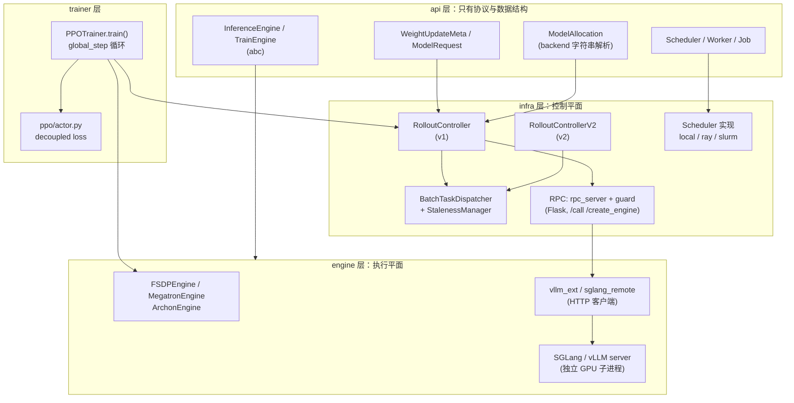
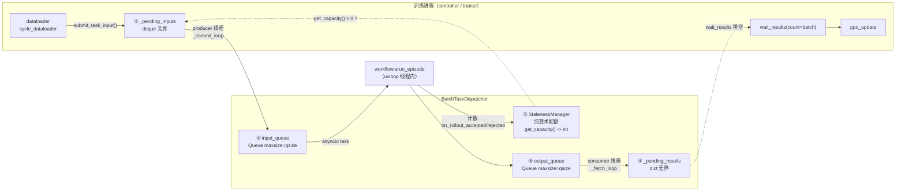
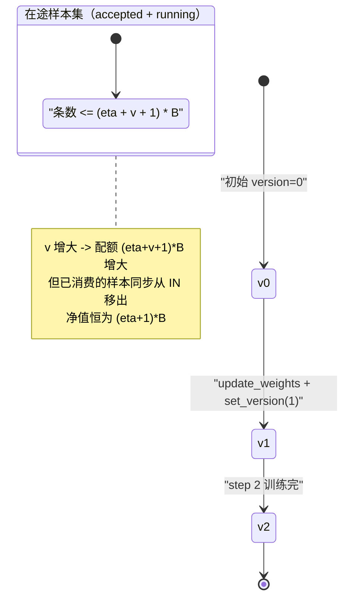
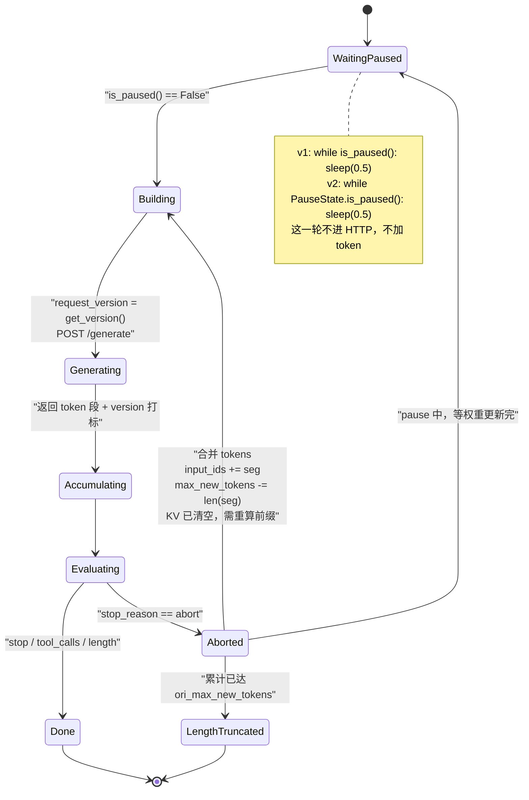
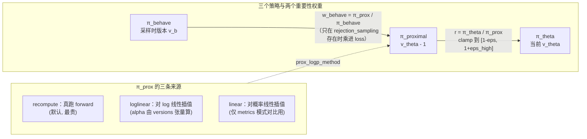
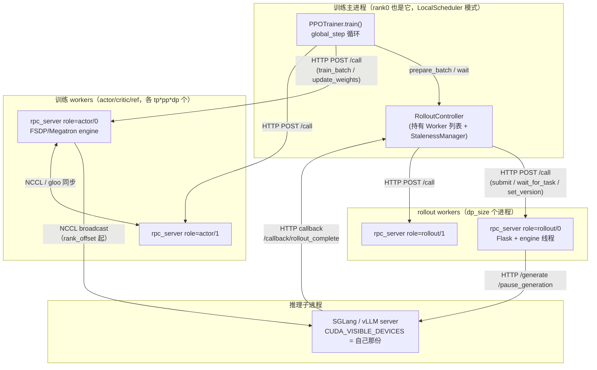

# AReaL v2.1.0 源码级素材

- 仓库：`~/Desktop/Projects/github/AReaL`
- commit：`ecc8b0e4dfb4e3965f67121a5c87866a07c390ae`（tag `v2.1.0`）
- 取证方式：`git -C ~/Desktop/Projects/github/AReaL show "<commit>:<path>"` / `git grep`，未 checkout
- permalink 形式：`https://github.com/areal-project/AReaL/blob/ecc8b0e4dfb4e3965f67121a5c87866a07c390ae/<path>#L<a>-L<b>`

> 本文只放实现细节与可核算的数字，不写文章段落。每个小节按 `NOTES-SPEC.md` §3 的模板。

---

## 0. 先列清单：AReaL 的「书」与「码」怎么分

**结论**：v2.1.0 是一个**两套执行栈并存**的仓库——`areal/infra` + `areal/engine` 是 v1（`rollout._version="v1"`），`areal/v2` 是 v2（`RolloutControllerV2` / `InfBridge` / data proxy）。两者共用 `areal/infra/staleness_manager.py`、`areal/infra/workflow_executor.py`、`areal/trainer/ppo/actor.py`。博客里若只说「AReaL 是全异步」，会漏掉 v1/v2 的分层。

**文档清单**（`git ls-tree -r --name-only <commit> -- docs/en`，共 37 个 md）：

| 主题 | 文件 | 行数 | 与本篇相关 |
| --- | --- | --- | --- |
| 异步总纲 | `docs/en/algorithms/async.md` | 70 | 专题 1/3 |
| 近端近似 | `docs/en/algorithms/prox_approx.md` | 233 | 专题 5 |
| 序列打包 | `docs/en/algorithms/sequence_packing.md` | 67 | 旁证 |
| GRPO 家族 | `docs/en/algorithms/grpo_series.md` | — | 旁证 |
| M2PO | `docs/en/algorithms/m2po.md` | 73 | 旁证（`use_decoupled_loss` 冲突） |
| 资源分配 | `docs/en/reference/alloc_mode.md` | 170 | 专题 7 |
| 工作流 API | `docs/en/reference/rollout_workflow.md` | 307 | 专题 4（`versions` 字段、dump 格式） |
| 智能体工作流 | `docs/en/reference/agent_workflow.md` | 608 | 专题 7（proxy） |
| 诊断 | `docs/en/best_practices/algo_perf.md` | — | 专题 5（decoupled 损失公式原文） |
| 版本史 | `docs/en/version_history.md` | — | 专题 8（2.77x / 1.5x） |
| 博客 | `blog/AReaL_v0_1.md` / `v0_2.md` / `v0_3.md` | — | 专题 8（测法） |
| 论文 PDF | `docs/paper/AReaL2.0_report.pdf`（13 页） | — | **注意：这是 AReaL 2.0 的 position paper，讲 agent 数据协议 / data proxy / evolution control plane，不含 2.77x 等系统数字** |

**源码清单**（与本篇相关的路径）：

```
areal/api/{cli_args,alloc_mode,engine_api,scheduler_api,io_struct,workflow_api}.py
areal/infra/staleness_manager.py            # 唯一一份 staleness 数学
areal/infra/workflow_executor.py            # BatchTaskDispatcher + WorkflowExecutor
areal/infra/async_task_runner.py            # uvloop 线程 + 双队列
areal/infra/controller/{rollout_controller,train_controller}.py
areal/infra/remote_inf_engine.py            # v1 HTTP 客户端 + 中断续跑
areal/infra/rpc/{rpc_server.py,guard/engine_blueprint.py,rtensor.py}
areal/infra/scheduler/{local,ray,slurm}.py
areal/engine/{fsdp_engine,megatron_engine,vllm_remote,sglang_remote}.py
areal/engine/vllm_ext/{areal_vllm_server,vllm_worker_extension}.py
areal/trainer/rl_trainer.py                 # 主循环，version 推进点
areal/trainer/ppo/actor.py                  # decoupled PPO / prox 近似
areal/utils/functional/functional.py        # ppo_actor_loss_fn
areal/v2/inference_service/{inf_bridge,pause.py,sglang/bridge,controller/controller}.py
```

---

## 1. 官方架构自述：AReaL 自己怎么定义「全异步」

### 1.1 一句话定义与开关

**结论**：AReaL 对「全异步」的定义**不是一个调度模式，而是一个整数旋钮**：`rollout.max_head_offpolicyness > 0` 即异步，`= 0` 即退化为同步。文档明确说同步「typically 2x slower」。

**代码/文档**（`docs/en/algorithms/async.md` L5-L11）：

```markdown
> **Note:** This guide applies to all algorithms when asynchronous training is enabled
> (i.e., `rollout.max_head_offpolicyness > 0`). Setting
> `rollout.max_head_offpolicyness=0` reverts AReaL to synchronous RL. The synchronous
> setting is useful for debugging but is typically 2x slower than asynchronous training.
```

**默认值**（`areal/api/cli_args.py` L2502-L2509）：

```python
    max_head_offpolicyness: int = field(
        default=0,
        metadata={
            "help": "Maximum off-policyness for the head. "
            "If the current version is more than this many versions behind, "
            "the request will not be accepted.",
        },
    )
```

**读法**：默认值是 0 → 默认就是同步。所以「AReaL 是全异步系统」的准确表述是：**AReaL 的架构是全异步的（generation 与 training 在不同 GPU 池、不同进程），但默认配置跑同步**。这一点在博客里容易被说反。

### 1.2 官方对「为什么同步慢」的自述（v0.3 博客，量化原因）

**结论**：官方给的理由不是「同步有气泡」，而是**解码退化为 memory-IO bound**——同步系统把 generation 摊到所有卡上，每卡 batch 变小，此时加卡不提吞吐。

**原文**（`blog/AReaL_v0_3.md` L66-L76）：

```markdown
Synchronous systems distribute generation across all devices, reducing the per-GPU
decoding batch size. This pushes the decoding process into a memory-IO-bound regime
where additional devices fail to improve throughput.


*Fig2. Left: Strong scaling of batched generation throughput for a 1.5B LRM. Right:
Generation becomes memory-IO bound as GPU count increases.*
```

**量化建模**（用来把「memory-IO bound」写成一个可算的判据）：

- 自回归解码每步必须把权重读一遍：`T_weight = Σ_l (2 · params_l bytes)`（bf16 每参数 2 byte）。
  以 H800 级卡 HBM 带宽 `BW ≈ 3.35 TB/s` 计，读一遍权重的时间
  `t_mem = bytes / BW`。
- 每步的计算量 `FLOPs ≈ 2 · P · B`（P=参数量，B=本次并发 token 数），算力 `F`，则
  `t_compute = 2 · P · B / F`。
- 判据：当 `t_compute < t_mem` 即为 memory-IO bound，即
  `B < BW · F / (2 · P^2 / P) = BW / (2 · P)`（写成每参数字节）→ **`B* ≈ BW / (2 · bytes_per_param · P)`**。
- 代入 1.5B、bf16：`B* ≈ 3.35e12 / (2 · 2 · 1.5e9) ≈ 558` 个并发 token。同步系统把 16 节点 × 8 卡都拿来解码时，每卡并发被摊薄到远小于 558，于是每加一张卡只多一个几乎空转的 HBM 读流 → 吞吐曲线饱和。这正好解释 `Fig2`。

> 这条是本文**自己推的模型**，不是文档原话；博客引用时须标注为「按官方结论做的量级核算」，不要写成 AReaL 的实测。

### 1.3 分层：api / engine / infra(controller, scheduler, rpc) / v2

**结论**：AReaL 的代码分层是 `api`（纯接口与数据结构）→ `infra`（控制器、调度器、RPC、staleness）→ `engine`（训练/推理引擎实现）→ `trainer`（主循环）→ `v2`（agent 服务化的第二套栈）。api 层是**懒加载的纯协议层**，不含实现。

**代码**（`areal/api/__init__.py` L5-L25 与 `areal/api/scheduler_api.py` L43-L49）：

```python
__all__ = [
    "RolloutWorkflow", "AsyncRewardWrapper", "TrainEngine", "InferenceEngine",
    "Scheduler", "Worker", "Job", "AllocationType", "ModelAllocation",
    "ParallelStrategy", "FSDPParallelStrategy", "MegatronParallelStrategy",
    "ModelRequest", "ModelResponse", "WeightUpdateMeta", "SaveLoadMeta",
    "StepInfo", "FinetuneSpec", "ParamSpec", "RolloutStat", "LocalInfServerInfo",
    "WorkflowLike", "AgentWorkflow",
]
```

```python
class Scheduler(abc.ABC):
    """Abstract base class for schedulers that manage distributed worker processes.

    A scheduler is responsible for creating and managing worker processes/containers,
    allocating resources (GPUs, ports, memory), creating and managing engine instances
    on workers, and facilitating RPC calls to engine methods.
    """
```

**读法**：`Scheduler` 的 docstring 是「四件事」的官方定义——建进程 / 分资源 / 在 worker 上建 engine / 做 RPC。AReaL 的整个控制平面都收敛到这一个抽象，`LocalScheduler` / `RayScheduler` / `SlurmScheduler` 只是它的三个实现。

**图**（`flowchart`，应画「AReaL 的分层 + 谁持有谁」）：



### 1.4 v1 / v2 的分界

**结论**：v1 与 v2 **不能混用**，`_validate_cfg` 会硬性拒绝；v2 把「回滚/重提交」的复杂度移到了 data proxy 的 `InfBridge`。

**代码**（`areal/trainer/rl_trainer.py` L1522-L1529）：

```python
        # Ensure actor and rollout controller versions match.
        actor_version = self.config.actor._version
        rollout_version = self.config.rollout._version
        if actor_version != rollout_version:
            raise ValueError(
                f"actor._version ('{actor_version}') and rollout._version "
                f"('{rollout_version}') must match. Both must be 'v1' or both 'v2'."
            )
```

**坑**：v1 的 `RemoteInfEngine.agenerate` 与 v2 的 `InfBridge.agenerate` 是**两份各自实现了中断续跑的代码**（见专题 4），行为参数不同（v1 靠 `workflow_executor.is_paused()` 轮询 0.5s；v2 靠 `PauseState` + `max_resubmit_retries=20` 上限）。换版本会静默改变「单条轨迹最多被中断几次」。

---

## 2. 三层队列：样本队列 / staleness 配额 / 结果队列

### 2.1 层结构（谁有界谁无界）

**结论**：AReaL 的 rollout 侧不是「三个队列」，而是 **4 个缓冲 + 1 个纯算术的配额函数**：

| # | 名称 | 数据结构 | 位置 | 界 |
| --- | --- | --- | --- | --- |
| ① | 待提交输入 | `deque[TInput]` | `BatchTaskDispatcher._pending_inputs` | **无界**（源码注释明说 "Unbounded deques"） |
| ② | runner 输入队列 | `queue.Queue(maxsize=qsize)` | `AsyncTaskRunner.input_queue` | 有界，`qsize = config.queue_size or max_concurrent_rollouts * 16` |
| ③ | runner 输出队列 | `queue.Queue(maxsize=qsize)` | `AsyncTaskRunner.output_queue` | 有界（同一个 qsize） |
| ④ | 已完成但未被训练消费 | `dict[int, TimedResult]` | `BatchTaskDispatcher._pending_results` | **无界** |
| ⑤ | staleness 配额 | 不是队列，是 `get_capacity()` 的返回值 | `StalenessManager` | 由公式给出，可为负 |

**代码**（`areal/infra/workflow_executor.py` L309-L322）：

```python
        self.runner = AsyncTaskRunner(
            max_queue_size=max_queue_size,
            enable_tracing=enable_tracing,
        )
        self.task_factory = task_factory
        self.staleness_manager = staleness_manager
        self.enable_tracing = enable_tracing
        self.deterministic_order = deterministic_order
        self.logger: Logger

        # Unbounded deques for producer/consumer pattern
        self._pending_inputs: deque[TInput] = deque()
        self._pending_results: dict[int, TimedResult[TResult]] = {}
        self._active_task_ids: set[int] = set()
```

**qsize 的计算**（`areal/infra/controller/rollout_controller.py` L217）：

```python
        qsize = self.config.queue_size or max_concurrent_rollouts * 16
```

**读法**：`max_concurrent_rollouts` 默认等于 `consumer_batch_size`（`cli_args.py` L2487-L2493）。所以**默认条件下 qsize = 16 × consumer_batch_size**，②③ 的界是训练批的 16 倍——这是一个非常宽的界，意味着正常情况下 back-pressure 只会来自 ①⑤ 而不是队列溢出。

**图**（`flowchart`，应画「三层缓冲 + 每层标注有界/无界 + 谁调用了 counter」）：



### 2.2 三层之间的真实约束：三个独立的条件

**结论**：放行一条新 rollout 需要**三个条件同时成立**，代码把它们写在两个不同地方，容易只看到其中一个。

**代码**（`areal/infra/workflow_executor.py` L356-L361 与 L464-L477）：

```python
    def _has_runner_capacity(self) -> bool:
        return (
            not self.runner.paused.is_set()
            and self.staleness_manager.get_capacity() > 0
            and self.runner.get_input_queue_size() < self.runner.max_queue_size
        )
```

```python
    def _get_next_task_for_submission(self) -> TInput | None:
        with self._input_cv:
            while not self._shutdown_event.is_set():
                self._check_thread_exception()
                # There is capacity and pending inputs
                if (
                    not self.runner.paused.is_set()
                    and self.staleness_manager.get_capacity() > 0
                    and self._pending_inputs
                ):
                    return self._pending_inputs.popleft()
                self._input_cv.wait()
```

**读法**：`_has_runner_capacity`（含队列长度）只用于**唤醒条件**；真正决定是否出队的是 `_get_next_task_for_submission`（**不含队列长度**）。队列满由 `runner.submit` 抛 `TaskQueueFullError` → `appendleft` 放回 + `wait_for` 再等（L404-L414）。即：**队列长度是「事后兜底」，staleness 配额是「事前准入」**。

### 2.3 结果队列的排序语义：不是 FIFO

**结论**：`_pending_results` 是 `dict`，`wait_results` 排空后按 **task 创建时间**（`time.monotonic_ns()`）升序取前 count 个，然后 **随机打乱**；`deterministic_sampling=True` 时改按 task_id 排序且不打乱。

**代码**（`areal/infra/workflow_executor.py` L267-L285）：

```python
def _select_results(
    drained: list,
    count: int,
    deterministic: bool,
) -> tuple[list, list]:
    """Order drained results, then split them into (selected, pending).

    Normally results are taken oldest-first and the returned batch is
    shuffled to avoid systematic ordering bias. Under deterministic sampling,
    completed results are ordered by task ID and are not shuffled.
    """
    if deterministic:
        drained.sort(key=lambda x: x.task_id)
    else:
        drained.sort(key=lambda x: x.create_time)
    selected, pending = drained[:count], drained[count:]
    if not deterministic:
        random.shuffle(selected)
    return selected, pending
```

**读法**：「oldest-first」保证**训练优先拿最老的样本**，这在 off-policy 系统里是最小化 staleness 的贪心策略；「再 shuffle」是防止 data order 与 process order 相关。注释原文 "to avoid systematic ordering bias" 就是设计理由。

**量化**：设消费者一次要 `batch` 条，此刻 `_pending_results` 有 `n` 条（`n ≥ batch`），则被选中的 `batch` 条其 create_time 是 `n` 条中最小的 `batch` 条——**最坏情况下训练消费的样本比「最新样本」老 `n - batch` 个位置**。所以 `_pending_results` 越大，实际 staleness 越大（虽然 `max_head_offpolicyness` 的公式是按 version 算的，见专题 3，两者是**两个独立的老化来源**）。

---

## 3. staleness 数学：`max_head_offpolicyness` 怎么变成真实 staleness

### 3.1 唯一的公式

**结论**：`max_head_offpolicyness` 不是一个「拒绝判定」，而是一个**准入配额**：它限定「已接受 + 正在跑」的样本总数不超过 `(η + v + 1) · B`，其中 `v` 是当前推理版本、`B` 是消费批大小。

**代码**（`areal/infra/staleness_manager.py` L79-L113）：

```python
        with self.lock:
            current_version = self.version_provider.get_version()
            # Calculate concurrency-based capacity
            max_concurrent_rollouts = max(1, self.max_concurrent_rollouts)
            concurrency_capacity = max_concurrent_rollouts - self.rollout_stat.running

            # Calculate staleness-based capacity
            ofp = self.max_staleness
            sample_cnt = self.rollout_stat.accepted + self.rollout_stat.running
            consumer_bs = max(1, self.consumer_batch_size)
            staleness_capacity = (ofp + current_version + 1) * consumer_bs - sample_cnt

            # Return the minimum of both constraints
            capacity = min(concurrency_capacity, staleness_capacity)
            return capacity
```

**公式**（文档 docstring 原文，L92-L95）：

```
max_samples = (max_staleness + current_version + 1) * consumer_batch_size
capacity = min(concurrency_limit, max_samples - current_samples)
```

即：

$$
\text{cap} = \min\Bigl(C_{\max} - R,\; (\eta + v + 1)\,B - (A + R)\Bigr)
$$

`η` = `max_head_offpolicyness`，`v` = `current_version`，`B` = `consumer_batch_size`，`A` = accepted，`R` = running，`C_max` = `max_concurrent_rollouts`。

### 3.2 η 的语义推导：为什么是 `η + 1`

**结论**：`(η + 1)·B` 的意思是「**允许存在 η+1 个训练批的未消费样本**」。因为每训练一个 step，`v` 加 1 且**恰好消费一个 B**，所以「第 v 个版本时提交的样本，最晚可以被第 v+η+1 个版本消费」，其 version 差即 `η`。

**推导**（可写进博客的算式）：

1. 版本推进：`rl_trainer.py` L888 `new_version = global_step + 1`，每 step 恰好 +1。
2. 每 step 消费：`prepare_batch` 返回 `dataloader.batch_size` 条（`rollout_controller.py` L1064-L1067）。
3. 当前版本 `v` 时，系统里最多允许 `(η+v+1)B` 条样本（已接受 + 在跑）。已消费掉的历史样本恰好是 `v·B` 条（每版本一批）。
4. 于是「在途 + 未消费」= `(η+v+1)B − vB = (η+1)B`。这 (η+1) 批里最早的一批是在版本 `v−η` 时提交的 → 被版本 `v` 训练时 stale 了 `η` 步。**η 就是「最老样本的 version 差」的上界**。
5. 边界：`η=0` → 只能有 1 批在途 → 严格同步（生成一批、训一批）。这与 `async.md` L8 的「`=0` reverts to synchronous」一致。

**量化表**（代入 `B=128`，看 `v` 增长时 `staleness_capacity` 如何变化）：

| 场景 | v | A+R | η | staleness_capacity | concurrency_capacity (C_max=128) | cap |
| --- | --- | --- | --- | --- | --- | --- |
| 刚启动 | 0 | 0 | 0 | 128 | 128 | 128 |
| 稳态 η=0 | 5 | 128 | 0 | (5+1)·128−128 = 640 | 0 | **0**（必须等消费） |
| 稳态 η=4 | 5 | 0 | 4 | (4+5+1)·128 = 1280 | 128 | **128**（被并发限住） |
| η=4 且已积压 | 5 | 1216 | 4 | 1280−1216 = 64 | 128 | **64** |
| η=4 积压到顶 | 5 | 1280 | 4 | 0 | 128 | **0** |

**读法**：注意 `η=0, v=5, A+R=128` 那一行 `cap` 为 0——同步模式在「上一批还没被消费」时**完全停止提交**，这就是同步模式「等待最长响应」的源头。

### 3.3 恢复训练时的版本跳变（一个真实的坑）

**结论**：checkpoint 恢复会让 `v` 从 0 跳到 `recovery_version`，若不对 `accepted` 做补偿，配额会瞬间放大 `v` 倍，造成「提交风暴 + 无界 staleness」。

**代码**（`areal/infra/staleness_manager.py` L115-L131）：

```python
    def on_version_recovered(self, version: int) -> None:
        """Adjust accepted count after checkpoint recovery.

        When a checkpoint is recovered, the version jumps from 0 to the
        recovered value. Without adjusting accepted, the capacity formula
        yields (max_staleness + version + 1) * batch_size instead of the
        intended (max_staleness + 1) * batch_size, causing a burst of
        submissions and unbounded staleness growth.
        ...
        """
        with self.lock:
            consumer_bs = max(1, self.consumer_batch_size)
            self.rollout_stat.accepted = version * consumer_bs
```

**调用点**（`areal/trainer/rl_trainer.py` L479-L487）：

```python
        # stays bounded despite the version jumping from 0 to recovery_version.
            recovery_version = self.recover_info.last_step_info.global_step + 1
            ...
                sm.on_version_recovered(recovery_version)
```

**量化**：设 `η=4`、`B=128`、从 step 500 恢复：不补偿则 `cap = (4+501+1)·128 − 0 = 64768` 条一次放行；补偿后 `accepted = 501·128 = 64128`，`cap = (4+501+1)·128 − 64128 = 640 = (η+1)·B`。**放行量差 101 倍**。

### 3.4 实际的 per-token staleness 存在哪：`versions` 张量

**结论**：`max_head_offpolicyness` 管的是「批级别」的准入；**单 token 的真实 staleness 存在轨迹的 `versions` 字段里**，由输出阶段的 `request_version` 逐段打标。`loglinear` 近似（专题 5）直接读这个张量。

**代码**（`areal/infra/remote_inf_engine.py` L966-L977）：

```python
            # Pin the version that serves this request. A trajectory may span
            # several weight versions, so each segment must be attributed to the
            # version that actually generated it rather than to whichever
            # version is current once the response arrives.
            request_version = self.get_version()

            # Build request using backend
            http_req = self.backend.build_generation_request(
                req,
                with_lora=self.config.use_lora,
                version=request_version,
            )
```

**读法**：注释 "A trajectory may span several weight versions" 就是「segments produced by different model versions」这件事在代码里的落点。`versions` 张量的字段定义见 `docs/en/reference/rollout_workflow.md` L71（`versions` `[batch_size, seq_len]` int32，"Weight version when token generated"）。

**量化**：一条轨迹若被中断 `k` 次，其 `versions` 就最多有 `k+1` 个不同的值（run-length 段）。`rollout_workflow.md` 的 dump 格式直接给 `head_version` / `tail_version` / `version_rle`：

```json
"head_version": 5, "tail_version": 6, "version_rle": [[5, 100], [6, 200]]
```

**图**（`stateDiagram-v2`，应画「版本与样本并存时的三者关系」）：



---

## 4. 可中断 rollout：中断点、KV 怎么办、恢复时版本怎么变

### 4.1 中断点：pause → 推理侧 abort in-flight → 训练侧广播

**结论**：中断不是给 rollout 发信号，而是 **HTTP 打 `/pause_generation`（abort 全部在途请求，把已生成 token 作为 partial output 返回）**，客户端侧把 partial output 拼回 prompt 再重发；KV cache 在 pause 时被**清空**（`clear_cache=True`），不是保留。

**代码 A**（`areal/trainer/rl_trainer.py` L873-L895，主循环的中断点）：

```python
            # pause inference for updating weights, save, and evaluation
            self.rollout.pause()

            # Actor already onloaded; engine-internal _offload_aware_context
            # calls in update_weights/save are no-ops.

            with (
                stats_tracker.record_timing("update_weights"),
                perf_tracer.trace_scope(
                    "train.update_weights",
                    category=Category.COMM,
                    args={"global_step": global_step},
                ),
            ):
                # Use versioned path for weight updates
                new_version = global_step + 1
                versioned_meta = self.weight_update_meta.with_version(new_version)
                self.actor.update_weights(versioned_meta)
```

**代码 B**（`areal/engine/vllm_ext/areal_vllm_server.py` L207-L217，abort 语义）：

```python
@router.post("/areal_update_weights_xccl")
async def areal_update_weight_xccl(raw_request: Request):
    logger.info("API server starts areal_update_weight_xccl")
    llm = raw_request.app.state.engine_client
    await llm.pause_generation(wait_for_inflight_requests=False, clear_cache=True)
    await llm.reset_mm_cache()
    try:
        ret_list = await llm.collective_rpc("areal_update_weight_xccl")
    finally:
        await llm.resume_generation()
    return build_response(ret_list)
```

**读法**：`wait_for_inflight_requests=False` = 不等在途请求；`clear_cache=True` = 把 KV cache 清掉（因为权重已经变了，旧 KV 与新权重不自洽）。`finally: resume_generation()` 保证即使权重更新抛异常也会恢复生成——**但此时已用旧权重广播了一部分参数**，这是专题 6 的坑。

**官方自述**（`blog/AReaL_v0_3.md` L90-L98）：

```markdown
- **Interruptible Rollout Worker** handles two types of requests: (1) The *generate*
  request generates responses given prompts. (2) The *update_weights* request interrupts
  all ongoing generations and loads parameters of new versions. Upon the interruption,
  the rollout workers discard KV caches computed by old weights, and re-compute them
  using the new weights. Afterwards, the rollout workers continue to decode the
  unfinished sequences until the next interruption or termination. We emphasize that
  such interruptions and in-flight weight updates would result in trajectories composed
  of segments produced by different model versions.
```

> **注意**：博客说的是「discard KV caches computed by old weights, **and re-compute them using the new weights**」——即 KV **不保留**，重算。代码与这句话一致（`clear_cache=True` + 客户端重发 extended prompt）。所以「AReaL 保留 KV 跨版本续跑」是**错的**；正确说法是「保留已生成的 token，丢弃 KV，用新权重重算前缀」。

**SGLang 侧的两段式 pause**（`areal/engine/sglang_remote.py` L344-L364，很值得引用的「为什么两次」注释）：

```python
    def get_pause_requests(self) -> list[HttpRequest]:
        """Pause in two steps so memory can be released safely.

        The first request keeps SGLang's default mode, which aborts in-flight
        requests and returns their partial output so the client resumes them by
        extending the prompt. That also leaves the scheduler fully idle, which
        SGLang requires before releasing memory.
        ...
        return [
            self.get_pause_request(),
            self.get_pause_request(mode="in_place"),
        ]
```

### 4.2 恢复：客户端把 partial output 拼回 prompt

**结论**：v1 的续跑是**客户端循环**——`while stop_reason not in ["stop","tool_calls","length"]`，每次 abort 返回的 token 累加进 `req.input_ids`，`max_new_tokens` 扣减，然后重发新请求。

**代码**（`areal/infra/remote_inf_engine.py` L954-L964 + L1011-L1028）：

```python
        # Deal with rollout interruption
        stop_reason = None
        ori_max_new_tokens = gconfig.max_new_tokens
        while (
            stop_reason not in ["stop", "tool_calls", "length"]
            and len(accumulated_output_tokens) < ori_max_new_tokens
        ):
            # Request is interrupted, wait for some time to avoid interfering
            # with update weights requests
            while self.workflow_executor.is_paused():
                await asyncio.sleep(0.5)
```

```python
            # Update accumulated outputs
            accumulated_output_tokens.extend(gen_result.output_tokens)
            accumulated_output_logprobs.extend(gen_result.output_logprobs)
            accumulated_versions.extend(
                [request_version] * len(gen_result.output_tokens)
            )
            ...
            # Update request for next iteration
            req.input_ids += gen_result.output_tokens
            req.gconfig.max_new_tokens -= len(gen_result.output_tokens)
```

**读法**：**`request_version` 每轮循环重新取**（L970 在 while 内），所以续跑的那一段会被打上新版本号 → 一条轨迹的 `versions` 天然分段。这就是「轨迹跨版本」的代码级来源。

**另一处关键细节**：abort 发生在 **prefill 之前**时，SGLang 会返回 `"Abort before prefill"`，此时 token 列表为空（`areal/engine/sglang_remote.py` L124-L130）：

```python
        if stop_reason == "abort" and stop_message.startswith("Abort before prefill"):
            return HttpGenerationResult(
                output_tokens=[],
                output_logprobs=[],
                stop_reason=stop_reason,
                routed_experts=routed_experts,
            )
```

即：**prefill 前被中断 = 零成本重来；decode 中被中断 = 保留 token、丢 KV、重新 prefill 更长前缀**。后者的代价是 `O(L_prompt + L_gen_so_far)` 的 prefill 重算。

**量化**（中断代价）：

- 设 prompt 长 `P`、当前已生成 `g` 个 token、单次 abort 后重算 `P+g` 个 token 的 prefill。
- 一条完整轨迹长 `L`，被中断 `k` 次（在第 `g_1<g_2<...<g_k` 处），则**额外 prefill 成本** = `Σ_i (P + g_i)`，而理想成本是 `P`（一次 prefill）。
- 例：`P=512`，`L=8192`，中断于 `g=2048, 4096, 6144` → 额外 `Σ(512+g_i) = 3×512 + 12864 = 14400` token 的 prefill，相对理想 `512` 是 **28 倍**。
- 反过来，收益是「不必等最长响应」：官方 ablation 给出 4 节点上 1.5B **+12%**、7B **+17%** 生成吞吐（`blog/AReaL_v0_3.md` L198-L203）。

**图**（`stateDiagram-v2`，应画「一条请求在中断-恢复中的状态机」）：



**坑列表**（本专题实测到的边界）：

1. **v1 无重试上限**：`while` 循环只看 `stop_reason` 与 token 数，`ori_max_new_tokens` 用尽才退出。若 `max_head_offpolicyness` 很大且训练很快，一条请求可能被中断上百次，每次重算前缀 → 生成吞吐反而塌掉。
2. **v2 有上限**：`max_resubmit_retries = 20`（`areal/v2/inference_service/data_proxy/config.py` L16），超过后 `stop_reason` 被强制改成 `"length"`（`inf_bridge.py` L249-L251）→ **静默截断**，轨迹变短但 reward 照算。
3. **abort 若发生在 prefill 前**，`output_tokens=[]`，`accumulated_tokens` 不增长；若此时 `ori_max_new_tokens` 已为 0，则 `remaining <= 0` → 判定为 length。
4. **KV 不保留**：任何「AReaL 跨版本复用 KV」的描述都与 `clear_cache=True` 冲突。

---

## 5. Decoupled PPO：近似方式、公式、与标准 clip 的差别

### 5.1 三个策略与官方损失公式

**结论**：decoupled PPO 把标准 PPO 里的「一个 π_old」拆成三个：π_behave（采样时）、π_proximal（上一步权重，裁剪中心）、π_θ（当前）。损失是**两级重要性权重之积**。

**官方公式原文**（`docs/en/best_practices/algo_perf.md` L79-L84）：

```markdown
$$L = -\mathbb{E}\left[
\underbrace{\frac{\pi_{\text{proximal}}}{\pi_{\text{behave}}}}_{\text{behave imp weight}}
\cdot \min\left(
\underbrace{\frac{\pi_\theta}{\pi_{\text{proximal}}}}_{\text{importance weight}}
A, \text{clip}\left(\frac{\pi_\theta}{\pi_{\text{proximal}}}, 1-\epsilon,
1+\epsilon\right) A \right) \right]$$
```

写成通式：

$$
L(\theta) = -\,\mathbb{E}\Bigl[\; w_{\text{behave}} \cdot \min\bigl(r A,\; \operatorname{clip}(r, 1-\epsilon, 1+\epsilon)\,A\bigr)\Bigr],
\quad r = \frac{\pi_\theta}{\pi_{\text{proximal}}},\;
w_{\text{behave}} = \frac{\pi_{\text{proximal}}}{\pi_{\text{behave}}}
$$

**对照标准 PPO**（`π_old` 只有一份）：

$$
L_{\text{PPO}} = -\,\mathbb{E}\Bigl[\min\bigl(r A,\; \operatorname{clip}(r,1-\epsilon,1+\epsilon)A\bigr)\Bigr],\quad r = \pi_\theta/\pi_{\text{old}}
$$

**差别**（三条，都可落到代码）：

1. **裁剪中心不同**：标准 PPO 以「采样时的策略」为 1 点；decoupled 以「上一步训练完的策略」为 1 点。样本越老，`π_behave` 离 `π_proximal` 越远，`w_behave` 就把这条样本的整体权重放大/缩小。
2. **多一层 off-policy 修正**：`w_behave` 乘在整个 clip 项外面，且**本身不被 clip**（除非配 `rejection_sampling`），所以大 `w_behave` 会主导梯度。
3. **clip 的两侧可以不对称**：代码里 `eps_clip_higher` 允许上界单独设，见 5.3。

### 5.2 代码落点：`ppo_actor_loss_fn`

**结论**：`ratio = exp(logprobs − proximal_logprobs)`，`clipped_ratio = clamp(ratio, 1−eps, 1+eps_high)`，然后 `pg_loss = max(−A·ratio, −A·clipped_ratio)`，最后乘 `behave_imp_weight`。

**代码**（`areal/utils/functional/functional.py` L536-L571）：

```python
    elif importance_sampling_level == "token":
        # Standard PPO: per-token ratio
        ratio = torch.where(stat_loss_mask, torch.exp(logprobs - proximal_logprobs), 0)
    ...
    clipped_ratio = torch.clamp(
        ratio,
        1.0 - eps_clip,
        1.0 + (eps_clip if eps_clip_higher is None else eps_clip_higher),
    )

    pg_loss1 = -advantages * ratio
    pg_loss2 = -advantages * clipped_ratio
    clip_mask = pg_loss1.detach() < pg_loss2.detach()
    pg_loss = torch.max(pg_loss1, pg_loss2)
    ...
    if rejection_sampling is not None:
        behave_approx_kl = proximal_logprobs.detach() - old_logprobs.detach()
        behave_mask = (behave_imp_weight > 0).logical_and(loss_mask.bool())
        behave_approx_kl = torch.where(behave_mask, behave_approx_kl, 0.0)
        pg_loss = pg_loss * behave_imp_weight
```

**⚠ 与官方公式的一处不一致（重要）**：官方公式里 `w_behave` 乘在**整个 min 外面**；代码里 `pg_loss = pg_loss * behave_imp_weight` 也是乘在 max 之后——但**只在 `rejection_sampling is not None` 时才乘**。也就是说：

- `use_decoupled_loss=True` 且 `rejection_sampling=None` → **`w_behave` 根本没进损失**，实际退化成「以 π_proximal 为中心的普通 PPO」；
- 想真正实现官方公式，必须同时配 `rejection_sampling`（例如 `{level: token, action: mask, metric: ratio, upper: 5.0}`）。

**补充（同一机制在 CISPO 里复现）**：`cispo_loss_fn`（`functional.py` L740-L790 区段）也用一模一样的 `if rejection_sampling is not None: pg_loss = pg_loss * behave_imp_weight`（L772），并在 docstring 里写明 `old_logprobs: ... Required only when ``rejection_sampling`` is set (decoupled loss)`。说明这是**三个 loss 函数（PPO / CISPO / SAPO 分支）共用的约定**，不是 PPO 的偶然实现。loss 选择点在 `areal/trainer/ppo/actor.py` L587（cispo）/ L604（sapo）/ L615（ppo）。

**证据**（`areal/api/cli_args.py` L1816-L1823 与 L1941-L1952）：

```python
    rejection_sampling: RejectionSamplingConfig | None = field(
        default=None,
        metadata={
            "help": "Rejection sampling configuration for filtering stale samples. "
            "None disables filtering (equivalent to old behave_imp_weight_mode='disabled'). "
            "Only effective when use_decoupled_loss=True."
        },
    )
```

```python
        # Warn if decoupled loss is enabled but no rejection sampling configured.
        # The old default (behave_imp_weight_cap=5.0, mode=token_mask) enabled
        # filtering implicitly; the new default (rejection_sampling=None) disables
        # it. This warning helps users who relied on the old defaults.
        if self.use_decoupled_loss and self.rejection_sampling is None:
            logger.warning(
                "use_decoupled_loss=True with rejection_sampling=None: "
                "staleness filtering is disabled. If you previously relied on "
                "the default behave_imp_weight_cap=5.0 with token_mask mode, "
                "restore equivalent behavior with:\n"
                "  rejection_sampling:\n"
                "    level: token\n"
                "    action: mask\n"
                "    metric: ratio\n"
                "    upper: 5.0"
            )
```

（`areal/api/cli_args.py` L1937-L1952）

**读法**：这是本文最值得写的一个「文档与代码的缝隙」。注意 warning 的措辞是 "**staleness filtering** is disabled"——它把 `rejection_sampling` 讲成滤波器；但代码里 `pg_loss = pg_loss * behave_imp_weight` 也在同一个 `if` 里，所以 **`w_behave` 的去偏作用一起消失了**。作者自己用的词（"filtering"）与公式里的名字（"behave imp weight"）不是一回事，这是文档与实现之间最容易误读的一处。

**补充**：`rejection_sampling` 的 `metric` 可取 `ratio` / `kl_k1` / `kl_k2` / `kl_k3` / `binary_kl`（`functional.py` L236-L260）；`action` 取 `mask` / `clamp`；`level` 取 `token` / `sequence`。`metric="ratio"` 时在**对数空间做几何平均**聚合（`functional.py` L269-L273 注释原文："avoid the 'length trap' where arithmetic mean inflates sequence-level ratios"）。

### 5.3 `prox_logp_method` 四种模式与近似公式

**结论**：`π_proximal` 怎么来有 4 种：`recompute`（真跑一遍前向）、`loglinear`（对数空间插值）、`linear`（概率空间插值，仅 metrics 模式内部用）、`reuse_train_logp`（复用本次训练前向，要求 `ppo_n_minibatches=1`）。

**配置原文**（`areal/api/cli_args.py` L1832-L1844）：

```python
    prox_logp_method: str = field(
        default=PROX_LOGP_METHOD_RECOMPUTE,
        metadata={
            "help": "Method for computing proximal policy log-probabilities in decoupled PPO. "
            "Only effective when use_decoupled_loss=True. Options: "
            "'recompute' (default): Standard decoupled PPO, recompute proximal policy via forward pass. "
            "'loglinear': Use log-linear interpolation to approximate proximal policy (skip forward pass). "
            "'metrics': Like 'recompute', but also compute approximation metrics for evaluation. "
            "'reuse_train_logp': Reuse training forward-pass logprobs as the proximal "
            "logp (skip the extra forward; requires ppo_n_minibatches=1).",
            "choices": PROX_LOGP_METHODS_ALL,
        },
    )
```

**近端近似的核心公式**（`areal/trainer/ppo/actor.py` L793-L817）：

```python
    # Assume proximal version is current_version - 1 (last broadcast)
    # In AReaL, proximal policy is the last updated/broadcast policy version
    v_proximal = current_version - 1

    # Extract version information
    v_behave = versions.float()
    v_theta = float(current_version)

    # CRITICAL: Only approximate generated tokens (version >= 0)
    # Prompt tokens (version < 0) must NOT be approximated - they have no generation version
    generated_tokens_mask = versions >= 0

    # Compute interpolation factor alpha
    # When v_behave == v_proximal: alpha=0 (use old_logp)
    # When v_behave == v_theta: alpha=1 (use logprobs)
    # For prompt tokens (version < 0): alpha=0 (no interpolation)
    version_diff = v_theta - v_behave
    version_gap = v_proximal - v_behave
    # Avoid division by zero AND exclude prompt tokens
    alpha = torch.where(
        (version_diff > 0) & generated_tokens_mask,
        version_gap / version_diff,
        torch.zeros_like(v_behave),
    )
    alpha = torch.clamp(alpha, 0.0, 1.0)
```

**三种近似**（`areal/trainer/ppo/actor.py` L826-L846）：

```python
        if m == PROX_APPROX_METHOD_LOGLINEAR:
            # Method 1: Log-linear interpolation in log-space (geometric mean in probability space)
            # log(p_prox) = (1-α)·log(p_behave) + α·log(p_theta)
            approximations[PROX_APPROX_METHOD_LOGLINEAR] = old_logp + alpha * (
                logprobs - old_logp
            )

        elif m == PROX_APPROX_METHOD_LINEAR:
            # Method 2: Linear interpolation in probability space (arithmetic mean)
            # p_prox = (1-α)·p_behave + α·p_theta
            # Then convert back to log space: log(p_prox)
            p_behave = torch.exp(old_logp)
            p_theta = torch.exp(logprobs)
            p_arithmetic = (1 - alpha) * p_behave + alpha * p_theta
            approximations[PROX_APPROX_METHOD_LINEAR] = torch.log(p_arithmetic + 1e-10)
```

**公式汇总**（把代码翻成数学）：

$$
v_\text{prox} = v_\theta - 1,\qquad
\alpha = \operatorname{clamp}\!\left(\frac{v_\text{prox} - v_\text{behave}}{v_\theta - v_\text{behave}},\,0,\,1\right)\ \text{（仅 } v_\text{behave}\ge 0 \text{ 的生成 token）}
$$

- loglinear：$\log\pi_\text{prox} \approx \log\pi_\text{behave} + \alpha(\log\pi_\theta - \log\pi_\text{behave})$ —— 概率空间取**几何插值**
- linear：$\log\pi_\text{prox} \approx \log\bigl[(1-\alpha)\pi_\text{behave} + \alpha\pi_\theta\bigr]$ —— 概率空间取**算术插值**
- rollout：$\log\pi_\text{prox} = \log\pi_\text{behave}$（仅作 metrics 基线）

**α 的取值语义**（可直接画成轴）：

| `v_behave` | `v_θ`（当前） | `v_prox` | α | 近似结果 = 什么 |
| --- | --- | --- | --- | --- |
| `v_θ` | `v_θ` | `v_θ−1` | 1（clamp 后） | 完全等于 `log π_θ` → `r = π_θ/π_prox = 1`，裁剪失效 |
| `v_θ−1` | `v_θ` | `v_θ−1` | 0 | 等于 `π_behave`，即 `w_behave = 1` |
| `v_θ−4` | `v_θ` | `v_θ−1` | `3/4` | 插值 3/4 向 θ 靠 |
| `−1`（prompt token） | `v_θ` | — | 0 | 不插值，`log π_prox = log π_behave`（prompt token 本就被 `loss_mask` 屏蔽） |

**量化（误差与收益）**：官方 `docs/en/algorithms/prox_approx.md` L141-L146 给的目标区间：

- log-prob 绝对误差 **0.001–0.01**，相对误差 **0.1%–1%**
- 重要性权重绝对误差 **0.001–0.01**，相对误差 **0.1%–1%**

**收益的本质是一个前向 pass**（`prox_approx.md` L17-L23）：

```markdown
### Performance Benefits

- **27% faster training**: Eliminates one full forward pass per step (163 min vs 207 min
  for 300 steps)
- **Better evaluation reward**: Achieves 0.799 vs 0.795 on GSM8K
- **Comparable task reward**: 0.937 vs 0.954 (within 2%)
```

**自估成本算式**（可放到博客里作为 sanity check）：单步训练含 1 次 forward（算 logp）+ 1 次 forward/backward（PPO 更新），FP 部分约占 1/2 的 forward 等价工作量。若去掉那次额外 forward，理论上限约 `1/(1+0.5) = 33%`。官方实测 **27%**（207→163 min），与「forward ≈ backward 的一半」这一常见经验一致——**这就是为什么消掉一个 forward 只能换来 ~1/4 而不是 1/3 的加速**。

**与标准 PPO 的差别再补一条**：`recompute_logprob` 与 `use_decoupled_loss` 的关系（`async.md` L32-L40）：`use_decoupled_loss=True` 隐含打开 `recompute_logprob`；即**行为策略 logp 必须重算一次**，否则 `w_behave` 的两端都来自推理后端，误差会串起来。

### 5.4 `should_compute_prox_logp`：谁决定要不要跑那个 forward

**代码**（`areal/api/cli_args.py` L1861-L1872）：

```python
    def should_compute_prox_logp(self) -> bool:
        """Determine if forward pass is needed for proximal log-probabilities.
        ...
        method = ProxLogpMethod(self.prox_logp_method)
        return (self.use_decoupled_loss and not method.skips_forward_pass()) or (
            not self.use_decoupled_loss and self.recompute_logprob
        )
```

**调用点**（`areal/trainer/rl_trainer.py` L784-L796）：

```python
            if config.actor.should_compute_prox_logp():
                with (
                    stats_tracker.record_timing("recompute_logp"),
                    ...
                    prox_logps = self.actor.compute_logp(rollout_batch)
                    ...
```

**读法**：开关是「组合」出来的，`loglinear` 模式下这个 `if` 整块被跳过——这就是「zero user script changes」的实现（`prox_approx.md` L147-L150："the forward pass is automatically skipped in `compute_logp()`"）。

### 5.5 坑：与 SAPO 互斥、与 M2PO 的交互

**代码**（`areal/api/cli_args.py` L1961-L1965）：

```python
            if self.use_decoupled_loss:
                raise ValueError?  # (见下方原文)
                    "SAPO is not compatible with `use_decoupled_loss=True`. "
                    "Please set `actor.use_decoupled_loss=false` in your configuration."
```

**原文**（`docs/en/algorithms/async.md` L47-L49）：

```markdown
> **Note:** The decoupled PPO loss may conflict with certain algorithm configurations
> (e.g., SAPO). The effects of asynchrony on these newer algorithms remain largely
> understudied.
```

**图**（`flowchart`，应画「三种 π 的三角关系 + 两把尺子」）：



---

## 6. 权重更新路径：`update_weights` 失败时到底发生什么

### 6.1 两条路径：`xccl`（NCCL 广播）与 `disk`（落盘再加载）

**结论**：`WeightUpdateMeta.type ∈ {"disk","xccl","awex"}`。`xccl` 走「训练 rank0 向推理集群 broadcast」；`disk` 走「训练侧写 safetensors → 推理侧从盘加载 → controller 删目录」；`awex` 是同卡共置模式（进程内 IPC）。

**代码**（`areal/engine/megatron_engine.py` L967-L1001）：

```python
    def update_weights(self, meta: WeightUpdateMeta):
        self._check_rollout_engine_connected()
        if meta.type == "awex":
            # Colocate mode flow (mirrors the AWEX reference integration):
            # 1. execute_colocate_weight_update: release grad → convert → offload
            #    weights → signal offloaded → IPC serialize → wait reader done →
            #    cleanup shared → signal write_finished
            # 2. finish: wait all infer engines done → cleanup MetaServer keys
            # 3. resume kv_cache + continue generation
            self._awex_adapter.execute_colocate_weight_update(meta.version or 0)
            ...
        with self._offload_aware_context():
            if meta.type == "xccl":
                assert self.weight_update_group_initialized
                self._update_weights_from_distributed(meta)
            elif meta.type == "disk":
                self._update_weights_from_disk(meta)
            else:
                raise ValueError(f"Unknown weight update type {meta.type}")
```

**字段**（`areal/api/io_struct.py` L184-L219，注意 `weight_chunked_mem_mb` 默认 1024 与 `with_version` 的目录改写）：

```python
class WeightUpdateMeta:
    type: Literal["disk", "xccl", "awex"]
    path: str | None = None
    gen_allocation: ModelAllocation | None = None

    nccl_master_address: str | None = None
    nccl_master_port: int | None = None
    nccl_group_name: str | None = None
    weight_chunked_mem_mb: int = 1024
    ...
    def with_version(self, version: int) -> "WeightUpdateMeta":
        """Return a copy of this meta with versioned path."""
        new_meta = copy.copy(self)
        new_meta.version = version
        if self.path is not None:
            base_dir = os.path.dirname(self.path)
            new_meta.path = os.path.join(base_dir, f"weight_update_v{version}")
        return new_meta
```

### 6.2 单 pending bucket 的流水线（FSDP 侧）

**结论**：FSDP 侧不是「一次性全量 broadcast」，而是按 `weight_chunked_mem_mb` **切桶**，并且只保留**一个**在途桶（single-pending-bucket）：切桶时等上一个桶完成，再开下一个。

**代码**（`areal/engine/fsdp_engine.py` L1652-L1681）：

```python
                tensor_size = tensor.numel() * tensor.element_size()
                bucket_overflow = (
                    buffer_size > 0
                    and tensor_size + buffer_size > weight_chunked_mem_size
                )
                if bucket_overflow:
                    # Only middle buckets need drain+align before the next all-gather.
                    if pending_bucket is not None:
                        self._wait_pending_weight_update_bucket(pending_bucket)
                        pending_bucket = None

                    pending_bucket = self._update_bucket_weights_from_distributed_async(
                        meta,
                        named_tensors,
                        stream=broadcast_stream,
                    )

                    named_tensors = []
                    buffer_size = 0
```

**量化**（权重同步的通信量，可直接算）：

- 全量模型 bf16：`bytes = 2 · P`。7B → **14 GB**；70B → **140 GB**。
- 单桶上限 `1024 MB`（默认）→ 7B 需要 `ceil(14/1) = 14` 个桶；70B 需要 **140 个桶**。
- 桶间是串行的（single-pending），所以同步时间下界 `≈ (P · 2 bytes) / BW_nccl`。若 IB 有效带宽 200 GB/s（单卡），7B 至少 `14/200 ≈ 70 ms`；**任何启动开销 × 140 次**（70B）会显著堆上去——这是「bucket 越小越好」与「bucket 越多越慢」的权衡。
- 反方向：桶越大，峰值显存越多（要暂存一个桶的完整张量）。

### 6.3 失败语义：`False, msg` → HTTP 400 → **丢失，但只影响这一轮**

**结论**：推理侧的 worker extension 方法全部是「catch 一切异常，`logger.error`，`return False, error_msg`」；server 侧把任何一个 rank 的失败转成 **HTTP 400**；客户端侧 `raise_for_status()` 抛 `ClientResponseError`；但**客户端是用 `max_retries=1` 发的请求**，所以这个 400 **不会被任何重试吸收**——它会一路 `raise` 回训练进程，整个训练 **crash**。真正「静默」的部位不在 update 请求本身，而在另外两类请求（见下）。

**代码 A**（`areal/engine/vllm_ext/vllm_worker_extension.py` L39-L56）：

```python
    def areal_update_weights(self, model_path):
        logger.info(f"start update weights, {model_path}", flush=True)
        try:
            ...
            self.sync()

            return True, "Success"
        except Exception as e:
            error_msg = f"failed to upload weights! {e}"
            logger.error(error_msg)
            return False, error_msg
```

**代码 B**（`areal/engine/vllm_ext/areal_vllm_server.py` L90-L108，`False` 如何变成 400）：

```python
def to_json_response(success, message):
    content = {"success": success, "message": message}
    if success:
        return JSONResponse(content, status_code=200)
    else:
        return JSONResponse(content, status_code=400)


def build_response(ret_list):
    success = True
    message = ""
    for rank, ret_value in enumerate(ret_list):
        if_success, msg = ret_value
        success = success if if_success else False
        ...
    return to_json_response(success, message)
```

**代码 C**（`areal/infra/utils/http.py` L178-L224，客户端语义：`raise_for_status` + 1 次重试）：

```python
            async with ctx as response:
                ...
                response.raise_for_status()
                ...
        except (TimeoutError, aiohttp.ClientError, aiohttp.ClientResponseError) as e:
            ...
            last_exception = e
            if attempt < max_retries - 1:
                await asyncio.sleep(retry_delay)
            continue
    if session is None:
        await _session.close()
    raise RuntimeError(
        f"Failed after {max_retries} retries each. "
```

**代码 D**（`areal/infra/remote_inf_engine.py` L1651-L1670，**`max_retries=1` 硬编码**）：

```python
        # Execute all requests sequentially (they may have dependencies)
        ...
            for http_req in weight_reqs.requests:
                jobs = [
                    arequest_with_retry(
                        session=session,
                        addr=addr,
                        endpoint=http_req.endpoint,
                        payload=http_req.payload,
                        method=http_req.method,
                        max_retries=1,
                        timeout=request_timeout,
                    )
                    for addr in addresses
                ]
                await asyncio.gather(*jobs)
```

**读法**：`max_retries=1` 不是 bug——上面那句注释 "they may have dependencies" 解释了原因：权重更新是**状态机式的两步**（`set_meta` 然后 `update`），重试任意一步都可能让集群处于**半更新**状态。所以作者选择「失败就 fail fast」。而 `request_retries=3`（`cli_args.py` L2564-L2566）只用于生成类请求。

**真「静默」在哪**（三个地方）：

1. **`best_effort=True` 的 LoRA 请求**（`areal/engine/sglang_remote.py` L186-L211 + `remote_inf_engine.py` L1556-L1565）：`load_lora_adapter` / `unload_lora_adapter` 失败**只 `logger.warning`**：
   ```python
                if http_req.best_effort:
                    # Cleanup requests (e.g. unloading a stale LoRA adapter) must
                    # not fail the weight update: the target may already be gone.
                    results = await asyncio.gather(*jobs, return_exceptions=True)
                    for r in results:
                        if isinstance(r, Exception):
                            logger.warning(
                                f"Best-effort request to {http_req.endpoint} "
                                f"failed (ignored): {r}"
                            )
   ```
   → LoRA 版本没加载成功时，整个 `update_weights` **返回正常**，但推理仍在用旧 adapter。**这是真正的「只 log.warn 返回成功」**。
2. **`init_weights_update_group` 的异步回调**（`remote_inf_engine.py` L1102-L1112）：`fut.add_done_callback` 里若 `fut.exception() is not None` 只 `logger.error(...)` 再 `return`。**Future 的异常被这个 callback 吞掉**，但 Future 本身的异常仍会由 `fut.result()` 抛出（见 `fsdp_engine.py` L1405 `fut.result()`）——所以这条其实**不会**静默。
3. **`bridge` 回落路径**（`areal/engine/megatron_engine.py` L547-L563）：`use_bridge_for_update_weights=True` 但在 FP8/LoRA/非 megatron-bridge 时**静默换用 registry 转换**：
   ```python
            # Warn once if bridge-delegated weight sync was requested but a
            # fallback condition forces the registry conversion path (the
            # dispatch in _update_weights_from_distributed silently falls back).
   ```

**约定结论（给博客的准确表述）**：AReaL 的 `update_weights` **不是**「失败只 log.error 返回 False」；准确说法是：

- **推理 worker 内部**：所有 `areal_*` 方法都是 `try/except → logger.error → return False, msg`（不抛异常）；
- **HTTP 边界**：`False` → HTTP 400，客户端 `raise_for_status` → 抛 `RuntimeError` → 训练 crash；
- **例外是 LoRA adapter 的装卸**（`best_effort`），那里是真的「只 warn 继续跑」。

### 6.4 一个真实的半更新窗口

**代码**（`areal/engine/vllm_ext/areal_vllm_server.py` L213-L217）：

```python
    try:
        ret_list = await llm.collective_rpc("areal_update_weight_xccl")
    finally:
        await llm.resume_generation()
    return build_response(ret_list)
```

**坑**：`finally` 里无条件 resume。若 `areal_update_weight_xccl` 在某个 TP rank 上中途失败（例如第 3 个参数 broadcast 超时），则**部分参数已是新值、部分是旧值**，且 server 已经恢复生成。客户端会收到 400 并 crash，但如果外层有 supervisor 重启训练，下一秒的 rollout 就是在「缝合权重」上生成的。代码里没有任何 rollback / 校验机制。

**量化**（这个窗口的概率上界）：设单次 update 有 `n` 个参数块、每块失败率 `p`，则「全部成功」概率 `(1−p)^n`。70B 模型按 1024MB 分桶约 140 块，`p=1e-4` 时成功率 `≈ 0.986`——**每 70 次更新就有一次会 crash 或进入半更新**。

---

## 7. 训练端与推理端的进程 / RPC 拓扑

### 7.1 三层进程：trainer / worker(rpc_server) / engine(gpu 子进程)

**结论**：AReaL 的部署是 **controller 进程（训练主进程）→ 每 role 的 N 个 RPC worker 进程（Flask）→ 每个 worker 里的 engine 线程 → 部分 engine 再起 GPU 子进程（SGLang/vLLM）**。文档 `gsm8k_grpo.md` L320-L334 明确说是 "Level 3 - GPU Subprocess"。

**代码 A**（`areal/infra/rpc/rpc_server.py` L33-L62，一个 worker 就是一个 Flask app）：

```python
def main():
    parser = make_base_parser(
        description="AReaL Sync RPC Server for TrainEngine/InferenceEngine"
    )
    ...
    state = GuardState()
    bind_host = configure_state_from_args(state, args)

    app = create_app(state)
    app.register_blueprint(data_bp)
    app.register_blueprint(engine_bp)
    register_engine_hooks(state)

    state.register_cleanup_hook(lambda: perf_tracer.save(force=True))
    ...
    run_server(state, app, bind_host, args.port)
```

**代码 B**（`areal/infra/rpc/guard/engine_blueprint.py` L9-L16，**为什么要「engine 线程」**）：

```python
Routes:

- ``POST /set_env``       — set environment variables in the engine thread
- ``POST /create_engine`` — instantiate a TrainEngine or InferenceEngine
- ``POST /call``          — invoke a method on a named engine instance

The engine thread guarantees serial execution of all engine operations,
which is required for NCCL compatibility.
```

**读法**：这是整个拓扑的关键约束——**worker 内的 Flask 是多线程的，但 engine 调用被强制路由到一个单线程**，因为 NCCL collective 要求「所有 rank 以相同顺序进入」。所以在 AReaL 里，**并发发生在 controller 层（多个 worker 并行），不发生在 worker 内**。

**代码 C**（`areal/infra/scheduler/local.py` L341-L358，worker 进程命令行）：

```python
            module_path = command or "areal.infra.rpc.rpc_server"
            raw_cmd = [
                sys.executable,
                "-m",
                module_path,
                "--host", "0.0.0.0",
                "--port", str(forked_port),
                "--experiment-name", str(self.experiment_name),
                "--trial-name", str(self.trial_name),
                "--role", role,
                "--worker-index", str(idx),
            ]
```

**图**（`flowchart`，应画「部署拓扑 + 每条边是什么协议」）：



### 7.2 controller 侧的「怎么把任务派到 worker」

**结论**：**round-robin**，不是负载感知。`choose_server` 里写死了只支持 round-robin，否则 `NotImplementedError`。

**代码**（`areal/infra/controller/rollout_controller.py` L781-L794 与 `remote_inf_engine.py` L870-L887）：

```python
    def _choose_worker(self) -> tuple[Worker, int]:
        """Choose a worker for the next request using round-robin scheduling.
        ...
        if not self.workers:
            raise RuntimeError("No workers available to choose from.")
        worker = self.workers[self._current_worker_idx]
        rank = self._current_worker_idx
        self._current_worker_idx = (self._current_worker_idx + 1) % len(self.workers)
        return worker, rank
```

```python
        if self.config.routing_strategy == "round_robin":
            server = self.addresses[self.server_idx]
            self.server_idx = (self.server_idx + 1) % len(self.addresses)
            return server
        raise NotImplementedError("Only round-robin scheduling is implemented.")
```

**坑**：round-robin + `StalenessManager` 的全局 count → 当某个 worker 变慢（长尾），任务仍均分过去，`accepted` 计数不变，`capacity` 不变 → **慢 worker 会持续吸纳新任务**，没有任何 worker 级背压。真正的背压只来自「全局 accepted+running 总数」。

### 7.3 推理地址粘性：`rid → server` 缓存

**结论**：同一 `rid`（一条 episode）固定路由到同一台推理 server，为的是 KV cache reuse；缓存大小 `RID_CACHE_SIZE = 128`（FIFO 淘汰）。

**代码**（`areal/infra/remote_inf_engine.py` L939-L949）：

```python
        # A single "rid" shares the same server to allow KV cache reuse
        if req.rid in self.rid_to_address:
            server_addr = self.rid_to_address[req.rid]
        else:
            server_addr = self.choose_server()
            if len(self.rid_queue) >= RID_CACHE_SIZE:
                # Remove the oldest entry if cache is full
                oldest_rid = self.rid_queue.pop(0)
                self.rid_to_address.pop(oldest_rid, None)
            self.rid_to_address[req.rid] = server_addr
            self.rid_queue.append(req.rid)
```

**量化**：`RID_CACHE_SIZE=128`（L65）对多轮 agent 轨迹是**硬上限**——同一时刻若并发 episode 超过 128 条，超过的那部分 `rid` 会被 FIFO 挤出，之后同一 episode 的下一轮请求可能被 round-robin 打到别的 server → **KV 全失效、prefix 重算**。设每条 episode `T` 轮、并发 `N` 条，只要 `N > 128` 就必然发生。多轮 agentic RL（AReaL 主推的场景）很容易踩到。

### 7.4 worker 的 GPU 分配：round-robin 而非紧凑分配

**代码**（`areal/infra/scheduler/local.py` L203-L218）：

```python
    def _allocate_gpus(self, num_gpus: int) -> list[int]:
        if num_gpus == 0:
            return []

        if num_gpus > len(self.gpu_devices):
            raise GPUAllocationError(
                f"Requested {num_gpus} GPUs but only {len(self.gpu_devices)} available"
            )

        allocated = []
        for _ in range(num_gpus):
            gpu_id = self.gpu_devices[self._gpu_counter % len(self.gpu_devices)]
            allocated.append(gpu_id)
            self._gpu_counter += 1

        return allocated
```

**读法**：`_gpu_counter` 是**全局单调递增**的游标，跨 role 共享。因此「actor 先建、rollout 后建」与反过来，**得到的物理卡完全不同**。这是「初始化顺序影响性能」的代码级证据。

**量化**：8 卡机器、`actor=fsdp:d4`（4 卡）、`rollout=sglang:d2t2`（2 实例 × 2 卡）：
- 顺序 actor → rollout：actor 拿 `[0,1,2,3]`，rollout/0 拿 `[4,5]`，rollout/1 拿 `[6,7]`。**互不重叠，符合预期**。
- 顺序 rollout → actor：rollout/0 `[0,1]`、rollout/1 `[2,3]`、actor `[4,5,6,7]`。同样不重叠。
- 但如果 `rollout=sglang:d4t2`（4 实例 × 2 卡 = 8 卡）且 actor 也要 8 卡 → `_allocate_gpus` 只检查「单次请求数 ≤ 卡数」，**不检查总体是否超卖**，第二次分配会 `gpu_counter` 回绕到 `[0,1,2,3]` → **两套 engine 抢同一批卡**。这个越界不会被 `_allocate_gpus` 拦住。

### 7.5 colocation 与 separation 两条 launch 路径

**代码**（`areal/infra/controller/rollout_controller.py` L299-L368，两条路径的注释值得整段引用）：

```python
        elif (
            self.config.scheduling_strategy.type
            == SchedulingStrategyType.colocation.value
        ):
            # Colocation (AWEX) path: multiple servers share a node, so SLURM does
            # NOT isolate GPUs per worker. We must compute base_gpu_id explicitly and
            # inject `_awex_gpus_per_server` so the worker recomputes base_gpu_id from
            # its own SLURM_LOCALID at runtime (the only value guaranteed unique per
            # node-slot). See SGLangBackend.launch_server.
            ...
            slots_per_node = max(
                1,
                getattr(self.scheduler, "n_gpus_per_node", 8) // self._gpus_per_server,
            )
```

```python
        else:
            # Separation path: each rollout server gets its own SLURM-isolated GPUs,
            # so we must NOT override base_gpu_id (SLURM already sets
            # CUDA_VISIBLE_DEVICES per worker). Use the collective launch + addr-less
            # initialize that the verified disaggregated baseline relies on; the
            # worker discovers its server address via name_resolve.
```

**读法**：分离模式下 GPU 由 SLURM 的 `CUDA_VISIBLE_DEVICES` 决定；共置模式下**同一节点上多实例**，必须用一个「每节点唯一」的量（`SLURM_LOCALID`）算 `base_gpu_id`。这就是为什么两种模式的 `launch_server` 参数不一样。

**坑**（源码注释自陈，L309-L312）："this assumes a server fits within one node (`gpus_per_server <= n_gpus_per_node`). Cross-node TP servers would collapse `slots_per_node` to 1 and collide"。

---

## 8. 官方性能数字：全部加速比与测法

**结论**：AReaL 官方数字分散在 `version_history.md`、`blog/AReaL_v0_{1,2,3}.md`、`docs/en/algorithms/prox_approx.md` 三处，**测法各不相同**，拼在一起比较会出错。

| # | 数字 | 来源 | 测法 / 口径 |
| --- | --- | --- | --- |
| 1 | **2.77×** 加速 | `docs/en/version_history.md` L40；`blog/AReaL_v0_3.md` 标题与 L10 | 「fully asynchronous pipeline」vs 同步，**未在同一篇里给出表格**；对应 `Table 2` 的实际数字见下 |
| 2 | 1.5B：**41.0 h → 14.8 h**（**2.77×**） | `blog/AReaL_v0_3.md` Table 2 | R1-Distill-Qwen-1.5B，AReaL-boba-106k，**16 节点**，**1000 PPO steps**，AIME24 42.0 vs 42.2（各 32 次采样平均） |
| 3 | 7B：**57.7 h → 25.4 h**（**2.27×**） | 同上 | 7B，**24 节点**，1000 PPO steps，AIME24 63.0 vs 63.1 |
| 4 | **+12% / +17%** 生成吞吐 | `blog/AReaL_v0_3.md` L198-L203 Fig.5 | 可中断生成 ablation，**4 节点**，1.5B / 7B |
| 5 | **1.27×**（207 min → 163 min） | `docs/en/algorithms/prox_approx.md` L17-L23 与 Baselines 表 | GSM8K，**Qwen2.5-1.5B-Instruct**，**300 steps**，**sample staleness = 8**；任务奖励 0.954 → 0.937，评测奖励 0.795 → 0.799 |
| 6 | **1.5×** 吞吐（v0.2 vs v0.1） | `docs/en/version_history.md` L87；`blog/AReaL_v0_2.md` 标题/L14 | 7B 模型，三项优化合起来：vLLM→SGLang v0.4.0（radix attention）、变长序列打包、GDRDMA。**没有单项拆分** |
| 7 | 同步比异步「typically **2x slower**」 | `docs/en/algorithms/async.md` L8 | 定性，无测法 |
| 8 | 数据传输 **< 3 s**（1000 GPU 集群） | `blog/AReaL_v0_2.md` L79-L82 | NCCL + GPU-Direct RDMA over IB/RoCE，「generation-to-training data transfer overhead」 |
| 9 | 1.5B 模型 **40 小时**训练超过 o1-Preview | `docs/en/version_history.md` L97-L99 | v0.1 的数学推理 |

**关键观察（博客里值得点出）**：

1. **2.77× 不是「异步 vs 同步」的纯系统加速，而是端到端墙钟时间比**（1000 steps 的总小时数），里面包含了算法（decoupled PPO、staleness control）让训练能在 η>0 下不退化的收益。若只看系统，官方 ablation（Fig.5）给的**系统部分只有 12%/17%**。
2. **2 与 3 的加速比不同（2.77× vs 2.27×）**，因为节点数不同（16 vs 24）导致同步基线的并行效率不同——同步系统在更多节点上生成更低效（memory-IO bound），但这个差距被「异步侧也用了更多节点」部分抵消。
3. **Table 3（staleness ablation）是最有信息量的一张表**：`η=4` 时 naive PPO 从 42.0 掉到 **23.3**（AIME24），加 decoupled 回到 **42.2**；`η=∞` 时 decoupled 也只有 **36.9**。测法：`batch_size=512, n_rollouts=16, n_mini_batch=4, max_new_tokens=8192, lr=2e-5`，staleness 定义为版本差，「模型版本每训练一个 batch_size × n_rollouts 的样本 +1」。
4. **`prox_approx` 的 1.27× 与 AReaL 的 2.77× 不能相乘**——前者是「消掉一次 forward」的微加速，后者是「异步 vs 同步」的架构加速；两者在同一配置下同时生效，但官方没有给联合数字。

**量化：把 2.77× 拆成「系统 × 算法」**

- 系统侧（可中断生成 + 分离部署）：Fig.5 的 +12%~+17% 只是「可中断」这一项的贡献，不是全部系统收益。
- 端到端：`41.0 / 14.8 = 2.770`；`57.7 / 25.4 = 2.272`。
- 悬置：Table 2 没有给同步侧是否也开了可中断生成、是否也开了 decoupled PPO（按 `async.md` L8，同步模式 η=0 下 decoupled 意义不大）。**这是本文未能验证的疑点**（详见文末）。

### 8.1 报告 PDF 的定位（避免误引）

**结论**：`docs/paper/AReaL2.0_report.pdf`（13 页）是 **AReaL 2.0 的 position paper**，标题 "Next-Generation Agentic Reinforcement Learning Systems Enable Self-Evolving Agents"，讲三根柱子（ATDP 轨迹协议 / data proxy / evolution control plane）。**里面没有任何加速比表格**，只有一句对 AReaL 异步的引述（§2 Related Work）：

> "AReaL [8] further decouples rollout generation from policy optimization through fully asynchronous execution, using staleness-aware training and a decoupled RL objective to maintain training stability."

即：**想引 2.77× 必须引 v0.3 博客 / `version_history.md`，不能引这份 PDF**。

---

## 9. 三个最有价值的非显然发现（供 Lead 取舍）

1. **`w_behave` 默认根本不进 loss**。官方公式（`algo_perf.md` L79-L84）是一个 **×w_behave 的双层重要性权重**；但 `functional.py` L564 `if rejection_sampling is not None:` 才乘。默认 `rejection_sampling=None`（`cli_args.py` L1816）= 退化为以 π_proximal 为中心的普通 PPO。→ 「开 `use_decoupled_loss=True` 就是 decoupled PPO」是**错的**。

2. **staleness 配额公式在 checkpoint 恢复时会放大 `v` 倍**，AReaL 用 `on_version_recovered` 把 `accepted` 补成 `v·B` 来抵消（`staleness_manager.py` L115-L131）。这是个几乎不可能从文档里读到的、只有读代码才会发现的正确性补丁；`η=4, v=501, B=128` 时放行量差 **101 倍**。

3. **中断续跑不保留 KV**。`areal_vllm_server.py` L211 `clear_cache=True`，v1 客户端靠「把已生成 token 拼回 input_ids 重发」续跑（`remote_inf_engine.py` L1022）。官方博客也明说 "discard KV caches ... and re-compute them using the new weights"。→ 「可中断 rollout 靠 KV 保留省 prefill」是**反的**，真实代价是前缀重算（例：P=512、L=8192、中断 3 次 → 额外 14400 token prefill，是理想 prefill 的 28 倍）。

## 10. 未能验证的疑点

| # | 疑点 | 已检查到什么 | 没验证的部分 |
| --- | --- | --- | --- |
| 1 | Table 2 里「同步 AReaL」的基线是否也开了可中断生成 | `blog/AReaL_v0_3.md` Table 2 只给了节点数/steps/小时数 | 文档没写同步基线细节 → 2.77× 中「系统 vs 算法」的干净拆分无法给出 |
| 2 | 2.77× 的 2.77 是否精确等于 41.0/14.8 | 41.0/14.8 = 2.7703 | 7B 行只有 2.27×，但博客标题统一写 2.77×，不确定是以 1.5B 行为准 |
| 3 | ~~`use_decoupled_loss=True` + `rejection_sampling=None` 是 warning 还是 raise~~ | **已解决**：`cli_args.py` L1937-L1952 是 `logger.warning`，不阻断；文案自陈「旧默认 `behave_imp_weight_cap=5.0` + token_mask，新默认关掉」 | — |
| 4 | ~~第 7.4 节「GPU 超卖」是否会真的发生~~ | **已确认为真**：`create_workers`（`local.py` L720-L746）逐 worker 调 `_allocate_gpus`，全程**没有总量记账**；`_gpu_counter` 只做模运算回绕。`_prepare_worker_specs`（L257-L281）也只校验 spec 条数 | 回绕是否会在 `get_env_vars` / TMS 处被别处拦下，未查 |
| 5 | `RID_CACHE_SIZE=128` 在 v2 是否同样 | v1 确认（`remote_inf_engine.py` L65） | v2 的 `inf_bridge` 没有 rid→server 缓存（直接单 backend_addr），v2 是否规避了此问题需另查 router |
| 6 | `prox_approx` 的 1.27× 是「300 steps 总时长比」还是「稳态 per-step」 | 文档写 207→163 min for 300 steps | 未区分 warmup |
