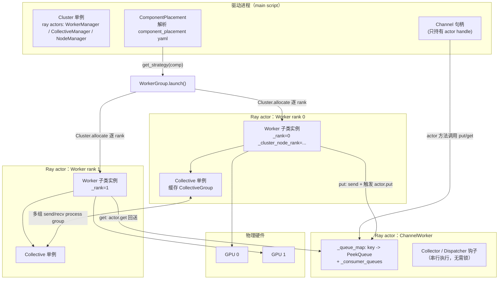
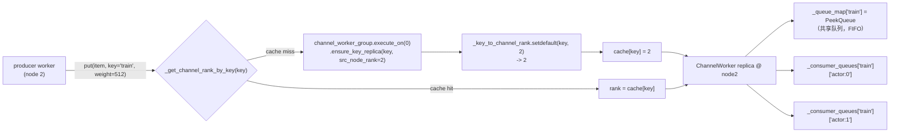
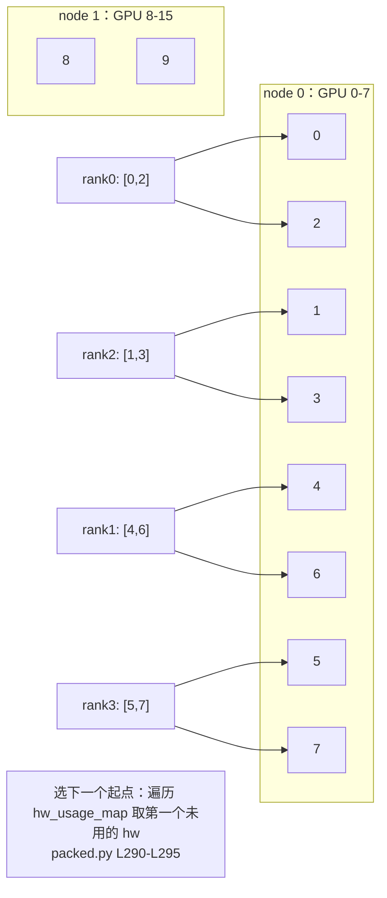
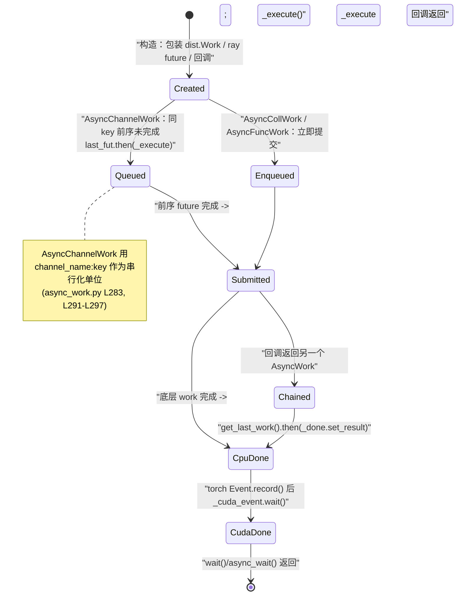
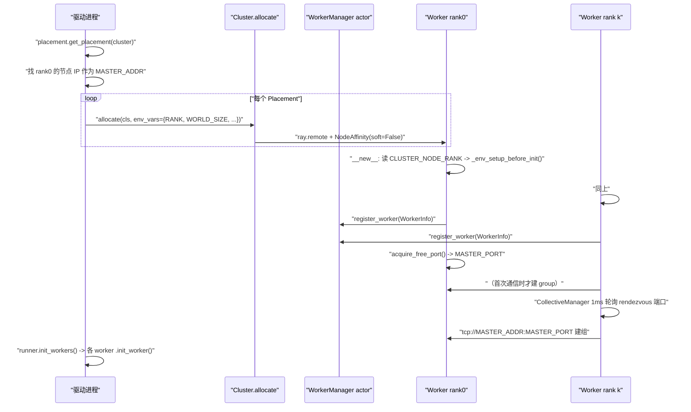
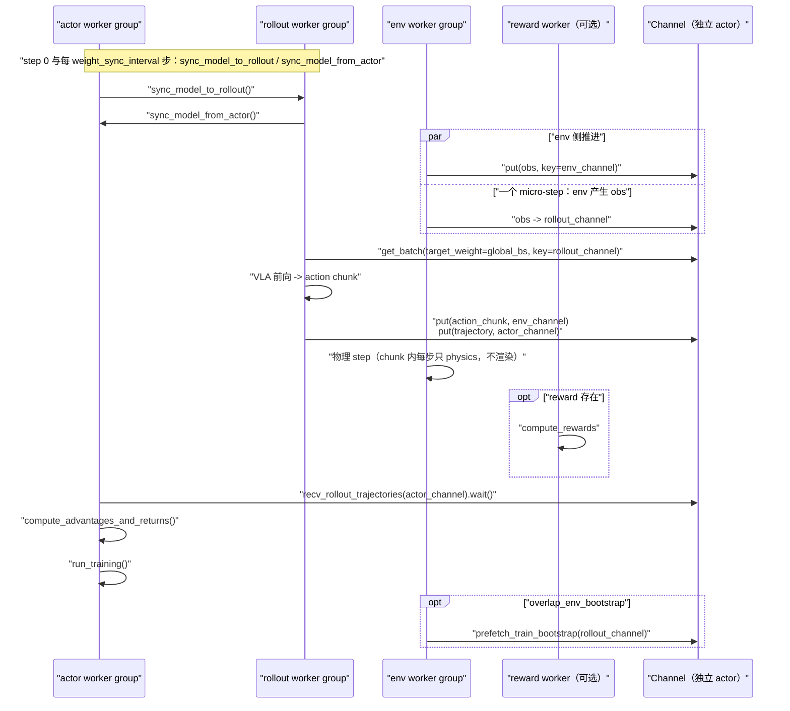
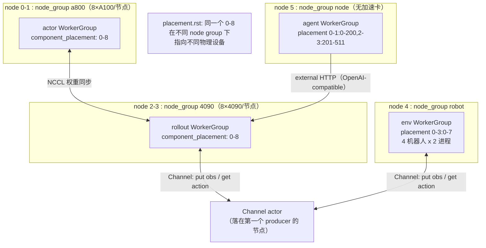

# RLinf v0.4 源码级素材

- 仓库：`~/Desktop/Projects/github/RLinf`
- commit：`2348ece3df113874671478be1360ae3115b346e3`（tag `v0.4`，`origin/release/v0.4`）
- 取证方式：`git -C ~/Desktop/Projects/github/RLinf show "<commit>:<path>"` / `git grep`，未 checkout
- permalink 形式：`https://github.com/RLinf/RLinf/blob/2348ece3df113874671478be1360ae3115b346e3/<path>#L<a>-L<b>`

> 只放实现细节与可核算数字，不写文章段落。每节按 `NOTES-SPEC.md` §3 模板。

---

## 0. 先列清单：RLinf 的「书」与「码」

**结论**：RLinf 的抽象只有 5 个（Worker / WorkerGroup / Channel / Placement / Collective），全部在 `rlinf/scheduler/` 下，约 1.1 万行 Python。上层（`rlinf/runners/`）只是把这些抽象按顺序 **接线**，不含调度逻辑——这就是它自称的 M2Flow（macro-to-micro flow）。

**文档清单**（`docs/source-en/rst_source/concepts/`，共 15 个 rst）：

| 文件 | 行数 | 对应专题 |
| --- | --- | --- |
| `worker.rst` | 185 | 1 / 5 |
| `channel.rst` | 279 | 1 / 2 |
| `cluster.rst` | 94 | 1 / 7 |
| `placement.rst` | 180 | 1 / 3 |
| `collective.rst` | 320 | 1 / 4 |
| `execution-model/index.rst` | 37 | 1（章节导览） |
| `scheduling-model/index.rst` | 25 | 1（章节导览） |
| `execution_flow.rst` | 31 | 1 / 6 |
| `execution_modes.rst` | 176 | 1 / 7 |
| `flow.rst` | 156 | 6（M2Flow 编程流） |
| `trajectory_collector.rst` | 239 | 6（具身 Actor 输出） |
| `replay_buffer.rst` | 283 | 旁证 |
| `robotics*.rst` / `realworld_envs.rst` | — | 旁证 |

**源码清单**（相关部分）：

```
rlinf/scheduler/channel/channel.py            695   # Channel 句柄（Ray actor 前端）
rlinf/scheduler/channel/channel_worker.py     640   # LocalChannel + ChannelWorker（真正持有队列）
rlinf/scheduler/channel/hooks.py                    # Collector / Dispatcher
rlinf/scheduler/collective/async_work.py      380   # AsyncWork 家族
rlinf/scheduler/collective/collective_group.py 2718 # P2P 用 broadcast 模拟
rlinf/scheduler/collective/multi_channel_pg.py      # send/recv 组 + 多 channel 切分
rlinf/scheduler/worker/worker.py             1700   # Worker 进程本体
rlinf/scheduler/worker/worker_group.py              # launch + 环境变量注入
rlinf/scheduler/placement/{placement,packed,node,flexible}.py  # 674/335/205/277
rlinf/runners/embodied_runner.py              678
rlinf/runners/reasoning_runner.py             670
```

---

## 1. 官方概念模型：五个概念的原文定义

### 1.1 一句话版本

**结论**：RLinf 的五概念可以这样对齐到代码：**Worker = Ray actor 进程；WorkerGroup = 一组同构 Worker 的句柄 + 环境变量注入 + 方法批量代理；Placement = 从「逻辑进程 rank」到「物理卡」的映射表；Channel = 一个由独立 Ray actor 持有的、按 key 分队列的分布式队列；Collective = 两两之间的 P2P 通道（用 broadcast 模拟 isend/irecv）。**

### 1.2 原文引用（逐条）

**Worker**（`docs/source-en/rst_source/concepts/worker.rst` L20-L32）：

```rst
A **Worker** represents a single remote process or computational unit.
By inheriting from :class:`Worker`, a worker or processor class gains the ability to:

- Run remotely across nodes in a distributed environment.

- Communicate with other workers in the cluster.

- Automatically receive essential environment variables such as ``MASTER_ADDR``, ``MASTER_PORT``, ``RANK``, ``LOCAL_RANK``, and ``WORLD_SIZE``.
```

**WorkerGroup**（同文件 L160-L172 区域）：

```rst
`WorkerGroup` is a utility for creating and managing a collection of Workers of the same type.
It simplifies the process of launching multiple Workers across the cluster and executing methods on them in parallel.
Key aspects of `WorkerGroup` include:

- **Group Creation**: Calling ``MyWorker.create_group().launch(cluster, placement)`` ...
```

**Channel**（`concepts/channel.rst` L3-L9）：

```rst
The Channel module provides a distributed producer-consumer queue for moving
data between workers. One or more producers can ``put`` items into a named
``Channel``, while one or more consumers ``get`` those items independently of
the producers' execution schedule.

The default shared queue supports synchronous and asynchronous operations,
logical queues selected by key, bounded capacity, and weighted batches.
```

**Placement**（`concepts/placement.rst` L3-L6）：

```rst
The placement module defines how workers are distributed across the hardware resources (nodes, GPUs, NPUs, robots and more) of the cluster.
The core interface of RLinf for this purpose is called ``ComponentPlacement``, which is configured via the ``cluster.component_placement`` field in the YAML configuration.
```

**Collective**（`concepts/collective.rst` L3-L6）：

```rst
This component provides point-to-point (P2P) data transfer between workers with **strict ordering** and **async handles**, on top of PyTorch ``torch.distributed``.
It consists of two public-facing classes:

- **Collective**: per-worker singleton that creates/caches communication groups.
- **CollectiveGroup**: a two-rank communication group that implements P2P send/recv for tensors, lists/dicts of tensors, and picklable Python objects.
```

**读法**：注意 Collective 的定义里那句「**on top of PyTorch `torch.distributed`**」与「two-rank」——这是理解专题 4 的关键：RLinf **没有**用 `dist.isend/irecv`（Gloo 之外不可靠），而是**用 broadcast 模拟**，并为一个二元组开**多条**单向 process group。

### 1.3 五个概念之间的关系图

**图**（`flowchart`，应画「五概念的持有关系 + 谁在哪个进程」）：



**关键事实（原文）**：Channel 的队列**不在任何 Worker 里，而在一个独立的 `ChannelWorker` actor 中**（`channel.rst` L29-L31）：

```rst
- **Places the queue** — With ``local=True`` the queue stays inside the calling process, where no other worker can reach it. Otherwise a ``ChannelWorker`` actor holds it: one on the node given by ``node_rank``, or one on every node when ``distributed=True``.
```

---

## 2. Channel 的实现：key 路由到底是 dict 还是单队列

### 2.1 答案：**单 Channel actor 内是 `dict[key] -> PeekQueue`；跨节点时外面再套一层 `dict[key] -> channel_rank` 路由缓存**

**结论**：有两层 key 路由，都落在 dict 上，但语义完全不同：

| 层 | 数据结构 | 所在位置 | 作用 |
| --- | --- | --- | --- |
| ① 逻辑队列 | `ChannelWorker._queue_map: dict[str, PeekQueue]` | ChannelWorker actor 内 | `key` → 一条独立 FIFO |
| ② 物理副本 | `Channel._key_to_channel_rank_cache: dict[Any, int]` | 每个 Client 进程内 | `key` → 「哪个节点上的 ChannelWorker 副本」 |
| ③ consumer 私有队列 | `ChannelWorker._consumer_queues: dict[key][consumer] -> PeekQueue` | ChannelWorker 内 | dispatcher 分发时用 |

**代码 A**（`rlinf/scheduler/channel/channel_worker.py` L261-L272）：

```python
        super().__init__()
        self._queue_map: dict[str, PeekQueue] = {}
        self._queue_map[DEFAULT_KEY] = PeekQueue(maxsize=maxsize)
        self._key_to_channel_rank: dict[Any, int] = {}

        self._context = context or ChannelContext(name=self.worker_address.get_name())
        self._collector = resolve_collector(collector)
        self._dispatcher = resolve_dispatcher(dispatcher)
        self._collector.setup(self._context)
        self._dispatcher.setup(self._context)
        # Private per-consumer queues, only used when the dispatcher deals.
        self._deals = self._dispatcher.deals
        self._consumer_queues: dict[str, dict[str, PeekQueue]] = {}
```

**代码 B**（`rlinf/scheduler/channel/channel.py` L338-L356，key → 副本 rank）：

```python
    def _get_channel_rank_by_key(self, key: Any) -> int:
        """Get the rank of the channel actor that should handle the given key."""
        if self._local_channel is not None:
            return -1
        if not self._distributed:
            return 0
        if key not in self._key_to_channel_rank_cache:
            src_node_rank = self._get_src_node_rank()
            target_rank = (
                self._channel_worker_group.execute_on(0)
                .ensure_key_replica(key=key, src_node_rank=src_node_rank)
                .wait()[0]
            )
            self._key_to_channel_rank_cache[key] = target_rank
        return self._key_to_channel_rank_cache[key]
```

**代码 C**（`channel_worker.py` L605-L614，「key 首次出现时绑到调用者所在节点」）：

```python
    async def ensure_key_replica(self, key: Any, src_node_rank: int = -1) -> int:
        """Assign (or fetch) the replica rank that should host the given key.

        If the key is new, choose the replica whose rank matches the source node rank
        (given NodePlacementStrategy launches workers in node order). If out of range,
        fall back to rank 0.
        """
        # Fallback to rank 0 if out of range
        default_rank = src_node_rank if 0 <= src_node_rank < self._world_size else 0
        return self._key_to_channel_rank.setdefault(key, default_rank)
```

**读法**：`setdefault` 是「**首次写入者决定归属**」——第一个用某 key 的 worker 决定这个 key 落在哪个节点。这与文档 L45-L50 的说法一致（"binds each `key` to one replica the first time that key is used, choosing the replica on the caller's own node"）。

**图**（`flowchart`，应画「一次 put 经过的 key 路由」）：



### 2.2 权重怎么参与 `get_batch`

**结论**：`weight` **不参与排序**——队列是 FIFO，`WeightedItem` 虽然用 `@dataclass(order=True)` 声明了按 weight 比较，但 `asyncio.Queue` 用的是 `put/get` 而非 `heappush/heappop`，所以**叠加顺序即入队顺序**。`weight` 唯一的作用是 `get_batch(target_weight)` 的**累加终止条件**。

**代码 A**（`channel_worker.py` L30-L35）：

```python
@dataclass(order=True)
class WeightedItem:
    """A class that holds an item with a weight for priority queueing."""

    weight: int
    item: Any = field(compare=False)
```

**代码 B**（`channel_worker.py` L528-L557，`get_batch` 的累加逻辑）：

```python
        queue = self._queue_for_get(key, dst_addr.get_name())
        batch = []
        current_weight = 0
        while True:
            next_item: WeightedItem = await queue.peek()
            if next_item is None or current_weight + next_item.weight > target_weight:
                break
            current_weight += next_item.weight
            item = await queue.get()
            batch.append(item.item)
            if current_weight >= target_weight:
                break
```

**读法**：「peek → 若加上会超标就停」= **不许超过**，但**也不回填**。所以如果队首是一个 `weight` 很大的样本，`get_batch` 会**立刻返回空 batch**（连一个都不给）——这是个明确的性能悬崖。

**量化**（用 `weight = token 数` 建模）：

- 设 `target_weight = 8192`（= global_batch 的 token 预算），队首样本 `weight = 9000`。`current_weight + 9000 > 8192` → 立即 `break`，返回 `[]`。
- 因 `weight` 是「该样本的 token 数」，且 RL 的样本长度近似重尾分布，**只要队首出现一个超长样本，本次 `get_batch` 就白跑**。调用方通常包在 `while len(batch) < target` 里重试，但**队列不会再变**（同一队首）→ 死等/忙等。
- 直观公式：`get_batch` 的成功概率 约 `P(X_1 + ... + X_k ≤ W)`，其中 `X_i ~ 长度分布`。若长度分布 `P(X > W) = p`，则「一次调用就返回空」的概率 约 `p`。对 `8192` 预算与 `P99约9000` 的长度分布，`p` 约 1%。
- 正确用法是 **weight 设为 1**（默认值 0 会让 `0 + 0 > target` 永假，导致**一直取到队列空**——这也是一个坑：`weight=0` 时 `target_weight` 完全失效，`get_batch` 会排空队列）。

**⚠ 坑汇总（本专题实测）**：

1. `put(item)` 不传 weight → `weight=0` → `get_batch(target_weight=N)` 会**取空整个队列**（因为 `0 + 0 > N` 恒假）。文档说 "leave the weight at its default value"（`channel.rst` L78-L80）指的是**用 `get` 而不是 `get_batch`** 时；混用会静默改变语义。
2. `LocalChannel.get_batch` **是 `async def`**（`channel_worker.py` L195），但 `Channel.get_batch` 在 local 分支直接 `return self._local_channel.get_batch(...)`（`channel.py` L630-L632）——返回的是一个 **coroutine 对象**，不是列表。调用方不做 `await` 会拿到永远不执行的 coroutine。
3. `LocalChannel.put/get` 的「阻塞」是纯 CPU 忙等（`channel_worker.py` L170-L171 / L190-L191：`while full(): continue`、`while empty(): continue`），**不是 `asyncio.Queue.put` 的协程等待**——在同一个进程里用会吃满一个核。

### 2.3 `put_no_wait` / 异步句柄的实现

**结论**：`put_nowait` 在 Worker 内是「Ray actor 端 `put(nowait=True)` + 本地 `send`」，队列满时由 **actor 端**抛 `asyncio.QueueFull`，再经 `send` 回传时被翻译成空值/异常。异步句柄是三种 `AsyncWork` 子类。

**代码 A**（`channel.py` L484-L519，`put_nowait` 在 worker 上下文里）：

```python
        target_rank = self._get_channel_rank_by_key(key)
        target_actor = self._get_channel_actor(target_rank)

        if self._current_worker is not None:
            put_kwargs = {
                "src_addr": self._current_worker.worker_address,
                "nowait": True,
            }
            async_channel_work = AsyncChannelWork(...)
            self._current_worker.send(
                item, self._channel_name, target_rank,
                async_op=True, piggyback_payload=(key, weight),
            )
            try:
                async_channel_work.wait()
            except asyncio.QueueFull:
                raise asyncio.QueueFull
```

**代码 B**（`channel_worker.py` L478-L510，actor 端的 `get` 与 nowait）：

```python
        if nowait:
            try:
                weighted_item: WeightedItem = await self._take(key, consumer, True)
            except asyncio.QueueEmpty:
                query_id = asyncio.QueueEmpty
                weighted_item = WeightedItem(weight=0, item=None)
```

**读法**：注意 `put` 是**两段式**——数据走 `Worker.send`（真正的通信通道），**`(key, weight)` 作为 `piggyback_payload` 随同一条消息送达**，然后 actor 侧再 `self.recv()` 取出来。这是为了省一次 RPC：`channel.py` L434 的注释 "First run async put to avoid send blocking put"。

**异步句柄家族**（`collective/async_work.py`）：

| 类 | 行 | 包装对象 | 完成判定 |
| --- | --- | --- | --- |
| `AsyncWork` | L28 | 抽象基类 | `wait()` / `async_wait()` / `then()` / `done()` / `get_last_work()` |
| `AsyncFuncWork` | L61 | 一个 Python 回调 + CUDA event | `self._done`（`torch.futures.Future`）+ `_cuda_event.wait()` |
| `AsyncCollWork` | L197 | `list[dist.Work]` | 所有 `work.get_future().done()` |
| `AsyncChannelWork` | L256 | `ray.ObjectRef` 的 future | `self._future` |
| `AsyncChannelCommWork` | L331 | 「recv 一次 + 用 query_id 从 store 取数据」 | `_data_future` |

**`AsyncChannelCommWork` 的设计理由**（`async_work.py` L343-L349，这段注释是本文档里最有价值的一段）：

```python
        """Initialize the AsyncChannelWork with a async recv comm of the get operation.

        A query_id should be provided to identify the data get query.
        This is because the received data of this recv call may be from another get,
        as the async task execution order at the channel worker side is non-deterministic.
        And so we need to associate the data with an identifier and store it for later retrieval.
```

**量化**：`AsyncChannelCommWork.channel_data_store` 是**类级全局 dict**（L334），只有 `query_id → Future` 的插入，**没有删除**——见 L361-L374。每做一次 `get`（含 `wait()`）就多一个 entry 永久驻留。1000 万次 get 后，即使每个 entry 只有 ~300 字节，也是 **3 GB 常驻**。

---

## 3. Placement 三种策略：rank 到物理卡的映射

### 3.1 三者定位（官方原文）

**结论**：三种策略是**递进的特化关系**——`NodePlacementStrategy` 以「节点」为最小单位（CPU worker 用）；`PackedPlacementStrategy` 以「硬件区间 + 每进程几张卡 + 步长」为参数（自动排布）；`FlexiblePlacementStrategy` 直接接受「每个进程要哪些卡」的显式列表（异构用）。而 `placement.rst` 说：用户一般不直接选，`ComponentPlacement` 会按 node group 有没有硬件自动选。

**原文**（`concepts/placement.rst` L152-L158）：

```rst
* If the node group has **no dedicated hardware** (no robots and no accelerators), RLinf uses :class:`rlinf.scheduler.placement.NodePlacementStrategy` to place processes purely by node rank. Each node is treated as a single resource; a process cannot span multiple nodes.

* If the node group has **hardware resources** (accelerators or custom hardware), RLinf uses :class:`rlinf.scheduler.placement.FlexiblePlacementStrategy` to map each process to one or more local hardware ranks on exactly one node.
```

**读法**：自动路径**只用 node 与 flexible**；`packed` 是 API 层的便利封装（`WorkerGroup.launch` 的默认值就是 `PackedPlacementStrategy(0, num_accelerators-1)`，见 `worker_group.py` L181-L186）。

### 3.2 `packed.py`：区间 + 步长 + 每进程卡数的「排布式分配」

**代码**（`rlinf/scheduler/placement/packed.py` L216-L251，一次迭代生成一个进程）：

```python
            # Generate the placement for one process
            local_hw_rank = resolver.get_local_hardware_rank(start_hw_rank)
            assert local_hw_rank + (
                self._num_hardware_per_process - 1
            ) * self._stride <= cluster.get_node_info(
                cluster_node_rank
            ).get_hw_resource_count(current_hw_type), (...)
            ...
            local_hw_ranks = list(
                range(
                    local_hw_rank,
                    local_hw_rank + self._num_hardware_per_process * self._stride,
                    self._stride,
                )
            )
```

**读法**：每个进程拿到的卡号是**等差数列** `start, start+stride, start+2*stride, ...`，共 `num_hardware_per_process` 个。断言 `num_hardware % (num_hardware_per_process * stride) == 0`（L137-L141）保证整除。

**映射规则（可写成伪代码，供博客贴）**：

```
hw 区间 [S, E]，跨度 = E - S + 1
对每个"切片起点" s ∈ [S, E] 按 (k*stride) 步进：
    rank = 下一个 rank
    local_hw_ranks = [s, s+stride, ..., s+(k-1)*stride]      # k = num_hardware_per_process
    若起始 s 与 s+... 跨了节点 → assert 失败（一个进程不能跨节点）
    按 hw 使用位图挑下一个未用的 hw 作为新的 s（L290-L295）
    若换了节点 → node_rank += 1, local_rank = 0（L302-L307）
```

**量化示例**（`PackedPlacementStrategy(start_hardware_rank=0, end_hardware_rank=3, num_hardware_per_process=2, stride=2)`，单节点 4 卡）：

- 首进程：`local_hw_rank = 0`，`local_hw_ranks = range(0, 0 + 2*2, 2) = [0, 2]`。占用 `{0, 2}`。
- `hw_usage_map` 扫描（L290-L295）找到第一个未用的 `1` → 次进程 `range(1, 5, 2) = [1, 3]`。占用 `{1, 3}`。
- 全部 4 卡用尽 → 共 **2 个进程**，各自 `[0,2]` 与 `[1,3]`。与 docstring L86-L88 的 `[2, 2]` 一致。
- **对照**：同样 4 张卡，若 `stride=1, num_hardware_per_process=1`，则得 **4 个进程**，各 1 张卡（docstring L58-L59 的 `[1,1,1,1]`）。

**`stride` 的语义（一句话）**：stride 越大，每个进程吃到的卡越「散」（跨 NUMA / 跨 NVLink 域），但进程数按 `(E−S+1) / (k·stride)` 的倍数**不变**——它改变的是**每进程内的卡号形态**，不是进程总数。

**断言**（L137-L141）保证了 `(E−S+1) % (k·stride) == 0`，所以「进程数 = `(E−S+1) / (k·stride)` × `stride`」这个式子成立：`4/(2·2) × 2 = 2`。

**图**（`flowchart`，应画「packed 如何从区间切出进程」）：



### 3.3 `node.py`：一个 rank 一个节点，**故意不设 visible devices**

**代码**（`rlinf/scheduler/placement/node.py` L151-L174）：

```python
        for rank, cluster_node_rank in enumerate(cluster_node_ranks):
            visible_devices = list(
                range(cluster.get_node_info(cluster_node_rank).num_accelerators)
            )
            visible_devices = [str(device) for device in visible_devices]
            placements.append(
                Placement(
                    rank=rank,
                    cluster_node_rank=cluster_node_rank,
                    placement_node_rank=-1,
                    accelerator_type=cluster.get_node_info(
                        cluster_node_rank
                    ).accelerator_type,
                    local_accelerator_rank=-1
                    if len(visible_devices) == 0
                    else visible_devices[0],
                    local_rank=-1,
                    local_world_size=0,
                    visible_accelerators=visible_devices,
                    isolate_accelerator=isolate_accelerator,
                    local_hardware_ranks=[],
                    node_group_label=resolved_group_labels[rank],
                )
            )
```

**读法**：`visible_accelerators` 是**该节点的全部卡**，`local_hardware_ranks=[]`。所以 node 策略下**两个 rank 落在同一节点时会共享整套 GPU**（`NodePlacementStrategy([0]*4)` 的 docstring 例子 L47-L52 就是这么用的：4 个进程都在 node 0）。同时 `local_rank=-1`（L167）——`NODE_LOCAL_RANK` 会被填成 `-1`。

**⚠ 坑**：`local_rank = -1` 会一路写进环境变量 `NODE_LOCAL_RANK`（`worker_group.py` L253），而 `Worker._setup_local_rank_world_size()`（`worker.py` L462）依赖它。任何把 node 策略用于**需要 GPU 的 worker** 的地方，都会拿到 `NODE_LOCAL_RANK=-1`。这也是为什么 `placement.rst` 明说 node 策略是给「no dedicated hardware」用的。

### 3.4 `flexible.py`：显式卡列表 + 四条硬性校验

**代码**（`rlinf/scheduler/placement/flexible.py` L150-L170，四条校验）：

```python
        # Check that all hardware ranks of a process are on the same node
        node_ranks = {
            resolver.get_node_by_hardware_rank(hw_rank).node_rank
            for hw_rank in hw_ranks
        }
        assert len(node_ranks) == 1, (
            f"All hardware ranks {hw_ranks} for a process must be on the same node. Instead, the hardware exist across node ranks {node_ranks}"
        )

        # Check that all hardware ranks of a process are unique
        assert len(hw_ranks) == len(set(hw_ranks)), (
            f"All hardware ranks {hw_ranks} for a process must be unique."
        )

        hw_types = {
            resolver.get_hardware_type_for_rank(hw_rank) for hw_rank in hw_ranks
        }
        if None not in hw_types:
            assert len(hw_types) == 1, (
                f"All hardware ranks {hw_ranks} for a process must use the same hardware type, but got {hw_types}."
            )
```

**读法**：四条 = ① 每个 rank 在范围内；② 不能跨节点；③ 不能重复；④ 不能混硬件类型。**注意没有「不同进程之间不能重复」的校验**——见下。

### 3.5 三策略对比表（可做成表）

| 维度 | `NodePlacementStrategy` | `PackedPlacementStrategy` | `FlexiblePlacementStrategy` |
| --- | --- | --- | --- |
| 输入 | `node_ranks: list[int]` | `(start, end, num_hw_per_proc, stride, node_group)` | `hardware_ranks_list: list[list[int]]` |
| 一个 rank 占什么 | **一整个节点**（全部卡可见） | `k` 张卡，等差数列步长 `stride` | 显式给定的卡列表 |
| 是否自动排序 | 是（`sorted(node_ranks)`，L74） | 是（按 hw rank 顺序 + 位图） | 是（按每个列表首元素排序，L197） |
| `local_rank` | **`-1`**（L167） | 节点内序号（L279） | 节点内序号（L239） |
| `local_hardware_ranks` | `[]`（L171） | 等差数列（L238-L244） | 映射到节点内序号（L211-L213） |
| 跨节点断言 | 无 | 有（L217-L223） | 有（L155-L157） |
| 防重复 | 无需 | 位图 `hw_usage_map`（L195-L197, L252-L253） | **无** |
| 典型用途 | CPU / robot / 无硬件 node group | 默认（`WorkerGroup.launch` 不传时） | 异构（模拟器 + 模型混部） |

**⚠ 关键坑（本专题最有价值的一条）**：`packed` 用 `hw_usage_map` 保证同一个 hw 不会被分给两个进程；`flexible` **没有这个检查**。所以 `FlexiblePlacementStrategy([[0,1],[0,2]])` 会被接受——进程 0 与进程 1 **共享 GPU 0**。在 RLinf 里这不是错误用法（collocated 模式就是刻意共享），但意味着「我把两个 component 交给了 flexible，它们的卡会不会打架」**完全取决于用户在 YAML 里写的字面量**，框架不做仲裁。

---

## 4. Collective 与 AsyncWork：通信句柄的生命周期

### 4.1 核心事实：RLinf 用 **broadcast 模拟 isend/irecv**

**结论**：`MultiChannelProcessGroup.send` / `recv` **都不是** `dist.isend` / `dist.irecv`，而是 `dist.broadcast` 的两次调用——发送方 `broadcast(src=me)`，接收方 `broadcast(src=peer)`。代码注释直说原因：Gloo 不支持 `dist.Work.get_future`。

**代码**（`rlinf/scheduler/collective/multi_channel_pg.py` L326-L342）：

```python
        # NOTE: GLOO backend doesn't support dist.Work.get_future, use broadcast to simulate send/recv instead
        if self._no_accel_ccl and device == CollectiveGroup.ACCEL:
            # Stage in pinned host memory if accel CCL is not available
            tensor = self._stage_to_pinned_cpu(tensor)
        group = (
            self._send_accel_ccl_process_groups[channel_id]
            if device == CollectiveGroup.ACCEL and not self._no_accel_ccl
            else self._send_gloo_process_groups[channel_id]
        )
        work = self._broadcast(
            tensor,
            src=self._cur_rank,
            group=group,
            async_op=async_op,
        )
        if work:
            return AsyncCollWork(work)
```

**读法**：`src=self._cur_rank` 而 `recv` 用 `src=self._peer_rank`（L378），**并且用的是不同的 process group**（`_send_*` vs `_recv_*`）。这就是为什么 `init()` 里要为**每个方向、每个 channel、每种后端**都切一个子组（L183-L242）：

```
对每个 channel i ∈ [0, num_channels):
    _send_accel_ccl_process_groups[i]   = split(base, "nccl_send_i")
    _recv_accel_ccl_process_groups[i]   = split(base, "nccl_recv_i")
    _send_gloo_process_groups[i]        = split(base, "gloo_send_i")
    _recv_gloo_process_groups[i]        = split(base, "gloo_recv_i")
    _collective_accel_ccl_process_groups[i] = split(base, "nccl_collective_i")
    _collective_gloo_process_groups[i]      = split(base, "gloo_collective_i")
```

**量化（通信组的数量）**：`CollectiveGroup.POOL_SIZE = 1`（`collective_group.py` L216）是**默认值**，`MultiChannelProcessGroup` 的 `num_channels` 由调用方传入。当 `num_channels = C` 时，一个两 worker 的组会创建：

- 每个 channel `i` 6 个子组（`accel_send_i` / `accel_recv_i` / `gloo_send_i` / `gloo_recv_i` / `accel_collective_i` / `gloo_collective_i`），
- 其中 `i=0` 的 `accel_send_0` 直接复用 base group（L183-L194 的 `if i > 0`），

所以精确是 **`6C − 1` 个 process group**（L183-L242）。`C=1` 时 5 个；`C=2` 时 11 个。

**为什么不能直接 `isend/irecv`**：`collective.rst` L17-L22 的原文是：

```rst
Internally, separate **send** and **receive** process groups are created for both GPU (NCCL) and CPU (Gloo), forming dedicated one-way channels; in a two-worker setup, a carefully configured broadcast is equivalent to a send/receive.
```

### 4.2 `AsyncWork` 的生命周期

**结论**：一个 `AsyncWork` 从「创建」到「完成」有四个可观测状态：构造（包装底层 work）→ 提交（`_execute` / 由前一个 work `then` 触发）→ 记录 CUDA event → `_done` future 被 set。`wait()` 与 `async_wait()` 的区别只是**阻塞方式**，两者都要额外 `_cuda_event.wait()`。

**代码 A**（`async_work.py` L114-L134，`AsyncFuncWork.__call__`）：

```python
    def __call__(self, future: Future):
        """Execute the function and set the done flag."""
        start = time.perf_counter()
        if self._pass_self:
            self._result = self._func(self, *self._args, **self._kwargs)
        else:
            self._result = self._func(*self._args, **self._kwargs)
        self._exec_time = time.perf_counter() - start
        if (
            Worker.current_worker.has_accelerator
            and Worker.torch_platform.is_initialized()
        ):
            self._cuda_event = Worker.torch_platform.Event()
            self._cuda_event.record()
        if isinstance(self._result, AsyncWork):
            # If the result is another AsyncWork, find the last work in the chain
            # Set the flag only after all works are done
            last_work_in_chain = self._result.get_last_work()
            last_work_in_chain.then(self._done.set_result, True)
        else:
            self._done.set_result(True)
```

**代码 B**（`async_work.py` L171-L186，`wait()` 的双重等待）：

```python
    def wait(self):
        self._done.wait()
        if self._cuda_event is not None:
            self._cuda_event.wait()
        result = self._result
        if isinstance(result, AsyncWork):
            # If the result is another AsyncWork, wait for it to complete
            return result.wait()
```

**读法**：**`_done` 只代表「CPU 侧提交完成」，`_cuda_event` 才代表「GPU 真的算完」**。所以 `AsyncCollWork.wait()`（L221-L224）只 `work.wait()`（PyTorch 的 `dist.Work.wait()` 本身会同步流），而 `AsyncFuncWork.wait()` 要额外等 event。这是「句柄生命周期」里最容易搞错的一点。

**状态机图**（`stateDiagram-v2`，应画「一个 AsyncWork 可能的全部状态与转换」）：



### 4.3 `Worker.send/recv` 与 PyTorch isend/irecv 的对应关系

**结论**：**接口对应，实现不对应**。三处硬性约束（都是文档原文）：

1. **不能混用** `send` / `recv_tensor`（协议不同：`send` 先发类型头，`send_tensor` 不发）；
2. **首次必须是 send 与 recv 配对**，两边都先发 async **会 hang**（NCCL communicator 懒创建）；
3. **send / recv 都不是线程安全的**。

**代码**（`rlinf/scheduler/worker/worker.py` L578-L589，三段 note 原文）：

```python
        .. note::
            Do not mix send with recv_tensor

        .. note::
            Complex nested dictionaries are serialized as Python objects and sent
            through the CPU communication path.

        .. note::
            When transferring GPU objects, the first send needs to be paired with a recv at the other end. Calling async send or recv first at both ends will result in communication hang, because NCCL communicators are established in a lazy manner when the first pair of send/recv is called.

        .. note::
            This method is not thread safe.
```

**对照表**（供博客直接贴）：

| PyTorch | RLinf | 差异 |
| --- | --- | --- |
| `dist.isend(tensor, dst)` | `worker.send(obj, group_name, rank, async_op=True)` | RLinf 支持任意 picklable 对象，自动分区 CPU/GPU 张量；底层是 **broadcast** |
| `dist.irecv(tensor, src)` | `worker.recv(group_name, rank, async_op=True)` | RLinf 的 `recv` **不需要预分配 buffer**（out-of-place） |
| 返回 `dist.Work` | 返回 `AsyncWork` | 多了 `async_wait()` / `then()` / `done()` / `get_next_work()` |
| `Work.wait()` | `work.wait()` | `AsyncFuncWork` 额外等 CUDA event |
| 首次 `isend` 后可任意顺序 | **首次必须 send↔recv 配对**，否则 hang | 因为 unicast 用 broadcast 模拟 |
| 线程安全 | 明示**不安全** | — |

**量化（一个 worker 间的 `CollectiveGroup` 有多重）**：`collective.rst` 说 `Collective` 是「per-worker singleton that creates/caches communication groups」。`Worker._get_collective_group(dst_addr)` 按对端地址缓存——**N 个 worker 的组会创建 O(N·6C) 个 process group**。NCCL 每个 group 都要建 communicator（代码注释 L176-L180 特别提到 "eager creation of NCCL communicators leads to severe GPU memory consumption. So we disable it by default"），所以 **group 数量直接吃掉显存**。

---

## 5. Worker 的启动与生命周期

### 5.1 一个 Worker 进程怎么起来：Ray actor + 环境变量注入

**结论**：Worker **不是** subprocess，而是一个 **Ray actor**。`WorkerGroup._create_workers()` 为每个 `Placement` 拼一份 19 个键的环境变量字典，再交给 `Cluster.allocate()`（内部 `ray.remote(cls)` + `NodeAffinitySchedulingStrategy(soft=False)`）拉起。**分布式所需的 rank / world_size / master 全部靠环境变量传递，不走 Ray 的 actor 参数**。

**代码 A**（`rlinf/scheduler/worker/worker_group.py` L244-L273，环境变量字典）：

```python
            env_vars = {
                "GROUP_NAME": self._worker_group_name,
                "WORKER_NAME": worker_name,
                "MASTER_ADDR": master_addr,
                "WORLD_SIZE": str(self._world_size),
                "RANK": str(placement.rank),
                "NODE_RANK": str(placement.placement_node_rank),
                "CLUSTER_NODE_RANK": str(placement.cluster_node_rank),
                "LOCAL_ACCELERATOR_RANK": str(placement.local_accelerator_rank),
                "NODE_LOCAL_RANK": str(placement.local_rank),
                "NODE_LOCAL_WORLD_SIZE": str(placement.local_world_size),
                "RAY_ACTOR": str(1),
                "CLUSTER_NAMESPACE": Cluster.NAMESPACE,
                "CATCH_SYSTEM_FAILURE": "1"
                if self._catch_system_failure
                else "0",  # Inform the Worker process to catch signals
                "VISIBLE_DEVICES": ",".join(placement.visible_accelerators),
                "ACCELERATOR_TYPE": str(accelerator_type),
                "ACCELERATOR_MODEL": accelerator_model,
                "ISOLATE_ACCELERATOR": "1" if placement.isolate_accelerator else "0",
                "LOCAL_HARDWARE_RANKS": ",".join(
                    map(str, placement.local_hardware_ranks)
                ),
                "NODE_GROUP_LABEL": placement.node_group_label,
            }
```

**读法**：`master_addr` 是**先算好的**——`WorkerGroup._create_workers()` 开头用 `next(p for p in placements if p.rank == 0)` 找出 rank 0 所在节点的 IP（`worker_group.py` L228-L232），所以所有 Worker 的 `MASTER_ADDR` 在启动前就已知，不需要「谁先起谁设」的协调。`MASTER_PORT` 则**不在这里**——由 `Worker._setup_master_address_and_port()`（`worker.py` L481-L482）在进程内用 `acquire_free_port()` 协商。

**代码 B**（`worker.py` L331-L347，`__new__` 里读取环境变量）：

```python
    def __new__(cls, *args, **kwargs):
        """Create a new instance of the Worker class."""
        instance = super().__new__(cls)

        cluster_node_rank = os.environ.get("CLUSTER_NODE_RANK", None)

        # ray.remote initializes the class with the ActorClass wrapper locally first (not in a remote process),
        # which doesn't have the environment variables set.
        if cluster_node_rank is not None and "ActorClass(" not in cls.__name__:
            instance._env_setup_before_init()
            # Handle OS signals for better debuggability
            # Ray new the class in main thread but call __init__ in worker thread if it's an Actor with async functions
            # Signal handlers must be registered in main thread, so we call the registration in __new__
            instance._register_signal_handlers()
            instance._enable_ptrace()
```

**读法**：这段注释是理解 RLinf 启动路径的关键——**`__new__` 在 Ray 的 worker 主线程里跑，`__init__` 在 actor 的事件循环线程里跑**，所以「注册信号处理器」必须放在 `__new__`。

**代码 C**（`worker.py` L433-L447，每个 Worker 自己也 `ray.init`）：

```python
        # Reset Cluster.NAMESPACE for this Worker process according to the environment variable
        namespace = os.environ.get("CLUSTER_NAMESPACE", None)
        assert namespace is not None, (...)

        # Initialize Ray if not already initialized
        if not ray.is_initialized():
            ray.init(
                address="auto",
                namespace=Cluster.NAMESPACE,
                logging_level=Cluster.LOGGING_LEVEL,
            )
```

**读法**：`address="auto"` 表示「连当前集群」；但注释里 "Initialize Ray if not already initialized" 说明**Ray actor 内的 `ray.is_initialized()` 可能是 False**（子进程 / fork 出来的场景）。

### 5.2 与 master 通信：三件套

**结论**：RLinf 的「master 通信」不是一条链路，而是**三个单例 manager actor + 一个名字解析**：

| 组件 | 来源 | 干什么 |
| --- | --- | --- |
| `WorkerManager` | `Cluster` 初始化时拉起 | 每个 Worker 注册自己的 `WorkerInfo`（地址、rank、node_id、gpu_id、可用 GPU 列表） |
| `CollectiveManager` | 同上 | 存 collective group 信息与 **rendezvous 端口** |
| `NodeManager` | 同上 | 向 Worker 提供节点布局（IP、GPU 数、master port） |
| `Cluster.NAMESPACE` | `ray.init(namespace=...)` | 保证「同一 namespace 下的所有进程看到同一个集群视图」 |

**代码**（`concepts/cluster.rst` L18-L31，三 manager 的职责）：

```rst
- **Global Manager Actors** : A key part of initialization is launching three singleton manager actors:

  * `WorkerManager` : tracks every worker's metadata.
  * `CollectiveManager` : stores collective-group information, including
    rendezvous ports.
  * `NodeManager` : provides node layout (IP, GPU count, master port) to workers.
```

**rendezvous 端口的具体流程**（`collective_group.py` L1322-L1359，这是「与 master 通信」最具体的一段）：

```python
            if self._rank == 0:
                master_port = self._worker.acquire_free_port()
                self._coll_manager.set_master_port_info(
                    self._group_info.group_name, master_port
                )
            else:
                master_port = None
                count = 0
                while master_port is None:
                    master_port = self._coll_manager.get_master_port_info(
                        self._group_info.group_name
                    )
                    time.sleep(0.001)
                    count += 1
                    if count % Cluster.TIMEOUT_WARN_TIME == 0:
                        self._logger.warning(...)
            ...
            self._mc_group.init(
                init_method=f"tcp://{self._group_info.master_addr}:{master_port}",
                world_size=self._group_info.world_size,
                rank=self._rank,
                group_name=self._group_info.group_name,
                options=options,
            )
            ...
            if self._rank == 0:
                # Avoid using the same master port for the next group
                self._coll_manager.reset_master_port_info(self._group_info.group_name)
```

**读法**：这是**手写的 rendezvous**——rank0 抢一个空闲端口 → 写进 CollectiveManager → 其他 rank **1ms 轮询**读 → 大家一起 `init_process_group(tcp://...)` → rank0 清掉记录。`reset_master_port_info` 保证「同一个 process group 名被重建时不会复用旧端口」。

**量化**：非 rank0 的轮询间隔 `1ms`，`TIMEOUT_WARN_TIME` 之后开 warning。设建组耗时 `T`（启动 NCCL 通常 1–5 s），则每个非零 rank 会**轮询 1000–5000 次**。

**图**（`sequenceDiagram`，应画「一个 WorkerGroup 的启动时序」）：



### 5.3 生命周期边界

**代码**（`worker_group.py` L211-L221，`_close`）：

```python
    def _close(self):
        """Close the worker group and release resources. This method is called when the worker group is no longer needed."""
        for worker_info in self._workers:
            # Call cleanup methods if they exist
            if hasattr(worker_info.worker, "_close"):
                ray.get(worker_info.worker._close.remote())
            ray.kill(worker_info.worker)
        self._workers.clear()
```

**读法**：`ray.kill` 是**强制杀**（不发 SIGTERM 等待落盘），所以任何需要「优雅退出」的 worker 必须自己实现 `_close`。

**⚠ 坑**：`Worker.__init__` 里 `Worker.current_worker = self`（`worker.py` L489）是**类变量**。一个进程里如果有两个 Worker（例如 `ChannelWorker` 与业务 Worker 同进程），后者的 `current_worker` 会覆盖前者——`AsyncFuncWork.__call__`（`async_work.py` L123）读的正是 `Worker.current_worker`。

---

## 6. 两种 runner：具身 vs 推理，一个 step 差在哪

### 6.1 结构对比（同一套抽象，两种接线）

**结论**：两个 runner **用的是同一批 Channel/Worker 抽象，但 pipeline 形状不同**——具身 runner 是「env ↔ rollout ↔ actor 的环形数据流 + 可选 pipeline 阶段」，推理 runner 是「dataloader → rollout → reward → (actor_inference) → (critic_inference) → actor 的线形数据流」。

| 维度 | `embodied_runner.py` (678 行) | `reasoning_runner.py` (670 行) |
| --- | --- | --- |
| 参与者 | `actor` / `rollout` / `env` / 可选 `reward` | `actor` / `rollout` / `reward` / 可选 `actor_inference` / 可选 `critic` / 可选 `critic_inference` / 可选 `scheduler` |
| 数据源 | **仿真器 env**（`env.interact`） | **dataloader**（`_put_batch` 从 `train_dataloader` 取） |
| 通道名 | `env_channel` / `rollout_channel` / `actor_channel` / `reward_channel` | `dataloader_channel` / `rollout_channel` / `reward_channel` / `actor_inference_channel` / `value_channel` / `critic_output_channel` |
| 权重同步 | `actor.sync_model_to_rollout()` + `rollout.sync_model_from_actor()`（**每 `weight_sync_interval` 步**） | `_sync_weights()`（**每步**） |
| 是否多 step 交错 | 是（env 与 rollout 互相喂） | 否（单向流水） |
| pipeline | 可选 `use_training_pipeline` → `run_pipeline()` | 恒为「stage 交错的 channel 链」 |
| 长尾优化 | `overlap_env_bootstrap`（下一步的 env 预取与本步训练重叠） | 无对应项 |

### 6.2 `embodied_runner.init_workers()`：顺序即内存策略

**代码**（`rlinf/runners/embodied_runner.py` L176-L186）：

```python
    def init_workers(self):
        # create worker in order to decrease the maximum memory usage
        rollout_handle = self.rollout.init_worker()
        env_handle = self.env.init_worker()

        if self.reward is not None:
            self.reward.init_worker().wait()

        rollout_handle.wait()
        env_handle.wait()
        self.actor.init_worker().wait()
```

**读法**：注释原文 "create worker in order to decrease the maximum memory usage" 就是设计理由。顺序 = **先并发发起 rollout + env 的初始化（两者不占 actor 的显存）→ 同步等 reward → 等 rollout/env → 最后才初始化 actor**。理由是 actor（FSDP + 优化器状态）最吃显存，把它放到最后能避开「启动瞬间三份显存全在」的峰值。

**量化**：设 rollout worker 显存 `R`、env worker 显存 `E`、actor 显存 `A`（含梯度和优化器约 4× 模型权重的 bf16 等价）。
- 顺序执行（`rollout → env → actor`，每步等完）：峰值 = `max(R, E, A)`。
- 全并发（三个 `init_worker()` 都不等）：峰值 = `R + E + A`。
- RLinf 的写法（rollout/env 并发，actor 最后）：峰值 = `max(R + E, A)` —— **比全并发省 `min(R+E, A)`**。
- 代入 `R=8 GiB, E=12 GiB, A=64 GiB`：全并发 84 GiB，RLinf 写法 64 GiB，**省 20 GiB**。

### 6.3 一个 step 的时序（具身）

**代码**（`embodied_runner.py` L510-L555，主循环）：

```python
            with self.timer("step", trace_args={"step_idx": _step}):
                with self.timer("sync_weights"):
                    if _step % self.weight_sync_interval == 0:
                        self.update_rollout_weights()
                with self.timer("generate_rollouts"):
                    env_handle: Handle = self.env.interact(
                        input_channel=self.env_channel,
                        rollout_channel=self.rollout_channel,
                        reward_channel=self.reward_channel,
                    )
                    rollout_handle: Handle = self.rollout.generate(
                        input_channel=self.rollout_channel,
                        output_channel=self.env_channel,
                        actor_channel=self.actor_channel,
                    )
                    ...
                    self.actor.recv_rollout_trajectories(
                        input_channel=self.actor_channel
                    ).wait()
```

**图**（`sequenceDiagram`，应画「具身 one step」）：



### 6.4 一个 step 的时序（推理 LLM）

**代码**（`reasoning_runner.py` L470-L491 + L533-L563，主循环的关键段）：

```python
            for batch in self.train_dataloader:
                with self.timer("step"):
                    with self.timer("prepare_data"):
                        self._put_batch(batch)

                    with self.timer("sync_weights"):
                        self._sync_weights()
                    ...
                    # Rollout
                    rollout_handle: Handle = self.rollout.rollout(
                        input_channel=self.dataloader_channel,
                        output_channel=self.rollout_channel,
                    )
                    # Rewards
                    reward_handle: Handle = self.reward.compute_rewards(
                        input_channel=self.rollout_channel,
                        output_channel=self.reward_channel,
                    )
```

**代码 B**（`reasoning_runner.py` L423-L434，`_put_batch`）：

```python
    def _put_batch(self, batch: dict[str, torch.Tensor], split_size=None):
        if split_size is None:
            split_size = self.component_placement.rollout_dp_size

        requests = build_rollout_requests_from_batch(
            batch,
            group_size=self.cfg.algorithm.group_size,
            split_size=split_size,
            enforce_divisible_batch=False,
        )
        for request in requests:
            self.dataloader_channel.put(request, async_op=True)
```

**读法**：`put(..., async_op=True)` **不等**——这给了 pipeline：当 rollout worker 在消费第 `i` 个 request 时，主进程还在把第 `i+1..n` 个塞进 channel。

**代码 C**（`reasoning_runner.py` L436-L453，`_sync_weights`）：

```python
    def _sync_weights(self):
        if self.has_dedicated_actor_inference:
            self.actor.sync_model_to_inference()
            self.actor_inference.sync_model_from_actor().wait()

        if self.has_dedicated_critic_inference:
            self.critic.sync_model_to_inference()
            self.critic_inference.sync_model_from_actor().wait()  # TODO change this name

        # self.rollout here is always 'sync' mode ...
        self.actor.sync_model_to_rollout()
        self.rollout.sync_model_from_actor().wait()
        self.actor.del_reshard_state_dict().wait()
        # KV cache + cudagraph were deferred (only weights resumed) to avoid OOM;
        # mirrors the offload condition — pure disaggregated never offloads them.
        if self.component_placement.is_collocated or self.component_placement.is_auto:
            self.rollout.onload_kv_cudagraph().wait()
```

**读法**：`del_reshard_state_dict` 与 `onload_kv_cudagraph` 两行是**显存时序**的关键——「先删 reshard 出来的临时 state_dict，再按需把 KV cache / cudagraph 放回 GPU」。注释原文解释了原因：「KV cache + cudagraph were deferred (only weights resumed) to avoid OOM」。

**图**（`sequenceDiagram`，应画「推理 LLM one step」）：

```mermaid
sequenceDiagram
    participant DR as "runner 主进程"
    participant C as "Channel"
    participant RO as "rollout（vLLM/SGLang）"
    participant RW as "reward worker"
    participant AI as "actor_inference（可选）"
    participant CI as "critic_inference（可选）"
    participant AC as "actor"
    participant CR as "critic（可选）"
    DR->>DR: "next(train_dataloader) 取一个 batch"
    DR->>C: "build_rollout_requests_from_batch(split=rollout_dp_size)"
    loop "每个 request"
        DR->>C: "put(request, async_op=True) 不等"
    end
    DR->>AC: "_sync_weights(): sync_model_to_rollout"
    AC->>RO: "sync_model_from_actor().wait()"
    AC->>AC: "del_reshard_state_dict()"
    opt "collocated / auto"
        AC->>RO: "onload_kv_cudagraph()"
    end
    RO->>C: "rollout(dataloader_channel -> rollout_channel)"
    RO->>C: "put(result)"
    RW->>C: "compute_rewards(rollout_channel -> reward_channel)"
    opt "recompute_logprobs"
        AI->>C: "run_inference(reward_channel -> actor_inference_channel)"
    end
    opt "critic 存在"
        CI->>C: "run_inference(actor_inference_channel -> value_channel)"
    end
    CR->>C: "run_training(value_channel -> critic_output_channel)"
    AC->>C: "run_training(-> actor)"
    AC->>DR: "actor_metrics = handle.wait()"
    DR->>DR: "global_steps += 1; check_progress(); save/eval"
```

### 6.5 差异的本质

**结论**：具身 runner 的 `run()` 里**每个 handle 都保留到 step 末尾才 `wait()`**（L514-L536 把三个 handle 都拿到再统一等），是为了让 `env.interact` / `rollout.generate` / `reward.compute_rewards` **三者并发**；推理 runner 则**逐个 `wait()`**（L556-L563 使用前一阶段的结果构造后一阶段的输入）。所以**具身 runner 天然是数据流图，推理 runner 天然是流水线**——这直接决定了「哪种执行模式（collocated / disaggregated / hybrid）能叠上去」。

**量化**：设单个 micro-step 的三段耗时 `t_env`、`t_roll`、`t_rew`。
- 串行：`t_env + t_roll + t_rew`
- 三者并发（具身 runner）：`max(t_env, t_roll, t_rew)`
- 代入 `t_env=14ms, t_roll=12ms, t_rew=1ms`（BEHAVIOR 优化后的量级，见专题 8）：串行 27 ms，并发 14 ms，**约 1.9×**。

---

## 7. 异构调度：CPU 仿真器与 GPU 模型怎么落进同一个 placement

### 7.1 关键机制：resource rank 的「含义」由 node group 的硬件类型决定

**结论**：RLinf 的 `component_placement` 里写的 `0-3` **不是 GPU 号**，而是「该 component 所属 node group 的 **resource rank**」。资源含义按 node group 的硬件情况三级降级：**有 hardware type → 就是那个硬件（如机器人号）；无 hardware 但有加速卡 → GPU 号；都没有 → 节点号**。

**原文**（`concepts/placement.rst` L50-L66）：

```rst
* ``resource_ranks``: which physical resources to use (GPUs, robots, or
	nodes). The format supports:

	The meaning of "resource" depends on the node group:

	- If a hardware type is specified in the node group, the ranks refer to that hardware (e.g., robot indices).
	- If no hardware type is specified but accelerators exist, the ranks are accelerator (GPU) indices.
	- If no accelerators exist, the ranks become node indices.
```

**官方异构样例**（`placement.rst` L26-L44）：

```rst
	cluster:
	  num_nodes: 2
	  component_placement:
	    actor:
	      node_group: a800
	      placement: 0-8
	    rollout:
	      node_group: 4090
	      placement: 0-8
	    env:
	      node_group: robot
	      placement: 0-3:0-7
	    agent:
	      node_group: node
	      placement: 0-1:0-200,2-3:201-511
```

**读法**：`env: 0-3:0-7` = 「4 个机器人资源，承载 8 个进程」→ 每机器人 2 个进程。`agent: 0-1:0-200,2-3:201-511` = 「节点 0-1 上跑 200 个 agent 进程，节点 2-3 上跑 311 个」。**同一个 YAML 里，`0-8` 在不同 node group 下指向完全不同的物理设备**——这就是 RLinf 异构调度的全部秘密：**用 node group 做命名空间隔离**。

**约束**（`placement.rst` L96-L100）：

```rst
All process ranks for a component must be **continuous** from ``0`` to ``N-1`` (where ``N`` is the total number of processes for that component), and each process rank must appear exactly once. Violating this will raise an assertion error in the placement parser.

Additionally, for each ``resource_ranks:process_ranks`` pair, the number of resources and the number of processes must be compatible: one must be an integer multiple of the other.
```

**量化**：`env: 0-3:0-7` 满足 `4 | 8`（资源数整除进程数）；`agent: 0-1:0-200` 满足 `2 | 200`。若写成 `0-3:0-5`，`4` 不整除 `6` → **assert 失败**。所以「CPU 仿真器数 : GPU 进程数」的配比必须是整数倍——这直接限制了大 batch 推理 + 少仿真器的组合。

### 7.2 `env`（CPU）与 `actor`（GPU）在同一次 launch 里怎么共存

**结论**：两种写法，对应两种 node group：

- **写法 A（同机不同卡）**：`actor: 0-7` / `env: 0-3` / `rollout: 4-7`（`flow.rst` L35-L40 的样例）——都在默认 node group 里，`resource_ranks` 是 **GPU 号**。env worker 也被分到 GPU（`visible_accelerators` 非空），只是不用。
- **写法 B（异机，异构硬件）**：`env` 指向 `node_group: robot`，其 resource 是机器人；`actor`/`rollout` 指向 `a800`/`4090` node group。

**为什么需要 B**：BEHAVIOR 这类仿真器「无法像纯计算任务那样轻松部署在 A100 这类计算卡上，通常需要 RTX 4090 这类图形卡」（`behavior_system_optimization.rst` L49）。同一台 4090 机器上同时跑 actor 与 env，会让两者的显存互相挤压。

**`init_workers` 的顺序为什么这么排（专题 6.2 的延伸）**：

1. `rollout` 与 `env` **先启动**且**并发**：它们一个在 GPU、一个在 CPU/渲染卡，**资源不重叠**，并发启动不会抬高峰值；
2. `reward`（若有）**立刻 `.wait()`**：reward 通常是纯 CPU 小 worker，早等晚等一样；
3. `actor` **最后启动**：它需要 `rollout` 的 world size / 拓扑信息来推导 TP/PP，且最吃显存。

**代码证据**：`embodied_runner.py` L200-L204（`update_rollout_weights` 里先把两个 handle 都拿到再统一等，与 `init_workers` 同构）：

```python
    def update_rollout_weights(self):
        rollout_handle: Handle = self.rollout.sync_model_from_actor()
        actor_handle: Handle = self.actor.sync_model_to_rollout()
        actor_handle.wait()
        rollout_handle.wait()
```

**读法**：**先发 `sync_model_from_actor` 再发 `sync_model_to_rollout`**——接收端先就位，避免发送端先往 channel 里塞数据时被 `maxsize` 阻塞。

### 7.3 部署图

**图**（`flowchart`，应画「异构部署 + 每种 worker 落到什么硬件」）：



### 7.4 `execution_modes.rst` 的三种模式（同一套 placement 的不同取值）

**代码/原文**（`concepts/execution_modes.rst` L10-L25 与 L68-L84）：

```rst
Collocated Mode
---------------
All workers are scheduled on the *same* set of GPUs.  During any stage
only one type of worker runs and occupies the entire devices' computation capability until that
stage finishes. ...
   component_placement:
     actor,rollout: all # or 0-15
```

```rst
Disaggregated Mode
------------------
Different RL tasks are mapped to different GPU groups according to their computation needs. ...
   component_placement:
     rollout: 0-9
     inference: 10-11
     actor: 12-15
```

**读法**：**三种模式不是三套代码，是同一组 YAML 的三个取值**。`execution_modes.rst` 的 Pros/Cons 原文（collocated 的 "Long-tail latency in the rollout stage extends end2end RL training time"；disaggregated 的 "Data-flow dependencies lead to GPUs idle"）正好对应专题 8 的测法：**rollout 长尾决定 collocated 的劣化，数据依赖决定 disaggregated 的孔洞**。

---

## 8. 官方性能数字：全部加速比与测法

### 8.1 BEHAVIOR：1028.7 → 41.2 ms/step

**结论**：25× 是**单步 rollout 墙钟**的比，测在「AMD EPYC 7542 32 核 + 4×RTX 4090D」、**OpenPI Comet 3B**、每 epoch 固定 2048 step 上。三项优化**不是相乘关系**而是**逐层叠加**（每一项的倍数都是「在上一步基础上」）。

**测法原文**（`docs/source-zh/rst_source/resources/blog/behavior_system_optimization.rst` L239-L246）：

```rst
为了评估这套优化的实际效果，我们在一台配备 **AMD EPYC 7542 32 核 CPU** 和 **4 × NVIDIA RTX 4090 D GPU** 的服务器上进行了实验。
模型选用当前在 BEHAVIOR 上表现优异的开放权重模型 **OpenPI Comet 3B**。由于 rollout 过程中仿真器耗时占比很高，
我们采用分离式资源布局：

- **GPU 0** 运行 OpenPI 模型；
- **GPU 1-3** 各运行 2 个 BEHAVIOR 仿真器进程；
- 每个仿真器进程中运行 2 个向量化环境；
- 每个 rollout epoch 固定执行 **2048 个 step**。
```

**数字原文**（同文件 L252-L254）：

```rst
优化前，rollout 每 step 平均耗时为 **1028.7 ms/step**；完成整套优化之后，这一数字下降到了
**41.2 ms/step**，总计获得了 **25 倍** 的加速。如果单看 BEHAVIOR 仿真器的耗时，优化前平均执行速度约为
**473.4 ms/step**；完成整套优化之后，这一数字下降到了 **13.2 ms/step**，总计获得了 **36 倍** 的加速。
```

**三项拆分的原文**（同文件 L280-L290）：

```rst
首先，关闭视口并裁掉多余模态（图中的 Slim）为端到端 rollout 性能带来了 **4.8 倍** 的加速。
其次，跳过动作块中间观测（SkipObs）带来了 **3.3 倍** 的进一步提升。
最后，流水线并行和调度优化（All）在前两类"减法"优化的基础上，又带来了 **1.6 倍** 的提升。
```

**量化核算（博客里可以用这张表）**：

| 阶段 | 相对上一阶段的倍数 | 归一化到「原始 = 1×」的累计 |
| --- | --- | --- |
| baseline | — | 1×（1028.7 ms） |
| + Slim（关视口、砍模态、限线程） | 4.8× | 4.8× |
| + SkipObs（只在 action chunk 末尾出观测） | 3.3× | 15.84× |
| + 混合切分流水线并行 | 1.6× | **25.34×** |
| 实测 | — | **24.97×**（1028.7 / 41.2） |

**读法**：`4.8 × 3.3 × 1.6 = 25.34`，与实测 `25.0` 相差 **1.5%**——**说明文档里的三项确实是逐层叠乘，不是各自对 baseline 的比**。这条核对很重要：如果读者把 4.8/3.3/1.6 当成「各自对 baseline」，会算出矛盾。
（1028.7 / 41.2 = 24.9680…，与 25 一致。）

**环境侧单独核算**：`473.4 / 13.2 = 35.86 约 36×`。所以**仿真器本身快了 36×，端到端只快 25×**——因为优化后剩下的时间里有相当一部分是模型前向（原文 L47：「chunk step 的前向为 0.4-0.5 秒；若折算到单 step，则约为 12-16 ms」）。41.2 ms 里，13.2 ms 是环境、约 12-16 ms 是模型前向，余下 12-16 ms 是通信/调度——**优化后瓶颈确实"均衡"了**，与原文 L257-L258 的结论一致。

**资源侧数字**（同文件 L297-L304）：

| 指标 | 优化前 | 优化后 | 倍数 |
| --- | --- | --- | --- |
| 单环境 CPU 核心 | **10** | **2.1** | 4.8× |
| 单仿真器显存 | **11.5 GiB** | **8.2 GiB** | 1.40× |
| 模型 rollout GPU 利用率 | 基准 | **+69%** | — |

**自算校验**（显存账）：4×4090D × 24 GiB = 96 GiB。原配置 GPU1-3 各 2 个仿真器进程 × 2 个向量化环境 = 12 个环境实例；优化前 `12 × 11.5 = 138 GiB` > 3 卡 72 GiB → **必然 OOM 或换更少环境**；优化后 `12 × 8.2 = 98.4 GiB`，仍略超 72 GiB —— 所以「GPU 1-3 各 2 进程 × 每进程 2 环境」的配置**只可能在优化后跑**。这解释了为什么原文强调「OOM 发生频率显著下降」（L303）。博客里若引用资源配置，需注明这是**优化后**的可行配置。

### 8.2 与 veRL / slime 的 1.07×–1.70×

**结论**：这是 **论文（OSDI'26 / arXiv:2509.15965）** 里的数，RLinf 仓库只放了图和一句结论，**没有逐项数值表**。口径是「同一 RL 设置下的吞吐量（samples/s 或 steps/s）」。

**原文**（`docs/source-zh/rst_source/resources/publications/rlinf_system.rst` L32）：

```rst
RLinf 在多种数学推理 RL 设置下，吞吐量始终优于最先进的 RL 系统 veRL 和 Slime，提升幅度为 1.07×-1.70×。结果还表明，不同的 RL 设置适合不同的执行模式。
```

**总括**（同文件 L22）：

```rst
RLinf 实现了 **1.07×–2.43×** 的端到端训练加速：推理 RL 场景最高可达 **1.7×**，具身 RL 场景最高可达 **2.43×**。
```

**测法线索**（同文件 L27 与 L79 与 L107）：

```rst
我们在数学推理和具身 RL 工作负载上对 RLinf 进行了全面评估，涵盖四种不同规模的模型（即 Qwen2.5、Qwen3-MoE、Open-VLA、OpenVLA-OFT）、两种 RL 算法（GRPO 和 PPO）以及多种集群规模。
```

```rst
对于 MoE 模型，我们在 32、64 和 128 GPU 上评估了 Qwen3-30B-A3B，rollout batch size 为 1536，序列长度为 20480。
```

```rst
在 LIBERO 上，我们将 RLinf 与 SimpleVLA-RL（commit d001d，基于 veRL 构建）进行对比。在 ManiSkill 上，由于没有分布式 RL 基线，我们比较了 RLinf 的不同执行模式。训练速度以 **steps/sec** 报告，即环境步数总量除以迭代时间。
```

**口径差异（博客必须写清）**：

| 场景 | 基线 | 指标 | 倍数 |
| --- | --- | --- | --- |
| 数学推理（稠密，GRPO） | **veRL** | 吞吐量 | 1.07×–1.70× |
| 数学推理（MoE，GRPO） | **slime** | 吞吐量 | 同上区间 |
| 具身（LIBERO） | **SimpleVLA-RL**（veRL 建的） | **steps/sec** | 最高 2.43× |
| 具身（ManiSkill） | **RLinf 自身的不同执行模式** | steps/sec | —（不是与外部系统比） |
| BEHAVIOR | **RLinf 优化前**（同硬件同配置） | ms/step | 25× |

**读法**：
1. `1.07×` 的下界意味着**在某些设置下 RLinf 只比 veRL 快 7%**——论文自己承认「不同的 RL 设置适合不同的执行模式」，即 collocated/disaggregated 选错时优势很小。
2. **2.43× 与 25× 不可比**：2.43× 是 **steps/sec 的端到端训练加速**（ManiSkill/LIBERO），25× 是 **BEHAVIOR 单步 rollout 的系统优化**（同系统前后对比）。前者比系统，后者比自身。
3. ManiSkill 上「没有分布式 RL 基线」→ 只能自比。博客若写「RLinf 比 veRL 快 2.43×」是**错的**。

### 8.3 其他可引数字

| 数字 | 来源 | 说明 |
| --- | --- | --- |
| `1.07×–2.43×` | `rlinf_system.rst` L22 | 端到端训练加速总区间 |
| `4.8× / 3.3× / 1.6×` | `behavior_system_optimization.rst` L280-L290 | BEHAVIOR 三项逐层倍数，乘积 25.34 vs 实测 25.0 |
| `36×` | 同上 L252-L254 | 仅仿真器耗时：473.4 → 13.2 ms/step |
| `10 → 2.1` CPU 核心 | 同上 L297-L299 | 单环境 |
| `11.5 → 8.2` GiB | 同上 L301-L302 | 单仿真器实例 |
| `+69%` | 同上 L303 | 模型 rollout GPU 利用率 |
| `0.4-0.5 s` | 同上 L47 | OpenPI pi-05 chunk 前向；折算 12-16 ms/step |
| `ray>=2.47.0` | `cluster.rst` L13-L14 | 硬性依赖 |

---

## 9. 三个最有价值的非显然发现

1. **Channel 的「key 路由」不是路由表，而是「首次写入即定居」**。`ensure_key_replica` 用 `dict.setdefault(key, src_node_rank)`（`channel_worker.py` L613）——第一个用某个 key 的 worker 所在节点就是这个 key 的归宿。这意味着：**同一个 key 若被两个节点上的 worker 首次并发使用，谁先到谁定**，后续所有 put/get 都跨网络打到那个节点。文档 L45-L50 明确说「只有 key 总来自同一节点时才划算」，但代码里**没有**任何冲突检测。

2. **`weight` 不进排序，只做 `get_batch` 的累加停止条件；且 `weight=0` 会让 `get_batch` 排空队列**。`WeightedItem` 写了 `@dataclass(order=True)` 看起来像优先队列，但底层是 `asyncio.Queue`（FIFO）。更危险的是默认 `weight=0` 时 `0 + 0 > target` 恒假 → `get_batch(8192)` 会把队列取空为止（`channel_worker.py` L528-L556）。这是「权重字段怎么参与 `get_batch`」的准确答案，也是最容易静默出错的一处。

3. **RLinf 的 P2P 不是 `isend/irecv`，而是「每个方向一对 broadcast process group」**。`send` = `broadcast(src=me)`，`recv` = `broadcast(src=peer)`，用**不同的** process group（`multi_channel_pg.py` L326-L342 / L363-L381）。C 个 channel → 每对 worker `6C−1` 个 process group。代价是：① 首次必须 send↔recv 配对否则 hang（NCCL communicator 懒建）；② group 数量与 channel 数、worker 对数成正比，直接吃显存。

---

## 10. 未能验证的疑点

| # | 疑点 | 已查到什么 | 缺什么 |
| --- | --- | --- | --- |
| 1 | 1.07×–1.70× 的**逐项数值** | 只有区间与图 | 仓库只有 jpg 图（`rlinf_vs_verl_all.jpg` 等），无表格；精确每模型/每模式数值需查论文 PDF |
| 2 | BEHAVIOR「Slim」的具体代码位置 | 文案说「关闭视口 + 砍模态 + 限线程 + numba 缓存」，配置项只给了 `env.pipeline_stage_num` | 未找到 Slim/SkipObs 对应的实现文件（未在 `rlinf/envs/` 下逐文件查找） |
| 3 | `pipeline_stage_num` 的实现 | 只见于 YAML 示例（blog L225-L232） | 未核对 `rlinf/envs/` 里是否真的按「向量化环境内切片」切分——博客 L201-L205 描述的是设计意图 |
| 4 | `get_batch` 空返回在真实 runner 里是否被重试 | `reasoning_runner._put_batch` 用的是 `put` 而非 `get_batch`；具身侧 `MultiStepRolloutWorker` 未读 | 未逐行读 `rlinf/workers/rollout/*` 里 `get_batch` 的调用方 |
| 5 | `channel_data_store` 是否在别处清理 | `async_work.py` L334 / L361-L374 只见插入 | 未全局 grep `channel_data_store` 的删除点 |
| 6 | RLinf v0.4 的 `flexible` 不查重是设计还是遗漏 | `_verify_hw_ranks_for_process` 四条断言里没有跨进程查重 | 无法从代码单独判定意图；collocated 模式依赖共享 GPU 是合理的，但缺文档说明 |
| 7 | 8.1 的「优化后 12 环境 × 8.2 GiB = 98.4 GiB vs 3 卡 72 GiB」 | 原文只写了「GPU 1-3 各 2 进程 × 每进程 2 环境」 | 可能「单仿真器 8.2 GiB」是含共享渲染上下文的摊销值，不能直接乘；需原文未给的细节 |
