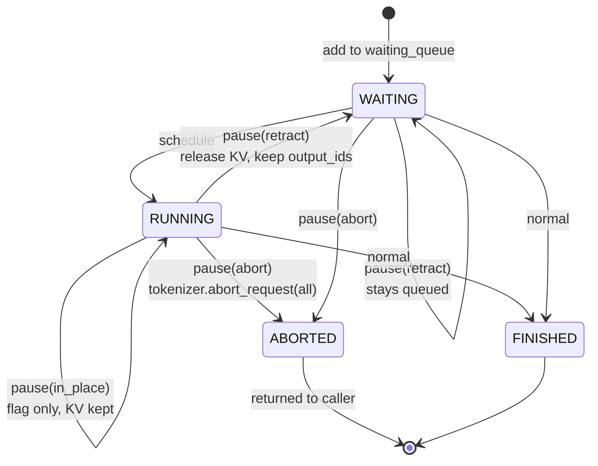
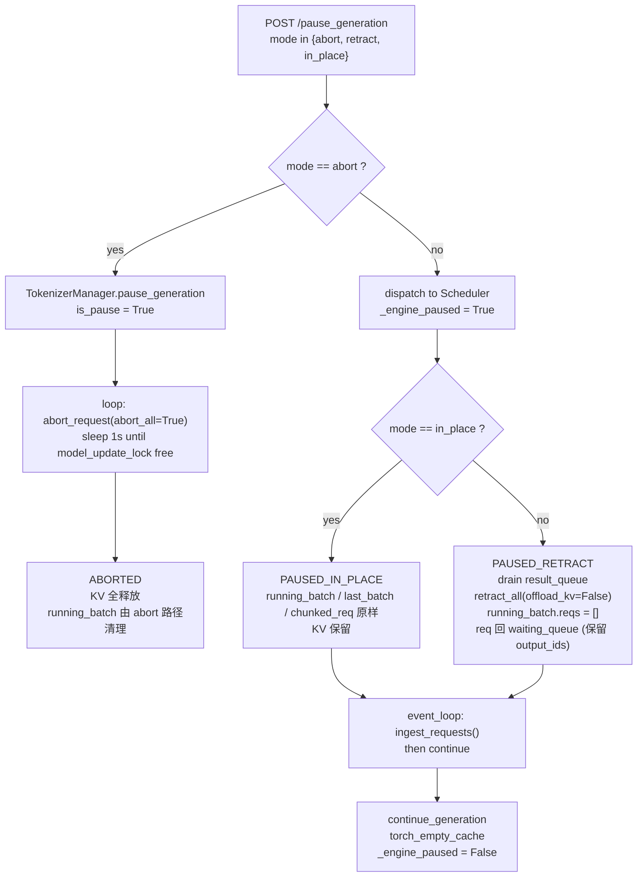
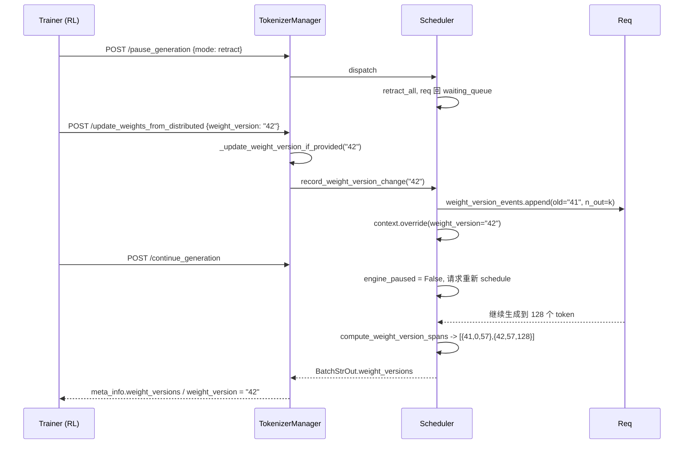
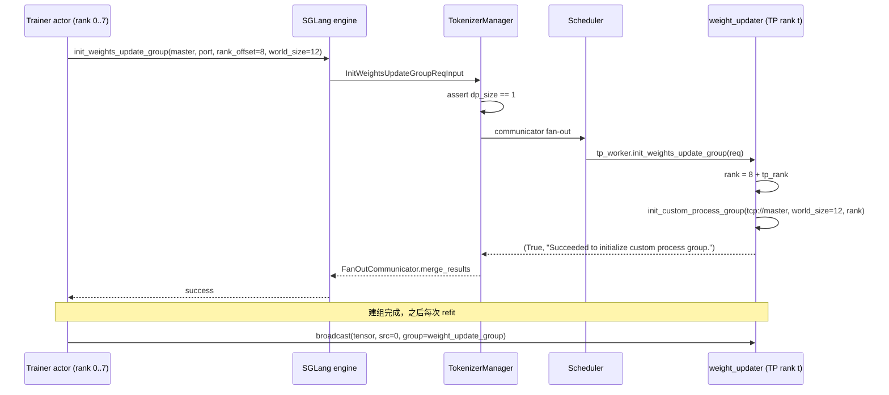

# 06 SGLang 源码级素材

- 仓库：`~/Desktop/Projects/github/sglang` @ `baa9befa381511cd4d56f83980951e5a45fffc6d`（v0.5.22）
- permalink 前缀：`https://github.com/sgl-project/sglang/blob/baa9befa381511cd4d56f83980951e5a45fffc6d/`
- 行号全部用 `git show <commit>:<path> | sed -n 'A,Bp'` 核对过。
- 本机工作树 HEAD 是 `ed26a10`（不是本文档的 commit），**所有引用只对 `baa9bef` 成立**。

---

## 专题 1：三档暂停的完整实现

**结论**：三档暂停**不是三个函数，是「一个布尔 + 一种收尾方式」**。

- `abort`：**完全不走 scheduler**。TokenizerManager 层直接调 `abort_request(abort_all=True)` 并轮询
  `model_update_lock`，把请求从「源头」掐掉。
- `retract`：设置 `_engine_paused=True` → drain 在途 result → 把 `running_batch` / `last_batch` /
  `chunked_req` 里的未完成请求**全部 retract 回 waiting_queue** → 释放 KV。
- `in_place`：只设置 `_engine_paused=True` 然后 `return`。所有 scheduler 状态**原样保留**。

所以「三档」的准确划分维度是：**(1) 由谁执行（tokenizer 进程 vs scheduler 进程）** 与
**(2) KV cache 是保留还是丢弃**。

### 1.1 `PauseGenerationReqInput` 的 docstring 原文

**代码**（`python/sglang/srt/managers/io_struct.py` L1921-L1941）：

```python
class PauseGenerationReqInput(BaseReq, kw_only=True):
    """
    Note that the PauseGenerationRequests is only supported in SGLang Server.
    abort: Abort and return all requests currently being processed.

    in_place: Pause the scheduler's event_loop from performing inference;
            only non-inference requests (e.g., control commands) will be handled.
            The requests in the engine will be paused and stay in the event_loop,
            then continue generation after continue_generation with the old kv cache.
            Note: In 'inplace' mode, flush_cache will fail if there are any requests
            in the running_batch.

    retract: Pause the scheduler's event loop from performing inference;
            only non-inference requests will be handled, and all currently running
            requests will be retracted back to the waiting_queue.
            Note: The KV cache can be flushed in this mode and will be automatically
            recomputed after continue_generation.
    """

    mode: Literal["abort", "retract", "in_place"] = "abort"
```

**读法**：注意 docstring 里 `inplace`（无下划线）和 `Literal["in_place"]`（有下划线）的写法不一致——
这只是注释笔误，**运行期只认 `"in_place"`**。另外默认值是 `"abort"`，
即「不写 mode 就是 abort」，这对 RL 场景里「只想暂停、不想丢样本」的调用者是**危险的默认值**。

### 1.2 `abort` 分支：在 tokenizer 进程里完成，不碰 running_batch

**代码**（`python/sglang/srt/managers/tokenizer_manager.py` L2266-L2280）：

```python
    async def pause_generation(self, obj: PauseGenerationReqInput):
        async with self.is_pause_cond:
            self.is_pause = True
            if obj.mode != "abort":
                await self._async_dispatch_to_scheduler(obj)
            else:
                # we are using the model_update_lock to check if there is still on-going requests.
                while True:
                    # TODO: maybe make it async instead of fire-and-forget
                    self.abort_request(abort_all=True)
                    is_locked = await self.model_update_lock.is_locked()
                    if not is_locked:
                        break
                    await asyncio.sleep(1.0)
```

**读法**：这是**唯一一个 `obj.mode == "abort"` 时不在 scheduler 里执行的路径**。它的逻辑是：
反复 `abort_request(abort_all=True)`（fire-and-forget），然后看 `model_update_lock` 是否还被占用；
一直转到锁空闲为止，每次 `asyncio.sleep(1.0)`。

**为什么用 `model_update_lock` 判据**：注释原文 *"we are using the model_update_lock to check if there
is still on-going requests."* ——「还有在途请求」这件事在 tokenizer 侧不可见，但
**「正在做权重更新的请求持有写锁」**这件事可见。所以它用「锁是否被占用」当代理信号。
这不是「所有请求都停了」，只是「没有正在进行中的权重更新」。

**量化（abort 的恢复成本）**：abort 分支**恢复成本 = 0（不存在恢复）**，代价是
**已生成的 token 全部丢弃**。若一个 partial rollout 平均已生成 `n_done` 个 token，
每 batch `B` 个请求的浪费量 = `B × n_done` 个 token 的前向计算。
（结合 SGLang 文档自述的 APRIL 场景：`n_done` 越大，abort 越亏。）

### 1.3 `retract` 与 `in_place` 分支：在 scheduler 进程里

**代码**（`python/sglang/srt/managers/scheduler.py` L5604-L5620，两个 mode 的分叉点）：

```python
    def pause_generation(self, recv_req: PauseGenerationReqInput):
        assert recv_req.mode in ("in_place", "retract")
        self._engine_paused = True

        if recv_req.mode == "in_place":
            # In-place pause: just set the flag and return immediately.
            # All scheduler state (running_batch, last_batch, chunked_req,
            # result_queue) is left untouched. On resume, the normal event
            # loop (get_next_batch_to_run) handles last_batch merge,
            # chunked_req cleanup, and overlap result processing through
            # the standard code paths. This avoids duplicating batch
            # manipulation logic and the accounting bugs that come with it.
            return
```

**读法**：`in_place` 的实现**只有一行 `return`**。所有「恢复时怎么接上」的逻辑都复用了
`get_next_batch_to_run` 的既有路径——注释明说这是为了 *"avoid duplicating batch manipulation logic
and the accounting bugs that come with it"*。这是「用状态复用代替状态机」的典型取舍。

**`assert recv_req.mode in ("in_place", "retract")`** 是关键：**`abort` 永远不会走到这里**（见 1.2）。
所以 scheduler 侧只有 **两** 档，第三档在 tokenizer 侧。

### 1.4 `retract` 分支：处理 `running_batch` 的关键代码

这段是全文最长的函数（L5604-L5713，110 行）。按执行顺序，关键 5 段：

**(a) drain 在途的 overlap result**（L5619-L5630）：

```python
        if self.enable_overlap and self.last_batch:
            if (
                self.disaggregation_mode == DisaggregationMode.PREFILL
                and (req := self.chunked_req) is not None
            ):
                # Retract skips the chunk step that sets this result's KV send boundary.
                req.tmp_end_idx = min(req.extend_end, len(req.origin_input_ids))
            tmp_batch, tmp_result = self.result_queue.popleft()
            self.process_batch_result(tmp_batch, tmp_result)
```

**读法**：`enable_overlap` 下 `result_queue` 里还压着一个**已经算完但还没 process** 的 batch。
必须先把它 process 掉，否则后面 retract 时这块 KV 会被重复释放。**这是最容易漏的一步**。

**(b) 收集要 retract 的请求集**（L5632-L5659）：

```python
        retract_reqs = [r for r in self.running_batch.reqs if not r.finished()]
        if (
            self.last_batch is not None
            and self.last_batch.forward_mode.is_extend()
            # A running batch that DP attention converted to extend is
            # last_batch itself; its requests are already listed above.
            and self.last_batch is not self.running_batch
            # Skip merge for disagg prefill: completed prefill requests are
            # already in disagg_prefill_inflight_queue. Merging them into
            # running_batch leaks them, since the prefill event loop never
            # calls update_running_batch to clean them up.
            and self.disaggregation_mode != DisaggregationMode.PREFILL
        ):
            retract_reqs += [r for r in self.last_batch.reqs if not r.finished()]

        if (
            self.chunked_req is not None
            and not self.chunked_req.finished()
            and self.chunked_req not in retract_reqs
            and self.disaggregation_mode != DisaggregationMode.PREFILL
        ):
            retract_reqs.append(self.chunked_req)
```

**读法**：三个来源：`running_batch.reqs`（主）、`last_batch.reqs`（extend 阶段的）
以及 `chunked_req`（chunked prefill 做了一半的）。三个来源之间有**去重和互斥条件**，
每一条注释都在说「少了这个条件会发生什么」——比如
*"Merging them into running_batch leaks them, since the prefill event loop never calls
update_running_batch to clean them up."*（PD prefill 模式直接泄漏请求）。

**(c) PD decode 的 staged 请求也要 retract**（L5661-L5669）：

```python
        if self.disaggregation_mode == DisaggregationMode.DECODE:
            # Transferred requests wait for a slot holding their row and KV;
            # retract them too, so their KV is rebuilt under the new weights.
            staged = [r for r in self.waiting_queue if r.kv.holds_kv]
            if staged:
                self.waiting_queue = [
                    r for r in self.waiting_queue if not r.kv.holds_kv
                ]
                retract_reqs += staged
```

**读法**：**PD decode 下 `waiting_queue` 里可能有「已经收到 KV、只等 slot」的请求**。
它们持有真实 KV 块，若不 retract，权重更新后会用旧权重算出的 KV 继续 decode → **off-policy**。
这是「暂停 → 更新权重 → 恢复」链路上最隐蔽的 stale-KV 来源。

**(d) 真正释放 KV：`retract_all(..., offload_kv=False)`**（L5675-L5691）：

```python
        if retract_reqs:
            # Decode-side retract always rebootstraps (recomputes the KV from
            # the prefill), so skip the device->host KV offload that release_req
            # would otherwise do; the offloaded copy would be immediately
            # discarded. Non-decode modes ignore offload_kv (they never offload).
            retract_all(
                reqs=retract_reqs,
                req_to_token_pool=self.req_to_token_pool,
                token_to_kv_pool_allocator=self.token_to_kv_pool_allocator,
                tree_cache=self.tree_cache,
                hisparse_coordinator=self.hisparse_coordinator,
                offload_kv=False,
            )
```

**读法**：`offload_kv=False` 的注释解释了**为什么 retract 在 decode 下连 KV offload 都省掉**：
因为 decode 侧 retract 之后**必然 re-bootstrap**（从头重算 prefill），offload 出来的副本
马上就会被丢弃。这是对「offload 到 host 再 offload 回来」这条优化路径的**主动关闭**。

**(e) 状态清空与重新入队**（L5692-L5706）：

```python
        self.running_batch.reqs = []
        for req in retract_reqs:
            if self.disaggregation_mode == DisaggregationMode.DECODE:
                if req.output_ids:
                    req.pd_rebootstrap_forced_output_id = req.output_ids.pop()
                req.pd_rebootstrap_in_progress = True
                req.time_stats.set_retract_time()
                self.disagg_decode_prealloc_queue.hold_rebootstrap(req)
            else:
                self._add_request_to_queue(req)
        self.running_batch.batch_is_full = False
```

**读法**：`self.running_batch.reqs = []` 是**原地清空**（不是换新对象），保证其它持有
`self.running_batch` 引用的地方看到空 batch。普通模式走 `_add_request_to_queue(req)`，请求回到
`waiting_queue`，**已生成的 `output_ids` 保留**（这是 retract 比 abort 省的地方）。

**(f) 最后一段：PD-prefill 的已知 off-policy 漏洞**（L5700-L5706）：

```python
        # In disagg-PREFILL, keep a live mid-chunk chunked_req rather than retract it:
        # freeing its KV under a live disagg KV-sender crashes pop_bootstrapped or
        # sends freed/reused KV to decode. Kept, it resumes prefill after the pause.
        # TODO(disagg-prefill-retract): tear the sender down (abort + release metadata
        # buffer + reset pending_bootstrap) before freeing KV, then retract for real.
        # Until then a weight-update pause leaves stale-weight prefix KV (off-policy).
        if self.disaggregation_mode != DisaggregationMode.PREFILL:
            self.chunked_req = None
```

**读法（重要坑）**：源码注释自己承认 **PD-prefill 模式下 `retract` 暂停会留下用旧权重算的
prefix KV（off-policy）**，并且这是一个 TODO。也就是说「`retract` 保证权重更新后 KV 全部重建」
**在 PD-prefill 模式下不成立**。

**(g) 指标收尾**（L5708-L5713）：`last_gen_throughput = 0.0` + 强制 flush KV events。
注释解释了为什么：paused 状态下 event loop 在 `on_idle` 之前就 `continue` 了，
**不手工清零的话 `gen_throughput` 会整个暂停窗口都停在上一个非零值**。

### 1.5 暂停在事件循环里到底做了什么

**代码**（`scheduler.py` L1944-L1949，`event_loop_normal`；L1993 在 `event_loop_overlap` 同构）：

```python
            # Receive requests
            self.ingest_requests()
            if self._engine_paused:
                self._record_scheduler_state_for_paused_engine()
                continue
```

**读法**：**只有一行**。`ingest_requests()` 仍然执行（所以控制类请求还能被处理），
但 `get_next_batch_to_run` / `run_batch` / `on_idle` 全被跳过。`_engine_paused` 是
**scheduler 进程内的一个 bool**，定义在 L1313（`self._engine_paused = False`），
在 L5606 置 `True`、L5736 置 `False`。

### 1.6 三档状态转换图

**图**（Mermaid `stateDiagram-v2`，画「请求」的视角；标注哪个 mode 走哪条边）：



**图**（Mermaid `flowchart`，画「引擎」视角，把三档落到进程与 KV 两个维度上）：



**四态命名对应**（写作时建议统一这组名字）：

| 文稿里的名字 | 引擎里的真实状态 | KV cache | 已生成 token | 恢复成本 |
| --- | --- | --- | --- | --- |
| `RUNNING` | `_engine_paused=False`，有在途 batch | 占用 | — | — |
| `PAUSED_IN_PLACE` | `_engine_paused=True`，`running_batch` 不变 | **保留** | 保留 | **0**（但 `flush_cache` 会失败） |
| `PAUSED_RETRACT` | `_engine_paused=True`，`running_batch.reqs=[]` | **已释放** | 保留（`output_ids`） | **重算整段 prefix** |
| `PAUSED_ABORTED` | 请求已消失，`is_pause=True` | 释放 | **丢弃** | 不存在（由调用方重发） |

### 1.7 坑

1. **默认 mode 是 `abort`**：不传 `mode` 时 RL 框架想「暂停等权重」会直接丢掉全部样本。
   源码与文档都把默认值写作 `abort`（`io_struct.py` L1941、RL 文档的 Options 列）。
2. **`in_place` + `flush_cache` 静默失效**：docstring 写 *"In 'inplace' mode, flush_cache will fail if
   there are any requests in the running_batch."* `flush_cache` 的前置条件是
   `self.is_fully_idle(ignore_waiting=self._engine_paused)`（L5350）——`in_place` 下
   `running_batch` 非空，所以 `is_fully_idle` 为 False，flush 整体跳过。
   **这不是报错，是跳过**，调用方拿不到任何失败信号。
3. **PD-prefill + retract 的 off-policy 漏洞**（见 1.4(f)），源码里有 TODO。
4. **`abort` 分支的 1 秒轮询粒度**：`asyncio.sleep(1.0)` 意味着最快也要 1 秒才退出循环，
   而且它在 `is_pause_cond` 锁内——这 1 秒里 `continue_generation` 拿不到锁。
5. **`assert recv_req.mode in ("in_place", "retract")`** 意味着如果有人绕过 tokenizer 直接给
   scheduler 发 `abort`，会**AssertionError 而不是正常处理**。

---

## 专题 2：`ContinueGenerationReqInput` 的 `torch_empty_cache` 注释

**结论**：恢复前主动调 `torch.cuda.empty_cache()`，动机是**把「权重更新期间产生的一次性分配」
还给 driver**，并且强调「不会和活跃 stream 竞争」。

### 2.1 原文

**代码**（`python/sglang/srt/managers/io_struct.py` L1943-L1950）：

```python
class ContinueGenerationReqInput(BaseReq, kw_only=True):
    # Call torch.cuda.empty_cache() before un-pausing. Returns blocks
    # cached by the PyTorch allocator (left over from transient allocs
    # during post-weight-update processing) back to the driver before
    # inference resumes, with no race against active streams. Set to
    # False to skip the empty_cache call.
    torch_empty_cache: bool = True
```

**读法（逐句拆）**：

1. *"before un-pausing"* —— 时机是「解除暂停**之前**」，不是之后。
2. *"Returns blocks cached by the PyTorch allocator (left over from transient allocs
   during post-weight-update processing) back to the driver"* —— PyTorch 的 caching allocator
   在权重更新期间做了大量一次性分配（例如从盘读权重、临时 reshape），这些块被缓存住不还给
   CUDA driver。`empty_cache()` 把它们真正归还。
3. *"with no race against active streams"* —— 前提是此时**引擎已 idle**（暂停中），
   没有活跃 kernel 在用这些块，所以 `empty_cache()` 是安全的（正常运行时它会同步设备）。

### 2.2 真正执行的位置

**代码**（`scheduler.py` L5715-L5736）：

```python
    def continue_generation(self, recv_req: ContinueGenerationReqInput):
        if recv_req.torch_empty_cache:
            before_mb = torch.cuda.memory_reserved() / (1024 * 1024)
            torch.cuda.empty_cache()
            after_mb = torch.cuda.memory_reserved() / (1024 * 1024)
            logger.info(
                f"[continue_generation] torch.cuda.empty_cache() called: "
                f"reserved {before_mb:.1f} MB -> {after_mb:.1f} MB "
                f"(freed {before_mb - after_mb:.1f} MB)"
            )
```

**读法**：它**顺带打了一条日志**，打印 `memory_reserved()` 的前后差——这个数字就是
「有多少 cache 被还给了 driver」。**这是唯一一个能直接观测「权重更新泄漏了多少显存」的埋点**，
写作时可以把它当成「读者在自己机器上复现」的锚点：日志行形如
`[continue_generation] torch.cuda.empty_cache() called: reserved 71234.5 MB -> 65890.2 MB (freed 5344.3 MB)`。

**量化**：`memory_reserved()` 是 PyTorch 向 cudnn/CUB 预留的段总量，**不是** `memory_allocated()`。
`empty_cache()` 只能释放 reserved 里**完全空闲**的段；碎片化的段（中间有小块存活）无法释放。
所以 `freed` 的数字**系统性地小于**「权重更新实际分配量」，且**依赖分配顺序**（不可复现）。
这一点在写作时值得提醒：**别把 `freed` 当成「节省的显存」**。

### 2.3 为什么需要它（在 RL 循环里的位置）

时间线：

```
pause(retract) → ["训练侧写权重文件 / 广播权重" ] → update_weights_from_*
              → [权重更新期间：读盘、反量化、cuda graph 重捕获 → 大量临时分配]
              → continue_generation → empty_cache() → 推理恢复
```

如果不做 `empty_cache()`：权重更新期间的临时块继续被 PyTorch 的 cache 持有，
**训练侧进入下一步要显存时**，这些被 cache 住的空块仍然占着 reserved 地址空间。
`empty_cache()` 把「我们不再需要但 allocator 贪着」的部分还给 driver。

**注意（重要坑）**：`torch_empty_cache` 的默认值是 `True`，而 `update_weights_from_disk` 的
`torch_empty_cache` 默认值是 `False`（`io_struct.py` L1969 附近）。也就是说
**同名的参数在两个 endpoint 上默认值相反**：暂停恢复**默认清**，更新权重**默认不清**。
RL 框架通常需要按「更新后是否立刻恢复」来配这一对——**只设一个会让另一方行为不符合预期**。

---

## 专题 3：FlattenedTensorBucket 完整实现

**结论**：把一组 `(name, tensor)` 按 `uint8` 展平后 `torch.cat` 成**一个一维 uint8 tensor**，
同时记一张 `metadata` 表（名字/原 shape/原 dtype/在 buffer 里的字节区间）。
还原时按区间切出来、`view(dtype).reshape(shape)`——**全部是零拷贝视图**。

**代码**：整文件只有 121 行，`python/sglang/srt/weight_sync/tensor_bucket.py`。

### 3.1 `FlattenedTensorMetadata` 的字段

**代码**（L7-L16）：

```python
@dataclass
class FlattenedTensorMetadata:
    """Metadata for a tensor in a flattened bucket"""

    name: str
    shape: torch.Size
    dtype: torch.dtype
    start_idx: int
    end_idx: int
    numel: int
```

**注意**：`start_idx` / `end_idx` / `numel` 的单位是 **uint8 字节**（`numel` 是展平后
`view(torch.uint8)` 的 `numel()`），**不是原 dtype 的元素个数**。这是最容易读错的一点：
对 bf16 的 `(4096, 4096)` 权重，`numel = 16.7M × 2 = 33.5M`。

### 3.2 压平

**代码**（L51-L72）：

```python
            # Collect metadata and flatten tensors
            current_idx = 0
            flattened_tensors: List[torch.Tensor] = [None] * len(named_tensors)

            for i, (name, tensor) in enumerate(named_tensors):
                flattened = tensor.flatten().view(torch.uint8)
                flattened_tensors[i] = flattened

                # Store metadata

                numel = flattened.numel()
                metadata_obj = FlattenedTensorMetadata(
                    name=name,
                    shape=tensor.shape,
                    dtype=tensor.dtype,
                    start_idx=current_idx,
                    end_idx=current_idx + numel,
                    numel=numel,
                )
                self.metadata[i] = metadata_obj
                current_idx += numel

            # Concatenate all flattened tensors
            self.flattened_tensor = torch.cat(flattened_tensors, dim=0)
```

**读法**：

- `tensor.flatten()` —— 若是连续张量返回视图，非连续才拷贝。**必须连续**才能 `view(uint8)`，
  非连续时 `flatten()` 会**静默做一次拷贝**（代价：一次全量 copy）。
- `.view(torch.uint8)` —— 位宽重解释（BF16 的 2 字节被拆成 2 个 uint8）。要求张量最后一维连续。
- `torch.cat` —— **这里是唯一一次真实分配**，大小 = 所有张量字节数之和。
  `flattened_tensors` 里各块是视图，所以峰值内存 ≈ **1 份 bucket 大小**（+ 可能的非连续拷贝）。
- `supports_multi_dtypes = True`（L23）—— 因为统一存成 uint8，混合 dtype（bf16 权重 + fp32
  layernorm + int8 量化参数）可以塞进**同一个** buffer。这是这个类存在的**核心理由**。

### 3.3 还原

**代码**（L96-L115）：

```python
    def reconstruct_tensors(self) -> List[Tuple[str, torch.Tensor]]:
        """
        Reconstruct original tensors from flattened tensor with optimized performance.
        Uses memory-efficient operations to minimize allocations and copies.
        """
        # preallocate the result list
        reconstructed = [None] * len(self.metadata)

        for i, meta in enumerate(self.metadata):
            tensor = (
                self.flattened_tensor[meta.start_idx : meta.end_idx]
                .view(meta.dtype)
                .reshape(meta.shape)
            )

            reconstructed[i] = (meta.name, tensor)

        return reconstructed
```

**读法**：`[start:end]` 是视图 → `.view(dtype)` 是位宽重解释 → `.reshape(shape)` 是视图。
**全程零拷贝**，但结果是**共享 `flattened_tensor` 存储的视图**——所以：

**坑**：`reconstruct_tensors()` 返回的张量**不是独立的**。如果调用方把它们塞进模型参数
（`param.data = t`），那么所有参数都**指向同一块 bucket 内存**。bucket 一旦被 GC，
参数变成悬空视图（实际上 tensor 引用会让 bucket 存活，但**显存不会被释放**，
因为那块 buffer 被 N 个参数引用）。SGLang 自己的用法是 `load_weights(reconstructed)`，
走 `copy_` 语义就没问题；**外部框架若直接赋值就会出事**。

### 3.4 三条实际使用路径

| 位置 | 用法 | 语义 |
| --- | --- | --- |
| `tp_worker.py` L223 | `FlattenedTensorBucket(flattened_tensor=data["flattened_tensor"], metadata=data["metadata"])` | **反序列化重建**（LoRA adapter 走 `load_format == "flattened_bucket"`） |
| `model_runner_components/weight_updater.py` L411 | 从 dict 里取出 metadata 逐字段重建 `FlattenedTensorMetadata`，再 `reconstruct_tensors()` | 从 tensor 更新（`update_weights_from_tensor` 的 bucketed 格式） |
| `model_runner_components/weight_updater.py` L309 | `FlattenedTensorBucket(named_tensors=named_tensors)` 然后**只 broadcast `flattened_tensor`** | **分布式更新的优化路径**（见下） |

**最值得写的是第三条**（L294-L316）：

```python
    def _receive_bucketed_weights_from_distributed(
        self: WeightUpdater, *, names, dtypes, shapes, group_name
    ):
        named_tensors = []
        for name, dtype, shape in zip(names, dtypes, shapes):
            target_dtype = (
                dtype if isinstance(dtype, torch.dtype) else getattr(torch, dtype)
            )
            named_tensors.append(
                (name, torch.empty(shape, dtype=target_dtype, device=self.device))
            )
        bucket = FlattenedTensorBucket(named_tensors=named_tensors)
        flattened_tensor = bucket.get_flattened_tensor()
        torch.distributed.broadcast(
            flattened_tensor,
            src=0,
            group=self._model_update_group[group_name],
        )
        return bucket.reconstruct_tensors()
```

**读法（关键性能点）**：对比它上面的 `_receive_weights_from_distributed`（L280-L294），那边是
**每个参数一次 `torch.distributed.broadcast(..., async_op=True)`**，N 个参数 → N 次 NCCL 调用。
bucket 版本把 N 个参数压成 **1 次 broadcast**。

**量化**：
- 设参数数 `N=300`，单参数平均 `S=8 MiB`。
- 逐参数：300 次 broadcast，每次至少一次 kernel launch + 一次 NCCL 握手（约 `5~20 µs` 固定开销），
  固定开销 `300 × 10 µs = 3 ms`；总传输 `2400 MiB / 25 GB/s ≈ 96 ms`。
- bucket：1 次 broadcast，固定开销 ≈ 0；总传输仍 96 ms（带宽不变）。
- **收益 = 300 次 → 1 次调用**，固定开销从 ~3 ms 降到 ~0.01 ms。在「每步都要 refit」的 RL 循环里，
  300 次 refit 就是 ~1 s 的纯启动开销差异。

**坑**：bucket 版本**丢失了 async 能力**——`torch.distributed.broadcast` 不带 `async_op=True`，
必须**同步等完**才能 `reconstruct_tensors()`。逐参数版本则能 `handle.wait()` 前先做别的。
所以 bucket 优化的是**启动开销**，牺牲的是**流水线重叠**。小参数多、带宽不是瓶颈时 bucket 好；
大参数少、能重叠时逐参数好。

---

## 专题 4：weight_version 的传播

**结论**：SGLang 的 weight_version 传播是**「按 token 打版本戳」**，不是「按请求打版本戳」。
一个请求如果跨越了版本更新（暂停 → refit → 恢复），它的输出会被切成若干 `[start, end)` 区间，
每个区间的 token 标注**生成它们时生效的版本号**。这个信息通过 `meta_info.weight_versions` 返回。

### 4.1 完整链路（6 跳）

```
POST /update_weights_from_disk|from_tensor|from_distributed  {weight_version: "42"}
  │  tokenizer_manager 侧
  ├─ 1. obj.weight_version 被取出 → _update_weight_version_if_provided("42")      (L2318)
  ├─ 2. record_config_updates("tokenizer.weight_version", ...)                     (L1047)
  ├─ 3. 同时 dispatch 到 scheduler → Scheduler.record_weight_version_change("42")
  │        get_context().override("scheduler.weight_version", weight_version="42")
  │        对每个 live req 追加 WeightVersionEvent(old="41", num_output_tokens=k)
  │                                                                     (scheduler L5419-L5435)
  ├─ 4. 生成结束时 _make_abort_req(req) →
  │        compute_weight_version_spans(events, current_version, num_out) (scheduler L6164-L6170)
  ├─ 5. BatchStrOut.weight_versions ← 每请求的 spans                    (io_struct L1681/L1775)
  └─ 6. tokenizer_manager: add_weight_versions_to_meta_info(...)         (L2559-L2569)
```

### 4.2 每层的代码

**(a) 版本号进入 scheduler**（`python/sglang/srt/managers/scheduler.py` L5414-L5436）：

```python
    def record_weight_version_change(self, new_version: Optional[str]) -> None:
        if new_version is None or new_version == get_serving().weight_version:
            return

        old_version = get_serving().weight_version
        get_context().override("scheduler.weight_version", weight_version=new_version)

        live_reqs = {
            *self.collect_inflight_reqs(),
            *self.waiting_queue,
            *([self.chunked_req] if self.chunked_req is not None else []),
        }
        if self.hisparse_coordinator is not None:
            live_reqs.update(
                act.req for act in self.hisparse_coordinator.ack_staging_queue
            )
        num_recorded = record_weight_version_events(live_reqs, old_version=old_version)
```

**读法**：三个要点——
1. **幂等短路**：`new_version == 旧版本` 时直接 return（所以重复发同一版本号不会污染事件流）。
2. **`live_reqs` 是五个来源的并集**：在途 batch、waiting_queue、chunked_req、HiSparse staging，
   以及 `collect_inflight_reqs()`。**漏掉任何一个都会让那个请求的 token 少一段版本记录。**
3. 记录的是 `old_version`（不是 new）——因为「此刻已经产出的那些 token 是旧版本生成的」。

**(b) 事件记录**（`python/sglang/srt/utils/weight_versions.py` L38-L50）：

```python
def record_weight_version_events(reqs: Iterable[Req], old_version: str) -> int:
    num_recorded = 0
    for req in reqs:
        if req.output_ids:
            req.weight_version_events.append(
                WeightVersionEvent(
                    old_version=old_version,
                    num_output_tokens=len(req.output_ids),
                )
            )
            num_recorded += 1
    return num_recorded
```

**读法**：只对**已经有输出**的请求记录（`if req.output_ids`）。记录内容是「旧版本 + 当时已有多少 token」。
`scheduler.py` 会把这句的结果打进日志：`Weight version changed. old_version=... new_version=... num_recorded=...`。
**这个 `num_recorded` 是判断「有多少请求被卷进跨版本」的唯一指标。**

**(c) 生成结束时算出 spans**（`scheduler.py` L6164-L6170 + `weight_versions.py` L66-L83）：

```python
def compute_weight_version_spans(
    events: List[WeightVersionEvent],
    current_version: str,
    num_output_tokens: int,
) -> WeightVersionSpans:
    changes = [(event.old_version, event.num_output_tokens) for event in events]
    changes.append((current_version, num_output_tokens))

    spans: WeightVersionSpans = []
    for version, end in changes:
        end = min(end, num_output_tokens)
        if spans and end <= spans[-1].end:
            continue
        if spans and version == spans[-1].version:
            spans[-1].end = end
            continue
        start = spans[-1].end if spans else 0
        spans.append(WeightVersionSpan(version=version, start=start, end=end))
    return spans
```

**读法**：把「事件点」变成「区间」。三个细节：
- `end = min(end, num_output_tokens)`：事件记的 token 数可能**超过最终输出长度**
  （例如 retract 之后又丢掉了尾部），必须截断。
- `if spans and end <= spans[-1].end: continue`：**丢弃零长/逆序区间**（同一批里两次版本切换之间
  一个 token 都没生成的情况）。
- `if version == spans[-1].version`：**合并相邻同版本区间**（版本回退到旧号时会触发）。

**(d) retract 时会截断事件**（`schedule_batch.py` L1995-L2005）：

```python
        if self.input_embeds is not None:
            self.output_ids = array("q")
            self.weight_version_events = truncate_weight_version_events(
                self.weight_version_events, num_kept_tokens=self.send_token_offset
            )
```

**读法**：retract 后 `output_ids` 会被清空（`input_embeds` 路径无法复用 KV），
**已记录的版本事件必须同步截断**，否则会记录「不属于现存 token 的版本」。这是
「retract 与版本记账耦合」的唯一显式处理点。

`truncate_weight_version_events`（`weight_versions.py` L53-L63）里还有一句
`if event.num_output_tokens > 0`——零长事件被删掉。

**(e) 进 meta_info**（`tokenizer_manager.py` L2559-L2569 + `weight_versions.py` L88-L104）：

```python
                if (
                    recv_obj.weight_versions is not None
                    and (spans := recv_obj.weight_versions[i]) is not None
                ):
                    add_weight_versions_to_meta_info(
                        meta_info,
                        spans,
                        num_output_tokens=recv_obj.completion_tokens[i],
                    )
```

```python
def add_weight_versions_to_meta_info(
    meta_info: Dict[str, Any],
    spans: WeightVersionSpans,
    num_output_tokens: int,
) -> None:
    visible = [
        span for span in spans if span.start < num_output_tokens or span.start == 0
    ]

    meta_info["weight_versions"] = [
        {
            "version": span.version,
            "start": span.start,
            "end": min(span.end, num_output_tokens),
        }
        for span in visible
    ]
    meta_info["weight_version"] = visible[-1].version
```

**读法**：`meta_info` 里同时有**两个**字段：
- `weight_versions`：区间列表（细粒度）
- `weight_version`：**最后一个区间的版本**（粗粒度）

`or span.start == 0` 这个条件是保证「至少有一个 span」——即使第一个 span 的 start 已超过
`num_output_tokens`（异常的零输出），也会保留它，避免 `visible[-1]` 索引越界。

### 4.3 输出形态（官方文档原文）

`docs/docs/advanced_features/sglang_for_rl.mdx` L600-L609：

```
A request can outlive a version change: the RL flow retracts it with `pause_generation`, refits, and
continues it, or `POST /update_weight_version` relabels while it is still generating. `meta_info` then
reports which tokens came from which weights:

"weight_version": "42",
"weight_versions": [
    {"version": "41", "start": 0, "end": 57},
    {"version": "42", "start": 57, "end": 128}
]
```

以及 L610：

> Ranges are half-open `[start, end)` over output-token indices, prompt excluded. The usual case is a
> single span.

**「prompt excluded」很关键**：区间只覆盖 **output token**，prompt 的 token 不占位置。
这决定了 RL 侧怎么用：把 spans 直接对上 `response_ids` 的下标即可，不需要减 `len(prompt)`。

### 4.4 图（时序）



### 4.5 客观限制（量化）

| 问题 | 事实 | 写作提示 |
| --- | --- | --- |
| 版本号**不进入数值** | `weight_version` 是 `str`，只存 metadata，**不参与任何计算或校验** | 它是「记账」不是「一致性保证」——token 是否真的来自那个版本，取决于 retract 是否真的重建了 KV（专题 1.7 第 3 条：PD-prefill 下没有） |
| 版本号**不随请求下发** | scheduler 记录的是 **scheduler 当前版本**，不是请求自己声明的版本 | 如果在两个版本的窗口里并发请求，**所有在途请求**都按同一个版本边界切 |
| 区间数上界 | 每次版本变更给每个在途请求 +1 个 span | 一次 rollout 内 refit `K` 次、每个请求跨过 `m` 次 → 最多 `m+1` 个 span；正常是 1 个 |
| 版本号默认值 | `UpdateWeightFromDiskReqInput.weight_version: Optional[str] = None`（`io_struct.py` L1966 附近） | **不传版本号时 `meta_info` 里没有这个字段**，RL 侧拿不到任何判定材料 |
| 开销 | 每个 Req 一个 `List[WeightVersionEvent]`（通常空列表） | 空 list 约 56 B/请求；100 万在途请求 ≈ 56 MB——只有在极大规模下才需关注 |

---

## 专题 5：建组协议（`init_weights_update_group`）

**结论**：这是**在训练进程组之外，建一个 SGLang 与训练侧共享的第二套 NCCL 组**。
四层（engine → tokenizer_manager → tp_worker → scheduler/weight_updater）都是**逐字段透传**，
真正的计算只有一行：`rank = rank_offset + self.tp_rank`。

### 5.1 完整调用链

**代码**（`python/sglang/srt/entrypoints/engine.py` L1597-L1618）：

```python
    def init_weights_update_group(
        self,
        master_address: str,
        master_port: int,
        rank_offset: int,
        world_size: int,
        group_name: str,
        backend: str = "nccl",
    ):
        """Initialize parameter update group."""
        obj = InitWeightsUpdateGroupReqInput(
            master_address=master_address,
            master_port=master_port,
            rank_offset=rank_offset,
            world_size=world_size,
            group_name=group_name,
            backend=backend,
        )
        return self.loop.run_until_complete(
            self.tokenizer_manager.init_weights_update_group(obj, None)
        )
```

**代码**（`python/sglang/srt/managers/tokenizer_control_mixin.py` L441-L451）：

```python
    async def init_weights_update_group(
        self: TokenizerManager,
        obj: InitWeightsUpdateGroupReqInput,
        request: Optional[fastapi.Request] = None,
    ) -> Tuple[bool, str]:
        self.auto_create_handle_loop()
        assert get_parallel().dp_size == 1, (
            "data-parallel replicas are not supported for update weights from distributed"
        )

        results = await self.init_weights_update_group_communicator(obj)
        return FanOutCommunicator.merge_results(results)
```

**读法**：**`dp_size == 1` 是硬 assert**。分布式更新权重在 DP 副本下**不支持**——
因为每个 DP 副本都会用同一个 `rank_offset` 加入组，rank 会冲突。

**代码**（`scheduler_components/weight_updater.py` L165-L169 → `tp_worker.py` L147-L155）：

```python
    def init_weights_update_group(self, recv_req: InitWeightsUpdateGroupReqInput):
        """Initialize the online model parameter update group."""
        success, message = self.tp_worker.init_weights_update_group(recv_req)
        return InitWeightsUpdateGroupReqOutput(success=success, message=message)
```

```python
    def init_weights_update_group(self, recv_req: InitWeightsUpdateGroupReqInput):
        success, message = self.model_runner.weight_updater.init_weights_update_group(
            recv_req.master_address,
            recv_req.master_port,
            recv_req.rank_offset,
            recv_req.world_size,
            recv_req.group_name,
            recv_req.backend,
        )
        return success, message
```

**代码**（`model_executor/model_runner_components/weight_updater.py` L100-L145，最终实现）：

```python
    def init_weights_update_group(
        self,
        master_address,
        master_port,
        rank_offset,
        world_size,
        group_name,
        backend="nccl",
    ):
        """Initialize the Torch process group for model parameter updates.

        `_model_update_group` is used in the RLHF workflow, where rank
        0 is the actor model in the training engine, and the other ranks are
        the inference engine, which is used for rollout.
        ...
        """
        assert torch.distributed.is_initialized(), (
            "Default torch process group must be initialized"
        )
        assert group_name != "", "Group name cannot be empty"

        rank = rank_offset + self.tp_rank
        ...
            na = NetworkAddress(master_address, master_port)
            self._model_update_group[group_name] = init_custom_process_group(
                backend=backend,
                init_method=na.to_tcp(),
                world_size=world_size,
                rank=rank,
                group_name=group_name,
            )
```

### 5.2 `rank_offset` 的作用（核心）

**`rank = rank_offset + self.tp_rank`**（L124）。

- **训练侧**：actor 模型占 rank `0 .. train_world_size-1`
- **推理侧**：SGLang 的 TP rank `t` 在共享组里占 rank `rank_offset + t`

所以 `world_size = train_world_size + inference_tp_size`（单实例），
`rank_offset` 通常设为 `train_world_size`。

**量化（一个具体例子）**：训练 8 卡（TP=8 的 actor）+ 推理 4 卡（TP=4）：

| 共享组 rank | 属于 | 角色 |
| --- | --- | --- |
| 0-7 | 训练侧 | 广播方（`src=0`） |
| 8 | 推理 TP rank 0 | `rank_offset=8` + `tp_rank=0` |
| 9 | 推理 TP rank 1 | `8+1` |
| 10 | 推理 TP rank 2 | `8+2` |
| 11 | 推理 TP rank 3 | `8+3` |

`world_size = 12`。**这就是 `rank_offset` 的全部作用**：让两套互相独立的进程组
（各自的 world_size 不同）能在一个扁平 rank 空间里共存。

### 5.3 多实例时的 `rank_offset`

如果 SGLang 起了 `N` 个独立实例（每个 TP=4），每个实例的 `rank_offset` 必须错开：

```
worker i (i=0..N-1) 的 rank_offset = train_world_size + i * 4
```

否则多个实例的 TP rank 0 都会自认为「rank 8」，TCPStore 里会打架。

### 5.4 建组后用一次 broadcast 传权重

**代码**（`weight_updater.py` L280-L294）：

```python
        for name, dtype, shape in zip(names, dtypes, shapes):
            target_dtype = (
                dtype if isinstance(dtype, torch.dtype) else getattr(torch, dtype)
            )
            weight = torch.empty(shape, dtype=target_dtype, device=self.device)
            handles.append(
                torch.distributed.broadcast(
                    weight,
                    src=0,
                    group=self._model_update_group[group_name],
                    async_op=True,
                )
            )
            weights.append((name, weight))
        for handle in handles:
            handle.wait()
        return weights
```

**读法（关键：它怎么处理 TP 分片）**：`torch.empty(shape, ...)` 的 `shape` 来自**调用方传入的
`shapes` 列表**，而这个列表是 `POST /update_weights_from_distributed` 请求体里的。
所以**每个推理 worker 按自己声明的 local shape 接收**——训练侧必须**按推理侧的 TP 切好再发**。
SGLang 不做任何切分，它只是「说是多大就收多大」。

**副作用**：如果 `shapes` 填错（例如填成完整未切的 shape），broadcast 仍会成功（NCCL 只关心字节数），
但 `load_weights` 时 shape 对不上——**报错点在 load 不在传输**，排查距离很远。

### 5.5 图（时序）



### 5.6 坑

1. **`dp_size == 1` 的 assert**：DP attention 或 DP 副本下直接不可用。
2. **`assert torch.distributed.is_initialized()`**（L119-L121）：SGLang 进程自己的默认 process group
   必须先初始化。在「先建默认组、再建自定义组」的顺序之外，任何顺序都会 assert。
3. **`group_name` 冲突**：`_model_update_group` 是 **dict**（`field(default_factory=dict)`），
   同名再建会**静默覆盖**旧组的引用——旧 NCCL 组不会被 destroy，进程内泄漏 communicator。
4. **训练侧必须切好再发**（见 5.4），SGLang 不做 TP 切片。
5. **`weight_update_group` 与默认组共享同一批 NIC**：两个组是**两套独立的 NCCL communicator**，
   同时有流量时会互相挤压带宽。RL 的典型做法是「暂停推理后再 refit」，正是为了避免这个。
6. **文档与源码的 `rank_offset` 描述差异**：文档只说 "Offset for local rank mapping"（L460 附近），
   没提 `rank = rank_offset + tp_rank` 这个公式——**写作时应以源码为准并明确写出公式**。

---

## 专题 6：官方 RL 文档自述

**文档**：`docs/docs/advanced_features/sglang_for_rl.mdx`（686 行），是四个仓库里**唯一一份
专门为 RL 场景写的完整文档**。

### 6.1 定位与五条卖点（L1-L22）

**原文**：

> This document is a practical guide for infrastructure teams integrating SGLang into RL and
> post-training systems. It focuses on the operational pain points in the loop (rollout, evaluation,
> training, weight sync) and maps them to concrete SGLang APIs, flags, and integration patterns.

> **Be a library, not a framework.**
> This philosophy empowers innovation by providing SGLang as flexible tools, not rigid structures.
> Here are five reasons to use SGLang for your RL lifecycle:
> * **Fine-Grained Engine Sleep and Wake Up** …
> * **Open-To-Use Refit Functionality** …
> * **Easy To Postpone Generation**: enable partial rollout and dedicated rollout control
> * **Deterministic Inference** …
> * **Load Balancing Router** …

**读法**：「Be a library, not a framework」是 SGLang 对整个 RL 集成场景的定位声明——
**它不提供训练循环，只提供 rollout 侧的原子操作**。这与 verl / slime / AReaL 那种
「框架接管全部」的路线形成对照，是 06 篇最好的开篇引文。

### 6.2 睡/醒（Sleep & Wake）：三档 tag + torch_memory_saver

**文档 L24-L42 原文**：

> Rollout and training are both memory-intensive, and co-locating them on the same GPUs often leads to
> memory pressure and slow handoffs. SGLang provides a memory-aware sleep/wake mechanism that releases
> KV cache and weights while keeping the server process alive, then resumes them for rollout without a
> full restart. This avoids repeated disk I/O and CUDA graph recapture during each RL step.
>
> Under the hood, the RL team uses **CUDA-graph-aware weight offload via
> [torch_memory_saver](https://github.com/fzyzcjy/torch_memory_saver) to preserve virtual memory
> addresses for graph replay**.

**这是全文档最重要的一段自述**：它把「不重启进程」的技术原因**直接归因于 torch_memory_saver 保留
虚拟地址**。这正是 07（vLLM）篇 sleep mode 的核心机制。两篇可以在这里做交叉引用。

**两个 endpoint**：

| endpoint | tag 取值 | 关键行为（文档原文） |
| --- | --- | --- |
| `POST /release_memory_occupation` | `kv_cache` / `weights` | "This call asserts there are no ongoing requests. Ensure the engine is idle before calling it."；"If `kv_cache` is released, SGLang flushes cache" |
| `POST /resume_memory_occupation` | `kv_cache` / `weights` | 对称恢复 |

**源码实现对应**（`scheduler_components/weight_updater.py` L337-L381）：

```python
        assert self.is_fully_idle(
            ignore_waiting=scheduler is not None and scheduler._engine_paused
        ), "release_memory_occupation should be called only when server is idle."
        ...
        if GPU_MEMORY_TYPE_KV_CACHE in tags:
            ...
            self.memory_saver_adapter.pause(GPU_MEMORY_TYPE_KV_CACHE)
            self.flush_cache()

        if GPU_MEMORY_TYPE_WEIGHTS in tags:
            self._assert_weight_cache_inactive("release_memory_occupation")
            self.stashed_model_static_state = _export_static_state(
                self.tp_worker.model_runner.model
            )
            torch.distributed.barrier(self.tp_cpu_group)
            self.memory_saver_adapter.pause(GPU_MEMORY_TYPE_WEIGHTS)

        if GPU_MEMORY_TYPE_CUDA_GRAPH in tags:
            self.memory_saver_adapter.pause(GPU_MEMORY_TYPE_CUDA_GRAPH)
```

**三个非显然细节**：

1. **`GPU_MEMORY_TYPE_CUDA_GRAPH = "cuda_graph"` 是源码里有的第三档**（`python/sglang/srt/constants.py` L2-L10），
   但**文档只列了 `kv_cache` / `weights` 两档**。源码注释（在 `io_struct.py` L1381 附近，文档也引用了
   这个行号）说 "currently only supports `kv_cache`, `weights`"。**即 CUDA graph 那一档是内部能力，
   通过这两个 endpoint 暂时还没开放**。
2. **`_export_static_state` + `barrier` 的顺序**：先导出「不可 offload 的静态状态」（如 rope 的
   频率表等），再 barrier，再 pause 权重。**barrier 是为了保证所有 TP rank 都导出完了才有人释放权重**。
3. **`ignore_waiting=self._engine_paused`**：在 paused 状态下 `waiting_queue` 里有请求**也允许**
   release——这正是 RL 的正确用法（先 `retract` 暂停、把请求放回 waiting_queue、再 release）。

**`memory_saver_adapter.pause` 背后是什么**（`python/sglang/srt/utils/torch_memory_saver_adapter.py` L98-L131）：
它只是 `torch_memory_saver` 的薄适配层：

```python
    def configure_subprocess(self):
        if is_xpu():
            # Nothing to preload: this LD_PRELOADs the preload-mode .so, which the
            # upstream setup.py does not build for XPU.
            return self._noop_context()
        return torch_memory_saver.configure_subprocess()

    def region(self, tag: str, enable_cpu_backup: bool = False):
        return _memory_saver.region(tag=tag, enable_cpu_backup=enable_cpu_backup)

    def cuda_graph(self, **kwargs):
        ...
        return _memory_saver.cuda_graph(**kwargs)

    def pause(self, tag: str):
        return _memory_saver.pause(tag=tag)

    def resume(self, tag: str):
        return _memory_saver.resume(tag=tag)
```

**关键**：`configure_subprocess()` 在 CUDA 上是 **`torch_memory_saver.configure_subprocess()`**，
注释明说它是 **"This LD_PRELOADs the preload-mode .so"**——即**靠 LD_PRELOAD 劫持 CUDA 的
分配调用**来实现「pause 时 unmap、resume 时 remap 到同一虚拟地址」。这与 07 篇 vLLM 的
`cuMemCreate`/`cuMemUnmap` 路线是**同一类技术、两种落地方式**（一个是库，一个是框架自研）。

**`_TorchMemorySaverAdapterNoop`（L145-L170）**：`enable_memory_saver=False` 时全部是 `pass`/`yield`。
**所以忘开 `--enable-memory-saver` 时，release/resume 全部静默 no-op**，显存一点没释放，
而且只有一条 warning（`check_validity` 里，L56-L62）：

```python
            logger.warning(
                f"`{caller_name}` will not save memory because torch_memory_saver is not enabled. "
                ...
```

**这是最重要的坑**：`--enable-memory-saver` 忘开时不会有任何显存报错，只是「什么都没发生」。

### 6.3 Refit：三条路径

**文档 L106-L118 原文**：

> SGLang supports three refit strategies so you can match your infrastructure style (co-located vs
> disaggregated) and scaling needs.
> - **From disk** is simplest and best for elastic rollout scaling and checkpointing.
> - **From tensor** is best for co-located training/rollout when you can pass in-memory tensors.
> - **From distributed** is best for disaggregated training/rollout with dedicated communication
>   groups (NCCL/IB).

| 路径 | endpoint | 传输 | 源码落点 |
| --- | --- | --- | --- |
| disk | `/update_weights_from_disk` | 文件系统 | `weight_updater.update_weights_from_disk` |
| tensor | `/update_weights_from_tensor` | 同机 IPC / 共享内存 | `weight_updater` + `FlattenedTensorBucket` |
| distributed | `/update_weights_from_distributed` | NCCL/IB | `_receive_weights_from_distributed` / `_receive_bucketed_weights_from_distributed` |

**注意源码里** **实际是四条**：还有一条 `update_weights_from_ipc`（`weight_updater.py` ~L420），
走 `checkpoint_engine` 的 ZMQ handles：

```python
    def update_weights_from_ipc(self: WeightUpdater, recv_req):
        """Update weights from IPC for checkpoint-engine integration."""
        ...
            worker = SGLangCheckpointEngineWorkerExtensionImpl(self.get_model_runner())
            worker.update_weights_from_ipc(recv_req.zmq_handles)
```

文档没提这条，但它是「Zero-copy IPC」这类集成（如 Megatron-Bridge 文档里的 ZMQ streaming 方案）的
对端。**两篇可以在这里对上。**

### 6.4 暂停（Pause）：文档的三档说明

**文档 L612-L660 原文（`## Easy To Postpone Generation` 一节）**：

> Multi-turn RL rollouts often suffer from long-tail requests that block the entire batch. …
> SGLang exposes explicit pause/resume APIs so you can pause slow requests and continue them later.
> This pattern matches systems like [APRIL](https://arxiv.org/abs/2509.18521), terminate once enough
> responses are collected, and recycle incomplete responses in the next step.

> `pause_generation` --- update weights --- `continue_generation` is the correct execution flow when
> updating weights from training. **An update can only happen when SGLang is not actively processing
> inference tasks.**

**Modes 表格原文**：

> - `abort`: Default behavior, identical to `abort` endpoint with `abort_all` set. Pending requests from
>   `waiting_queue` and `running_queue` will be returned immediately to the caller.
> - `retract`: Put engine in "paused" state. Move running requests back to waiting queue. KV cache can be
>   flushed and recomputed later.
> - `in_place`: Put engine in "paused" state without changing states of the requests. Running requests rely
>   on availability of KV caches to continue, so any subsequent `flush_cache` call will be unsuccessful.

**读法**：文档的 `retract` 描述（"KV cache can be flushed and recomputed later"）与源码一致，
但**没有提到 PD-prefill 下的 off-policy 漏洞**（专题 1.4(f) 的 TODO）。
`in_place` 的描述（"flush_cache call will be unsuccessful"）**措辞温和**——
源码里它是**静默跳过**（`is_fully_idle(...)` 为 False 直接 return），不是 "unsuccessful" 报错。

### 6.5 确定性推理（Deterministic Inference）

**文档 L661-L673 原文**：

> SGLang supports a deterministic inference mode that reduces non-determinism across batch shapes. This
> mitigates variance introduced by runtime batching and kernel selection. **To further achieve true
> on-policy training, you need to modify the training engine to use the same deterministic kernels.**

开关：`--enable-deterministic-inference`。详见 `docs/docs/advanced_features/deterministic_inference`。

**读法（重要的边界自述）**：官方明确说「**只做推理侧还不够**」——要 true on-policy 必须训练侧
也用同一套 kernel。这一句应该原样引用，因为它否定了「只开一个 flag 就能 on-policy」的常见误解。

### 6.6 `mem_fraction_static` 等 RL 场景推荐配置

本轮在 `sglang_for_rl.mdx` 里**没有**找到专门的 mem_fraction_static 推荐值表格
（`grep mem-fraction` 无命中）。文档里的配置建议集中在：
- `--enable-memory-saver`（L40）
- `--enable-deterministic-inference`（L670）
- 负载均衡路由器的 cache-aware 参数（L675 起的章节）

**结论**：**官方 RL 文档不给具体的显存比例数字**，只给「开关清单」。写作时若需要「
co-located 下 KV 该留多少」这类量化，必须自己推导（见下方公式），不能引用文档。

**可推导的公式**（供 06 篇用）：

```
co-located 场景单卡 HBM 预算：
    HBM_total
  = weights_gpu (推理权重一份 + 训练权重一份, 若同卡)
  + kv_cache
  + activation (训练侧峰值)
  + grad_opt (训练侧)

SGLang 侧可控的是 kv_cache，由 --mem-fraction-static f 决定：
    kv_cache ≈ f * (HBM_total - weights_gpu - cuda_graph) - other_overhead

RL 的典型配置（工程惯例，非文档数值）：
    训练开始前 release_memory_occupation(tags=["kv_cache"]) -> 把 KV 还给训练
    rollout 前 resume_memory_occupation(tags=["kv_cache"])   -> 重新分配
```

**注意**：上面的「工程惯例」是**从 API 语义推出的用法**，不是官方文档原文，写作时不应标注为
「官方推荐」。

### 6.7 官方文档与源码的 4 处不一致（写作时需要留意）

| # | 文档说 | 源码实际 | 影响 |
| --- | --- | --- | --- |
| 1 | 只支持 `kv_cache` / `weights` 两档 tag | `constants.py` 定义了 `cuda_graph` 第三档 | 内部能力，未开放 |
| 2 | `in_place` 下 `flush_cache` 会是 "unsuccessful" | 静默跳过，无返回信号 | 调用方无法感知 |
| 3 | `retract` 的 KV "can be recomputed later" | PD-prefill 下保留 stale KV（TODO） | off-policy 风险 |
| 4 | 三种 refit 路径 | 源码有四种（多 `from_ipc`） | 文档滞后于实现 |

---

## 遗留疑点（未能验证）

1. **`torch_memory_saver` 内部怎么用 CUDA VMM** —— 它是外部包（`import torch_memory_saver`），
   本仓库只看到 `LD_PRELOAD` 的注释，没看到 `cuMemCreate`/`cuMemUnmap` 的具体调用。
   如果 06 篇要与 07 篇（vLLM sleep mode）做机制对比，**需要另取 `torch_memory_saver` 仓库的源码**。
2. **`GPU_MEMORY_TYPE_CUDA_GRAPH` 对外是否真的不可用** —— 我只看到文档引用的
   `io_struct.py#L1381` 注释说 "currently only supports `kv_cache`, `weights`"，
   但**没有确认 `ReleaseMemoryOccupationReqInput.tags` 的类型定义是否限制了取值**。
   （`io_struct.py` 在这个 commit 的行号已经飘到 1900+，文档里的 L1381 是旧行号。）
3. **`_export_static_state` 导出了哪些内容** —— 没追进去。如果它导出的是**权重以外的可学习量**
   （例如 RMSNorm 的 eps、per-head 的 qk_clip 参数），那 release/resume 的语义就不是纯「权重 offload」。
4. **`update_weights_from_tensor` 的 TP 分片语义** —— 专题 5 只覆盖了 distributed 路径。
   tensor 路径依赖 `FlattenedTensorBucket` + 每个 rank 只反序列化自己那份
   （`tp_worker.deserialize_own_rank`：`serialized_named_tensors[get_parallel().tp_rank]`，L198-L201），
   我看到了代码但**没有验证「调用方传的是完整张量列表、每个 rank 各取一份」这个契约**有没有文档。
5. **`retract` 之后 `output_ids` 到底保留哪些** —— 专题 4.2(d) 里 `input_embeds` 路径是
   `self.output_ids = array("q")`（清空）；非 `input_embeds` 路径我看的是
   `pause_generation` 里直接 `_add_request_to_queue(req)` 不做清理，因此推断保留。
   但**「retract 时 KV 释放了、output_ids 保留、KV 重算」这个组合是否在所有后端（Mamba/混合）
   下都成立**，没有验证。
