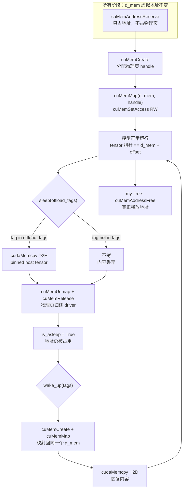
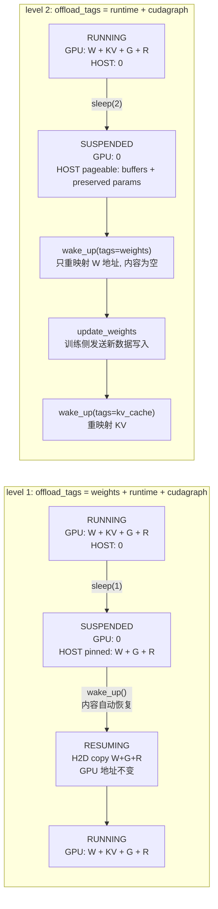
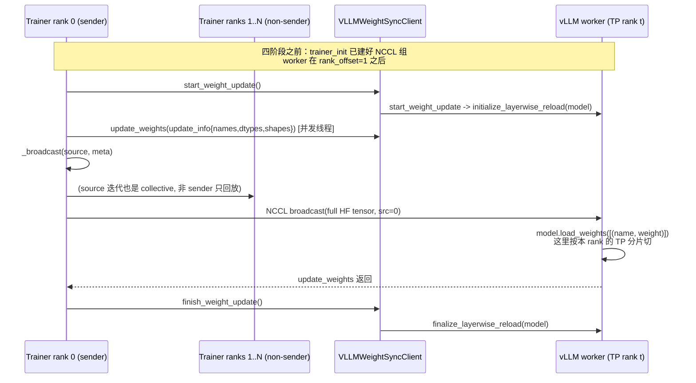
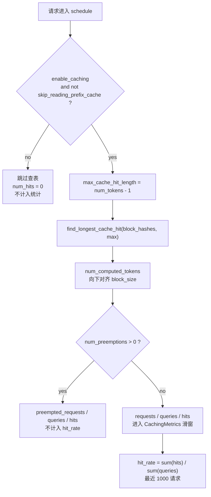
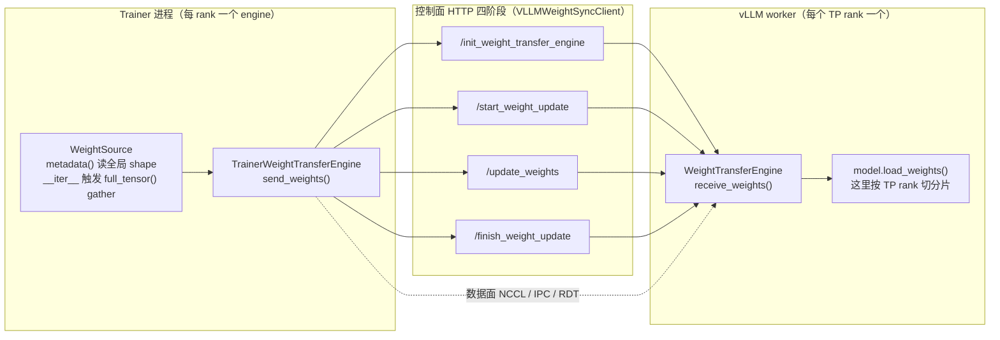

# 07 vLLM 源码级素材

- 仓库：`~/Desktop/Projects/github/vllm` @ `2365177ddda7714502e4df7a1669cc79c0a4dfd0`（v0.32.1rc0）
- permalink 前缀：`https://github.com/vllm-project/vllm/blob/2365177ddda7714502e4df7a1669cc79c0a4dfd0/`
- 行号全部用 `git show <commit>:<path> | sed -n 'A,Bp'` 核对过。
- 本机工作树 HEAD 是 `719735d`（不是本文档的 commit），**所有引用只对 `2365177` 成立**。

---

## 专题 1：sleep mode 的分配器实现

**结论**：vLLM 自己写了一个 **PyTorch pluggable CUDA allocator**（C++ 扩展
`csrc/cumem_allocator.cpp`），用 **CUDA Virtual Memory Management（VMM）API** 把「虚拟地址」和
「物理显存」解耦：地址永远保留，物理页可以在 `sleep` 时 unmap+release、在 `wake_up` 时重新
create+map 回**同一个地址**。这样**所有指向这些地址的指针（包括 CUDA graph 里固化下来的）继续有效**。

### 1.1 为什么 PyTorch 默认 allocator 做不到（源码注释原文）

**代码**（`vllm/device_allocator/cumem.py` L1-L10）：

```python
# cumem-based pytorch pluggable allocator to implement sleep mode.
# other approaches tried but failed:
# - cuda-python package binding
# - custom libcuda driver ctypes wrapper
# both of them failed because of cuda context mismatch.
# not sure why, they are created from a different context.
# the only successful approach is to call cuda driver API in C.
```

**读法**：这段注释回答了**两个**「为什么」：

1. **为什么不用纯 Python**：`cuda-python` 绑定和 `libcuda` 的 ctypes 包装都「failed because of
   cuda context mismatch」——driver API 的 context 和 runtime API 建立的不一致。**唯一成功的路是在
   C 里直接调 driver API**。这是 L4-L7 的原话。
2. **为什么 PyTorch 默认 allocator 不行**（这是文档没写、但代码结构决定的推理）：
   `torch.cuda.caching_allocator` 是一个**块缓存**——`free` 时把块放回内部池，**并不 `cudaFree`**；
   而 `torch.cuda.empty_cache()` 会真的 `cudaFree`，**之后再次分配可能拿到不同地址**。
   一旦地址变了：
   - CUDA graph 内部记录的指针失效（graph 是「指针快照」）；
   - 已经 `torch.cuda.graphs.capture` 的 kernel 参数指向旧地址 → **非法地址访问**。

   所以「释放但可恢复」必须**地址不变**。PyTorch 默认分配器没有任何「保留地址、只还物理页」的接口，
   而 CUDA VMM 原生支持这件事。

**官方文档的对应自述**（`docs/features/sleep_mode.md`）：

> **Frees GPU memory**: Offloads model weights to CPU RAM and discards KV cache, releasing up to 90%+
> of GPU memory for other tasks.

> **Fast resume**: Quickly wake up the engine and resume inference without full model reload.

「without full model reload」能成立，前提就是**地址不变 + weights 被备份到 CPU**。

### 1.2 关键的 CUDA API 调用链

**代码**（`csrc/cumem_allocator.cpp` L337-L364，`my_malloc` 的启动段）：

```cpp
void* my_malloc(ssize_t size, int device, CUstream stream) {
  ensure_context(device);

  CUmemAllocationProp prop = {};
  prop.type = CU_MEM_ALLOCATION_TYPE_PINNED;
  prop.location.type = CU_MEM_LOCATION_TYPE_DEVICE;
  prop.location.id = device;
  prop.allocFlags.compressionType = CU_MEM_ALLOCATION_COMP_NONE;

  // Check if the allocation is supported
  size_t granularity;
  CUDA_CHECK(cuMemGetAllocationGranularity(&granularity, &prop,
                                           CU_MEM_ALLOC_GRANULARITY_MINIMUM));
  ...
  size_t alignedSize = ((size + granularity - 1) / granularity) * granularity;

  CUdeviceptr d_mem;
  CUDA_CHECK(cuMemAddressReserve(&d_mem, alignedSize, 0, 0, 0));
```

**代码**（L119-L172，`create_and_map` 的核心）：

```cpp
void create_and_map(unsigned long long device, ssize_t size, CUdeviceptr d_mem,
...
  prop.allocFlags.compressionType = CU_MEM_ALLOCATION_COMP_NONE;
  ...
    prop.requestedHandleTypes = CU_MEM_HANDLE_TYPE_FABRIC;
  ...
  // Allocate memory using cuMemCreate
  CUresult ret = (CUresult)cuMemCreate(p_memHandle, size, &prop, 0);
  ...
  CUDA_CHECK(cuMemMap(d_mem, size, 0, *p_memHandle, 0));
```

**代码**（L233-L249，`unmap_and_release`）：

```cpp
void unmap_and_release(unsigned long long device, ssize_t size,
...
  CUDA_CHECK(cuMemUnmap(d_mem, size));
  ...
    CUDA_CHECK(cuMemRelease(*p_memHandle));
```

**完整的 API 序列**：

| 阶段 | 调用 | 作用 |
| --- | --- | --- |
| 分配前 | `cuMemGetAllocationGranularity(..., MINIMUM)` | 取 **最小粒度**（CUDA 通常是 2 MiB、HMM/ROCm 另有值），`alignedSize` 必须向上取整到它的倍数 |
| 第一次 | `cuMemAddressReserve(&d_mem, alignedSize, 0, 0, 0)` | **只保留虚拟地址，不占物理显存**。这一步就是「可恢复」的全部前提 |
| 第一次 | `cuMemCreate(&handle, size, &prop, 0)` | 真正分配物理页，得到 `CUmemGenericAllocationHandle` |
| 第一次 | `cuMemMap(d_mem, size, 0, handle, 0)` | 把物理 handle 映射到保留的地址 |
| 第一次 | `cuMemSetAccess(d_mem, size, accessDesc, 1)` | 设置 RW 权限（L215-L224，`CU_MEM_ACCESS_FLAGS_PROT_READWRITE`） |
| sleep | `cuMemUnmap(d_mem, size)` + `cuMemRelease(handle)` | **只还物理页，地址 `d_mem` 仍被占用** |
| wake | `cuMemCreate` + `cuMemMap(d_mem, ...)` + `cuMemSetAccess` | 重新拿物理页，映射回**同一个 `d_mem`** |
| 真正释放 | `cuMemAddressFree(d_mem, alignedSize)` | 在 `my_free` 的路径（L452、L574） |

**另有两条高阶特性**（顺带发现，写作时可选）：

- **Fabric handle**（L136-L149）：分配前先用 `cuDeviceGetAttribute` 查
  `CU_DEVICE_ATTRIBUTE_HANDLE_TYPE_FABRIC_SUPPORTED`，支持则
  `prop.requestedHandleTypes = CU_MEM_HANDLE_TYPE_FABRIC`。失败再退回
  `CU_MEM_HANDLE_TYPE_POSIX_FILE_DESCRIPTOR`（L160-L161）。这是**多节点 NVLink / 跨进程共享**的基础，
  与 `enable_cumem_allocator` 的 docstring「such as multi-node NVLink support」对应
  （`vllm/config/model.py` L387-L391）。
- **ROCm 分块**（L166-L198）：ROCm 不能一次 create 巨大分配，所以按
  `VLLM_ROCM_SLEEP_MEM_CHUNK_SIZE`（默认 256 MB）切成多块，每块单独 `cuMemCreate`/`cuMemMap`。

### 1.3 地址保留怎么和 PyTorch 的 tensor 对上：`pointer_to_data`

分配器只保留「地址 → (handle, tag, 备份 tensor, 是否睡着)」。**tensor 本身由 PyTorch 管理**，
分配器只负责保证「这块地址的物理页在睡醒之间可以消失又回来」。

**代码**（`cumem.py` L188-L202，malloc 回调）：

```python
    def _python_malloc_callback(self, allocation_handle: HandleType) -> None:
        """Internal method to store the allocation data
        when memory is allocated in the memory pool.
        """
        py_d_mem = allocation_handle[2]
        self.pointer_to_data[py_d_mem] = AllocationData(
            allocation_handle, self.current_tag
        )
```

**数据结构**（`vllm/device_allocator/__init__.py` L11-L27）：

```python
# py_device, py_size_or_aligned_size, py_ptr, py_handle
# py_handle has type list[int] on ROCm and int otherwise
HandleType: TypeAlias = tuple[int, int, int, list[int] | int]

# Selective wake may defer only these; any wake restores every other tag.
DEFERRABLE_TAGS: tuple[str, ...] = ("weights", "kv_cache")


@dataclasses.dataclass
class AllocationData:
    handle: HandleType
    tag: str
    cpu_backup_tensor: torch.Tensor | None = None
    is_asleep: bool = False
```

**读法（关键）**：`tag` 是**这个分配属于哪个内存类别**（`weights` / `kv_cache` / `runtime` / `cudagraph` /
`default`）。`sleep(offload_tags=...)` 就是按 tag 决定「这块是备份到 CPU 还是直接丢弃」。

### 1.4 `sleep` / `wake_up` 的完整实现

**代码**（`cumem.py` L233-L298）：

```python
    def sleep(self, offload_tags: tuple[str, ...] | str | None = None) -> None:
        """Put the allocator in sleep mode.
        All data in the memory allocation with the specified tag will be
        offloaded to CPU memory, and others will be discarded.
        """
        if offload_tags is None:
            # by default, allocated tensors are offloaded
            # when the allocator sleeps
            offload_tags = (CuMemAllocator.default_tag,)
        elif isinstance(offload_tags, str):
            offload_tags = (offload_tags,)

        assert isinstance(offload_tags, tuple)

        total_bytes = 0
        backup_bytes = 0
        has_policy_conflict = False

        for ptr, data in self.pointer_to_data.items():
            if data.is_asleep:
                ...
                continue
            handle = data.handle
            total_bytes += handle[1]
            if data.tag in offload_tags:
                backup_bytes += handle[1]
                size_in_bytes = handle[1]
                cpu_backup_tensor = torch.empty(
                    size_in_bytes,
                    dtype=torch.uint8,
                    device="cpu",
                    pin_memory=PIN_MEMORY,
                )
                cpu_ptr = cpu_backup_tensor.data_ptr()
                libcudart.cudaMemcpy(cpu_ptr, ptr, size_in_bytes)
                data.cpu_backup_tensor = cpu_backup_tensor
            try:
                unmap_and_release(handle)
            finally:
                data.is_asleep = True
```

**读法**：三个动作，顺序严格：

1. `torch.empty(size, dtype=uint8, device="cpu", pin_memory=PIN_MEMORY)` —— **pinned host memory**，
   否则 `cudaMemcpy` 走同步慢路径。
2. `libcudart.cudaMemcpy(cpu_ptr, ptr, size)` —— **D2H 全量拷贝**（注意用 `cudaMemcpy` 而非
   `cudaMemcpyAsync`，是同步的）。
3. `unmap_and_release(handle)` —— VMM 释放物理页，**地址保留**。`finally` 里设 `is_asleep = True`，
   即使 release 抛异常也标记成睡着（避免重复释放）。

`wake_up`（L331-L357）：

```python
    def wake_up(self, tags: list[str] | None = None) -> None:
        """Wake up the allocator from sleep mode.
        All data that is previously offloaded will be loaded back to GPU
        memory, and the rest will have empty memory (zeroed on ROCm).
        """
        gc.collect()
        torch.accelerator.empty_cache()

        for ptr, data in self.pointer_to_data.items():
            if not data.is_asleep:
                continue
            if tags is None or data.tag in tags or data.tag not in DEFERRABLE_TAGS:
                handle = data.handle
                create_and_map(handle)
                data.is_asleep = False
                if data.cpu_backup_tensor is not None:
                    cpu_backup_tensor = data.cpu_backup_tensor
                    ...
                    libcudart.cudaMemcpy(ptr, cpu_ptr, size_in_bytes)
                    data.cpu_backup_tensor = None
```

**读法（最重要的条件表达式）**：

```
tags is None or data.tag in tags or data.tag not in DEFERRABLE_TAGS
```

→ **只有 `weights` / `kv_cache` 这两个 tag 的恢复是「可延后」的**（`DEFERRABLE_TAGS`）；
其他 tag（`runtime` / `cudagraph` / `default`）**在任何一次 `wake_up` 里都会被强制恢复**。
这就是「先 wake weights、更新权重、再 wake kv_cache」能成立的原因——
`runtime`/`cudagraph` 的恢复不等你点第二次。

**`stats` 埋点**（L314-L321）：`sleep` 结束打一条 INFO：

```
CuMemAllocator: sleep freed %.2f GiB memory in total, of which %.2f GiB is backed up in CPU
and the rest %.2f GiB is discarded directly.
```

**这是复现时唯一能直接观测「offload 了多少 / 丢弃了多少」的日志**。

### 1.5 量化：74B 模型的 level 1 / level 2 显存与主机内存账

设模型 `P = 74 B` 参数、BF16（`2 B/param`）、`kv_cache = 20 GiB`、CUDA graph 池 `4 GiB`、
`runtime`（workspace 等）`3 GiB`、TP=8。

| 项 | 单卡大小（÷8 除 KV 外按 TP 切） | level 1 tag | level 2 tag |
| --- | --- | --- | --- |
| weights | `74e9 × 2 / 8 ≈ 18.5 GiB` | offload | **discard** |
| kv_cache | `20 / 8 = 2.5 GiB` | discard（不在 offload_tags） | discard |
| cudagraph | `4 / 8 = 0.5 GiB` | offload | offload |
| runtime | `3 / 8 ≈ 0.375 GiB` | offload | offload |

- **level 1**（`offload_tags = ("weights", "runtime", "cudagraph")`，见专题 2）：
  - GPU 释放 `18.5 + 2.5 + 0.5 + 0.375 ≈ 21.9 GiB`
  - 主机 pinned 内存占用 `18.5 + 0.5 + 0.375 ≈ 19.4 GiB`
  - **唤醒时 D2H 拷贝量 `19.4 GiB`**，PCIe 4.0 x16 实测带宽 ~25 GB/s → **约 0.78 s**
- **level 2**（`offload_tags = ("runtime", "cudagraph")`）：
  - GPU 释放 `18.5 + 2.5 + 0.5 + 0.375 ≈ 21.9 GiB`（**一样多**）
  - 主机 pinned 内存占用 `0.875 GiB`（**少 22 倍**）
  - **唤醒时不拷权重**，需要外部 `reload_weights`

**结论**：**两个 level 释放的 GPU 显存一样多；差别是主机内存与唤醒成本**。这是写作时最值得强调的
「反直觉点」——很多人以为 level 2 释放更多，其实它省的是主机内存。

**pin 的成本**：pinned 内存不可换页。`19.4 GiB` pinned 会让整机可用内存显著下降。官方文档对此有
明确警告（`docs/features/sleep_mode.md`）：

> Please make sure there's enough CPU memory to store the model weights.

并给了 level 2 的合理场景：

> Level 2 sleep is also useful when there is not enough CPU memory to back up the model weights,
> e.g. when a colocated trainer already uses CPU memory for offloading its own state; since nothing
> is backed up, restore the weights after waking up with `collective_rpc("reload_weights")`.

### 1.6 一个容易漏掉的正确性细节：`_python_free_callback` 里的 `synchronize`

**代码**（`cumem.py` L204-L231）：

```python
    def _python_free_callback(self, ptr: int) -> HandleType:
        """Internal method to look up the allocation data
        when memory is freed in the memory pool.
        """
        data = self.pointer_to_data.pop(ptr)
        if data.cpu_backup_tensor is not None:
            data.cpu_backup_tensor = None
        if data.is_asleep and current_platform.is_rocm():
            ...
        # Drain pending kernels before the C extension's cuMemUnmap.
        # The pluggable allocator path doesn't defer reclaim like the
        # regular caching allocator, so without this, in-flight work
        # (e.g. quant helpers' transient tensors during weight loading)
        # races the unmap and surfaces as CUDA_ERROR_ILLEGAL_ADDRESS.
        torch.cuda.synchronize(data.handle[0])
```

**读法（原文注释，极有价值）**：*"The pluggable allocator path doesn't defer reclaim like the regular
caching allocator"* ——**pluggable allocator 没有 PyTorch caching allocator 那种「延迟回收 + stream 级
安全」的保证**。所以每次 `free` 都要 **`torch.cuda.synchronize()`**。

**量化（这是 sleep mode 的真实性能代价）**：每次 tensor free 一次全设备同步。权重加载/量化阶段
会产生成百上千个临时 tensor（每个专家、每个 scale 张量），若每次同步 `~2 ms`，1000 个临时分配
就是 **~2 s** 的纯同步开销。这解释了为什么 `sleep()` 之后、真正更新权重之前会有明显的停顿感。

### 1.7 图（Mermaid，画 VMM 的地址/物理页生命周期）



**为什么是这张图而不是「显存曲线」**：sleep mode 的**核心不是显存数字，而是地址的生命周期**。
显存曲线画不出「地址保留」这件事，而它才是 CUDA graph 能直接 replay 的原因。

---

## 专题 2：level 1 与 level 2 的代码路径对比

**结论**：**两者唯一的差别是 `offload_tags` 元组里有没有 `"weights"`**。这个判断只出现在一个地方
（`sleep_mode_backend.py` 的 `CuMemBackend.suspend`），而 level 2 额外做的事全在
**worker 层**（备份 buffers / 指定参数），不在 allocator 层。

### 2.1 分发层：`sleep_mode_backend.py`

**代码**（`vllm/device_allocator/sleep_mode_backend.py` L145-L158）：

```python
    def suspend(self, level: int = 1) -> None:
        from vllm.device_allocator import get_mem_allocator_instance

        self._state = "SUSPENDED"
        allocator = get_mem_allocator_instance()
        # Runtime state and graph pools are kept at every level; weights only
        # at level 1.
        offload_tags: tuple[str, ...] = ("runtime", "cudagraph")
        if level == 1:
            offload_tags = ("weights", *offload_tags)
        allocator.sleep(offload_tags=offload_tags)
```

**读法（原文注释）**：*"Runtime state and graph pools are kept at every level; weights only at level 1."*

- **level 1**：`("weights", "runtime", "cudagraph")` → 三者的物理页都释放，但都**备份到 CPU**
- **level 2**：`("runtime", "cudagraph")` → 只有这两者备份，**weights 的物理页直接丢弃、内容不保留**

「kept at every level」是**歧义措辞**——它不是「保留在 GPU」，而是「保留备份」，物理页两个 level
都释放了。**写作时应该明确指出这一点**，否则读者会以为 level 2 少释放了 memory。

**这个 backend 抽象是新的**（docstring 原文，L5-L14）：

> vLLM's sleep/wake-up today is hard-wired to `CuMemAllocator`: the GPU worker calls
> `allocator.sleep(...)` / `allocator.wake_up(...)` directly. RFC #34303 proposes additional mechanisms
> for freeing and restoring GPU state - CUDA process checkpoint, CRIU, durable snapshot/restore - that
> share the *dispatch* (`/sleep` endpoint -> engine -> executor -> worker) but differ in *mechanism*.

**官方文档（`docs/features/sleep_mode.md`）的对应表述**：

> Level 1 sleep will offload the model weights and discard the KV cache. … The model weights are
> backed up in CPU memory. …
> Level 2 sleep will discard both the model weights and the KV cache (while the model's buffers are
> kept in CPU, like rope scaling tensors). … Level 2 sleep is good for sleeping and waking up the engine
> to run a different model or update the model, where previous model weights are not needed, e.g. RLHF
> weight update.

### 2.2 worker 层：`gpu_worker.py` 的 `sleep` / `wake_up`

**代码**（`vllm/v1/worker/gpu_worker.py` L298-L334）：

```python
    def sleep(self, level: int = 1) -> None:
        torch.accelerator.synchronize()
        free_bytes_before_sleep = torch.accelerator.get_memory_info()[0]

        # Save the buffers before level 2 sleep
        if level == 2:
            model = self.model_runner.model
            self._save_sleep_parameters(model)
            self._sleep_saved_buffers = {
                name: buffer.cpu().clone() for name, buffer in model.named_buffers()
            }
            draft = self.get_draft_model()
            if draft is not None:
                self._sleep_saved_draft_buffers = {
                    name: buffer.cpu().clone() for name, buffer in draft.named_buffers()
                }

        if has_kv_transfer_group():
            get_kv_transfer_group().unregister_kv_caches()
        self.sleep_mode_backend.suspend(level)
        if self.vllm_config.model_config.enable_nccl_comm_suspend:
            suspend_device_comms()
```

**读法**：level 2 的额外动作是两件，**都在 `suspend` 之前**：

1. `_save_sleep_parameters(model)`（L274-L288）：按 `sleep_preserve_parameter_names` 的 fnmatch
   模式，把**需要保留的参数** `.detach().to("cpu")`。这是「冻结权重」（RL 里 trainer 不更新的
   部分，如 Engram 表 / draft 权重）不被 level 2 丢弃的机制。
2. `self._sleep_saved_buffers = {name: buffer.cpu().clone() ...}`：**所有 buffers** 拷到可换页 CPU 内存
   （`is_asleep` 之后 GPU 上的内容就没了，但 rope scaling 这类 buffer **不是参数、训练侧不会发**，
   必须自己留）。

**`_save_sleep_parameters` 的边界**（L283-L288）：

```python
        self._sleep_saved_parameters = {
            name: param.detach().to("cpu")
            for name, param in parameters.items()
            if name in names and not param.is_cpu
        }
```

注意 `and not param.is_cpu`——**已经在 CPU 上的参数（CPU offload 的 Engram 表）不会被再备份一份**。
官方文档对此有对应说明：

> CPU-offloaded tables remain on CPU without an extra backup copy.

**`wake_up`**（L336-L376）：

```python
    def wake_up(self, tags: list[str] | None = None) -> None:
        self.sleep_mode_backend.resume(tags)
        if has_kv_transfer_group() and (tags is None or "kv_cache" in tags):
            get_kv_transfer_group().restore_kv_caches()
        if self.vllm_config.model_config.enable_nccl_comm_suspend:
            resume_device_comms()

        # Restore the buffers after level 2 sleep
        wake_weights = tags is None or "weights" in tags
        if wake_weights and self._sleep_saved_parameters:
            self._restore_sleep_parameters(self.model_runner.model)
```

**读法**：`wake_weights = tags is None or "weights" in tags`——**buffers/参数恢复跟着 `weights` tag 走**。
所以 `wake_up(tags=["kv_cache"])` **不会**恢复 rope buffer。这是一个容易踩的坑：
只 wake kv_cache 时，rope 的 buffer 仍是 level 2 丢掉的那份（如果之前 `sleep(level=2)`）。

### 2.3 「suspend → resume」的显存 / 内存变化图

**图**（Mermaid，画 level 1 与 level 2 的两条时间线）：



**量化对照表**（74B / BF16 / TP=8，同专题 1.5 数值）：

| 指标 | level 1 | level 2 |
| --- | --- | --- |
| suspend 后 GPU 占用 | 0 | 0 |
| host **pinned** 内存 | `W + G + R ≈ 19.4 GiB` | 0 |
| host **pageable** 内存 | 0 | `buffers + preserved params`（通常 < 1 GiB） |
| resume 的 D2H/H2D 量 | `≈ 19.4 GiB`（自动） | 0（等 trainer 灌数） |
| resume 后权重从哪来 | CPU 备份 | **训练侧 `update_weights`** |
| 能否换模型 | 不能（恢复的是旧权重） | **能**（`reload_weights` 或直接灌新权重） |
| 主机内存需求 | 高（pinned 不可换页） | 低 |

### 2.4 坑

1. **`sleep_mode_backend.suspend` 的注释 "kept at every level" 有歧义**（见 2.1），容易被读成
   「level 2 不释放这些」。
2. **`wake_up(tags=["kv_cache"])` 不恢复 buffer**（见 2.2 末）。level 2 之后若跳过
   `wake_up(tags=["weights"])` 直接 wake kv_cache，rope buffer 是空的。
3. **`assert freed_bytes >= 0, "Memory usage increased after sleeping."`**（`gpu_worker.py` L322-L323）：
   `sleep()` 结束会断言「空闲显存必须增加」。如果有别的进程/线程正在这时分配显存，
   **这条 assert 会误报**。前面还有一个 ROCm 专用的 5 秒重试窗口（L317-L322），CUDA 没有。
4. **`enable_cumem_allocator` 是隐式打开的**（`vllm/config/model.py` L655-L662）：

   ```python
           if self.enable_sleep_mode:
               ...
               if current_platform.is_cuda_alike() and not self.enable_cumem_allocator:
                   logger.info_once(
                       "Enabling cumem allocator because sleep mode requires it."
                   )
                   self.enable_cumem_allocator = True
   ```

   即 `enable_sleep_mode=True` 会自动把**整个进程**的 CUDA 分配切到 cumem allocator。
   这带来专题 1.6 的「每次 free 一次全设备同步」代价——**不是只在 sleep 时才有开销**。

---

## 专题 3：`collective_rpc` 的完整链路

**结论**：`collective_rpc` 是「**广播一次、所有 worker 各跑一次、回收集结果**」的同步 RPC。
它走 **ZMQ 消息队列**（`rpc_broadcast_mq` 广播 + 每 worker 一条 `response_mqs` 单播），
**不经 HTTP、不经 Ray**。middleware 层（HTTP 前置）**不参与**这条链路——
涉及的只有 Express 中间件（日志/鉴权/请求 id），与 RPC 语义无关。

### 3.1 六层调用链

```
框架侧入口（任选其一）
  ├─ LLM.collective_rpc(...)                    entrypoints/llm.py L574
  ├─ AsyncLLM.collective_rpc(...)               v1/engine/async_llm.py L1240
  └─ POST /collective_rpc                       entrypoints/serve/dev/rpc/api_router.py L24
        │
        ▼
AsyncMPClient.collective_rpc_async(...)         v1/engine/core_client.py L1421
  └─ self.call_utility_async("collective_rpc", method, timeout, args, kwargs)
        │  （ZMQ 到 EngineCore 进程）
        ▼
EngineCore.collective_rpc(...)                  v1/engine/core.py L1073
  └─ self.model_executor.collective_rpc(method, timeout, args, kwargs)
        │
        ▼
Executor.collective_rpc(...)                    v1/executor/abstract.py L193（抽象）
  └─ MultiprocExecutor.collective_rpc(...)      v1/executor/multiproc_executor.py L382
        ├─ send_method = method 或 cloudpickle.dumps(method)
        ├─ self.rpc_broadcast_mq.enqueue((send_method, args, kwargs, output_rank))
        └─ 等 response_mqs（每个 worker 一条）
        │
        ▼
WorkerProc.worker_busy_loop()                   v1/executor/multiproc_executor.py L1037
  └─ _execute_worker_rpc(self.rpc_broadcast_mq.dequeue(indefinite=True))
        ├─ func = getattr(self.worker, method) 或 partial(cloudpickle.loads(method), self.worker)
        └─ output = func(*args, **kwargs)
```

### 3.2 广播与回收的代码

**代码**（`multiproc_executor.py` L422-L434）：

```python
        if isinstance(method, str):
            send_method = method
        else:
            send_method = cloudpickle.dumps(method, protocol=pickle.HIGHEST_PROTOCOL)
        self.rpc_broadcast_mq.enqueue((send_method, args, kwargs, output_rank))

        response_mqs: Sequence[MessageQueue] = self.response_mqs
        if output_rank is not None:
            response_mqs = (response_mqs[output_rank],)
```

**代码**（L436-L458，收结果）：

```python
        def get_response():
            responses = []
            for mq in response_mqs:
                dequeue_timeout = (
                    None if deadline is None else max(0.0, deadline - time.monotonic())
                )
                try:
                    status, result = mq.dequeue(timeout=dequeue_timeout)
                except TimeoutError as e:
                    raise TimeoutError(f"RPC call to {method} timed out.") from e
                if status != WorkerProc.ResponseStatus.SUCCESS:
                    raise RuntimeError(
                        f"Worker failed with error '{result}', please check the"
                        " stack trace above for the root cause"
                    )
                responses.append(result)
            return responses[0] if output_rank is not None else responses
```

**读法**：
- **`output_rank` 是「只要一个 worker 的结果」的开关**。`execute_model` 就是用它
  （`abstract.py` L236-L248 的 `return output[0]`）——只有 rank 0 的结果被取回，其他 worker 不产生
  返回负载。**这是 `collective_rpc` 上最重要的一级优化**。
- 结果回收是**顺序 dequeue**：按 rank 0, 1, 2, … 依次抽。所以**慢 worker 会阻塞整条链**，
  且总耗时 = `max(每 worker 耗时)`（因为广播是同时的，但 dequeue 是串行累加墙钟）。
- `method` 可以是 str 或 callable。callable 走 `cloudpickle.dumps` 序列化后 **在每个 worker 里反序列化**
  执行——所以能用闭包，但**闭包捕获的对象也要可 pickle**，且**每个 worker 都反序列化一份**。

### 3.3 worker 侧执行

**代码**（`multiproc_executor.py` L1041-L1064）：

```python
    def worker_busy_loop(self):
        """Main busy loop for Multiprocessing Workers."""
        assert self.rpc_broadcast_mq is not None
        while True:
            self._execute_worker_rpc(self.rpc_broadcast_mq.dequeue(indefinite=True))

    def _execute_worker_rpc(
        self,
        rpc_request: tuple[str | bytes, tuple[Any, ...], dict[str, Any], int | None],
    ) -> None:
        """Execute one RPC in a separate frame from the dequeue loop."""
        method, args, kwargs, output_rank = rpc_request
        try:
            if isinstance(method, str):
                func = getattr(self.worker, method)
            elif isinstance(method, bytes):
                func = partial(cloudpickle.loads(method), self.worker)

            output = func(*args, **kwargs)

            if output_rank is None or self.rank == output_rank:
                self.handle_output(output)
```

**读法**：`_execute_worker_rpc` 被注释说明是 **"in a separate frame from the dequeue loop"**——
拆出来是为了**异常栈更清楚**（`traceback.format_exc()` 的帧不混进 while 循环）。
`handle_output` 把结果或异常序列化后放进 `async_output_queue`，由另一个线程
（L1029-L1033 的 `output_handler`）搬进 response MQ——**计算与发送解耦**。

### 3.4 middleware 层做了什么（以及不做什么）

**结论**：`vllm/entrypoints/serve/middleware/` 下的四个文件全都**与 RPC 语义无关**：

| 文件 | 职责 | 对 `collective_rpc` 的影响 |
| --- | --- | --- |
| `log_response.py` | 记录响应体（debug 用） | 只在 HTTP 入口处；**直接调 Python API 时完全不经过** |
| `authenticate.py` | Bearer token / API key 校验 | 只影响 `/collective_rpc` 这个 **dev endpoint** 是否放行 |
| `x_request_id.py` | 注入 `X-Request-ID` | 仅日志关联 |
| `register.py` | 注册上述中间件 | — |

所以**「middleware 层」在 collective_rpc 的链路上不存在真正的业务逻辑**。
真正的「中间层」是 **ZMQ 消息队列 + 进程边界**：

- **序列化边界 1**：客户端 → EngineCore（`msgspec` / pickle）
- **序列化边界 2**：Executor → 每个 WorkerProc（`cloudpickle` / `multiprocessing.Queue`）
- **反序列化点 3**：每个 worker 各自反序列化一份（callable 方法时）

**量化（一次 `collective_rpc` 的开销，TP=8）**：

| 项 | 次数 | 估算 |
| --- | --- | --- |
| ZMQ enqueue（广播） | 1 | ~10 µs |
| 每 worker 执行 | 8（并行） | `T_exec` |
| dequeue 串行 | 8 | `8 × ~20 µs ≈ 160 µs` |
| pickle 一次闭包 | 1 次序列化 + 8 次反序列化 | 取决于闭包大小；若捕获 1 MB 对象 ≈ `8 MB` 拷贝 |

**结论**：`collective_rpc` 的固定开销在**百微秒量级**，对「一次同步几百 MiB 权重」的场景可忽略；
但如果用它**逐参数**更新权重（几千次 RPC），固定开销会累积到秒级。这正是专题 4 里
「一个 session 内多次 `update_weights`」而不是「多次 `collective_rpc`」的设计动因。

### 3.5 官方文档对它的定位

**代码注释原文**（`abstract.py` L212-L214）：

```python
        Note:
            It is recommended to use this API to only pass control messages,
            and set up data-plane communication to pass data.
```

→ **`collective_rpc` 只用来传控制消息，不要用它传数据**。这是 vLLM 自己写在 docstring 里的规约，
也解释了为什么 weight transfer 另起一套 engine，而不是「用 `collective_rpc` 把权重塞过去」。

---

（专题 4-6 见下一段）

## 专题 4：update_weights 的两条路径

**重要前提（本轮最需要 Lead 知道的事实）**：
**在 `2365177`（v0.32.1rc0）里，`update_weights_from_distributed` 与 `update_weights_from_tensor`
这两个旧 endpoint 已经不在源码里了**。`git grep -n "update_weights_from_distributed" -- vllm`
**无任何命中**（0 条）。

它们被一套新的 **`WeightTransferEngine` 抽象**取代：

- **两条路径**改成了 **六种后端**：`nccl` / `ipc` / `sparse_nccl` / `sharded_rdt` / `nccl_m2n` / `modelexpress`
- **旧的名字 → 新的名字** 的粗略对应：`from_distributed` → `nccl`（或 `sharded_rdt` / `nccl_m2n`）、
  `from_tensor` → `ipc`
- **控制面**从 API endpoint 改成了 **四阶段协议**（init → start → update → finish）

**如果 07 篇初稿还在写 `update_weights_from_distributed`，必须改写。** 这个版本的官方文档
`docs/training/weight_transfer/README.md` 与源码完全一致地只讲新抽象。

### 4.1 新架构：一个进程一个 engine，两侧对称

**文档原文**（`docs/training/weight_transfer/README.md` L7-L15）：

| | Trainer process | Inference workers |
| --- | --- | --- |
| Class | `TrainerWeightTransferEngine` | `WeightTransferEngine` |
| Built by | `WeightTransferTrainerFactory.trainer_init(...)` | vLLM, from `WeightTransferConfig` |
| Driven by | `send_weights()` | the four-phase protocol below |
| Holds | communicators, transfer plans, wire params | communicators, the target model |

**四阶段协议原文**（同文档 L21-L27）：

> 1. **Initialization** (`init_weight_transfer_engine`): establishes the communication channel …
>    Called once, from `trainer_init`, before the training loop begins.
> 2. **Start** (`start_weight_update`): prepares the inference engine for a weight update.
> 3. **Weight Update** (`update_weights`): transfers updated weights. May be called one or more times
>    (e.g. for chunked transfers).
> 4. **Finish** (`finish_weight_update`): finalizes the update … Called once after all weights have
>    been transferred.

**worker 侧的四个方法**（`vllm/v1/worker/gpu_worker.py` L1495-L1516、L1518、L1551、L1602）：

```python
    def init_weight_transfer_engine(self, init_info: dict) -> None:
        ...
        self._check_weight_transfer_engine()
        assert self.weight_transfer_engine is not None
        typed_init_info = self.weight_transfer_engine.parse_init_info(init_info)
        self.weight_transfer_engine.init_transfer_engine(typed_init_info)
```

```python
    def update_weights(self, update_info: dict | list[dict]) -> None:
        """Receive one weight update chunk from the trainer.

        start_weight_update must be called before update_weights and
        finish_weight_update must be called after all chunks have been sent.
        ...
        Args:
            update_info: Backend-specific update info, or a list indexed by
                global worker rank across data parallel replicas.
        """
        ...
        if not self._weight_update_active:
            raise RuntimeError(
                "start_weight_update must be called before update_weights."
            )
```

**读法（`list[dict]` 的分派）**（L1573-L1583）：

```python
                if isinstance(update_info, list):
                    parallel_config = self.vllm_config.parallel_config
                    local_update_info = update_info[
                        parallel_config.data_parallel_index * parallel_config.world_size
                        + self.rank
                    ]
                else:
                    local_update_info = update_info
```

即：**DP > 1 时，调用方可以一次传一个 list，每个 worker 按自己的全局 rank 索引取自己那份**。
这一条很关键——它是「一个 RPC 覆盖所有 DP 副本」的机制。

### 4.2 TP 分片：每个 worker 拿「完整 HF 张量」，不拿分片

**这是整个专题的核心结论**，也是与 SGLang（每个 worker 自己声明 local shape）**完全相反**的设计。

**证据链**：

**(a) 发送的内容是完整 HF 形状的张量**（`vllm/distributed/weight_transfer/base.py` L85-L95）：

```python
@dataclass(frozen=True)
class ParamMeta:
    """Name / wire dtype / full (HF) shape for one output parameter."""

    name: str
    dtype: torch.dtype
    shape: tuple[int, ...]
```

注意 docstring：**"full (HF) shape"**。

**(b) `ModuleSource` 用 `full_tensor()` 把 FSDP/TP 的 DTensor 先 gather 成完整张量**
（`base.py` L160-L176、L300-L312）：

```python
def materialize_full_tensor(tensor: torch.Tensor) -> torch.Tensor:
    """Return a full, locally-materialized tensor ready to send.

    FSDP shards (DTensors) expose `full_tensor()`, a collective all-gather;
    regular tensors do not and are returned unchanged. Trainer engines call
    this at send time so the (potentially expensive) gather happens exactly
    once — reading `.shape`/`.dtype` for metadata does not trigger it.
    """
    full_tensor = getattr(tensor, "full_tensor", None)
    return full_tensor() if callable(full_tensor) else tensor
```

```python
class ModuleSource(WeightSource):
    """`WeightSource` over `module.named_parameters()` — the common case.

    Handles both plain dense modules and FSDP-sharded ones with no special
    casing: iteration all-gathers each `DTensor` via `full_tensor()` (a
    collective) and passes regular tensors through. `metadata()` reads the
    *global* `.shape` / `.dtype`, so it never triggers a gather.
    """
```

**注意 `metadata()` 读的是 DTensor 的 `.shape`（全局形状），不触发 gather**——这是「先用全局形状建计划、
再按需 gather」的两阶段设计。

**(c) 接收侧只建一个全尺寸 buffer，灌完后交给 `model.load_weights`**
（`nccl_engine.py` L217-L228）：

```python
            else:
                # Use simple one-by-one broadcasting
                for name, dtype_name, shape in zip(
                    update_info.names, update_info.dtype_names, update_info.shapes
                ):
                    dtype = getattr(torch, dtype_name)
                    weight = torch.empty(shape, dtype=dtype, device=self.device)
                    self.model_update_group.broadcast(
                        weight, src=0, stream=torch.cuda.current_stream()
                    )
                    self.model.load_weights([(name, weight)])
                    del weight
```

**读法（关键）**：`torch.empty(shape)` 的 `shape` 是**完整 HF 形状**。每个 TP worker 都拿**完整**张量，
然后 `self.model.load_weights([(name, weight)])` 内部按自己的 TP rank 切。

**(d) 切片发生在 `load_weights` 里**，不在传输层。**已取证**：

`ColumnParallelLinear.weight_loader`（`vllm/model_executor/layers/linear.py` L589-L602）：

```python
    def weight_loader(self, param: Parameter, loaded_weight: torch.Tensor):
        output_dim = getattr(param, "output_dim", None)

        is_sharded_weight = getattr(param, "is_sharded_weight", False)

        param_data = param.data
        if output_dim is not None and not is_sharded_weight:
            shard_size = param_data.shape[output_dim]
            start_idx = self.tp_rank * shard_size
            loaded_weight = loaded_weight.narrow(output_dim, start_idx, shard_size)
        ...
        assert param_data.shape == loaded_weight.shape
        param_data.copy_(loaded_weight)
```

`RowParallelLinear.weight_loader`（同文件 L1758-L1771）结构完全一样，只是把 `output_dim`
换成 `input_dim`：

```python
        if input_dim is not None and not is_sharded_weight:
            shard_size = param_data.shape[input_dim]
            start_idx = self.tp_rank * shard_size
            loaded_weight = loaded_weight.narrow(input_dim, start_idx, shard_size)
```

**读法（这是「完整再切」的最终证据）**：

- `start_idx = self.tp_rank * shard_size`、`shard_size = param_data.shape[output_dim]`
  ——**按本 rank 参数的实际形状偏移**，而不是 `P // tp_size`。所以不整除（如词表 padded）也能工作。
- `loaded_weight.narrow(...)` 返回**视图**，`copy_` 只拷 `1/tp_size` 的字节 → **切片本身零额外拷贝**。
- `assert param_data.shape == loaded_weight.shape` 是一道**形状契约检查**：因此每个 worker 接收 buffer
  的 shape 必须是**完整 HF 形状**，否则在这里炸。
- 注意 `is_sharded_weight` 例外：某些参数（如 fused expert、量化 scale）**已经是分片形状**，
  跳过 narrow 直接 copy —— 这类参数走的是「worker 只收自己那份」的路径，是**「完整再切」的例外**。

**结论**：vLLM 传输层统一发**完整张量**，TP 切分统一在 `weight_loader` 里用
`tp_rank * shard_size` 的 **`narrow` 视图**完成。

**为什么这么设计（tradeoff 量化）**：

设模型 `P` 个字节、`TP = 8`、`DP = 1`。

| 方案 | 每 worker 传输量 | 面试网络总量 | 每 worker 峰值显存 |
| --- | --- | --- | --- |
| **vLLM（完整给每个 worker）** | `P` | `8P`（broadcast，一次发送 N 份接收） | `P`（暂存）+ `P/8`（参数） |
| SGLang（每 worker 只收自己那份） | `P/8` | **`P`**（scatter/p2p） | `P/8` |

**结论**：vLLM 的路线**在网络上便宜、在显存上贵**。

- **网络**：NCCL `broadcast` 是**一次发送、全组接收**（ring/tree 算法），带宽成本是 `P` 而不是 `8P`。
  这正是注释里 *"packed or one-by-one"* 那条路径能高效的原因。
- **显存**：每个 worker 要临时持有一个**完整张量**才能切。对 74B BF16 的 `q_proj`
  （`hidden=8192, nheads=64, head_dim=128` → `q_proj` 为 `8192 × 8192`，`134 MiB`）没问题；
  但对 `embed_tokens`（`vocab=152064 × 8192`，BF16 **2.3 GiB**），**每个 TP worker 都要一个 2.3 GiB 的
  临时缓冲**——这是「用显存换网络」的真实账单。

（注：`packed` 路径会把多个参数甚至整个 chunk 打进一个 buffer，进一步降低的是**启动开销**，
不改变「每个 worker 拿完整张量」这一语义。）

### 4.3 IPC 路径（对应旧的 from_tensor）：零拷贝，每 GPU 一个 handle

**代码**（`ipc_engine.py` L391-L411，trainer 侧）：

```python
        for name, tensor in source:
            # FSDP shards were gathered by the source; ensure contiguity here.
            names.append(name)
            dtype_names.append(str(tensor.dtype).split(".")[-1])
            shapes.append(list(tensor.shape))

            weight = tensor.detach().contiguous()
            weight_refs.append(weight)
            _, ipc_args = reduce_tensor(weight)
            ipc_handles.append({self.gpu_uuid: ipc_args})
```

**读法**：`reduce_tensor(weight)` 拿到 CUDA IPC handle（**不拷贝数据**），
`{self.gpu_uuid: ipc_args}` 是「物理 GPU UUID → 映射参数」。**同样存的是完整张量**（`tensor.shape`）。

**接收侧**（L225-L239）：

```python
                if physical_gpu_id not in ipc_handle:
                    raise ValueError(
                        f"IPC handle not found for GPU UUID "
                        f"{physical_gpu_id}. "
                        f"Available UUIDs: {list(ipc_handle.keys())}"
                    )

                args = ipc_handle[physical_gpu_id]
                list_args = list(args)
                # Index 6 of the args from reduce_tensor is the device_index.
                # We need to overwrite it with the receiver's device index.
                list_args[6] = device_index
                weight = rebuild_cuda_tensor(*list_args)
                weights.append((name, weight))
```

**读法**：`rebuild_cuda_tensor` 在接收侧**重建一个指向同一物理内存的 tensor 视图**——**零拷贝**。
所以 IPC 路径只能用于 **co-located（同机同卡或 NVLink 域）**场景，这是 README 里
"Colocated training and inference on same GPU" 的实现依据。

**多 rank 合并 handle 的特殊处理**（L326-L364 `_all_gather_and_merge_handles`）：
trainer 侧若多 rank（FSDP），每个 rank 只 `reduce_tensor` 了自己那份；sender 用一次
`all_gather_object` 把**所有 rank 的 handle 列表**收上来，然后**按参数下标 merge 成
「一个 dict 含所有 GPU UUID」**。这样一个 IPC update 就能覆盖多卡。

### 4.4 图（时序：nccl 路径的一次完整 refit）



### 4.5 坑

1. **`.v1` 的旧 API 全消失**（见专题开头）。如果文章要讲「旧的 from_distributed」，必须换成
   **旧版本 commit** 取证，不能挂在 `2365177` 上。
2. **IPC 路径对非连续张量强制 `.contiguous()`**（L391）：注释原文 *"reduce_tensor's args do NOT keep
   storage alive, and non-contiguous inputs allocate fresh storage in .contiguous(); the caller must keep
   these alive until the post-send barrier"*。所以 `weight_refs` 必须被持有到 `_post_send_sync()` 之后，
   否则接收侧拿到悬空 handle。
3. **trainer 侧 non-sender rank 必须也迭代 `source`**（`nccl_engine.py` L363-L371）：

   ```python
           if not self.is_sender:
               for _ in source:
                   pass
               return
   ```

   **不能跳过**——`full_tensor()` 是 collective，少一个 rank 就死锁。README 也明确写了这点。
4. **NCCL 路径下 worker 和 trainer 必须在同一批 NCCL 调用里 rendezvous**（L363-L370）：

   ```python
           # NCCL sends `numel` elements straight from `data_ptr()`, so a
           # non-contiguous view would ship whatever follows its base
           # pointer. Keep the copy referenced until the broadcast is enqueued.
   ```

   这句针对的是 **非 packed 路径**：不连续张量必须先 `contiguous()`，否则 NCCL 会从 `data_ptr()`
   开始连续读 `numel` 个元素，**把内存里后面的东西也发过去**——静默数据损坏。
   这就是「trainer 侧 `update_weights` 必须和 broadcast 并发跑」的注释：
   *"update_weights (workers receive) must run concurrently with the trainer-side broadcast — both
   rendezvous inside the same NCCL calls."*（L347-L348）
5. **`update_weights` 失败会让服务处于中间状态**。README 原文（warning 块）：

   > If `/update_weights` fails, the model is left mid-reload while `/health` stays 200, and
   > `/finish_weight_update` is rejected. Before generating again, resend a full `/start_weight_update`
   > → `/update_weights` → `/finish_weight_update`

   即 **`/health` 200 不代表权重是一致的**。RL 框架必须自己做「失败即整体重来」的逻辑。
6. **`weight_version` 只能通过 `/finish_weight_update` 提交**（README 的 endpoint 表：

   > `/finish_weight_update` | POST | Finish the update and optionally commit its `weight_version`

   ）——中途 fail 的话版本号不会变，但权重可能已经变了一半。

---

## 专题 5：prefix caching 的实现与统计

**结论**：命中率是 **「最近 N 个请求的命中 token 数 / 查询 token 数」** 的**滑动窗口**，
不是全局累计。窗口默认 `N = 1000` 个请求。`enable_prefix_caching` **默认 `True`**，
关闭它会影响至少 5 处行为（不止「少一次查表」）。

### 5.1 命中率的定义

**代码**（`vllm/v1/metrics/stats.py` L112-L118）：

```python
    @property
    def hit_rate(self) -> float:
        """Calculate the hit rate for the past N requests."""
        if self.aggregated_query_total == 0:
            return 0.0
        return self.aggregated_query_hit / self.aggregated_query_total
```

**滑动窗口的维护**（L39-L110）：

```python
class CachingMetrics:
    """Metrics for caching with a hit rate of the most recent N requests.

    Args:
        max_recent_requests: The number of the most recent requests to aggregate.

    """

    def __init__(self, max_recent_requests: int = 1000) -> None:
        ...
        self.query_queue = deque[tuple[int, int, int]]()
```

```python
        # Update the metrics.
        self.query_queue.append((stats.requests, stats.queries, stats.hits))
        self.aggregated_requests += stats.requests
        self.aggregated_query_total += stats.queries
        self.aggregated_query_hit += stats.hits

        # Remove the oldest stats until number of requests does not exceed
        # the limit.
        # NOTE: We preserve the latest added stats regardless.
        while (
            len(self.query_queue) > 1
            and self.aggregated_requests > self.max_recent_requests
        ):
            old_requests, old_queries, old_hits = self.query_queue.popleft()
```

**读法**：三个非显然点：

1. **按请求数（`max_recent_requests`）滑窗，不是按时间**。默认 1000 请求。
   → 低 QPS 时长窗口可能是几小时前；高 QPS 时可能是最近 10 秒。
2. **`if stats.requests == 0: return`**（L79-L82）：空统计**不入队**，注释原文
   *"DO NOT appending empty stats to avoid helpful info get kicked out due to sliding window."*
   ——防止 idle 期间的空 tick 把有效历史挤掉。
3. **`len(self.query_queue) > 1`**：永远保留最后一条（即使单条就超了 1000 请求）。
   → **批量很大的场景下命中率实际上是「最近一批」的**，不是最近 1000 个请求。

### 5.2 `PrefixCacheStats` 的字段与「preempted」的特殊处理

**代码**（`stats.py` L122-L154）：

```python
@dataclass
class PrefixCacheStats(BaseCacheStats):
    """Stores prefix cache hit statistics.
    - `reset`: Whether `reset_prefix_cache` was invoked.
    - `queries`: Refers to the number of tokens that were queried.
    """

    preempted_requests: int = 0
    """The number of previously preempted requests in this update."""

    preempted_queries: int = 0
    """The `queries` number for preempted requests."""

    preempted_hits: int = 0
    """The `hits` number for preempted requests."""
    hits_by_source: dict[CacheHitSource, int] = field(default_factory=dict)
```

```python
    def record(
        self,
        num_tokens: int,
        num_hits: int,
        preempted: bool,
        ...
    ) -> None:
        """Aggregate request information into the stats."""
        if preempted:
            # Previously preempted request
            self.preempted_requests += 1
            self.preempted_queries += num_tokens
            self.preempted_hits += num_hits
            return
        # New request
        self.requests += 1
        self.queries += num_tokens
        self.hits += num_hits
```

**读法（重要）**：被抢占过（`num_preemptions > 0`）的请求**全部记到 `preempted_*` 三个字段，
不计入 `queries`/`hits`**。而 `hit_rate` 的公式只用 `aggregated_*`，`aggregated_*` 只从
`stats.requests` 累加（`loggers.py` L230 `observe(scheduler_stats.prefix_cache_stats)`）。
→ **抢占风暴会让报告的命中率显著偏高**，因为「被抢占后重算」这类低命中样本被整体剔除了。
写作时必须提醒：**官方 per-request 日志里的 `Prefix cache hit rate` 不含 preempted 请求**。

**`reset` 的处理**（L70-L72）：

```python
        # reset_prefix_cache was invoked before the current update.
        # Reset the metrics before aggregating the current stats.
        if stats.reset:
            self.reset()
```

即 `reset_prefix_cache()` 会**清零滑窗**，命中率从 0 重新累积。**RL 每步都 flush KV cache 的话，
命中率永远接近 0 且不具可比性**——这是 07 篇讲 RL 与 prefix caching 关系时的关键点。

### 5.3 命中是怎么算出来的

**代码**（`vllm/v1/core/kv_cache_manager.py` L294-L300）：

```python
        # NOTE: When all tokens hit the cache, we must recompute the last token
        # to obtain logits. Thus, set max_cache_hit_length to prompt_length - 1.
        # This can trigger recomputation of an entire block, rather than just
        # the single last token, because allocate_slots() requires
        # num_computed_tokens to be block-size aligned. Removing this limitation
        # could slightly improve performance in the future.
        max_cache_hit_length = request.num_tokens - 1
        computed_blocks, num_new_computed_tokens, num_uncached = (
            self.coordinator.find_longest_cache_hit(
                request.block_hashes, max_cache_hit_length
            )
        )
```

**读法（量化）**：`max_cache_hit_length = num_tokens - 1`。假设 `block_size = 16`：
prompt 有 1000 个 token 且**全部命中**，理论最大命中 999，但 `allocate_slots` 要求
`num_computed_tokens` 对齐到 block：

```
num_tokens - 1 = 999  →  向下对齐到 16 的倍数 = 992
```

**结果：最多命中 992 个 token，比理论上界少 7 个**。对短 prompt（比如 32 token 全是命中）：
`31 → 对齐到 16`，命中率从 96.9% 掉到 50%。**prompt 越短，这个「-1 再对齐」的损耗比例越大**。

**命中是否统计**（L251-L262）：

```python
    def prefix_cache_lookup_enabled(self, request: Request) -> bool:
        """Whether a local prefix cache lookup may be run for this request."""
        return self.enable_caching and not request.skip_reading_prefix_cache

    def record_prefix_cache_stats(self, request: Request, num_hits: int) -> None:
        # Don't count a request that skipped the cache lookup.
        if not self.log_stats or not self.prefix_cache_lookup_enabled(request):
            return
```

→ **`skip_reading_prefix_cache` 的请求不计入统计**（例如需要 prompt logprobs 的请求、
池化模型 all-pooling 的请求，见 L282-L286 的注释）。所以统计口径是「**实际做了查表的请求**」。

### 5.4 `enable_prefix_caching` 的默认值与影响范围

**默认值**（`vllm/config/cache.py` L142-L143）：

```python
    enable_prefix_caching: bool = True
    """Whether to enable prefix caching."""
```

**影响点清单**（`git grep` 于 `vllm/config/`）：

| 位置 | 行为 |
| --- | --- |
| `vllm.py` L1178-L1179 | `is_mm_encoder_only` 时**自动关闭**（encoder-only 实例没有 KV cache 可复用） |
| `vllm.py` L1176 附近 | `AuxOutput Connector` **要求** prefix caching，否则 raise |
| `vllm.py` L2041-L2050 | KV cache events 开启但 prefix caching 关闭 → **只 warning 不报错**，events 实际不会产生 |
| `vllm.py` L3406 | `mamba_block_size` 显式设置 且 prefix caching 关闭 → 报错 |
| `cache.py` L190 | Mamba 层的 cache 策略**从 `enable_prefix_caching` 派生** |

**量化：关闭 prefix caching 的显存收益**

块管理器在关闭 caching 时**不需要保留已完成的块**（block 释放回 free pool 后立即可复用）。
但**块数不变**——`num_gpu_blocks` 由 `gpu_memory_utilization` 决定，与 caching 无关。
所以**关闭 prefix caching 不会增加 KV cache 容量**，只减少「保留不可回收块」带来的碎片。
在长对话/多轮场景下这一项可能达到 10%~30% 的可用块比例，但**没有官方数字**，写作时不要给具体百分比。

**图**（Mermaid，画一次请求的命中计算与统计入口）：



### 5.5 坑

1. **`hit_rate` 不含 preempted 请求**（见 5.2）→ 报告值偏高。
2. **`reset_prefix_cache` 清零滑窗** → RL 每步 flush 时命中率不可比。
3. **`max_cache_hit_length = num_tokens - 1` + block 对齐** 让短 prompt 的命中率上限显著低于 100%。
4. **`enable_prefix_caching=True` 是默认**，对 RL 来说未必正确——KV 复用意味着**更早的 token
   用了旧权重的 KV**。这正是 SGLang `retract` 要释放 KV、vLLM 要在权重更新前 `flush`/`reset` 的原因。
5. **`CachingMetrics` 是 loggers 层的一个实例**（`loggers.py` L124-L125），不是 Scheduler 的。
   DP 多副本时**每个 engine 一个**，日志里看到的是**单个 engine** 的命中率。

---

## 专题 6：官方 RL 文档与 `WeightTransferEngine` 实现

### 6.1 官方文档清单

| 文件 | 内容 | 行数 |
| --- | --- | --- |
| `docs/features/sleep_mode.md` | sleep level 1/2、tags、`enable_cumem_allocator`、`--enable-sleep-mode`、ROCm 分块限制 | 226 |
| `docs/training/weight_transfer/README.md` | `WeightTransferEngine` 架构、四阶段协议、6 个 backend、HTTP endpoint 表 | 179 |
| `docs/training/weight_transfer/base.md` | `WeightSource` / `VLLMWeightSyncClient` 契约 | — |
| `docs/training/weight_transfer/{nccl,ipc,m2n,modelexpress,sharded_rdt}.md` | 各 backend 细节；含「trainer 不装 vLLM 也能用」的 wire contract | — |
| `docs/training/weight_checker.md` | 权重校验 | — |

**没有单独的 `docs/features/rl.md`**——RL 相关内容分布在 sleep_mode 与 weight_transfer 两处。

### 6.2 sleep_mode 文档的关键自述（原样摘）

**推荐配置（RL 标准流程，原文代码块）**：

```python
# Put engine to deep sleep (level=2)
llm.sleep(level=2)
# ... Get the new weights
# Wake up only weights to avoid OOM
llm.wake_up(tags=["weights"])
# ... Update the weights
# wake up KV cache after weights are updated
llm.wake_up(tags=["kv_cache"])
```

**为什么分两次 wake**（原文）：

> During RLHF training, vLLM allows you to selectively wake up only the model weights or the KV cache
> using the tags argument in wake_up(). This fine-grained control is especially useful when updating
> model weights: by waking up just the weights (e.g., llm.wake_up(tags=["weights"])), you avoid
> allocating memory for the KV cache until after the weight update is complete. This approach helps
> prevent GPU out-of-memory (OOM) errors, particularly with large models, by minimizing peak memory
> usage during weight synchronization and update operations.

**一个隐式陷阱**（紧接其后的原文）：

> **Note** that `is_sleeping` will report `true` until all components are awake.

→ **`GET /is_sleeping` 在只 wake 了 weights 之后仍返回 `true`**。RL 框架如果用它判断「可以推理了」
会**误判**。应该用自己的状态机，或者按「两次 wake 都返回成功」作为判据。

**官方给出的 level 2 的两个动机**（见 2.1 引文）：换模型 / `simulate` 到训练侧没留 host 内存的场景。

**Optional 能力（三个独立开关）**：

| 开关 | 作用 | 前置条件（原文） |
| --- | --- | --- |
| `sleep_mode_offload_cudagraph` | CUDA graph 也进 cuMem pool、也备份到 CPU | 需要 cumem backend、CUDA/ROCm、开启 CUDA graphs |
| `enable_nccl_comm_suspend` | `ncclCommSuspend` / `ncclCommResume` 释放 NCCL 通信子显存 | **NCCL ≥ 2.29.7**，否则只 warning、显存留在 GPU |
| `sleep_preserve_parameter_names` | level 2 时保留指定参数（fnmatch） | 匹配 `model.named_parameters()` |

**`sleep_mode_offload_cudagraph` 的代价（原文）**：

> The cost is pinned host memory for the pool's backup, also at level 2, and one extra copy per captured
> custom allreduce (about 3% decode latency at batch size 1). `NCCL_GRAPH_REGISTER` defaults to `0`…

**这是文档里唯一给出的性能数字（3% decode 延迟），且限定 batch size 1**。

### 6.3 weight_transfer 文档的关键自述

**「trainer 是唯一真相源」的设计原则**（README L105-L118 原表）：

| Setting | Lives on | Notes |
| --- | --- | --- |
| Backend, inference side | `WeightTransferConfig(backend=...)` | A plain string selector — that is all this config holds |
| Backend, trainer side | `init_info.backend` | A `ClassVar` on each init info; never passed by hand |
| Wire params (`packed`, buffer sizes) | the backend's `TrainerInitInfo` | The trainer propagates them to the worker during `trainer_init`, so the two sides *cannot* disagree |

紧接着的一条 note（原文）：

> Wire params are deliberately *not* on `WeightTransferConfig` and *not* on the per-round update info.
> Because the trainer ships them at init and the worker reads what it was told, **a mismatched `packed`
> flag between the two sides is unrepresentable rather than merely discouraged.**

**这是本轮找到的最佳「为什么这么设计」引文**：把「两侧配置不一致」这个 bug 类别用**类型/协议设计
消除**（make it unrepresentable），而不是靠检查。可以直接用作 07 篇的架构原则段引文。

**trainer 每 rank 都要 `send_weights()`**（README "Multi-Rank Trainers" 节原文）：

> For sharded trainers (FSDP, TP/PP/EP), **every trainer rank builds an engine and calls
> `send_weights()`**. Rank 0 is the sender: only it holds a communicator, talks to the client, and puts
> bytes on the wire. Non-sender ranks still iterate the `WeightSource`, because materializing a
> parameter is usually itself a collective (an FSDP `full_tensor()` all-gather, a Megatron export)
> that would deadlock if some ranks skipped it.

**「trainer 可以不装 vLLM」**（README API Endpoints 节原文）：

> A trainer may also implement the protocol directly without importing vLLM: see the wire contracts in
> NCCL and IPC. This keeps the trainer decoupled from vLLM: it needs no vLLM install or version pin,
> only this documented HTTP and wire contract, so trainer and server can upgrade independently
> (non-PyTorch trainers such as JAX can use it too).

**与 01 篇（Megatron-Bridge）的接口边界**：Bridge 文档里 refit 用的是 ZMQ streaming + `get_conversion_tasks`；
vLLM 这里是 HTTP 四阶段 + NCCL/IPC。**两者可以在「trainer 侧发送的是完整 HF 张量」这一点上对齐**——
Bridge 的 `export_hf_weights` 也是完整 HF 张量，正好匹配 vLLM 的 `ParamMeta`（full HF shape）。

### 6.4 `WeightTransferEngine` 的实现：类层次与注册表

**基类**（`vllm/distributed/weight_transfer/base.py` L332-L360）：

```python
class WeightTransferEngine(ABC, Generic[TInitInfo, TUpdateInfo]):
    """Base class for weight transfer engines that handle transport of model weights
    from a trainer to inference workers.

    This abstraction separates weight transfer transport logic from the worker
    implementation, allowing different backends (NCCL, CUDA IPC, RDMA[TODO]) to be
    plugged in.

    Each engine owns its full weight-update lifecycle: `start_weight_update`,
    `update_weights`, and `finish_weight_update`. Layerwise reloading (used by
    checkpoint-format engines) is opted into per engine by running it inside
    `start_weight_update`/`finish_weight_update`. Engines that apply weights in
    place (e.g. sparse patches) leave those methods as no-ops.
    """
```

**一个非常细致的设计：`defers_processing`**（L371-L388），原文引：

```python
    defers_processing: bool = False
    """Whether `update_weights` returns before the weights are on the device.

    An engine that pipelines its GPU post-processing onto background threads
    cannot let `update_weights` synchronize the device — that would block on those
    threads and serialize the pipeline. Such an engine sets this True, omits the
    per-update sync, and guarantees completion in `finish_weight_update` instead.

    Callers that go through `finish_weight_update` need do nothing: the engine
    drains there. A caller that instead drives the tail itself — running its own
    `finalize_layerwise_reload`, say — must read this flag and call
    `drain_pending()` first, because with it set a returned `update_weights` means
    "queued", not "applied".
    """
```

**读法**：默认实现里 `update_weights` 结尾会 `torch.accelerator.synchronize()`
（`base.py` L499-L504）。而「后台线程做后处理」的 engine 把这次 sync 去掉，
**把语义从「已应用」改成「已入队」**——并明确要求调用方读 `defers_processing` 再决定是否 `drain_pending()`。
这是「提高吞吐但引入新状态语义」的典型设计，值得单独一段。

**注册表**（`vllm/distributed/weight_transfer/factory.py` L222-L258）：

```python
WeightTransferEngineFactory.register_engine(
    "nccl",
    "vllm.distributed.weight_transfer.nccl_engine",
    "NCCLWeightTransferEngine",
)

WeightTransferEngineFactory.register_engine(
    "ipc",
    "vllm.distributed.weight_transfer.ipc_engine",
    "IPCWeightTransferEngine",
)

WeightTransferEngineFactory.register_engine(
    "sparse_nccl",
    "vllm.distributed.weight_transfer.sparse_nccl_engine",
    "SparseNCCLWeightTransferEngine",
)
```

**完整后端清单**（6 个 worker 侧 + 5 个 trainer 侧）：

| backend | 传输 | worker 侧类 | trainer 侧类 |
| --- | --- | --- | --- |
| `nccl` | NCCL broadcast | `NCCLWeightTransferEngine` | `NCCLTrainerWeightTransferEngine` |
| `ipc` | CUDA IPC handle | `IPCWeightTransferEngine` | `IPCTrainerWeightTransferEngine` |
| `sparse_nccl` | NCCL，稀疏 patch | `SparseNCCLWeightTransferEngine` | `SparseNCCLTrainerWeightTransferEngine` |
| `sharded_rdt` | NIXL / Ray RDT，pull 式 | `ShardedRDTWeightTransferEngine` | `ShardedRDTTrainerWeightTransferEngine` |
| `nccl_m2n` | NCCL M2N reshard | `M2NWeightTransferEngine` | — |
| `modelexpress` | ModelExpress 版本化 | `ModelExpressWeightTransferEngine` | — |

**为什么要分两个 registry**（`factory.py` L123-L131 原文）：

> Parallel to `WeightTransferEngineFactory`, with its own lazy-import registry. **The trainer-side and
> worker-side registries are kept separate**: they share backend names by convention, but the trainer
> process never instantiates a worker engine and vice versa, so unifying them would only couple the
> import graphs.

**`sharded_rdt` 为什么存在**（README 表格 "Use Case" 列原文）：

> Very large models where each worker needs only its own slice (MoE with expert parallelism)

→ 这是唯一一个**「每个 worker 只取自己那份」**的后端——正是专题 4.2 里 vLLM 默认策略（完整张量）
在**超大 MoE + EP** 场景下的例外。**这对 07 篇是一个重要的结构对照**：默认「完整再切」，
只有在「完整张量塞不进单卡」时才切换到 pull 式分片。

### 6.5 图（架构总览）



### 6.6 坑

1. **`is_sleeping` 的误判陷阱**（6.2）——只 wake weights 后仍返回 `true`。
2. **`enable_nccl_comm_suspend` 在 NCCL < 2.29.7 时静默无效**（只 warning）——`sleep` 照样成功，
   但 NCCL 那部分显存没释放。这会直接破坏「腾出 90% 显存给训练」的预算。
3. **`/update_weights` 失败后 `/health` 仍 200**（专题 4.5 第 5 条）——RL 框架的故障恢复必须自己写。
4. **HTTP 控制面需要 `VLLM_SERVER_DEV_MODE=1`**（README note）——生产环境默认不可用；
   上线要么接受 dev mode，要么走 Rust 前端的 gRPC `Control` service（README 提到）。
5. **`WeightTransferConfig` 只存 backend 一个字段**（6.3 表原文 "A plain string selector — that is
   all this config holds"）——如果读者想从 config 里读 `packed` 等参数会找不到，它们在 trainer 的
   `init_info` 里。

---

## 遗留疑点（未能验证）

1. **旧的 `update_weights_from_distributed` / `update_weights_from_tensor` 在哪个版本被移除**
   —— 我只确认了 `2365177` 里**没有**，没有 `git log -S` 追到移除的那个 commit。
   若 07 篇要写「vLLM 的 API 演进」，**必须补这一步取证**，否则「何时变的」会是猜的。
   本机工作树 HEAD 是 `719735d`（更新的版本），也不能直接当证据。
2. ~~`model.load_weights` 里 TP 切分的具体行号~~ —— **已补取证**：`linear.py` L589-L602
   （Column）与 L1758-L1771（Row）的 `weight_loader`。**不列为遗留疑点**。
   仍有缺口：`is_sharded_weight=True` 的那批参数（expert / 量化 scale）走的是「只收自己那份」，
   它们的 shape 协商路径**没有完整追**。
3. **`sharded_rdt` 的后端实现细节** —— 只看了 README 的定位（"each worker needs only its own slice"），
   没读 `sharded_rdt_engine.py`。如果 07 篇要对比「完整再切 vs 分片拉取」，这一节需要补。
4. **`sleep(level=0, mode="keep")` 的语义** —— 文档提到「level 0 pause」+ `release_kv_cache_memory`，
   源码里我看到 `PauseState.PAUSED_ALL if mode == "keep" else PAUSE_NEW`（`v1/engine/core.py` L945），
   但**没有完整追 level 0 在 `sleep_mode_backend` 里的分支**（`CuMemBackend.suspend` 只处理 level 1
   与 else）。level 0 可能根本不进 allocator。需补。
5. **`docs/features/sleep_mode.md` 说的「up to 90%+ of GPU memory」没有可复现的口径** ——
   它取决于模型大小 / KV cache 配置 / TP。专题 1.5 我给的 21.9 GiB 是我按 74B 假设推的，
   **不是官方数字，也不是实测**。写作时必须标明是「按公式估算」。
6. **vLLM 与 SGLang 的 version 语义差异未对照** —— vLLM 的 `weight_version` 通过
   `/finish_weight_update` 提交、`/weight_info` 查询（README 表），但**没有像 SGLang 那样的
   per-token span**。这一点我只看了 endpoint 表，**没有读 `weight_version` 在 vLLM 里的实际存储与返回
   路径**。若 06/07 两篇要对齐讲「版本追踪」，需要补 vLLM 侧的取证。
