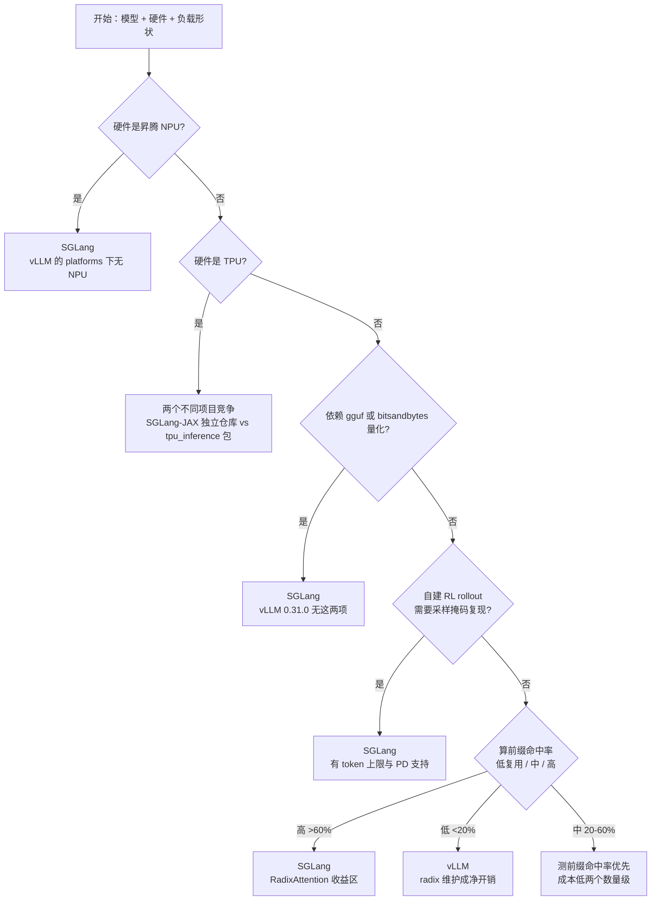

# 10 选型决策手册

> 基准：vLLM `v0.31.0`（`db9527a4`）／ SGLang `v0.5.21`（`e00930c5`）
> 引用行号见 [02](02-feature-matrix.md)

## TL;DR

**默认选 vLLM，除非你有明确的理由偏离。** 理由不是「vLLM 更快」—— 没有证据支持这一点——
而是三项可量化的不对称：模型与硬件覆盖更广、故障隔离更成体系、默认配置在大模型上更可靠。

偏离默认的理由也很明确，共四条。前缀复用率高、RL rollout 自建、TPU 或国产 NPU、
以及「同一批prompt 反复命中」的高重复 Agent 负载。

---

## 1. 决策树

按顺序判断，命中即停。

---

## 2. 四条明确的「选 SGLang」理由

### 2.1 前缀复用率高 —— 最主要理由

**判定**：tokenize 一天真实请求，统计公共前缀 token 数，估算命中率。

| 命中率 | 建议 |
|:---|:---|
| > 60% | **SGLang**。RadixAttention 的 token 级最长前缀匹配 + cache-aware 路由收益最大 |
| 20% – 60% | 先测。成本低两个数量级，再决定 |
| < 20% | **vLLM**。radix 树维护是净开销 |

机制依据见 [01](01-architecture-divergence.md) §1，量化关系见 [08](08-benchmark-crosscheck.md) §5。

典型的高复用负载：多轮对话、RAG（反复命中同一批文档）、few-shot、
Agent 循环（system prompt + tool schema 每轮重复）。

> ⚠️ 常见误解：SGLang 默认调度策略是 **`fcfs`**，不是 `lpm`。
> 想吃到prefix-aware 调度的好处必须显式传 `--schedule-policy lpm`
> （`fields/schedule.py:98`）。默认吃到的只是 radix cache 本身的自动复用。

### 2.2 自建 RL rollout

需要把采样过程精确复现（`return_sampling_mask`）时，SGLang 有两处额外能力：

- **`--sampling-mask-max-tokens`**（默认 4096）可给 mask 加上限，
  防止宽采样分布下 token 数爆炸 —— vLLM 全树 grep 0 命中，无对应参数
- **PD 分离下完整支持**：`disaggregation/prefill.py:853,922`、`decode.py:2557`
- mask capture 的开销只在开启时付（`sampler.py:335`）

代价：SGLang 要求**必须同时开 `return_meta_info`**（`serving_chat.py:1030-1031`），
且 PD 两侧必须用同一个 token 上限值（`arg_groups/validation_hook.py:511`）。

vLLM 侧也有 `return_sampling_mask`（18 文件完整链路），
但开启后会**关闭 flashinfer/xpu sampler 快速路径**（`sampler.py:89`、`:93`），
且与 batch-sharded gather 不兼容（`config/vllm.py:3205-3208`）。

### 2.3 硬件不在 vLLM 支持列表里

| 硬件 | vLLM | SGLang |
|:---|:---|:---|
| **昇腾 NPU** | ❌ `platforms/` 下无 npu/ascend | ✅ `platforms/npu.py` + `disaggregation/ascend/` + 专用 quantization |
| **TPU** | ✅ 但委托给 PyPI 包 `tpu_inference`（`tpu.py` 全文 20 行） | ⚠️ 主仓无代码，在**独立仓库** `sgl-project/sglang-jax` |

TPU 上两者是**两个不同项目的竞争关系**，不是同一项目的两条后端路径。
vLLM 侧「支持 TPU」意味着「依赖 `tpu_inference` 这个包」。

### 2.4 量化格式 / 多 LoRA 租户

| 需求 | vLLM 0.31.0 | SGLang 0.5.21 |
|:---|:---|:---|
| **gguf** | ❌ 确认不存在 | ✅ `:76` |
| **bitsandbytes** | ❌ 确认不存在 | ✅ `:75` |
| 多 LoRA 同 batch | 默认 **1**（`max_loras`），要开得调 | 默认 **8**（`max_loras_per_batch`） |
| LoRA kernel 后端可换 | ❌ Triton 固定 | ✅ `triton`/`csgmv`/`ascend`/`torch_native` |
| 缓存淘汰策略可插拔 | ❌ | ✅ 8 种（`lru`/`lfu`/`fifo`/`mru`/`filo`/`priority`/`slru`/`tlru`） |

多租户 LoRA 服务（一个基座 + 几十个业务 adapter）SGLang 有结构性优势。
业务价值差异大的缓存场景（如付费用户 vs 可重试批处理）可以用 `priority`/`slru`。

---

## 3. 五条明确的「选 vLLM」理由

### 3.1 覆盖面

| | vLLM | SGLang |
|:---|---:|---:|
| 模型架构 | **387** 唯一架构名 | 282 EntryClass 条目 |
| Attention backend | **44** | 24 |
| KV 传输 connector | **16**（含 push/pull 双向） | 5 |
| 结构化输出后端 | 4 | 4 |
| 量化方法 | 30 | 25 base + 平台追加 |

⚠️ 模型数口径不同（唯一 arch 字符串 vs EntryClass 条目），**不能直接相减**。
但方向明确：冷门模型、奇怪架构、需要特定 attention kernel 时，vLLM 的选择面更大。

### 3.2 故障隔离已成体系

vLLM 的 `engine_core_sentinel.py` 把每个 EngineCore 的 busy loop 包起来，
崩溃时：中止在飞请求（`:88-89`）→ 清队列（`:90-91`）→ 置 `UNHEALTHY`/`DEAD`（`:92-98`）
→ 推送状态让上层绕开（`:106`）。

限制也要知道：**当前只实现 `retry` 一种恢复指令**
（`engine_core_sentinel.py:122-137`），且 `instruction` 是裸 `str`、无白名单
（`utils.py:15`）。超时默认 120s（`config/fault_tolerance.py:12`）。

SGLang 侧没有对应的引擎进程级故障隔离机制（PD role switch 的失败对实例是致命的，
`role_switch.py:46-47` 明确 "no in-place rollback"）。

### 3.3 大模型默认配置更可靠

GPT-OSS-120B / 2×H100 / 默认配置下：
vLLM 6,095 tok/s vs SGLang 1,814 tok/s（版本较旧，标 A→B 之间）。
模型越大、并发越高，RadixAttention 的相对优势越被通用调度效率抵消乃至反转。

### 3.4 观测面更宽的「够用」

vLLM 38+ 指标覆盖核心请求/缓存/抢占；SGLang 156 指标多出的整类
（KV 传输分段耗时、grammar 编译耗时、encoder、路由）主要是 PD 分离与结构化输出场景的需要。
**只做单模型服务的话 vLLM 的指标够用。**

### 3.5 周边生态与文档

- vLLM `entrypoints/` 已按域拆成 30 个 `api_router.py`，每个域有独立文档位置
- SGLang 是单文件 55 路由（`http_server.py`，2936 行），混入 Ollama / Vertex / Anthropic 兼容层
- vLLM 有 `serve/` 下11 个子域（含 `fault_tolerance`、`elastic_ep`、`sagemaker`）
- 反过来：SGLang 的 Rust 网关（`sgl-model-gateway/`）有 cache-aware routing，
  vLLM 无对等物

---

## 4. 灰色地带

这些场景两边都能做，按团队熟悉度选：

| 场景 | 建议 | 理由 |
|:---|:---|:---|
| 结构化输出为主（大量 JSON） | 先试 vLLM | 后端都是 4 个，能力档位不一致需实测 |
| 单模型单卡小规模服务 | vLLM | SGLang 的 overlap 在这个规模可能变慢（issue #2558） |
| 模型在 70B 以上且高并发 | vLLM | 优势反转区 |
| 混合负载（部分前缀密集） | 测命中率 | 灰色地带的核心变量就是命中率 |
| A/B 迁移期 | 两个都跑 | 见§5 的迁移成本 |

---

## 5. 迁移成本：OpenAI 兼容 ≠ 零成本

「都兼容 OpenAI API，改配置就行」是**错的**。真正会卡住的地方：

### 5.1 参数语义不一致

| 参数 | 坑 |
|:---|:---|
| `max_loras` vs `max_loras_per_batch` | 名字不同，默认值差 8 倍 |
| `max_lora_rank` | vLLM 固定 16；SGLang 默认自动推断 |
| `schedule_policy` | SGLang 独有，9 种；默认 `fcfs` |
| `enable_prefix_caching` vs `disable_radix_cache` | **一个正一个反**，默认值都是「开」 |
| `async_scheduling` vs `disable_overlap_schedule` | **一个正一个反**，默认值都是「关」（vLLM 关 overlap、SGLang 开） |

> 最后两条是最容易搞反的。迁移时照抄参数名会得到**相反的行为**。

### 5.2 structured output 的同名参数支持后端不同

| 参数 | vLLM 支持的后端 | SGLang 支持的后端 |
|:---|:---|:---|
| `disable_any_whitespace` | xgrammar + guidance | outlines + llguidance |
| `disable_additional_properties` | **仅** guidance | xgrammar + llguidance |
| `max_whitespace` | 未提供 | **仅** xgrammar |

同名字段在不同后端上静默不生效，比报错更难查。

### 5.3 行为差异（非参数）

| 项 | 差异 |
|:---|:---|
| 前缀复用粒度 | 16 token 对齐 vs 任意 token 位置 → 缓存命中率数字不可直接比较 |
| structured output 后端名 | `guidance` vs `llguidance` |
| 可用端点 | vLLM 有 `/v1/rerank`、`/v1/pooling`；SGLang 有 `/v1/decisions`、Ollama 兼容层 |
| `/v1/responses` 存储 | SGLang v0.5.20 起**默认关闭**，需 `--enable-response-store`，否则相关请求返回 400 |
| Tokenizer 双路径 | SGLang 同时提供 `/v1/tokenize` 和 `/tokenize` |

### 5.4 迁移 checklist

- [ ] 用 `--enable-metrics` / Prometheus 各跑一轮，**对比 prefix cache 命中率**（不是吞吐）
- [ ] 核对所有在用的 `extra_body` 私有参数在另一边是否存在
- [ ] structured output 的 grammar 后端**显式指定**，不要依赖默认值
- [ ] 确认 `/v1/responses` 是否用到了（决定 SGLang 要不要开 response store）
- [ ] 长prompt 场景按**真实最长长度**调 `--mem-fraction-static` / `chunked-prefill-size`
- [ ] 用真实流量回放，**不是** `bench_serving` 随机负载
   （issue #2558 就是在随机负载下测出反直觉结果的）
- [ ] 小模型单卡场景**单独测关掉 overlap**（SGLang）
- [ ] PD 分离场景确认 KV 传输后端两侧都装（NIXL / Mooncake / MORI / ASCEND）
- [ ] SGLang + PD：确认辅助数据走 TCP（NVLink 不覆盖 auxiliary data，`pd_disaggregation.mdx:195`）
- [ ] 权重量子路径：确认没有依赖 gguf / bitsandbytes（vLLM 侧无此二者）
- [ ] 大模型 + 高并发：实测确认 vLLM 的默认配置没落后太多
- [ ] Canary：版本锁定后再放量（两边 breaking change 都很频繁）

---

## 6. 「先 vLLM 起步，需要时再切」在什么条件下成立

这是最常被推荐的默认策略。它成立的条件：

- ✅ 前缀复用率< 60%（不是重度 Agent / RAG 负载）
- ✅ 硬件是 NVIDIA / AMD / Intel / CPU（不是 NPU）
- ✅ 不自建 RL rollout
- ✅ 依赖 gguf 或 bitsandbytes 量化 → **不成立，必须直接选 SGLang**
- ✅ 模型冷门 → 不成立，vLLM 覆盖更广
- ✅ 团队已有 vLLM 生产运维经验 → 这是最大权重项

**不成立的情况**：你的负载形状本身是 prefix-heavy（多轮/RAG/Agent），
那从一开始就选 SGLang 比「先 vLLM 再迁」更省事 ——
因为 prefix cache 是**数据布局层面的差异**，迁移后命中率指标要重新建立。

---

## 7. 推荐的决策顺序

1. **先算前缀命中率**（成本最低，信息量最大）
2. **核对硬约束**：硬件、量化格式、RL 需求 —— 任一命中即基本定案
3. **选定后用真实流量回放**，不是 benchmark
4. **锁 commit**。两边 breaking change 都很频繁：
   - vLLM v0.29.0 把 Model Runner V2 设为**所有模型默认**；v0.31.0 移除 8 个配置项
   - SGLang v0.5.20 移除 prefill CP v1 与 CUDA 12 产物；
     v0.5.21 移除 `SWARadixCache`/`HiRadixCache` 与所有废弃 2+ 版本的别名
5. 「vLLM 支持某模型」这句话必须带版本号

---

## 参考

- [01 架构分歧](01-architecture-divergence.md)
- [02 功能矩阵](02-feature-matrix.md)
- [08 Benchmark 交叉验证](08-benchmark-crosscheck.md)
- vLLM release notes：<https://github.com/vllm-project/vllm/releases>
- SGLang release notes：<https://github.com/sgl-project/sglang/releases>
- SGLang decision models（`/v1/decisions`）：<https://docs.sglang.io/supported-models/decision_models/>
- SGLang PD 分离拓扑约束：<https://docs.sglang.io/advanced_features/pd_disaggregation/>
- SGLang TPU（独立仓库说明）：<https://docs.sglang.io/hardware_platforms/tpu/>
- vLLM LoRA 文档：<https://docs.vllm.ai/en/latest/features/lora.html>
- SGLang LoRA 文档：<https://docs.sglang.io/advanced_features/LoRA/>