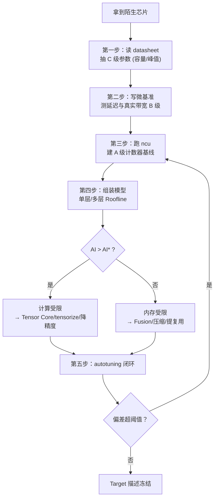

# Roofline 理论决策树 (汇总图)

本文档提供 Roofline 性能分析的完整决策流程，整合自 Chip 系列 (03/09/10)、Op 系列 (04)、Quant 系列 (24)。

## 1. 顶层决策流



## 2. 单层 Roofline 判定 (基础版)

### 2.1 算术强度计算

$$AI = \frac{\text{总 FLOPs}}{\text{总访存字节}}$$

**通式速查**:
- saxpy: $AI = 1/6$
- GEMM (方形): $AI = \frac{2L}{3w}$
- Naive Attention: $AI \approx 62$ (n=4096,d=128,FP16)
- FlashAttention: $AI \approx 1365$

### 2.2 拐点比较

$$AI^* = \frac{P_{\text{peak}}}{BW}$$

**三代旗舰拐点表** (稠密口径):
| GPU | 精度 | Peak (TFLOPS) | BW (TB/s) | AI* (FLOP/byte) |
|-----|------|---------------|-----------|-----------------|
| A100 | FP32 | 19.5 | 2.04 | ≈9.6 |
| A100 | FP16 TC | 312 | 2.04 | ≈153 |
| H100 | FP16 TC | 989.5 | 3.35 | ≈295 |
| B200 | FP8 | ≈4500 | ≈8 | ≈562 |
| B200 | FP4 | ≈9000 | ≈8 | ≈1125 |

### 2.3 判定规则

```
if AI > AI*:       # 在拐点右侧
    瓶颈 = "计算受限"
    优化方向 = ["tensorize", "降精度", "算法加速"]
else:              # 在拐点左侧
    瓶颈 = "内存受限"
    优化方向 = ["fusion", "tiling", "压缩", "提高复用"]
```

## 3. 多层 Roofline (进阶版)

### 3.1 分层流量账

对于 tile 边长为 $b$ 的 GEMM:

$$B_{\text{smem}} \approx \frac{2mnk \cdot w}{b},\quad B_{\text{l2}} \approx \frac{2mnk \cdot w}{b},\quad B_{\text{hbm}} \approx w(mk+kn+mn)$$

### 3.2 逐层判定

```python
def multi_level_roofline(flops, moved_bytes_dict, peaks_dict, bw_dict):
    """moved_bytes_dict = {'smem': ..., 'l2': ..., 'hbm': ...}"""
    for level in ['smem', 'l2', 'hbm']:
        ai = flops / moved_bytes_dict[level]
        ridge = peaks_dict[level] / bw_dict[level]
        if ai < ridge:
            return f"瓶颈在第{level}层：AI={ai:.1f} < 拐点={ridge:.1f}"
    return "计算受限：三层全过拐点"
```

### 3.3 典型案例

**GEMM 4096³ FP16**:
- 不分块：在 L2 层卡死 ($AI=0.5 <$ 拐点)
- tile=64: 三层全部翻越拐点
- **价值**: 一行流量账就能看见 tiling 的定价

## 4. ncu 判读树 (实证验证)

### 4.1 第一查：Speed of Light

```
Compute Throughput:  XX%
Memory Throughput:   YY%

if YY >> XX:  -> 访存瓶颈
elif XX >> YY: -> 计算瓶颈
else:          -> 查看 Occupancy
```

### 4.2 第二查：Occupancy 资源

```
Achieved Occupancy:  45% (理论 62%)
Registers Per Thread: 128

占用率低的原因排序:
1. 寄存器溢出 (regs > 255)
2. SMEM 容量超限
3. Warp slots 不足
```

### 4.3 第三查：Warp Stall 分解

```
Stall Long Scoreboard:  48.2%   ← 等全局内存
Stall Short Scoreboard: 15.0%  ← 等共享内存
Stall Wait:             12.0%  ← 同步等待
```

### 4.4 计数器 ↔ 电路映射速查

| 异常信号 | 根因 (电路单元) | 修复命令 |
|---------|----------------|----------|
| Memory Throughput 高 + sector/request 偏高 | 访问不合并 (03 篇) | 向量化加载/线程重排 |
| long_scoreboard 高 | 在飞不足 (03 篇 Little 定律) | num_stages↑ / cp.async |
| bank conflict 高 | gcd(s,32) 冲突 (03 篇) | padding / swizzle |
| tensor pipe 利用率低 | 累加环未拆分 (06 篇) | mma fragment 轮换 |
| issue_active 低 + regs≈255 | 寄存器地皮封顶 (03/06) | 减 unroll / launch_bounds |

## 5. LLM 场景下的 Roofline 二分

### 5.1 Prefill 阶段

$$AI_{\text{prefill}} \approx \frac{2n^3}{6n^2 w} = \frac{n}{3w}$$

- n=4096, w=2 (FP16) → $AI \approx 683$
- **判断**: 远超 H100 拐点 295 → **计算受限**
- **优化**: Tensor Core 满载、batch 调度

### 5.2 Decode 阶段

$$\mathrm{AI}_{\text{decode}} = \frac{2n_h}{n_{\text{kv}} B_{\text{kv}}}$$

- 关键洞察：**与 batch 无关**!
- FP16 KV Cache → 彻底的带宽受限
- **优化**: KV Cache 量化、反量化 fused

### 5.3 W4 是否值得？(Quant 24 §5)

H100 上算力拐点 $b^* \approx 74$:

```
if batch < 74:
    瓶颈 = "带宽" → W4 有意义 (省时间)
else:
    瓶颈 = "算力" → W4 收益递减 (反量化开销大)
```

## 6. 校准闭环

### 6.1 已知失效模式

| 现象 | 原因 | 出处 |
|------|------|------|
| 实测低于预测 | DVFS 污染频率 | Chip 02 |
| 系统偏差 | PTX 估算 vs SASS 发射 | Chip 04/06 |
| L2 干扰 | 多 block 争用 | Chip 03 |
| 尾波损失 | wave quantization | Chip 06 |

### 6.2 校准步骤

```
1. 锁频 (防止 DVFS)
2. 跑 K 个代表性配置
3. 实测时间 → 对 BW 折扣系数最小二乘
4. 回归测试守护：偏差>5% 则回滚
```

## 7. 参考资料索引

| 主题 | 来源 |
|------|------|
| 原始论文 (Williams et al.) | [ISCA'09/CACM](https://crd.lbl.gov/departments/computer-science/PAR/research/roofline/) |
| 三代旗舰拐点 | Chip 09 (§5.1) |
| 多层 Roofline 实战 | Chip 10 (§3.3) |
| ncu 判读树 | Chip 10 (§5.2) / Op 04 (§3.3) |
| LLM decode/prefill | Quant 24 (§4-5) |
| FlashAttention IO 视角 | [arXiv:2205.14135](https://arxiv.org/abs/2205.14135) |
| Volta/Ampere 微基准 | [arXiv:1804.06826](https://arxiv.org/abs/1804.06826) / [arXiv:2208.11174](https://arxiv.org/abs/2208.11174) |

## 8. Lab Exercises

### Exercise 1: 三层 Roofline 计算器

运行 [`Chip 10 Lab 1`](/2026/08/23/chip-for-ai-compiler-10-codesign-perf-modeling/#lab-1-三层-roofline-计算器) 中的 Python 脚本，观察:
- 不分块 GEMM 为何在 L2 层卡死
- tile=64 如何翻越三层拐点
- 改变 b=32/128 时流量如何线性变化

### Exercise 2: 实测你的 GPU

```bash
ncu --section SpeedOfLight --section Occupancy your_kernel
```

然后用本决策树判读输出，对照 §4.4 找到对应的电路单元和修复路径。

### Exercise 3: LLM 场景 DIY

假设你有 H100 SXM，计算:
- Prefill n=4096 时的 AI
- Decode (n_h=32, n_kv=8, FP16) 时的 AI
- W4 在 batch=10 和 batch=100 时的时间收益差异

参考 Quant 24 §5 的决策表自行推导。
